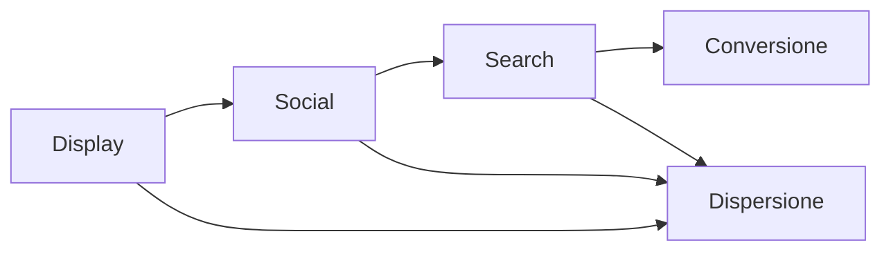

# Modelli di attribuzione marketing

Questa lezione appartiene al binario tabellare: il ragionamento si muove tra tabelle di touchpoint, quote e finestre temporali, più che tra modelli statistici. Ogni settimana il responsabile marketing vede lo stesso paradosso: la search porta quasi tutte le conversioni registrate, il display sembra non portare nulla. Eppure quando spegne il display, le vendite calano dopo tre settimane. Il problema non è il dato, ma la regola con cui il credito si distribuisce tra i punti di contatto. Quella regola si chiama modello di attribuzione, e ogni scelta di budget la usa, anche quando non la dichiara.

## La regola che distribuisce il credito

Il modello di attribuzione è la regola che ripartisce il valore di ogni conversione tra i touchpoint precedenti con unità, finestra, metrica e baseline dichiarate prima di ogni confronto tra canali.

## Sei passi per impostare l'attribuzione

1. Ricostruisci i journey con identificatori coerenti, unico fuso orario e deduplicazione degli eventi doppi.
2. Fissa unità di analisi, finestra di osservazione coerente col ciclo di acquisto e metrica di valore al netto dei resi.
3. Calcola le quote con il modello operativo e con almeno un modello alternativo per testare la robustezza.
4. Segmenta per nuovi contro esistenti, categoria e fascia di valore prima di leggere qualsiasi media.
5. Calibra le decisioni di budget con un holdout e correggi le quote con il fattore di incrementalità stimato.
6. Pubblica ogni report con modello, finestra, esclusioni e data di ricalcolo, e sorveglia la stabilità delle quote nel tempo.

## Perché attribuire significa decidere come premiare i canali

Un modello di attribuzione ripartisce il valore di una conversione tra i touchpoint precedenti. Se una conversione vale 120 euro e il percorso è display, social, email e search, il modello decide quanto dei 120 euro va a ciascuno. La somma deve tornare: il totale attribuito non supera il valore reale, altrimenti il `ROAS` diventa fittizio e il budget cresce su basi irreali.

Il punto poco compreso è che ogni modello crea un incentivo. Il last-click premia chi chiude: search branded, retargeting, email di carrello abbandonato. Il first-click premia chi apre: video, display, content e `PR`. Il lineare premia chi sta in mezzo senza distinguere. Chi gestisce i canali ottimizza ciò che misuri, e cambiare modello cambia il comportamento di team e agenzie prima ancora dei numeri.

Per valutare un modello servono quattro elementi espliciti. L'unità di analisi dice cosa premi: click, sessione, utente o account in ottica `B2B`. La finestra definisce quanto indietro guardi: 7, 30 o 90 giorni cambiano il peso del prospecting. La metrica stabilisce se distribuisci fatturato, margine o valore predittivo netto resi. La baseline indica rispetto a cosa leggi il risultato: periodo precedente, coorte non esposta o mercato comparabile.

```sql
-- Confronto tra finestre di attribuzione sullo stesso percorso
-- Commenti in italiano: ogni riga spiega il passaggio logico
SELECT
  user_id,
  -- conta i touchpoint dentro una finestra breve da 7 giorni
  COUNT(*) FILTER (WHERE days_before_conversion <= 7) AS tocchi_7gg,
  -- conta gli stessi dentro una finestra lunga da 30 giorni
  COUNT(*) FILTER (WHERE days_before_conversion <= 30) AS tocchi_30gg,
  -- calcola quanti touchpoint recupera la finestra lunga in più
  COUNT(*) FILTER (WHERE days_before_conversion <= 30)
    - COUNT(*) FILTER (WHERE days_before_conversion <= 7) AS tocchi_recuperati
FROM touchpoints
GROUP BY user_id;
```

La query mostra un effetto sistematico: allungare la finestra aumenta il peso dei canali di scoperta e riduce la quota della search branded. Non esiste una finestra giusta in assoluto; esiste quella coerente con il ciclo di acquisto reale, misurato sui dati di time-to-conversion del proprio catalogo.

## Come i modelli single-touch distorcono la lettura del percorso

Last-click e first-click sono semplici da spiegare e implementare, e per questo sopravvivono in quasi tutte le piattaforme. Il last-click dà il 100% all'ultimo touchpoint. Il first-click dà il 100% al primo. Entrambi ignorano per costruzione tutto il resto.

Il last-click ha tre pregi reali: è deterministico, verificabile riga per riga e senza stime statistiche. Ma distorce in modo prevedibile. Sovrastima i canali di cattura della domanda esistente, specie search branded e direct, e azzera il prospecting. In un e-commerce con molto riacquisto, attribuisce a email e direct conversioni che sarebbero avvenute comunque, gonfia il `ROAS` della retention e penalizza l'acquisizione.

Il first-click fa l'errore opposto. Riconosce la scoperta, utile quando il problema è capire quali contenuti generano nuova domanda, ma ignora nurturing e chiusura. Un video YouTube visto quattro mesi prima si prende tutto il merito di una vendita costruita poi da comparatori, recensioni e offerta commerciale. Usato per allocare budget, spinge a comprare reach a basso costo senza controllo sulla qualità del traffico generato.

Detto `V` il valore e `T_1 ... T_n` i touchpoint in ordine, il last-click mette tutto il credito su `T_n` e zero agli altri. Il first-click lo mette su `T_1`. Non c'è parametro da stimare, quindi non c'è varianza statistica. Il bias però è massimo: tutto l'errore di specificazione ricade su un punto solo.

Il segnale operativo per riconoscerne il limite è il confronto tra conversioni assistite e conversioni chiuse. Se un canale ha molte assistenze e poche chiusure in last-click, probabilmente lavora nelle fasi alte del percorso e il modello lo sta penalizzando.

Verdetto: i single-touch vanno bene per operare dentro un canale ma non per dividere il budget tra canali, perché premiano un solo punto del percorso e azzerano tutto il resto.

## Quando i modelli multi-touch euristici aiutano e quando illudono

I modelli multi-touch euristici distribuiscono il credito con regole fisse. Il lineare divide in parti uguali: con quattro touchpoint, 25% a ciascuno. Il time decay pesa di più verso la conversione, in genere con dimezzamento esponenziale. Il position-based a `U` dà 40% al primo, 40% all'ultimo e 20% agli intermedi. La variante a `W` pesa anche il tocco di creazione opportunità, rilevante nel `B2B`.

Queste regole hanno un vantaggio politico prima che analitico: nessun canale resta a zero, quindi è più facile far accettare il modello ai team. Sul piano tecnico riducono il bias estremo dei single-touch senza richiedere infrastrutture dati complesse. Per un'azienda che passa dal last-click a una prima ripartizione più equa, il position-based è spesso un compromesso ragionevole.

Il limite è che i pesi sono arbitrari. Nessuna ragione empirica dice che primo e ultimo valgano esattamente 40%: è una convenzione comoda, non una stima. Il time decay richiede un tasso di decadimento `lambda`, e piccole variazioni spostano quote significative tra prospecting e retargeting. Due analisti con stessi dati e due parametri diversi producono due verità incompatibili, entrambe difendibili sulla carta.

Detto `d` il numero di giorni prima della conversione e `lambda` il tasso di decadimento, il peso non normalizzato del touchpoint nel time decay è `w = exp(-lambda * d)`. Con `lambda = 0,1` un click di 14 giorni fa pesa circa un quarto di uno di ieri; con `lambda = 0,3` pesa quasi zero. La scelta di `lambda` è la scelta del risultato, e va documentata come tale.

```python
# Confronto tra ripartizioni euristiche sullo stesso percorso
# Ogni commento descrive il passaggio in italiano
percorso = ["display", "social", "email", "search"]

def ripartizione_lineare(n):
    # divide il credito in parti uguali tra tutti i tocchi
    return [1 / n] * n

def ripartizione_posizione(n):
    # assegna 40% al primo, 40% all'ultimo, resto agli intermedi
    if n == 1:
        return [1.0]
    if n == 2:
        return [0.5, 0.5]
    quota_centro = 0.2 / (n - 2)
    return [0.4] + [quota_centro] * (n - 2) + [0.4]

print(ripartizione_lineare(len(percorso)))   # [0.25, 0.25, 0.25, 0.25]
print(ripartizione_posizione(len(percorso))) # [0.4, 0.1, 0.1, 0.4]
```

L'uso corretto di questi modelli è diagnostico: se last-click, lineare e position-based raccontano la stessa storia su un canale, la conclusione è robusta. Se divergono, la divergenza stessa è l'informazione, perché segnala che il ruolo del canale dipende interamente dall'ipotesi di attribuzione e serve un metodo basato sui dati.

Verdetto: gli euristici servono come test di robustezza e compromesso organizzativo, perché i pesi restano convenzioni e non stime del reale contributo.

## Come funziona l'attribuzione data-driven con le catene di Markov

L'attribuzione data-driven abbandona i pesi fissi. Stima il contributo osservando come cambia la probabilità di conversione quando un canale è presente o assente. L'implementazione diffusa usa catene di `Markov` del primo ordine: ogni touchpoint è uno stato, le transizioni hanno probabilità dai dati, con due stati assorbenti, conversione e dispersione.

Il concetto chiave è l'effetto rimozione. Calcoli la probabilità complessiva con tutti i canali. Poi la ricalcoli rimuovendo un canale e ridistribuendo le sue transizioni. La differenza misura il contributo marginale. Normalizzando su tutti i canali ottieni quote che sommano a uno, determinate dai percorsi osservati e non da parametri scelti a mano.



Il diagramma mostra la logica: ogni freccia ha una probabilità stimata dai conteggi reali. Se molti percorsi passano per social prima di arrivare a search e convertire, rimuovere social fa crollare la probabilità di assorbimento in conversione e il suo credito cresce. Se invece social porta quasi sempre a dispersione, il suo effetto rimozione è modesto anche con volumi alti.

I requisiti sono concreti. Servono journey ricostruiti a livello di utente o cookie con identità stabile. Servono volumi sufficienti per le transizioni rare. Serve una gestione esplicita di direct e non tracciato, che altrimenti assorbe credito spurio. Con meno di qualche migliaio di conversioni mensili le stime diventano instabili: gli intervalli si allargano fino a rendere indistinguibili i canali intermedi, e in quel caso un euristico trasparente batte un data-driven rumoroso.

## Come calcolare gli Shapley values senza farsi ingannare

Gli `Shapley values`, dalla teoria dei giochi cooperativi, rispondono a una domanda precisa: quanto aumenta in media la probabilità di conversione quando un canale si aggiunge a una combinazione che non lo contiene. Il calcolo considera tutte le combinazioni, misura il tasso di ciascuna e attribuisce a ogni canale la media dei suoi contributi marginali.

Il risultato ha proprietà desiderabili: ripartisce tutto il valore, tratta simmetricamente canali con identico comportamento, ignora i canali che non cambiano mai il risultato.

```sql
-- Tasso di conversione per combinazione di canali
-- Ogni commento spiega il passaggio in italiano
SELECT
  -- costruisce l'etichetta della combinazione in ordine alfabetico
  STRING_AGG(channel, '+' ORDER BY channel) AS combinazione,
  -- conta gli utenti esposti esattamente a quella combinazione
  COUNT(*) AS utenti,
  -- somma le conversioni osservate nella combinazione
  SUM(converted) AS conversioni,
  -- calcola il tasso grezzo di conversione della combinazione
  ROUND(SUM(converted) * 100.0 / COUNT(*), 1) AS tasso_conversione
FROM user_journeys
GROUP BY user_id, combo_id;
```

Il passaggio delicato è il trattamento delle combinazioni rare. Con cinque canali esistono 32 combinazioni; con otto sono 256, molte con poche decine di utenti. I tassi grezzi su piccoli campioni oscillano enormemente e gli Shapley values ereditano quell'instabilità. La pratica corretta prevede tre accorgimenti: raggruppare i canali a granularità gestibile prima del calcolo, applicare una regolarizzazione verso la media globale per le combinazioni piccole, e pubblicare sempre gli intervalli di confidenza ottenuti via bootstrap accanto alle quote puntuali.

Un secondo avvertimento riguarda l'interpretazione. Shapley misura il contributo osservato nei percorsi tracciati, non l'incrementalità causale. Se il display raggiunge utenti che avrebbero comunque comprato via search, il suo Shapley value è positivo ma il suo effetto incrementale può essere nullo. Confondere le due grandezze porta a scalare canali che sembrano produttivi nei report e deludono quando il budget aumenta.

Verdetto: Markov e Shapley descrivono i percorsi meglio di qualsiasi euristica ma non misurano causalità, perché senza holdout il merito osservato resta diverso dalle vendite create.

## Come distinguere attribuzione osservata e impatto incrementale

Attribuzione e incrementalità rispondono a domande diverse. L'attribuzione ripartisce il merito delle conversioni avvenute. L'incrementalità conta quante conversioni in più esistono grazie a un canale rispetto allo scenario senza quel canale. La prima lavora su osservazionali. La seconda richiede un controfattuale: `holdout` geografici, pause controllate, `lift` delle piattaforme o media mix con calibrazione.

Il caso tipico è la search branded. Nei report last-click mostra `ROAS` altissimi perché intercetta chi cerca già il prodotto. Ma un `holdout` che spegne il branded per due settimane scopre spesso che gran parte del volume si sposta su organico e direct, con perdita netta contenuta. Il `ROAS` attribuito era reale come ripartizione. Era fuorviante come guida all'investimento marginale.

La regola operativa è usare i due strumenti in sequenza. L'attribuzione data-driven serve per il monitoraggio continuo e per accorgersi quando il mix dei percorsi cambia. Gli esperimenti di incrementalità servono per calibrare le decisioni di budget importanti: aumentare un canale del 50%, lanciarne uno nuovo, spegnerne uno storico. Una buona prassi è mantenere un calendario di test con almeno un holdout per trimestre sui canali principali, e usare i risultati per correggere le quote attribuite con un fattore di incrementalità stimato.

Sul piano delle metriche, il ponte tra i due mondi è il confronto tra ROAS attribuito e ROAS incrementale, dove il secondo è definito come margine incrementale diviso per spesa incrementale nel periodo di test. Quando il rapporto tra i due scende sotto 0,5 per un canale di chiusura, quasi sempre c'è cannibalizzazione di domanda che sarebbe arrivata comunque.

## Come mettere in produzione un sistema di attribuzione affidabile

Un modello in produzione è un sistema dati prima che una formula. Il flusso parte dalla raccolta: click, impression viewable, visite e conversioni con identificatori coerenti e timestamp in un unico fuso. Poi ricostruisce i journey con sessionizzazione esplicita, gestione dei buchi di consenso e deduplicazione da tag multipli. Solo dopo calcola le quote. Infine espone report con metodologia, finestra e data di aggiornamento.

```python
# Controllo di stabilità delle quote di attribuzione nel tempo
# Ogni commento descrive il passaggio in italiano
import pandas as pd

# df contiene: settimana, canale, quota (frazione tra 0 e 1)
df = df.sort_values(["canale", "settimana"]).copy()
# media mobile a 4 settimane per canale, per filtrare il rumore
df["media_4s"] = df.groupby("canale")["quota"].transform(
    lambda s: s.rolling(4, min_periods=2).mean()
)
# deviazione mobile per costruire una banda di controllo
df["std_4s"] = df.groupby("canale")["quota"].transform(
    lambda s: s.rolling(4, min_periods=2).std()
)
# distanza standardizzata dalla media: oltre 2 merita indagine
df["z"] = (df["quota"] - df["media_4s"]) / df["std_4s"]
anomale = df[df["z"].abs() >= 2].sort_values("z")
print(anomale[["settimana", "canale", "quota", "media_4s", "z"]])
```

Lo script risponde a una domanda gestionale: la variazione settimanale riflette un cambiamento reale nel comportamento o è rumore di campionamento più ritardi di tracciamento. Una quota che esce dalla banda dopo un cambio di finestra, un aggiornamento del consenso o una migrazione di tag va letta come artefatto tecnico finché non si dimostra il contrario.

Tre scelte tecniche determinano la qualità del sistema. La prima è la gestione delle impression non cliccate: includerle senza controllo sul viewability gonfia il credito del display programmatico. La seconda è il trattamento cross-device: senza login o identity graph, i percorsi mobile-desktop risultano spezzati e il first-click perde sistematicamente peso. La terza è la documentazione: ogni report deve indicare modello, finestra, esclusioni e data di ricalcolo, altrimenti due estrazioni diverse generano due verità e la fiducia nel sistema crolla.

## Come evitare gli errori che invalidano qualsiasi modello

Il primo errore è aggregare troppo presto. Mediare quote e `ROAS` su tutti i segmenti nasconde pattern opposti: il display può essere incrementale sui nuovi e nullo sul retargeting, e la media sbaglia in entrambi i casi. Segmenta almeno per nuovi contro esistenti, categoria e fascia di valore, e decidi il budget a quel livello di granularità.

Il secondo errore è trascurare la qualità del tracciamento. Tag duplicati, parametri UTM incoerenti, timezone mescolati tra piattaforme e consensi privacy applicati in modo disomogeneo producono journey troncati che premiano sistematicamente l'ultimo evento tracciato, qualunque esso sia. Un audit trimestrale che riconcilia spesa delle piattaforme, sessioni di analytics e ordini del gestionale individua scostamenti prima che diventino decisioni sbagliate.

Il terzo errore è trattare la quota attribuita come verità causale e scalarla linearmente. Raddoppiare il budget di un canale con rendimenti decrescenti non raddoppia le conversioni incrementali: saturazione dell'audience, aumento delle frequenze e asta più competitiva erodono il ROAS marginale. La correzione è ragionare in termini di curva di risposta, testando aumenti graduali e misurando il ROAS dell'ultimo euro speso, non di quello medio storico.

## Un caso reale: il taglio di Procter & Gamble

Nel 2017 Procter & Gamble taglia circa 140 milioni di dollari di spesa pubblicitaria digitale, dopo aver scoperto con i propri audit quote rilevanti di traffico non viewable e non umano. Nei trimestri successivi le vendite non mostrano alcun contraccolpo attribuibile al taglio, e la società estende l'intervento l'anno dopo. Il caso resta la dimostrazione più citata della distanza tra merito attribuito e vendite create: i report assegnavano a quel digital un credito che gli esperimenti di spegnimento non confermano.

## Domande di autoverifica

1. Quale incentivo crea il last-click nei team che gestiscono search e retargeting?
2. Perché allungare la finestra da 7 a 30 giorni sposta credito verso il prospecting?
3. Quando un modello euristico trasparente batte un data-driven rumoroso?
4. Cosa distingue il ROAS attribuito dal ROAS incrementale prima di scalare un canale?
