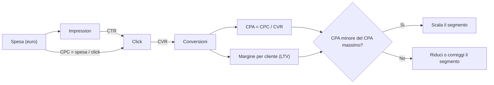

Scenario costruito con numeri di esempio: un e-commerce di arredo investe 30.000 euro al mese in ricerca a pagamento e il cruscotto di piattaforma mostra un CPA medio di 58,8 euro su 510 conversioni. Il responsabile performance vede un valore vicino al target di 60 euro e approva il budget del mese successivo senza modifiche. Nessuno ha però guardato dentro la media. Una parte del budget compra clienti che non ripagheranno mai il costo di acquisizione, un'altra compra clienti così redditizi che meriterebbe il doppio della spesa. La media li fonde in un numero rassicurante e nasconde entrambi i fatti.

Il performance marketing è la disciplina che collega ogni euro speso a un esito misurabile: click, conversione, margine. La difficoltà non sta nel calcolare le metriche, che sono rapporti elementari, ma nel decidere a quale livello di dettaglio leggerle e rispetto a quale soglia economica giudicarle. Una metrica senza segmento e senza soglia descrive soltanto l'asta pubblicitaria, non la convenienza dell'investimento.

> **Idea chiave:** il CPA non è buono o cattivo in sé, lo diventa solo confrontato con quanto margine produce il cliente acquisito. Un CPA basso su clienti poveri di valore perde denaro, un CPA alto su clienti ricchi lo guadagna.

## Le sei metriche come catena di moltiplicazioni

Le metriche del performance marketing non sono sei numeri indipendenti: formano una catena in cui ciascuna spiega un anello tra la spesa e l'incasso. L'asta determina il costo del click, l'annuncio determina quanti utenti cliccano, la pagina di destinazione determina quanti convertono. Il CPA è il risultato finale di questa catena e si scompone esattamente.

| Metrica | Formula | Anello della catena che descrive |
| --- | --- | --- |
| CPC | spesa / click | Prezzo del traffico stabilito dall'asta |
| CTR | click / impression | Rilevanza dell'annuncio per chi lo vede |
| CVR | conversioni / click | Efficacia della pagina e dell'offerta |
| CPA | spesa / conversioni | Costo di una conversione, uguale a CPC / CVR |
| ROAS | ricavo da ads / spesa | Ricavo generato per euro speso |
| Impression share | impression ricevute / impression disponibili | Quota di visibilità conquistata |

La scomposizione `CPA = CPC / CVR` è la relazione più utile della tabella perché dice dove cercare un problema. Se il CPA sale e il CPC è stabile, il difetto sta nella conversione: pagina lenta, offerta cambiata, un problema di tracciamento. Se il CPA sale e il CVR è stabile, il difetto sta nell'asta: un concorrente ha alzato le offerte o la qualità dell'annuncio è scesa. Due cause opposte producono lo stesso sintomo sul CPA, e la media non le distingue.

Il ROAS ha un limite diverso. Il ricavo che la piattaforma attribuisce alle inserzioni include acquisti che sarebbero avvenuti comunque, per esempio di chi cercava già il nome del negozio. Per questo conviene leggere il ROAS di piattaforma come limite superiore del ritorno reale e non come misura dell'effetto causale. La differenza tra le due cose si misura soltanto con un confronto contro un gruppo di controllo, argomento che la lezione sui modelli di attribuzione sviluppa.



## Calcolo passo-passo: dove il CPA medio inganna

Riprendiamo il caso d'apertura con i dati del mese su tre dispositivi. La tabella riporta le quantità osservate e le metriche derivate, ricalcolate riga per riga.

| Dispositivo | Spesa (euro) | Click | Conversioni | CPC (euro) | CVR | CPA (euro) |
| --- | --- | --- | --- | --- | --- | --- |
| Mobile | 9.000 | 15.000 | 300 | 0,60 | 2,0% | 30 |
| Tablet | 3.000 | 3.000 | 60 | 1,00 | 2,0% | 50 |
| Desktop | 18.000 | 12.000 | 150 | 1,50 | 1,25% | 120 |
| Totale | 30.000 | 30.000 | 510 | 1,00 | 1,7% | 58,8 |

Verifichiamo la scomposizione sul desktop: CPC 1,50 euro diviso CVR 0,0125 dà 120 euro, identico a 18.000 euro diviso 150 conversioni. Sul totale, 30.000 euro diviso 510 conversioni dà 58,82 euro. Il CPA medio sta vicino al target di 60 euro, ma i tre segmenti vanno da 30 a 120 euro: il valore centrale non descrive nessun cliente reale.

Il passo successivo introduce il valore. Dall'analisi delle coorti dello stesso negozio il margine di contribuzione cumulato su dodici mesi, al netto di costi di prodotto, spedizione e resi, risulta di 28 euro per cliente acquisito da mobile, 55 euro da tablet e 260 euro da desktop. I clienti da mobile comprano un solo articolo economico e non tornano, quelli da desktop acquistano mobili completi e riacquistano. Il margine netto di ciascun segmento è il numero di conversioni per la differenza tra margine del cliente e CPA:

Per il mobile otteniamo 300 × (28 − 30) = −600 euro, per il tablet 60 × (55 − 50) = +300 euro, per il desktop 150 × (260 − 120) = +21.000 euro. Il totale è −600 + 300 + 21.000 = +20.700 euro.

Il segmento con il CPA migliore, il mobile, è l'unico che perde denaro, mentre quello con il CPA peggiore produce il 101% del margine netto totale. Un responsabile che tagliasse il desktop per ridurre il CPA medio distruggerebbe 21.000 euro di margine per risparmiarne 18.000 di spesa. Il rapporto tra margine del cliente e CPA, che chiameremo copertura, lo mostra con un solo numero per segmento: 28/30 = 0,93 sul mobile, 55/50 = 1,10 sul tablet, 260/120 = 2,17 sul desktop. Sotto 1 il segmento vende in perdita.

## Fissare il CPA massimo per fascia di valore

La sequenza corretta dell'ottimizzazione parte dal valore e arriva alle leve tattiche per ultime. Il primo passo è stabilire quanto si può pagare un cliente senza perdere denaro. Il CPA massimo sostenibile è il margine di contribuzione atteso del cliente, ridotto da un fattore di sicurezza che copre l'incertezza della stima: un cliente con 260 euro di margine stimato può costare 200 euro, non 260, perché la stima porta con sé un errore e il capitale immobilizzato ha un costo.

Con un fattore di sicurezza del 25% il tetto vale 195 euro per la fascia alta (margine atteso 260), 41 euro per la media (margine 55) e 21 euro per la bassa (margine 28).

Con questa regola il mobile, che costa 30 euro, supera di 9 euro il tetto di 21 euro e va corretto: abbassando le offerte, escludendo le keyword di sola ricerca informativa, migliorando la pagina per smartphone. Il desktop, che costa 120 euro contro un tetto di 195, ha 75 euro di margine di manovra e può assorbire un aumento delle offerte per conquistare più impression. Il tablet, a 50 euro contro 41, richiede un intervento minore. Ogni segmento riceve una decisione diversa dalla stessa regola.

Il punto delicato è la riallocazione. Spostare 9.000 euro dal mobile al desktop non produce 75 conversioni (9.000 / 120) perché il CPA marginale cresce: le prime conversioni costano meno delle ultime, dato che l'asta premia prima le ricerche più intenzionali. Se il CPA marginale sul budget aggiuntivo fosse 150 euro, otterremmo 9.000 / 150 = 60 conversioni con un margine di 60 × (260 − 150) = 6.600 euro, contro i −600 euro del mobile tagliato: il guadagno di 7.200 euro resta ampio, ma va dichiarato come stima, non come certezza. Conviene procedere a scaglioni del 15% del budget del segmento, rileggendo il CPA marginale a ogni passaggio.

```python
import pandas as pd

# numeri di esempio: segmenti di un mese di campagne a pagamento
df = pd.DataFrame({
    "segmento": ["mobile", "tablet", "desktop"],
    "spesa": [9000, 3000, 18000],
    "click": [15000, 3000, 12000],
    "conversioni": [300, 60, 150],
    "margine_cliente": [28, 55, 260],   # margine di contribuzione a 12 mesi
})

df["cpc"] = df["spesa"] / df["click"]
df["cvr"] = df["conversioni"] / df["click"]
df["cpa"] = df["spesa"] / df["conversioni"]
df["copertura"] = df["margine_cliente"] / df["cpa"]            # sotto 1 si vende in perdita
df["margine_netto"] = df["conversioni"] * (df["margine_cliente"] - df["cpa"])

# controllo di coerenza: CPA = CPC / CVR su ogni riga
assert ((df["cpc"] / df["cvr"]) - df["cpa"]).abs().max() < 1e-9
print(df[["segmento", "cpa", "copertura", "margine_netto"]].round(2))
```

## Anomalie: separare il segnale dal rumore

Anche un segmento sano oscilla da una settimana all'altra, perché poche decine di conversioni bastano a spostare un rapporto. Reagire a ogni variazione porta a modificare le offerte di continuo e a peggiorare ciò che funzionava. Lo strumento minimo è la banda di controllo: media e deviazione standard delle settimane precedenti, con lo z-score che misura quante deviazioni separano l'ultima osservazione dalla media.

Prendiamo il CPA settimanale del desktop in sette settimane stabili: 118, 121, 119, 123, 120, 117, 122 euro. La media è 840 / 7 = 120 euro. Gli scarti sono −2, +1, −1, +3, 0, −3, +2, con quadrati 4, 1, 1, 9, 0, 9, 4 e somma 28. La deviazione standard campionaria vale √(28 / 6) = 2,16 euro. Nell'ottava settimana il CPA sale a 141 euro: lo z-score è (141 − 120) / 2,16 = 9,7. Una distanza simile non nasce dal caso e impone un'indagine su tracciamento, offerte dei concorrenti e pagina di destinazione.

Sul mobile le prime sette settimane sono 28, 33, 29, 31, 30, 27, 32 euro, con media 30 e stessa deviazione 2,16 euro. L'ottava settimana vale 34 euro e lo z-score è (34 − 30) / 2,16 = 1,85: dentro la banda di ±2,5, quindi nessuna azione. Il valore 34 è più alto di 28 che è il più basso, ma la variabilità tipica rende l'oscillazione ordinaria. Una regola pratica richiede due settimane consecutive fuori banda prima di scattare, per ridurre i falsi allarmi su serie corte.

## Errori tipici nella lettura delle campagne

### Ottimizzare il CPA medio invece del margine per segmento

Il sintomo è un CPA medio che scende mentre il fatturato netto resta fermo o cala. Succede perché la strada più rapida per abbassare la media è tagliare i segmenti costosi, che spesso sono proprio quelli con clienti di valore, e comprare più traffico economico a bassa qualità. Il rimedio è fissare un CPA massimo per fascia di valore e giudicare ogni segmento sul proprio tetto, tenendo il margine netto come unica metrica di sintesi.

### Fidarsi del ROAS di piattaforma come misura causale

Il sintomo è un ROAS alto sulla ricerca di marca e sul retargeting, che crolla quando si prova a scalare. La piattaforma attribuisce alle inserzioni le conversioni di utenti già decisi, e il ritorno marginale reale di quei canali è molto più basso di quello medio. Il caso Uber è la illustrazione più citata: secondo i resoconti pubblici, la società ha disattivato una quota rilevante della spesa performance per app, nell'ordine di 100 milioni di dollari annui, senza un calo apprezzabile delle installazioni, perché molte di esse erano organiche o frutto di frodi sui click. La contromisura è un holdout o una pausa controllata prima di scalare qualunque canale di cattura della domanda.

### Reagire al rumore settimanale

Il sintomo è un'offerta cambiata ogni lunedì, con risultati che oscillano ancora di più. Le serie corte producono variazioni del 10-20% senza alcuna causa, e ogni intervento aggiunge una variazione propria. Il rimedio è la banda con media mobile e z-score, il vincolo delle due settimane consecutive e un registro delle modifiche, così da riconoscere gli effetti dei propri cambiamenti.

## Controllo decisionale sui tuoi segmenti

1. Un segmento ha spesa 6.000 euro, 120 conversioni e margine del cliente di 70 euro. Vende in perdita?

<details>
<summary>Mostra risposta</summary>

Il CPA è 6.000 / 120 = 50 euro. Con un margine di 70 euro il margine netto per conversione è 20 euro e quello totale 120 × 20 = 2.400 euro. Il segmento è in utile, con copertura 70/50 = 1,4. Se applichiamo il tetto con sicurezza del 25%, il CPA massimo è 52,5 euro: il segmento è sotto soglia, ma con poco margine di manovra.

</details>

2. Il CPA sale da 40 a 52 euro e il CPC è passato da 0,80 a 0,82 euro. Dove cerchi la causa?

<details>
<summary>Mostra risposta</summary>

Dalla relazione CPA = CPC / CVR il CVR iniziale era 0,80 / 40 = 2% e quello finale 0,82 / 52 = 1,58%. Il costo del traffico è quasi stabile, quindi il problema sta nella conversione: pagina, offerta, disponibilità o tracciamento. Conviene controllare prima il tracciamento, perché un guasto dei tag riproduce lo stesso sintomo.

</details>

3. Una serie ha media 80 e deviazione standard 4. L'ultima settimana vale 90. Scatta un allarme?

<details>
<summary>Mostra risposta</summary>

Lo z-score è (90 − 80) / 4 = 2,5. Sta sul bordo della banda di ±2,5, quindi non conclude nulla da solo. Con la regola delle due settimane consecutive aspettiamo la lettura successiva: se anch'essa è fuori banda, indaghiamo, altrimenti la trattiamo come rumore.

</details>

4. Perché un ROAS di piattaforma pari a 6 non basta per raddoppiare il budget di un canale?

<details>
<summary>Mostra risposta</summary>

Perché il ricavo attribuito include acquisti che sarebbero avvenuti senza annunci e perché il rendimento marginale è inferiore a quello medio. Prima di raddoppiare conviene misurare il lift con un holdout: se la pausa del canale non riduce il fatturato, il ROAS di 6 descriveva domanda già esistente.

</details>
