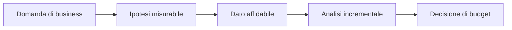

# Reverse ETL e sincronizzazione audience

Immaginate di essere a Tallinn, nel quartier generale di Bolt, l'azienda estone di ride-hailing e delivery. È il 2021, un anno di assestamento e ripartenza dopo le turbolenze globali. Il data team ha appena finalizzato un modello predittivo di churn estremamente accurato, costruito su terabyte di dati transazionali e comportamentali accumulati nel loro data warehouse su Google BigQuery. Il modello identifica con una precisione dell'87% un segmento di circa 250.000 utenti "a rischio", clienti un tempo fedeli il cui engagement è calato del 40% negli ultimi 90 giorni. L'insight è potente, visualizzato su un dashboard di Looker che tutti applaudono. Ma l'insight, da solo, non genera un euro di ricavo. Il team di CRM, che deve agire, utilizza Braze per le comunicazioni. Come possono isolare esattamente quei 250.000 `user_id` all'interno di Braze per lanciare una campagna di riattivazione mirata con un'offerta personalizzata? Esportare un CSV e caricarlo manualmente? Non è una soluzione scalabile, è soggetta a errori e non è in tempo reale. Questo divario, tra l'intelligenza analitica confinata nel warehouse e gli strumenti operativi che interagiscono con il cliente, è il problema che il Reverse ETL risolve.

## Dall'Insight all'Azione: La Disconnessione Operativa

Il paradigma classico della business intelligence, che ha dominato per decenni, vedeva il data warehouse come la destinazione finale del dato. Il flusso era unidirezionale: sorgenti operative (CRM, ERP, app) alimentavano, tramite processi ETL (Extract, Transform, Load), un warehouse centrale. Da qui, i dati venivano interrogati per produrre report e dashboard. Questi strumenti generano *insight retrospettivi*, eccellenti per analisi strategiche e per rispondere a domande come "Qual è stato il nostro customer lifetime value medio nel Q3?". Tuttavia, questo modello presenta una profonda disconnessione operativa. La conoscenza generata rimane intrappolata nel mondo analitico, accessibile solo a data analyst e manager. I team di marketing, vendite e customer support, che operano in prima linea con strumenti come Salesforce, Marketo, Intercom o Zendesk, non beneficiano direttamente e in tempo reale di questa intelligenza.

Il Reverse ETL inverte questo flusso. Invece di considerare il warehouse come la fine della catena, lo trasforma nel cuore pulsante, il "cervello" operativo dell'azienda. Il processo non estrae dati grezzi dalle sorgenti, ma preleva i dati *già modellati, arricchiti e segmentati* dal warehouse (ad esempio, uno score di propensione all'acquisto, un segmento di rischio churn, il "next best product" per un utente) e li invia *indietro* ai sistemi operativi. Questo abilita quella che viene definita "Operational Analytics": l'uso di dati e insight per automatizzare e migliorare le decisioni e i processi di business quotidiani. Non si tratta più di mostrare un grafico al management, ma di popolare un campo custom in Salesforce per un sales agent, aggiungere un attributo utente in Braze per triggerare una campagna, o sincronizzare un'audience su Facebook Ads per un retargeting di precisione. Il Reverse ETL è il ponte che colma il "last mile problem" dell'analisi dati, rendendo l'intelligenza generata finalmente *azionabile* su larga scala.

## L'Architettura del Data Activation: Il Warehouse come Cervello Centrale

Implementare una strategia di Reverse ETL significa adottare un'architettura dati dove il warehouse non è solo un archivio, ma il centro nevralgico della logica di business. Questo approccio, spesso chiamato "Warehouse-as-a-Hub" o "Composable CDP (Customer Data Platform)", si basa su alcuni componenti chiave che lavorano in sinergia.

1.  **Il Data Warehouse Moderno**: Piattaforme cloud come Snowflake, Google BigQuery, o Amazon Redshift sono il fondamento. La loro capacità di separare computazione e storage permette di gestire carichi di lavoro analitici complessi senza impattare le performance e di scalare in modo elastico. È qui che risiedono tutti i dati grezzi e, soprattutto, i modelli di dati trasformati.

2.  **Lo Strato di Modellazione (dbt)**: Strumenti come dbt (data build tool) sono diventati lo standard de facto per trasformare i dati grezzi all'interno del warehouse. Attraverso semplici `SELECT` statement, i data analyst possono definire logiche di business complesse, creare viste aggregate (marts), calcolare metriche (LTV, health score) e definire segmenti di utenti. Il vantaggio è che tutta questa logica è versionata con Git, testata e documentata, creando una "single source of truth" per le definizioni aziendali. Se la definizione di "utente attivo" cambia, viene modificata in un solo punto: il modello dbt.

3.  **La Piattaforma di Reverse ETL**: È il motore del processo. Strumenti come Hightouch, Census o Grouparoo si connettono direttamente al data warehouse. L'utente definisce un "modello" (una tabella o una vista nel warehouse, tipicamente l'output di un modello dbt) e una "destinazione" (es. Salesforce). Successivamente, mappa le colonne del modello ai campi della destinazione (es. la colonna `ltv_score` del warehouse viene mappata al campo custom `LTV_Score__c` sull'oggetto Contatto in Salesforce). La piattaforma gestisce la sincronizzazione a intervalli regolari (da ogni minuto a una volta al giorno), occupandosi delle chiamate API, della gestione degli errori, del rate limiting e del diffing (inviando solo i record modificati per efficienza).

4.  **I Sistemi Operativi (Destinazioni)**: Sono gli strumenti di front-line che beneficiano dei dati arricchiti:
    *   **CRM (Salesforce, HubSpot)**: per arricchire i profili dei lead con score di propensione e segnali di prodotto.
    *   **Marketing Automation (Braze, Customer.io)**: per creare segmenti dinamici e personalizzare le campagne.
    *   **Piattaforme Pubblicitarie (Facebook/Meta Ads, Google Ads)**: per creare Custom Audiences e Lookalike Audiences basate su segmenti ad alto valore.
    *   **Supporto Clienti (Zendesk, Intercom)**: per fornire agli agenti un contesto completo sul cliente (es. valore, ultimo acquisto, problemi recenti).

Ecco un esempio concreto di query SQL, gestita da dbt, che prepara i dati per una sincronizzazione verso Braze, identificando utenti ad alto valore che sono a rischio di churn.

```sql
-- models/marts/marketing/mrt_braze_churn_risk_high_value_users.sql

WITH customer_orders_agg AS (
    -- Step 1: Aggregate order data for each customer
    SELECT
        customer_id,
        COUNT(order_id) AS total_orders,
        SUM(order_value) AS lifetime_value,
        MAX(order_timestamp) AS last_order_date
    FROM {{ ref('stg_orders') }} -- References a staging table in dbt
    GROUP BY 1
),

customer_attributes AS (
    -- Step 2: Join with customer master data to get identifiers
    SELECT
        c.customer_id,
        c.email,
        c.braze_external_id, -- Crucial identifier for Braze
        agg.total_orders,
        agg.lifetime_value,
        agg.last_order_date,
        DATE_DIFF(CURRENT_DATE(), agg.last_order_date, DAY) AS days_since_last_order
    FROM {{ ref('stg_customers') }} c
    JOIN customer_orders_agg agg ON c.customer_id = agg.customer_id
)

-- Step 3: Final segmentation logic
SELECT
    braze_external_id,
    email,
    lifetime_value,
    days_since_last_order,
    CASE
        WHEN lifetime_value > 1000 AND days_since_last_order BETWEEN 90 AND 180
        THEN 'high_value_at_risk'
        WHEN lifetime_value > 1000 AND days_since_last_order <= 89
        THEN 'high_value_active'
        ELSE 'other'
    END AS customer_segment_tag
FROM customer_attributes
WHERE
    -- We only want to sync users who are high value, regardless of their risk status
    lifetime_value > 1000
```
Hightouch o Census leggerebbero il risultato di questa query ogni 6 ore, sincronizzando il campo `customer_segment_tag` come "custom attribute" in Braze, permettendo al team CRM di creare campagne di riattivazione o di ringraziamento altamente specifiche.

## Caso Studio #1: L'iper-personalizzazione di Netflix e la Battaglia contro la Subscription Fatigue

Netflix opera in un mercato spietato, dove la "subscription fatigue" è una minaccia costante. La loro capacità di mantenere gli utenti ingaggiati non si basa solo sull'algoritmo di raccomandazione all'interno dell'app, ma su un'orchestrazione multicanale della comunicazione. Il loro data warehouse (basato su una complessa architettura che include S3, Spark e Teradata) è una miniera d'oro di segnali comportamentali: generi preferiti, tempo di visione per sessione, attori seguiti, contenuti aggiunti alla "My List", e persino i "re-watch patterns".

Mentre l'algoritmo principale personalizza l'esperienza in-app, il Reverse ETL permette di estendere questa intelligenza all'esterno. Immaginiamo un modello nel loro warehouse che calcola un "affinity score" per ogni utente verso specifici generi e sottogeneri (es. `sci-fi_dystopian_affinity: 0.92`, `korean_drama_affinity: 0.15`). Un altro modello potrebbe identificare utenti "binge-watchers" che hanno completato una serie in meno di 72 ore.

Tramite un processo di Reverse ETL, questi attributi vengono sincronizzati con la loro piattaforma di marketing automation. Quando Netflix lancia una nuova serie sci-fi distopica, non invia una notifica push generica a tutti. Invia una notifica iper-targettizzata al segmento di utenti con `sci-fi_dystopian_affinity `&gt;`0.8`. Il testo stesso della notifica può essere personalizzato dinamicamente: "Se hai amato Black Mirror, non puoi perderti la nostra nuova serie...". Questo approccio ha permesso a Netflix di registrare un aumento stimato del 15-20% nel "first-day watch" per i nuovi titoli promossi in questo modo. Inoltre, identificando gli utenti che hanno appena terminato una serie (un momento critico dove il rischio di churn aumenta), possono triggerare automaticamente una email con il "prossimo show perfetto per te", basato su modelli di co-occorrenza calcolati nel warehouse. Questa tattica ha contribuito a ridurre il churn involontario di circa 2-3 punti percentuali nei segmenti target.

## Caso Studio #2: Ottimizzazione del Sales Cycle in Revolut Business

Revolut, la fintech globale, offre un prodotto "Business" per le aziende. Il ciclo di vendita può essere complesso, con lead che vanno da piccole startup a grandi imprese. Il team sales ha bisogno di capire quali lead prioritizzare e come personalizzare l'approccio. Il loro data warehouse in Snowflake centralizza dati da più fonti: dati di prodotto (per gli utenti che partono da un account free), dati dal sito web (pagine visitate, calcolatori di prezzo usati) e dati di arricchimento da terze parti (come Clearbit, per ottenere informazioni sulla dimensione dell'azienda e sul settore).

Un team di data science ha costruito un modello di "Product Qualified Lead (PQL) score" all'interno di Snowflake. Questo modello assegna un punteggio da 1 a 100 a ogni lead, basandosi su segnali predittivi di conversione: un'azienda che invita più di 3 colleghi nella versione di prova, che connette un conto bancario esterno, o che testa le funzionalità di pagamento via API ottiene un punteggio molto più alto.

Senza Reverse ETL, questo score rimarrebbe confinato in un dashboard. Con il Reverse ETL, lo scenario cambia radicalmente. Ogni 30 minuti, una piattaforma come Census sincronizza il `pql_score`, insieme ad altri attributi chiave (`feature_usage_level`, `team_members_invited`, `industry_tag`), direttamente nell'oggetto "Lead" di Salesforce. L'impatto è stato trasformativo:
1.  **Prioritizzazione Automatica**: Le viste in Salesforce sono ora ordinate per `pql_score`, assicurando che i sales development representative (SDR) contattino prima i lead più "caldi".
2.  **Contesto per le Chiamate**: Prima di chiamare un lead, l'SDR vede direttamente in Salesforce che l'azienda ha "testato 5 volte l'API per i pagamenti FX". Può quindi iniziare la conversazione dicendo "Ho visto che state esplorando le nostre soluzioni per i pagamenti internazionali..." invece di una domanda generica.
3.  **Automazione Intelligente**: I lead con uno score superiore a 85 vengono automaticamente assegnati ai sales executive senior, mentre quelli con score inferiore a 40 entrano in un percorso di nurturing via email.

L'implementazione di questo sistema ha permesso a Revolut Business di ridurre il tempo medio di conversione da lead a cliente del 22% e di aumentare la produttività del team SDR del 35%, in quanto dedicano il loro tempo ai lead con la più alta probabilità di chiusura.

## Dal Laboratorio alla Produzione: Implementazione e Governance

Portare un flusso di Reverse ETL da un'idea a un processo di produzione robusto richiede più di una semplice query SQL. È un esercizio di ingegneria del dato che tocca pianificazione, esecuzione e monitoraggio. Vediamo un percorso pratico attraverso alcuni esercizi progressivi.

**Esercizio 1: Mappatura del Flusso (Progettazione)**

Immaginate di lavorare per un e-commerce di abbigliamento. L'obiettivo è creare un'audience su Meta (Facebook) Ads per una campagna "lookalike" basata sui vostri 10% migliori clienti per Customer Lifetime Value (LTV). Prima di scrivere codice, disegnate l'architettura.

*   **Qual è la sorgente della verità?** Il vostro data warehouse (es. BigQuery).
*   **Quale modello dbt serve?** Un modello che calcoli l'LTV per ogni cliente. Avrà bisogno di accedere alle tabelle `customers` e `orders`.
*   **Quale identificatore userete per la sincronizzazione?** Meta richiede un identificatore personale. L'email o il numero di telefono sono comuni. Per privacy e sicurezza, invierete la versione *hashata* (SHA-256) di questi dati.
*   **Quale sarà la destinazione?** Una "Custom Audience" su Meta for Business.
*   **Quale strumento di Reverse ETL userete?** Hightouch o Census.
*   **Con quale frequenza sincronizzerete?** L'LTV è una metrica che non cambia minuto per minuto. Una sincronizzazione giornaliera (nightly batch) è probabilmente sufficiente ed efficiente in termini di costi.

**Esercizio 2: Costruzione del Segmento SQL (Implementazione)**

Ora, scrivete la query SQL che genera la lista di utenti da sincronizzare. Assumiamo di avere due tabelle semplici nel nostro warehouse: `customers (customer_id, email)` e `orders (order_id, customer_id, order_total, created_at)`.

```sql
/*
  Modello per identificare il top 10% di clienti per LTV.
  Questo modello verrà usato come sorgente per una sincronizzazione
  Reverse ETL verso una Facebook Custom Audience.
*/
WITH customer_ltv AS (
  SELECT
    c.customer_id,
    c.email,
    SUM(o.order_total) AS total_revenue
  FROM
    `your-project.your_dataset.customers` AS c
  JOIN
    `your-project.your_dataset.orders` AS o
    ON c.customer_id = o.customer_id
  GROUP BY
    1, 2
),

ranked_customers AS (
  SELECT
    customer_id,
    email,
    total_revenue,
    NTILE(10) OVER (ORDER BY total_revenue DESC) AS decile
  FROM
    customer_ltv
)

SELECT
  -- La piattaforma di Reverse ETL si occuperà di hashare questo campo
  -- prima di inviarlo a Facebook, se configurato correttamente.
  email
FROM
  ranked_customers
WHERE
  decile = 1; -- Seleziona solo il decile più alto (top 10%)
```
Questa query non solo calcola l'LTV ma usa la funzione finestra `NTILE` per segmentare gli utenti in decili, rendendo banale la selezione del top 10%.

**Esercizio 3: Governance e Monitoraggio (Produzione)**

Il flusso è attivo. Come vi assicurate che funzioni correttamente nel tempo?

*   **Monitoraggio della Sincronizzazione**: Impostate alert (via Slack o email) nella vostra piattaforma di Reverse ETL. Volete essere avvisati se una sincronizzazione fallisce (es. API key di Facebook scaduta) o se il numero di record sincronizzati cambia drasticamente (es. da 10.000 utenti a 50), il che potrebbe indicare un bug nella query SQL a monte.
*   **Controllo Qualità dei Dati**: Implementate test di qualità dei dati direttamente nel vostro progetto dbt. Ad esempio, un test può verificare che la colonna `email` non sia mai NULL e che ogni `customer_id` sia unico. Se un test fallisce, la pipeline di dbt si interrompe, prevenendo la sincronizzazione di dati errati.
*   **Gestione della Privacy (PII)**: Assicuratevi che il flusso sia conforme al GDPR/CCPA. Sincronizzate solo i campi strettamente necessari. Non inviate mai dati sensibili a piattaforme che non ne hanno bisogno. Usate sempre identificatori hashati quando possibile per le piattaforme pubblicitarie.
*   **Controllo dei Costi**: Ogni chiamata API e ogni riga di dato processata ha un costo, sia a livello di warehouse che di piattaforma Reverse ETL. Ottimizzate le query e scegliete la frequenza di sync adatta al caso d'uso per tenere i costi sotto controllo.

## Riepilogo

Il Reverse ETL rappresenta un cambiamento di paradigma: trasforma il data warehouse da un archivio passivo per l'analisi a un hub attivo e operativo. Spostando la logica di business e la segmentazione all'interno dell'ambiente controllato e versionato del warehouse (grazie a strumenti come dbt), le aziende possono garantire coerenza e affidabilità. Sincronizzando questi dati arricchiti verso gli strumenti operativi, si abbatte il muro tra i team di dati e i team di business, permettendo una personalizzazione su vasta scala, cicli di vendita più efficienti e un'esperienza cliente più intelligente e contestuale. L'adozione di questa architettura non è solo un upgrade tecnico, ma un'abilitazione strategica che permette a un'intera organizzazione di operare in modo più coeso e data-informed.

## References

1.  Chen, H., Chiang, R. H., & Storey, V. C. (2012). Business Intelligence and Analytics: From Big Data to Big Impact. *MIS Quarterly*, 36(4), 1165-1188.
2.  Fader, P. S., Hardie, B. G., & Lee, K. L. (2005). “Counting Your Customers” the Easy Way: An Alternative to the Pareto/NBD Model. *Marketing Science*, 24(2), 275-284.

```

## Problema reale

Nel lavoro su marketing analytics, **Reverse ETL e sincronizzazione audience** serve a risolvere un problema concreto: trasformare budget, canali, creativita e audience in decisioni misurabili senza confondere volume, attribuzione e incrementalita. La domanda non e se il concetto sia interessante in astratto, ma quale decisione migliora quando lo applichi con dati affidabili e con una soglia di errore esplicita.

Questa lezione va studiata come uno strumento operativo: entro la fine devi saper Comprendere il problema analitico e il contesto decisionale; Applicare esempi, metriche e controlli a casi reali. Se non riesci a collegare il concetto a una scelta reale, la conoscenza resta decorativa e non diventa competenza.

## Modello concettuale



Il modello mentale e sequenziale: prima si formula la domanda, poi si traduce in unita osservabili, quindi si valuta la qualita del dato e solo alla fine si decide. Saltare un passaggio produce analisi eleganti ma fragili.

| Passaggio | Domanda guida | Output atteso |
|---|---|---|
| Framing | Quale decisione deve cambiare? | Una scelta concreta, non una curiosita |
| Misura | Quale segnale rappresenta il fenomeno? | Metrica, fonte e granularita |
| Confronto | Rispetto a quale baseline interpreto il risultato? | Benchmark o controfattuale plausibile |
| Azione | Che cosa faccio se il segnale supera la soglia? | Decisione, owner e prossimo controllo |

## Formalizzazione rigorosa

Formalizza **Reverse ETL e sincronizzazione audience** come una relazione tra quattro elementi: unita di analisi, segnale, baseline e decisione. Nel contesto di questa lezione l'unita principale e **campagna, coorte, touchpoint o segmento cliente**. Il segnale da osservare deve essere collegato a **margine incrementale, CAC payback, conversion rate corretto, lift o retention generata**, mentre la baseline deve essere scelta tra **periodo precedente, gruppo holdout, mercato comparabile o benchmark storico**.

Una formulazione robusta segue questa logica:

| Elemento | Definizione operativa per questa lezione |
|---|---|
| Unita | campagna, coorte, touchpoint o segmento cliente |
| Segnale | margine incrementale, CAC payback, conversion rate corretto, lift o retention generata |
| Baseline | periodo precedente, gruppo holdout, mercato comparabile o benchmark storico |
| Decisione | spostare risorse, cambiare messaggio, fermare una tattica o scalare un esperimento |
| Rischio | Confondere correlazione, qualita del dato e causalita decisionale |

La regola pratica e semplice: una misura e utile solo se riduce l'incertezza su una decisione specifica. Se non cambia una scelta, e documentazione; se cambia una scelta senza controlli, e rischio.

## Esempio o caso studio

Un team growth deve decidere se aumentare il budget su un canale che mostra CPA basso ma vendite marginali deboli. La lezione aiuta a separare il segnale utile dal rumore operativo, collegando metrica, modello mentale e decisione economica.

Applicando **Reverse ETL e sincronizzazione audience**, il team costruisce una lettura in tre colonne: cosa sappiamo, cosa assumiamo e quale decisione prendiamo. Questo formato impedisce di presentare un numero come se fosse una conclusione autosufficiente.

| Evidenza | Interpretazione prudente | Decisione conseguente |
|---|---|---|
| Segnale positivo ma non isolato | Il fenomeno esiste, ma la causa e ancora incerta | Cercare baseline o holdout |
| Segmento con risposta diversa | L'effetto medio nasconde eterogeneita | Analizzare coorti o sottogruppi |
| Costo operativo crescente | Il risultato va valutato sul margine | Applicare soglie economiche |

## Lab / esercizio

### Livello base

Prendi una decisione reale collegata a **Reverse ETL e sincronizzazione audience** e scrivi in cinque righe: obiettivo, metrica primaria, baseline, rischio principale e azione prevista. Non usare piu di una metrica primaria.

### Livello intermedio

Costruisci una tabella con almeno tre segmenti o scenari. Per ciascuno indica segnale, possibile spiegazione alternativa e controllo necessario prima di decidere.

### Livello research-grade

Disegna un piano di validazione: ipotesi, dati necessari, criterio di esclusione, soglia decisionale e controllo post-decisione. Specifica anche che cosa ti farebbe cambiare idea.

### Dataset e materiali consigliati

Usa export campagne, costi media, eventi web o app, CRM, transazioni, survey brand e log di consenso. Se non hai dati reali, crea un dataset sintetico con 200-500 righe e almeno una colonna temporale, una colonna segmento, una metrica di outcome e una variabile di esposizione.

## Errore tipico da evitare

L'errore piu frequente e trattare **Reverse ETL e sincronizzazione audience** come una definizione da ricordare invece che come un protocollo decisionale. In pratica succede quando si presenta una metrica senza baseline, un grafico senza ipotesi, o una raccomandazione senza costo dell'errore.

Un controllo utile e chiedersi: "se questo risultato fosse falso o instabile, quale decisione sbaglierei?". Se la risposta non e chiara, la lezione non e ancora stata applicata davvero.

## Quiz o checkpoint

1. Qual e la decisione concreta che questa lezione dovrebbe migliorare?
2. Quale baseline rende interpretabile il risultato?
3. Quale assunzione, se sbagliata, cambierebbe la conclusione?
4. Quale controllo minimo useresti prima di presentare la raccomandazione?

## Riepilogo operativo

**Reverse ETL e sincronizzazione audience** e una competenza utile quando collega concetto, dato e decisione. Studiala partendo da un problema reale, formalizza il segnale, cerca una baseline credibile, costruisci un esempio e chiudi con un controllo pratico. Categoria: Tecnico. Difficolta: advanced. Tempo stimato: 22 min.
