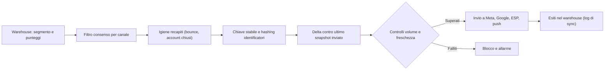

## Il segmento giusto che non arriva dove serve

Ecco uno scenario costruito con numeri di esempio. Un e-commerce di articoli per la casa ha un modello di propensione all'acquisto che nel warehouse individua 48.000 clienti ad alta probabilità di riacquisto entro 30 giorni. Ogni lunedì un analista esporta il segmento in CSV e lo carica a mano su Meta e su Google Ads. Il martedì la campagna parte, ma tra il lunedì e il giovedì una parte dei clienti ha già comprato, due hanno revocato il consenso e la lista caricata contiene indirizzi che rimbalzano. Nessuno sa più quali filtri siano stati applicati, perché la query viveva nel notebook dell'analista e il notebook è cambiato nel frattempo.

Il problema non è il modello. Il segmento nel warehouse è corretto, ma l'attivazione lo degrada in tre punti: la lista invecchia, i filtri non sono ripetibili e nessuno misura quanti profili la piattaforma riesce davvero ad agganciare. Il Reverse ETL è il pattern che chiude questo tratto: il segmento diventa una query versionata, una sync lo porta sulle destinazioni a intervalli regolari e ogni riga inviata lascia una traccia con valore, orario ed esito.

> **Idea chiave:** una sync non è un export più veloce, è un contratto versionato che decide quali righe escono dal warehouse, con quale chiave, con quale prova di consenso e con quali controlli di volume prima di toccare un'audience attiva.

La riproducibilità è il vero guadagno. Con l'export manuale due analisti producono due liste diverse a partire dalla stessa richiesta. Con la sync la definizione è una sola, sta nel repository e produce sempre lo stesso insieme a parità di dati di partenza.



Lo schema mostra l'ordine che conta. Consenso e igiene stanno a monte dell'invio, nel warehouse, non dentro le singole piattaforme: ogni piattaforma applica regole proprie e non conosce le tue basi giuridiche. Il controllo di volume sta subito prima dell'uscita, perché è l'ultimo punto in cui un errore costa zero.

## Il contratto di una sync

Una sync ben definita si descrive con sei elementi: la sorgente (la tabella o la vista del warehouse), la chiave che identifica una riga in modo stabile, il mapping tra colonne e campi della destinazione, la cadenza, i filtri di consenso e la modalità di scrittura, cioè se la destinazione accetta delta o solo sostituzioni integrali. Scriverli in un file di configurazione versionato serve a due scopi: chi subentra capisce che cosa gira, e una modifica ai filtri passa da una revisione invece che da un clic in un'interfaccia.

```yaml
# Contratto di sync: audience "alta propensione riacquisto" verso Meta
sync: audience_riacquisto_meta
source: marts.audience_riacquisto_v3     # vista versionata nel warehouse
key: customer_uid                        # attributo immutabile, mai un row number
mode: delta                              # ingressi, uscite, cambi
schedule: "*/30 * * * *"                 # ogni 30 minuti
filters:
  consent_marketing_ads: true            # prova con timestamp e fonte
  email_status: valid                    # igiene decisa a monte
mapping:
  email_sha256: EMAIL
  phone_sha256: PHONE
guards:
  max_delta_pct_vs_baseline: 50          # oltre, la sync si ferma
  min_rows_vs_previous_snapshot_pct: 70  # sotto, nessuna sostituzione
  max_freshness_hours: 6
```

Il campo `guards` è quello che distingue una sync da un caricamento fatto con uno script. Le tre soglie dichiarano in anticipo quando la sync deve fermarsi da sola. Una sync che non sa fermarsi, il giorno in cui un join duplica le righe, invia una lista da 2 milioni di profili invece di 34.000 e l'errore finisce direttamente nelle campagne.

Un contratto per destinazione, non uno solo per segmento. Meta, Google e il tool di email accettano identificatori diversi e hanno regole di consenso diverse, quindi lo stesso segmento produce tre sync distinte con filtri e mapping propri. Il segmento resta uno, ma i contratti sono tre e ciascuno si può bloccare senza fermare gli altri.

## Quanti profili raggiungi davvero: il calcolo del funnel di attivazione

Il numero che interessa al team media non è la dimensione del segmento ma quanti profili la piattaforma aggancia a un utente reale. Si arriva a quel numero con tre filtri applicati in sequenza, e conviene fare il calcolo completo con i dati dello scenario.

Il segmento di partenza conta 48.000 clienti. Il primo filtro è il consenso: solo 36.000 hanno una base giuridica valida per la pubblicità, cioè il 75% del segmento (36.000 / 48.000 = 0,75). Il secondo è l'igiene. Dei 36.000 profili con consenso, il 6% ha un recapito in bounce, una casella spazzatura o un account chiuso: 36.000 × 0,06 = 2.160 profili da escludere, quindi restano 36.000 − 2.160 = 33.840 profili inviabili. Il terzo è il match rate, che cambia per destinazione. Su Meta, con email e telefono hashati, la piattaforma aggancia il 62% dei profili inviati: 33.840 × 0,62 = 20.980,8, cioè circa 20.981 utenti raggiungibili. Su Google Ads, con la sola email, il match è del 48%: 33.840 × 0,48 = 16.243,2, cioè circa 16.243 utenti.

Dei 48.000 clienti del segmento, quindi, ne raggiungi 20.981 su Meta (43,7%) e 16.243 su Google (33,8%). La differenza tra Meta e Google dipende dagli identificatori disponibili, non dalla qualità del modello. Se vuoi alzarla, intervieni sui campi mappati, non sul segmento.

Il calcolo serve anche a confrontare segmenti diversi, perché un segmento più piccolo ma con identificatori migliori può battere uno grande e povero di recapiti. Prendi il segmento A con 50.000 profili e match al 30%: raggiunge 15.000 utenti. Il segmento B ne ha 30.000 con match al 70%: raggiunge 21.000 utenti. Il segmento B è più piccolo del 40% ma porta il 40% di raggiunti in più. Giudicare i segmenti sulla dimensione prima di misurare il match porta a scegliere sempre il primo.

| Passaggio | Profili | Regola | Risultato |
| --- | ---: | --- | ---: |
| Segmento nel warehouse | 48.000 | punto di partenza | 48.000 |
| Con consenso ads valido | 48.000 | × 75% | 36.000 |
| Dopo igiene recapiti | 36.000 | − 6% (2.160) | 33.840 |
| Raggiunti su Meta | 33.840 | × 62% | 20.981 |
| Raggiunti su Google | 33.840 | × 48% | 16.243 |

Il consenso non è un parametro da ottimizzare. Il 75% del segmento che ha dato il consenso è il tetto legale, e la sync deve propagare anche le revoche: quando un utente ritira il consenso, alla sync successiva il suo profilo esce dall'audience attiva. Per questo l'uscita (la riga che sparisce dal segmento) è un evento da inviare esplicitamente alla destinazione, non un effetto collaterale che si risolve da solo.

## Delta idempotenti in SQL

Una sync oraria deve essere idempotente: rieseguita due volte senza cambiamenti nei dati, non duplica profili, non svuota liste, non genera eventi fantasma. Il modo più semplice per ottenerlo è confrontare lo snapshot corrente con l'ultimo snapshot inviato con successo e spedire solo la differenza. Ogni riga del delta ha un'azione: ingresso, uscita o cambio.

```sql
-- Delta tra snapshot corrente e ultimo snapshot inviato (SQL standard)
WITH corrente AS (
  SELECT customer_uid, email_sha256, phone_sha256, propensity_band
  FROM marts.audience_riacquisto_v3
  WHERE consent_marketing_ads = TRUE
    AND email_status = 'valid'
),
precedente AS (
  SELECT customer_uid, email_sha256, phone_sha256, propensity_band
  FROM sync_log.audience_riacquisto_meta_last_sent
)
SELECT
  COALESCE(c.customer_uid, p.customer_uid) AS customer_uid,
  CASE
    WHEN p.customer_uid IS NULL THEN 'ingresso'
    WHEN c.customer_uid IS NULL THEN 'uscita'
    ELSE 'cambio'
  END AS azione,
  c.email_sha256, c.phone_sha256, c.propensity_band
FROM corrente c
FULL OUTER JOIN precedente p ON c.customer_uid = p.customer_uid
WHERE p.customer_uid IS NULL                       -- nuovi ingressi
   OR c.customer_uid IS NULL                       -- uscite (revoche incluse)
   OR c.propensity_band IS DISTINCT FROM p.propensity_band
   OR c.email_sha256 IS DISTINCT FROM p.email_sha256;
```

Rieseguita senza cambiamenti, la query restituisce zero righe: è questa la definizione pratica di idempotenza. La tabella `last_sent` si aggiorna solo dopo che la destinazione ha confermato la ricezione, mai prima, altrimenti un invio fallito a metà lascia il log convinto che tutto sia arrivato.

Un esempio con numeri di esempio sui volumi. Ieri l'audience inviata contava 33.840 profili. Oggi lo snapshot corrente ne conta 34.500. Il delta contiene 1.200 ingressi e 540 uscite: 33.840 + 1.200 − 540 = 34.500, quindi il bilancio torna. Le righe da spedire sono 1.200 + 540 = 1.740, il 5,1% dell'audience (1.740 / 34.500 ≈ 0,05), contro le 34.500 di un caricamento integrale: la chiamata alla piattaforma è 20 volte più piccola. Se la baseline dei delta è di circa 1.500 righe al giorno, la soglia del +50% scatta a 2.250: oggi si resta sotto e la sync prosegue.

Alcune piattaforme accettano solo la sostituzione integrale dell'audience. In quel caso la regola è lo snapshot prima dell'invio e un confronto sul conteggio: se il nuovo insieme è inferiore al 70% del precedente, non si sostituisce nulla e scatta l'allarme. Un crollo del 30% in un'ora quasi mai è un cambiamento reale del comportamento dei clienti, più spesso è un join rotto o una tabella sorgente caricata a metà.

## Chiave stabile e hashing degli identificatori

La chiave è il punto in cui le sync si rompono senza fare rumore. Se la chiave si rigenera a ogni ricalcolo, per esempio un row number assegnato dall'ordinamento della query, la destinazione vede ogni utente come nuovo, perde lo storico e azzera l'apprendimento delle campagne. La chiave giusta deriva da attributi immutabili: l'identificativo cliente del CRM, oppure un hash calcolato su quell'identificativo con un sale fisso. Non deve mai dipendere dalla posizione della riga, dall'orario di calcolo o da campi che cambiano, come l'indirizzo email se l'utente può modificarlo.

Gli identificatori inviati alle piattaforme advertising si normalizzano e si hashano prima di uscire dal perimetro aziendale. La normalizzazione è il passaggio che molti saltano: due indirizzi uguali scritti con maiuscole diverse producono hash diversi e il match crolla senza segnalare errori.

```python
import hashlib
import re

def normalizza_email(email: str) -> str:
    # Minuscolo e senza spazi: Mario.Rossi@Example.com  ->  mario.rossi@example.com
    return email.strip().lower()

def normalizza_telefono(numero: str, prefisso: str = "39") -> str:
    # Solo cifre, con prefisso internazionale: "+39 333 123 4567" -> "393331234567"
    cifre = re.sub(r"\D", "", numero)
    return cifre if cifre.startswith(prefisso) else prefisso + cifre

def sha256_hex(valore: str) -> str:
    return hashlib.sha256(valore.encode("utf-8")).hexdigest()

def riga_audience(customer_uid: str, email: str, telefono: str) -> dict:
    # La chiave resta il customer_uid: l'hash serve solo alla piattaforma
    return {
        "customer_uid": customer_uid,
        "EMAIL": sha256_hex(normalizza_email(email)),
        "PHONE": sha256_hex(normalizza_telefono(telefono)),
    }
```

Il numero di campi sincronizzati va tenuto basso. Ogni campo deve avere un consumatore dichiarato: un'audience, una regola di bidding, una personalizzazione. Decine di campi senza un uso preciso aumentano la superficie di rischio privacy e il numero di punti dove la sync può rompersi, senza spostare un euro di fatturato. Se nessuno sa dire quale decisione dipende da un campo, quel campo non parte.

## Monitoraggio: volume, freschezza e righe rifiutate

Ogni sync ha tre numeri sorvegliati. Il primo è il volume di righe per azione e per destinazione, confrontato con la baseline dei giorni precedenti. Un delta che esplode oltre il 50% della baseline ferma la sync finché qualcuno non stabilisce se è crescita reale (una campagna ha portato 20.000 iscritti) oppure un join duplicato. Il secondo è la freschezza, cioè le ore trascorse dall'ultimo ricalcolo riuscito del segmento: una sync puntuale che invia dati vecchi di tre giorni trasmette decisioni scadute con l'aspetto di decisioni attuali. Il terzo è il tasso di righe rifiutate dalla destinazione, sempre con il motivo: formato non valido, identificatore assente, limite di frequenza.

La riconciliazione chiude il cerchio. Gli esiti (invio, consegna, apertura, clic, conversione, disiscrizione) rientrano nel warehouse e si uniscono al log della sync. Il confronto tra inviato e consegnato localizza il guasto: se l'inviato resta stabile a 34.500 e il consegnato crolla, il problema è nella destinazione o nei suoi limiti, non nel segmento. Se invece l'inviato stesso cambia di colpo, il problema è a monte.

La cadenza va scelta sul decadimento dell'intento, non sulla comodità tecnica. Per un recupero carrello, dove l'intento decade in ore, ha senso una sync ogni 15-30 minuti. Per un segmento di propensione al riacquisto a 30 giorni, una sync giornaliera basta e costa molto meno. Forzare tutto sul tempo reale moltiplica chiamate API, costi e punti di rottura senza spostare il fatturato.

## Tre errori che rompono una sync

### La chiave cambia a ogni ricalcolo

Il sintomo è un'audience che sembra sempre nuova: la piattaforma segnala 100% di ingressi a ogni giro e le campagne ripartono dalla fase di apprendimento. Succede perché la chiave è stata costruita con un `ROW_NUMBER()` o con un identificativo generato al momento della query, scelta che sembra ragionevole perché è univoca nel singolo caricamento. La correzione è derivare la chiave da un attributo immutabile del cliente e verificare con una query di test che due esecuzioni consecutive producano gli stessi identificativi.

### La revoca del consenso non arriva alla destinazione

Il sintomo è un cliente che ha ritirato il consenso e continua a ricevere pubblicità due settimane dopo. Succede perché la sync invia solo gli ingressi e i cambi, mentre le uscite vengono scartate come rumore oppure il filtro sul consenso è applicato soltanto al segmento nuovo. La correzione è trattare l'uscita come un'azione di prima classe con la stessa priorità dell'ingresso, e aggiungere un controllo di riconciliazione che confronta ogni giorno gli utenti con consenso revocato e quelli ancora presenti nell'audience attiva: il risultato atteso è zero.

### La sostituzione integrale senza guardia

Il sintomo è un'audience che da 34.000 profili passa a 400 nel giro di un'ora, con le campagne che smettono di consegnare. Succede perché la destinazione supporta solo la sostituzione e la tabella sorgente, per un caricamento incompleto, conteneva una frazione dei dati. La sync ha fatto esattamente ciò che le era stato chiesto. La correzione è la soglia minima rispetto allo snapshot precedente dichiarata nel contratto, con il blocco automatico e un allarme che indica sorgente e conteggi.

## Verifica sulle tue sync

1. Un segmento ha 60.000 profili, il 70% con consenso valido, il 5% di quelli con consenso ha recapiti non inviabili e il match su Meta è del 55%. Quanti utenti raggiungi?

<details>
<summary>Mostra risposta</summary>

Consenso: 60.000 × 0,70 = 42.000 profili. Igiene: 42.000 × 0,05 = 2.100 esclusi, quindi 42.000 − 2.100 = 39.900 inviabili. Match: 39.900 × 0,55 = 21.945 utenti raggiungibili, pari al 36,6% del segmento di partenza.

</details>

2. Ieri l'audience inviata aveva 20.000 profili. Oggi il delta contiene 800 ingressi e 300 uscite. Quanti profili conta l'audience e quante righe vengono spedite?

<details>
<summary>Mostra risposta</summary>

L'audience conta 20.000 + 800 − 300 = 20.500 profili. Le righe spedite sono 800 + 300 = 1.100, cioè il 5,4% dell'audience (1.100 / 20.500). Un caricamento integrale ne avrebbe spedite 20.500.

</details>

3. Perché un `ROW_NUMBER()` non è una chiave accettabile per una sync a delta?

<details>
<summary>Mostra risposta</summary>

Perché il numero dipende dall'ordinamento della query e cambia a ogni ricalcolo: lo stesso cliente riceve chiavi diverse in giorni diversi. La destinazione lo tratta come un profilo nuovo, perde lo storico e il delta si gonfia di falsi ingressi e false uscite. La chiave deve derivare da un attributo immutabile, come l'identificativo cliente del CRM.

</details>

4. L'inviato è stabile a 34.500 righe ma il consegnato è sceso del 40% in un giorno. Dove cerchi il problema?

<details>
<summary>Mostra risposta</summary>

Nella destinazione, non nel segmento. Se l'inviato fosse cambiato, il guasto sarebbe a monte, nella query o nelle tabelle sorgente. Con l'inviato fermo controlli i motivi di rifiuto restituiti dalla piattaforma, i limiti di frequenza delle chiamate, la scadenza dei token di accesso e le modifiche recenti al mapping degli identificatori.

</details>

5. Una destinazione accetta solo la sostituzione integrale. Che cosa dichiari nel contratto per proteggerti da una sorgente caricata a metà?

<details>
<summary>Mostra risposta</summary>

Una soglia minima sul conteggio rispetto all'ultimo snapshot inviato, per esempio il 70%, con blocco automatico sotto soglia e uno snapshot salvato prima di ogni sostituzione. Se l'audience precedente aveva 34.000 profili, una nuova versione sotto i 23.800 non viene inviata e genera un allarme.

</details>
