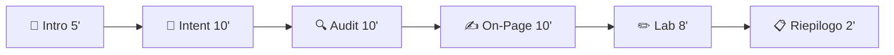

## SEO Content Analytics — Lezione Completa

La SEO non è magia nera; è ingegneria inversa degli algoritmi di ricerca. Ma scrivere contenuti "per Google" spesso porta a testi illeggibili. L'obiettivo della SEO moderna è soddisfare l'intento di ricerca dell'utente meglio di chiunque altro. In questa lezione, impareremo a usare i dati per guidare la creazione di contenuti che posizionano, convertono e costruiscono autorità.

### Obiettivi di Apprendimento

Al termine di questa lezione, lo studente sarà in grado di:
1.  Distinguere tra Keyword Research (volume) e Search Intent (bisogno).
2.  Analizzare le SERP (Search Engine Results Page) per capire cosa Google vuole premiare.
3.  Utilizzare strumenti come Google Search Console per identificare opportunità di "Content Decay".
4.  Strutturare un articolo in modo semantico (H1, H2, H3) per massimizzare la leggibilità e l'indicizzazione.
5.  Misurare il ROI dei contenuti oltre il semplice traffico (Conversioni assistite).

### Timeline della Lezione

| Fase | Argomento | Durata |
|------|-----------|--------|
| 1 | Introduzione: L'evoluzione della SEO | 5 min |
| 2 | Teoria: Search Intent e Topic Clusters | 10 min |
| 3 | Pratica: Audit dei Contenuti Esistenti | 10 min |
| 4 | Tecnica: Ottimizzazione On-Page Data-Driven | 10 min |
| 5 | Esercizi: Riscrivere un Titolo e Meta Description | 8 min |
| 6 | Riepilogo e Domande | 2 min |
| **Totale** | | **45 min** |



### Fase 1 — Introduzione: L'evoluzione della SEO (5 min)

Dieci anni fa, SEO significava ripetere la parola chiave "Scarpe Rosse" 50 volte nella pagina (Keyword Stuffing). Oggi, Google usa l'AI (RankBrain, BERT) per capire il linguaggio naturale.
Se cerchi "Scarpe Rosse", Google sa che potresti volerle comprare (E-commerce), vedere foto (Images) o sapere come abbinarle (Blog).
La Content Analytics non conta più le parole chiave, ma misura la **rilevanza** e l'**engagement**.

### Fase 2 — Teoria: Search Intent e Topic Clusters (10 min)

Non scrivere articoli a caso. Costruisci **Topic Clusters**.
*   **Pillar Page:** Una guida completa su un argomento ampio (es. "Digital Marketing").
*   **Cluster Content:** Articoli specifici che linkano alla Pillar (es. "SEO", "Email Marketing", "PPC").

**I 4 Tipi di Intent:**
1.  **Navigational:** Voglio andare su un sito specifico ("Facebook login").
2.  **Informational:** Voglio imparare ("Come fare il nodo alla cravatta").
3.  **Transactional:** Voglio comprare ("Prezzo iPhone 15").
4.  **Commercial Investigation:** Sto valutando ("Miglior CRM per piccole aziende").

Se scrivi un articolo informativo per una keyword transazionale, non ti posizionerai mai.

### Fase 3 — Pratica: Audit dei Contenuti Esistenti (10 min)

Il traffico non cresce sempre. I vecchi contenuti "decadono".
Usa Google Search Console (GSC) per trovare i "Zombi".

1.  **Filtra:** Ultimi 12 mesi.
2.  **Confronta:** Ultimi 3 mesi vs 3 mesi precedenti.
3.  **Identifica:** Pagine che hanno perso il 20% del traffico ma hanno ancora impression (la gente cerca, ma non clicca o Google ti ha abbassato).
4.  **Azione:**
    *   *Aggiorna:* Aggiungi dati recenti (2025 vs 2022).
    *   *Espandi:* Aggiungi una sezione mancante.
    *   *Consolida:* Unisci 3 articoli brevi in uno lungo.

### Fase 4 — Tecnica: Ottimizzazione On-Page Data-Driven (10 min)

Come si ottimizza una pagina oggi?
1.  **CTR (Click-Through Rate):** Il Tag Title e la Meta Description sono il tuo annuncio pubblicitario nella SERP. Se nessuno clicca, Google ti scende.
2.  **Dwell Time:** Se l'utente clicca, entra ed esce in 3 secondi (Bounce), Google capisce che il risultato faceva schifo.
    *   *Soluzione:* Introduzione breve ("BLUF" - Bottom Line Up Front). Indice dei contenuti. Paragrafi brevi.
3.  **Semantica:** Usa termini correlati (LSI). Se parli di "Pizza", Google si aspetta di trovare "Lievito", "Farina", "Forno", "Napoli".

```mermaid
graph TD
    Search[Utente Cerca] --> SERP[Vede Risultati]
    SERP -->|Clicca (CTR)| Page[Legge Pagina]
    Page -->|Esce subito (Bounce)| Google[Google Penalizza]
    Page -->|Resta 5 min (Dwell)| Google2[Google Premia]
```

### Fase 5 — Esercizi: Riscrivere un Titolo e Meta Description (8 min)

**Scenario:** Hai un articolo intitolato "Guida alle scarpe da corsa".
Dati GSC: Posizione media 5, CTR 1% (basso).

**Task:** Riscrivi per aumentare il CTR.
*   *Analisi:* "Guida alle scarpe da corsa" è noioso. Chi cerca? Principianti? Professionisti?
*   *Nuovo Titolo:* "Come scegliere le Scarpe da Corsa: La Guida Completa per Principianti (2025)"
    *   *Perché:* Include il beneficio ("Scegliere"), il target ("Principianti") e la freschezza ("2025").
*   *Nuova Meta Description:* "Non sai quale scarpa comprare? Scopri i 3 fattori chiave per evitare infortuni e correre meglio. Leggi la guida aggiornata." (Punta sulla paura dell'infortunio e sulla curiosità).

### Fase 6 — Riepilogo e Domande (2 min)

1.  **Intento > Keyword.** Rispondi alla domanda dell'utente.
2.  **Cluster.** Organizza i contenuti in famiglie logiche.
3.  **Aggiorna.** I contenuti vecchi sono una miniera d'oro.
4.  **Struttura.** Scrivi per chi scansiona (skimmers), non per chi legge romanzi.

### Domande di Verifica

1.  Qual è la differenza tra una keyword "Informational" e una "Transactional"? Fai un esempio.
2.  Cos'è un "Topic Cluster" e come aiuta l'autorità del sito (Domain Authority)?
3.  Come useresti Google Search Console per identificare il "Content Decay"?
4.  Perché il "Dwell Time" (tempo di permanenza) è un segnale di ranking indiretto così importante?
5.  Cosa significa l'acronimo LSI (Latent Semantic Indexing) nel contesto della scrittura SEO?

### Riferimenti Bibliografici

-   Ahrefs Blog, "SEO: The Complete Guide".
-   Moz, "The Beginner's Guide to SEO".
-   Google Search Central, "Creating Helpful Content".
