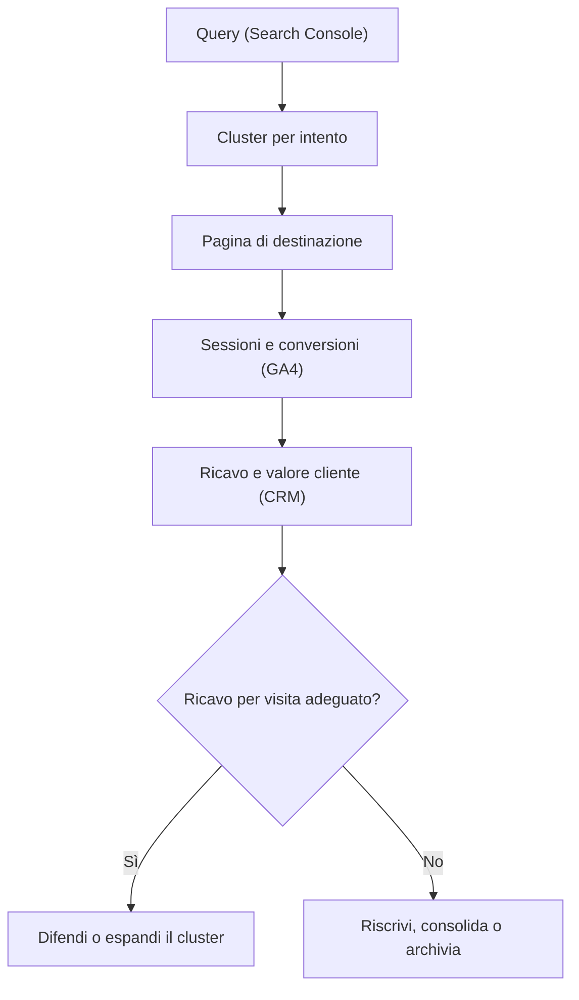

## Posizione 11-20: la lista che non decide niente

Questo è uno scenario costruito con numeri di esempio. Un software di fatturazione per freelance ha 600 keyword in posizione 11-20 secondo la Search Console. Il responsabile content ha una lista ordinata per volume di ricerca e propone di riscrivere le prime 40 pagine nello sprint. Analytics mostra traffico organico stabile da sei mesi, quindi nessuno sa se la riscrittura sposterà il fatturato, se riguarda pagine che portano clienti o se ottimizza articoli che nessun cliente leggerebbe mai fino al pulsante di prova gratuita.

La lista per volume risponde alla domanda sbagliata. Dice quanto si cerca, non quanto vale ottenere quel traffico né se la pagina giusta è già quella che si posiziona. Una priorità editoriale utile lega ogni query a un intento, ogni intento a una pagina di destinazione e ogni pagina a un valore economico per visita.

> **Idea chiave:** l'intento di ricerca decide il valore di una visita organica e il volume la descrive soltanto: diecimila visite di chi vuole comprare valgono più di un milione di visite di chi cerca una definizione.

Il lavoro dell'analista SEO consiste nel costruire una tabella in cui ogni riga è una coppia query-pagina con posizione, impression, click, sessioni, conversioni e ricavo. Da quella tabella escono le decisioni: cosa riscrivere, cosa fondere in una pagina sola, cosa archiviare con un redirect.



## Dall'intento al valore per visita

Le query di ricerca si dividono in quattro famiglie, e ciascuna ha una metrica primaria diversa. Applicare la stessa metrica a tutte produce giudizi sbagliati: un articolo informativo non converte come una pagina prezzo, e misurarlo sul conversion rate lo condanna ingiustamente.

| Intento | Cosa cerca l'utente | Esempio di query | Metrica primaria |
| --- | --- | --- | --- |
| Informazionale | Risposte e guide | come funziona la fattura elettronica | Ranking non branded, nuovi utenti, scroll |
| Commerciale | Confronto tra opzioni | miglior software fatturazione freelance | CTR organico, passaggi verso pagine di prodotto |
| Transazionale | Pronto ad agire | prova gratuita software fatturazione | Conversion rate, valore medio ordine, ricavo per visita |
| Navigazionale | Cerca il brand | nome del prodotto login | Volume branded, quota di click sul sito |

Il ricavo per visita è il ponte comune. Si calcola dividendo il ricavo attribuito a un gruppo di sessioni per il numero di sessioni, e permette di confrontare traffico di natura diversa su una sola scala in euro.

Un esempio numerico svolto. Il valore medio di una nuova iscrizione a pagamento è 120 euro nel primo anno. Un cluster transazionale converte al 2,5%: ricavo per visita = 0,025 × 120 = 3,00 euro. Un cluster generico converte allo 0,02%: ricavo per visita = 0,0002 × 120 = 0,024 euro. Ora confronta i volumi. Dieci mila visite transazionali valgono 10.000 × 3,00 = 30.000 euro. Un milione di visite generiche valgono 1.000.000 × 0,024 = 24.000 euro. Il traffico cento volte più piccolo rende il 25% in più, e la scelta di cosa scrivere dovrebbe partire da questo rapporto, non dalla colonna dei volumi.

Una cautela sul numero. Il tasso di conversione dello 0,02% è una stima che il team dovrebbe misurare sulla propria base di dati, perché nelle visite informative il contributo è spesso indiretto: un utente legge una guida, torna dopo due settimane da un'email e compra. Il ricavo per visita attribuito all'ultimo contatto sottostima quel contenuto. Per questo la metrica primaria dell'intento informazionale non è il ricavo, ma i nuovi utenti e il tasso con cui tornano.

## Una sola base dati: join con chiave, finestra e quota di match

Le analisi fatte con esportazioni manuali incollate in un foglio non reggono due controlli successivi. Le fonti utili sono quattro: la Search Console fornisce query, posizione, impression e click per pagina; GA4 (via API o esportazione su BigQuery) fornisce sessioni e conversioni; uno strumento di backlink come Ahrefs o SEMrush fornisce autorevolezza e link; il CRM fornisce il valore del cliente nel tempo. Si caricano in un unico warehouse con un processo schedulato.

La regola di igiene è una sola: ogni join dichiara tre cose, la chiave, la finestra temporale e la quota di match. Tra Search Console e GA4 la chiave è l'URL canonico della pagina, normalizzato senza parametri e senza barra finale. La finestra deve essere la stessa sui due lati, perché la Search Console ha un ritardo di un paio di giorni sui dati. La quota di match dice quanta parte del totale resta agganciata dopo il join. Le parti non agganciate non si ignorano, si quantificano.

Ecco il tipo di riconciliazione da fare sempre. Nel mese, la Search Console registra 12.000 click organici. GA4 registra 10.200 sessioni organiche sulle stesse pagine. La quota di match è 10.200 / 12.000 = 85%, e la differenza del 15% (1.800 click) ha cause note: consenso cookie negato, blocchi del tracciamento, chiusure della pagina prima del caricamento dello script. Inoltre la Search Console nasconde le query rare per ragioni di privacy: se le query visibili sommano 8.640 click su 12.000, la quota di query visibili è 72% e il 28% del traffico non ha una query associata. Un'analisi che tratta le query visibili come il totale sovrastima il peso delle query di coda corta, e quindi il contributo dei temi più competitivi.

```sql
-- Cluster di query con ricavo per visita (BigQuery, nomi di tabella di esempio)
WITH query_page AS (
  SELECT
    cluster_id,
    landing_page,
    SUM(clicks)       AS clicks,
    SUM(impressions)  AS impressions,
    SAFE_DIVIDE(SUM(clicks), SUM(impressions)) AS ctr,
    SAFE_DIVIDE(SUM(position * impressions), SUM(impressions)) AS pos_media
  FROM seo.search_console_daily
  WHERE data_date BETWEEN '2026-10-01' AND '2026-10-31'   -- stessa finestra di GA4
  GROUP BY cluster_id, landing_page
),
sessioni AS (
  SELECT
    landing_page,
    COUNT(DISTINCT session_id)  AS sessioni,
    SUM(order_value_eur)        AS ricavo_eur
  FROM analytics.sessions_organic
  WHERE data_date BETWEEN '2026-10-01' AND '2026-10-31'
  GROUP BY landing_page
)
SELECT
  q.cluster_id, q.landing_page, q.clicks, q.impressions,
  ROUND(q.ctr * 100, 2)                     AS ctr_pct,
  ROUND(q.pos_media, 1)                     AS posizione,
  s.sessioni,
  SAFE_DIVIDE(s.sessioni, q.clicks)         AS quota_match,   -- da riportare nel report
  ROUND(SAFE_DIVIDE(s.ricavo_eur, s.sessioni), 2) AS ricavo_per_visita_eur
FROM query_page q
LEFT JOIN sessioni s USING (landing_page)   -- LEFT: le pagine senza mapping restano visibili
ORDER BY ricavo_per_visita_eur DESC NULLS LAST;
```

Il `LEFT JOIN` è una scelta deliberata. Un join interno farebbe sparire le pagine senza corrispondenza e il report mostrerebbe un contributo organico più pulito e più falso. Con il join sinistro le righe orfane restano, con quota di match vuota, e si vedono.

## Cannibalizzazione: quando due pagine competono per la stessa query

Due pagine dello stesso sito che si contendono la stessa query dividono i segnali: link, click e storico di engagement. Il risultato tipico è che nessuna delle due supera la posizione 10, mentre una pagina sola, più completa, ci arriverebbe. Il sintomo si legge nella Search Console: per una stessa query compaiono due URL diversi, con posizioni che si alternano da una settimana all'altra.

```sql
-- Query servite da due o più URL del sito nello stesso mese
SELECT
  query,
  COUNT(DISTINCT landing_page)       AS url_distinti,
  SUM(clicks)                        AS clicks_totali,
  MIN(position)                      AS posizione_migliore,
  MAX(position)                      AS posizione_peggiore
FROM seo.search_console_query_page
WHERE data_date BETWEEN '2026-10-01' AND '2026-10-31'
GROUP BY query
HAVING COUNT(DISTINCT landing_page) >= 2   -- candidati alla cannibalizzazione
   AND SUM(impressions) >= 500             -- ignora le query troppo rare
ORDER BY clicks_totali DESC;
```

Non ogni coppia è un problema. Se due pagine servono intenti diversi (una guida e una pagina prezzo) e compaiono per la stessa query ampia, il comportamento è normale e a volte desiderabile. La cannibalizzazione vera riguarda pagine con intento identico. La matrice intento per pagina, con il ricavo per visita in ogni cella, mostra subito dove il traffico giusto incontra il contenuto sbagliato.

Un consolidamento svolto con numeri di esempio. Nel cluster «fatturazione elettronica per freelance» la pagina A è in posizione 11,2 con 40.000 impression e CTR 1,1%: 40.000 × 0,011 = 440 click. La pagina B è in posizione 14,0 con 25.000 impression e CTR 0,6%: 25.000 × 0,006 = 150 click. Il totale del cluster è 440 + 150 = 590 click al mese. Si fondono le due pagine in una pilastro con redirect permanente dalla pagina meno forte. Ipotesi prudente: l'impression totale si stabilizza su 60.000 (non 65.000, perché una parte delle query si sovrapponeva) e la pagina sale in posizione 6, dove il CTR medio osservato sul sito è del 4%. Click attesi: 60.000 × 0,04 = 2.400 al mese. Con ricavo per visita di 3,00 euro, il valore mensile passa da 590 × 3,00 = 1.770 euro a 2.400 × 3,00 = 7.200 euro, con una variazione di +5.430 euro. Il calcolo è una stima: la salita in posizione 6 è l'ipotesi che regge tutto e va verificata, ma l'ordine di grandezza spiega perché il consolidamento batte due riscritture parallele.

Il consolidamento ha un lato opposto: la potatura. Ogni contenuto ha un costo di mantenimento (aggiornamenti, controlli, link da ripulire) e ciò che non porta traffico qualificato da trimestri si archivia con un redirect verso la pagina più vicina per tema. Un catalogo snello si posiziona meglio di un archivio gonfio, perché la qualità media del sito agli occhi del motore sale.

## Testare snippet e struttura leggendo CTR e conversione insieme

I test sui titoli, sulle meta description e sulla sezione iniziale della pagina hanno due effetti separati: modificano la probabilità che l'utente clicchi dal risultato di ricerca e modificano la probabilità che, una volta entrato, compia l'azione. Leggere un solo numero porta fuori strada.

Un esempio costruito. La variante A del titolo ottiene 50.000 impression con CTR 3,0%: 1.500 click, e una conversione del 2,0% sulla pagina produce 1.500 × 0,02 = 30 iscrizioni. La variante B è più promettente nel tono, il CTR sale al 4,2%: 50.000 × 0,042 = 2.100 click. Però il titolo attira anche chi cerca un'altra cosa, e la conversione scende all'1,2%: 2.100 × 0,012 = 25,2 iscrizioni. La variante B vince di 600 click e perde di 4,8 iscrizioni, cioè il 16% di conversioni in meno (25,2 / 30 = 0,84). Giudicata solo sul CTR sembra migliore, giudicata sul risultato economico è peggiore.

Un test sulla ricerca organica non si randomizza come uno su una landing page, perché il motore non assegna le varianti a utenti diversi. Si confrontano periodi o gruppi di pagine simili, e la lettura richiede cautela su stagionalità e aggiornamenti dell'algoritmo. Il confronto con un gruppo di pagine non toccate nello stesso periodo è il controllo minimo.

## Tre errori ricorrenti

### Misurare il traffico organico con un unico totale

Il sintomo è un grafico di visite organiche in crescita del 20% mentre i ricavi organici restano piatti. Succede perché la crescita viene da query informative generiche, mentre il traffico transazionale non si è mosso, e il totale mescola le due cose. La correzione è segmentare ogni sessione per intento del cluster e riportare per ciascun intento la sua metrica primaria, con il ricavo per visita accanto al volume.

### Riscrivere le pagine in posizione 11-20 senza guardare la cannibalizzazione

Il sintomo è una pagina riscritta con cura che resta ferma in posizione 13 per due mesi. Sembra una scelta ragionevole perché la pagina è vicina alla prima pagina dei risultati, ma una seconda pagina dello stesso sito serve la stessa query e divide i segnali. La correzione è eseguire la query di cannibalizzazione prima di ogni sprint e decidere per ciascun cluster se riscrivere, consolidare o lasciare.

### Ignorare le righe che il join non aggancia

Il sintomo è un contributo organico al fatturato che a fine trimestre non torna con la contabilità. Succede perché un join interno ha scartato le pagine senza mapping e le query anonimizzate, che insieme pesavano un terzo del traffico. La correzione è usare join che preservano le righe orfane, riportare in ogni report la quota di match e trattare la quota mancante come un'incertezza dichiarata.

## Controllo prima dello sprint editoriale

1. Un cluster transazionale converte al 3% con valore medio di 90 euro, un cluster informativo converte allo 0,1% con lo stesso valore. Qual è il ricavo per visita di ciascuno e quanto rende un'ipotetica visita in più nel primo?

<details>
<summary>Mostra risposta</summary>

Transazionale: 0,03 × 90 = 2,70 euro per visita. Informativo: 0,001 × 90 = 0,09 euro per visita. Il rapporto è 2,70 / 0,09 = 30, quindi una visita transazionale vale trenta visite informative sul ricavo diretto. Il contenuto informativo va comunque giudicato anche su nuovi utenti e ritorni, perché il suo contributo è spesso indiretto.

</details>

2. La Search Console segna 8.000 click e GA4 ne registra 6.800 sulle stesse pagine nella stessa finestra. Qual è la quota di match e come la usi?

<details>
<summary>Mostra risposta</summary>

6.800 / 8.000 = 85%. La differenza del 15% (1.200 click) è dovuta a consenso negato, blocchi di tracciamento e abbandoni prima del caricamento. La quota si riporta nel report accanto a ogni stima di conversioni organiche, ricordando che il valore reale è un po' superiore a quello misurato.

</details>

3. Due pagine dello stesso cluster stanno in posizione 12 e 15, con 300 e 120 click mensili e ricavo per visita di 2,00 euro. Dopo la fusione si stimano 1.000 click. Quanto vale il consolidamento al mese?

<details>
<summary>Mostra risposta</summary>

Prima: (300 + 120) × 2,00 = 840 euro. Dopo: 1.000 × 2,00 = 2.000 euro. Il guadagno stimato è 2.000 − 840 = 1.160 euro al mese. Il numero dipende dall'ipotesi di click dopo la fusione, che va verificata a quattro-sei settimane con un confronto su pagine non toccate.

</details>

4. Quando due pagine che compaiono per la stessa query non sono un caso di cannibalizzazione?

<details>
<summary>Mostra risposta</summary>

Quando servono intenti diversi, per esempio una guida informativa e una pagina prezzo che compaiono entrambe per una query ampia. In quel caso ciascuna intercetta un pezzo diverso del bisogno e la presenza doppia è normale. Si consolida solo quando l'intento è lo stesso e le posizioni si alternano.

</details>
