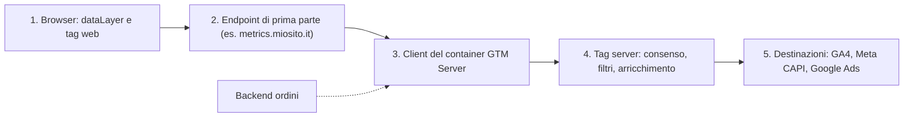

## Gli ordini che il browser non vede

Il caso è ricostruito con numeri di esempio. Un negozio online di abbigliamento chiude il mese con 1.200 ordini nel gestionale. Il pixel di Meta, installato nel browser, ne ha contati 780. Il rapporto tra i due numeri è 780 / 1.200 = 65%, e il 35% mancante è fatto di visitatori con un blocco del tracciamento attivo, di chi ha negato il consenso, di browser che cancellano i cookie dopo pochi giorni e di pagine di conferma chiuse prima che lo script partisse. Con 15.000 euro di spesa pubblicitaria nel mese, la piattaforma dichiara un costo per acquisizione di 15.000 / 780 = 19,23 euro, quando il costo reale per ordine è molto più basso.

Il responsabile marketing introduce la Conversions API e il tracciamento server-side, e dopo due settimane il pannello di Meta mostra 1.390 acquisti, il 16% in più degli ordini reali. Il tracciamento non è diventato più accurato: ogni ordine arriva due volte, una dal browser e una dal server, e nessuno ha configurato la deduplica.

> **Idea chiave:** il tracciamento server-side non serve a tracciare di più, serve a controllare quali dati escono, con quale consenso e con quale chiave di deduplica, perché solo il server conosce l'ordine vero.

Un server proprietario tra il sito e le piattaforme valida, filtra e arricchisce ogni evento prima di inoltrarlo. Il vantaggio è di governo oltre che di volume: dal punto in cui passa un evento si decide che cosa vede ogni destinazione.

## Cosa cambia con un server nel mezzo

Nel modello classico il browser carica JavaScript di terze parti e ciascun fornitore riceve i dati direttamente dal dispositivo dell'utente. Tre forze hanno reso fragile questo schema. I blocchi di tracciamento fermano le richieste verso gli endpoint dei fornitori, in misura che dipende molto dal pubblico: più alta tra utenti tecnici e su desktop. I browser limitano i cookie di terze parti e accorciano la vita di quelli scritti da JavaScript (Safari porta a pochi giorni quelli creati lato client). Infine il quadro normativo europeo, in particolare il GDPR e le regole sull'accesso al dispositivo dell'utente, richiede un consenso esplicito prima di molti tracciamenti.

Con il server-side l'evento segue cinque stadi, e conviene sapere in quale si decide ogni cosa.



Nel primo stadio il browser pubblica l'evento nel `dataLayer` e un solo tag web lo invia al tuo dominio. Nel secondo, l'endpoint è un sottodominio che appartiene al sito: per le restrizioni dei browser e per i filtri di blocco è un'altra cosa rispetto a una richiesta verso un fornitore esterno, e permette di impostare cookie di prima parte con durata più lunga. Il client del terzo stadio interpreta la richiesta e la trasforma in un evento strutturato. Il quarto è il punto di controllo: qui si legge il consenso, si scartano i campi non necessari, si arricchisce con dati che il browser non conosce, come il margine dell'ordine. Il quinto stadio inoltra a ciascuna destinazione nel formato che si aspetta. La freccia tratteggiata indica una fonte che il browser non offre: il backend può inviare direttamente al server eventi come un rimborso o una consegna completata.

Il prezzo è operativo. Un container server gira su un servizio cloud (Google Cloud Run o App Engine sono le opzioni documentate da Google) e va mantenuto, monitorato e dimensionato sui volumi. La configurazione richiede competenze di rete e di sicurezza. Chi lo adotta per inseguire i volumi perduti, senza una disciplina sullo schema degli eventi, ottiene errori più costosi dei precedenti.

## Cosa resta nel browser e cosa passa al server

Il client-side non scompare. I segnali che nascono nella pagina, come lo scroll, il clic su un elemento o la visualizzazione di un prodotto, si raccolgono nel browser perché solo lì esistono. Il server-side prende il posto del browser per la misura che decide il budget: gli acquisti, le iscrizioni, i lead qualificati. Per questi eventi il backend conosce il valore reale, la valuta, lo stato di pagamento e il fatto che l'ordine non sia stato annullato.

Una regola pratica separa le due strade. Se un evento serve per ottimizzare l'esperienza dell'utente o per ragionare sul comportamento in pagina, resta nel browser. Se serve per pagare piattaforme advertising o per misurare ricavo, passa dal server con il valore proveniente dal backend. Gli eventi che stanno in mezzo, per esempio l'aggiunta al carrello, si inviano da entrambi i lati con la stessa chiave di deduplica.

## Deduplica con event_id e invio alla Conversions API

La Conversions API di Meta permette di inviare eventi dal server aziendale e nasce, tra le altre ragioni, dalla perdita di segnale dopo gli aggiornamenti di iOS del 2021 sul consenso al tracciamento. Quando lo stesso acquisto arriva dal pixel e dal server, la piattaforma lo riconosce come duplicato solo se i due invii portano lo stesso nome di evento e lo stesso `event_id`. Senza una chiave condivisa la deduplica non avviene, e il passaggio al server raddoppia le conversioni invece di recuperare quelle perse.

La chiave più semplice è l'identificativo d'ordine, che esiste in entrambi i mondi: la pagina di conferma lo conosce e il backend lo ha generato. Email e telefono si normalizzano e si cifrano con SHA-256 prima dell'invio.

```python
import hashlib
import time
import requests

def sha256_normalizzato(valore: str) -> str:
    # Minuscolo e senza spazi prima dell'hash, altrimenti il match crolla
    return hashlib.sha256(valore.strip().lower().encode("utf-8")).hexdigest()

def invia_acquisto_capi(pixel_id, access_token, ordine, consenso_ads):
    # Nessun invio senza base giuridica: il filtro sta qui, nel server
    if not consenso_ads:
        return None

    evento = {
        "event_name": "Purchase",
        "event_time": int(time.time()),
        "event_id": ordine["order_id"],          # stessa chiave del pixel browser
        "action_source": "website",
        "event_source_url": ordine["url_conferma"],
        "user_data": {
            "em": [sha256_normalizzato(ordine["email"])],
            "client_ip_address": ordine["ip"],
            "client_user_agent": ordine["user_agent"],
        },
        "custom_data": {"currency": "EUR", "value": ordine["totale_eur"]},
    }
    risposta = requests.post(
        f"https://graph.facebook.com/v21.0/{pixel_id}/events",   # versione da allineare alla documentazione
        json={"data": [evento]},
        params={"access_token": access_token},
        timeout=10,
    )
    risposta.raise_for_status()
    return risposta.json()
```

Nel pixel browser, lo stesso identificativo si passa come secondo argomento della chiamata di tracciamento, nel parametro `eventID`. Nello snippet il valore `value` arriva dal backend e non dalla pagina, per evitare il caso in cui un ricalcolo lato client (sconti, spedizione, valuta) produca cifre diverse tra i due canali.

Un esempio numerico svolto sul mese del negozio. Il backend registra 1.200 ordini. Il pixel ne invia 780 e il server 1.200 (tutti, nei limiti del consenso). Senza deduplica la piattaforma riceve 780 + 1.200 = 1.980 eventi, pari a 1.980 / 1.200 = 165% degli ordini reali. Con `event_id` condiviso, i 780 ordini presenti in entrambi i canali vengono riconosciuti come lo stesso evento: gli eventi unici sono 1.980 − 780 = 1.200, esattamente gli ordini del backend. Nella pratica una piccola quota sfugge, e il controllo si fa con il tasso di duplicati residui: se la piattaforma dichiara 1.224 acquisti, il residuo è (1.224 − 1.200) / 1.200 = 2,0%. Attorno al 2% conviene fermarsi e indagare, perché un residuo stabile indica chiavi non identiche (uno spazio finale, un prefisso aggiunto da un lato) o orologi disallineati tra i due canali.

## Match rate e qualità dell'evento

Il match rate è la quota di eventi che la piattaforma riesce ad associare a un profilo noto. Dipende dagli identificatori inviati: email e telefono cifrati, identificativi del clic (`fbc`, `fbp`), indirizzo IP e user agent. Più segnali coerenti arrivano, più alta è la quota agganciata, e più precisa diventa l'ottimizzazione delle campagne.

Ogni parametro in più si pesa contro il rischio privacy: si invia il minimo che alza il match, non il massimo che si possiede. Un indirizzo email cifrato è un dato personale pseudonimizzato, non anonimo, e il consenso resta la condizione per l'invio. Anche la qualità del valore conta: un mismatch sistematico di pochi punti percentuali tra valore del pixel e valore del server segnala di solito una valuta convertita due volte o rimborsi trattati in modo diverso. Sono errori piccoli che spostano il ROAS abbastanza da rovesciare una decisione di budget.

Continuando l'esempio, prima della migrazione i 780 acquisti del pixel avevano un match del 60%: 780 × 0,60 = 468 acquisti associati a un profilo. Dopo la migrazione il server invia 1.200 eventi con email cifrata e un match dell'85%: 1.200 × 0,85 = 1.020 acquisti associati. Il segnale utilizzabile per l'ottimizzazione passa da 468 a 1.020 eventi, un incremento di 552 eventi, cioè +118%. Per un algoritmo che apprende dai pochi acquisti disponibili, è una differenza che si sente nel tempo di uscita dalla fase di apprendimento.

## Validare la migrazione con il backend come arbitro

Un caso come quello descritto invita a una conclusione affrettata: il CPA era 19,23 euro, ora la piattaforma mostra 15.000 / 1.200 = 12,50 euro, con un calo di (12,50 − 19,23) / 19,23 = −35%. È tentante attribuirlo al nuovo tracciamento che «ottimizza meglio». Va letto con attenzione. Gli acquisti reali del mese erano già 1.200 prima della migrazione, e la spesa è rimasta di 15.000 euro: il CPA reale non è cambiato. Il numero è cambiato perché la misura ha smesso di perdere il 35% degli ordini. Il calo di CPA vero, quello che deriva da un'ottimizzazione migliore, si può leggere solo nelle settimane successive, confrontando CPA calcolato sugli ordini del backend con CPA calcolato sugli eventi della piattaforma.

La verifica si fa con una query che mette a confronto, giorno per giorno, ordini reali e conversioni dichiarate.

```sql
-- Riconciliazione giornaliera: ordini backend vs conversioni dichiarate da Meta
SELECT
  o.giorno,
  o.ordini_backend,
  m.acquisti_meta,
  m.acquisti_meta - o.ordini_backend                                  AS scarto,
  ROUND(100.0 * (m.acquisti_meta - o.ordini_backend) / o.ordini_backend, 1) AS residuo_pct,
  ROUND(m.spesa_eur / NULLIF(o.ordini_backend, 0), 2)                 AS cpa_reale_eur
FROM (
  SELECT DATE(created_at) AS giorno, COUNT(*) AS ordini_backend
  FROM shop.orders
  WHERE status = 'paid'                      -- solo ordini pagati, non tentativi
  GROUP BY 1
) o
JOIN marketing.meta_daily m USING (giorno)
WHERE o.giorno >= CURRENT_DATE - INTERVAL '14 day'
ORDER BY o.giorno;
-- Residuo stabile oltre +2%: chiavi instabili o clock disallineati tra i canali
```

La finestra di osservazione è di almeno sette giorni, per assorbire le oscillazioni del giorno della settimana, e include un test deliberato: un ordine di prova effettuato con entrambi i canali attivi, per verificare che compaia una sola volta nel pannello della piattaforma.

## Tre errori ricorrenti

### Conversioni raddoppiate dopo l'attivazione

Il sintomo è un picco di acquisti dichiarati subito dopo il rilascio, con un CPA che sembra crollare e ordini reali piatti. Succede perché pixel e server inviano lo stesso acquisto con chiavi diverse, o senza chiave, e la migrazione sembra ragionevole perché il numero sale proprio come ci si aspetta. Si corregge con un `event_id` identico nei due canali, scelto tra identificativi che il browser e il backend conoscono entrambi, e con la query di riconciliazione sopra come controllo di accettazione.

### Consenso valutato nel posto sbagliato

Il sintomo è un utente che ha rifiutato i cookie pubblicitari e compare comunque come acquisto nelle audience di Meta. Succede perché il pixel rispetta il consenso del banner mentre il server, che riceve l'ordine dal backend, invia tutto. Sembra ragionevole perché il server «vede» soltanto ordini già conclusi. La correzione è portare lo stato di consenso nell'evento (o nell'ordine) e filtrare nel quarto stadio, come nello snippet, prima di qualunque inoltro.

### Valore diverso tra pixel e server

Il sintomo è un ROAS che differisce di tre o quattro punti tra il pannello della piattaforma e il backend, in modo costante. Succede perché il pixel legge il totale visibile in pagina, con IVA e spedizione, e il server legge un importo al netto di uno dei due, o perché la valuta viene convertita due volte. La correzione è scegliere una definizione unica di valore, dal backend, e passare quella a entrambi i canali.

## Controllo prima di scalare il budget

1. Il backend registra 2.000 ordini, il pixel ne invia 1.300 e il server 2.000. Senza deduplica, quanti eventi riceve la piattaforma e che percentuale degli ordini reali rappresentano?

<details>
<summary>Mostra risposta</summary>

1.300 + 2.000 = 3.300 eventi, pari a 3.300 / 2.000 = 165% degli ordini reali. Con `event_id` condiviso gli ordini presenti in entrambi i canali (1.300) vengono riconosciuti come uguali e gli eventi unici tornano a 3.300 − 1.300 = 2.000.

</details>

2. Dopo la deduplica la piattaforma dichiara 2.056 acquisti a fronte di 2.000 ordini. Quanto vale il residuo e che cosa fai?

<details>
<summary>Mostra risposta</summary>

Il residuo è (2.056 − 2.000) / 2.000 = 2,8%, sopra la soglia del 2%. Si cercano chiavi non identiche tra pixel e server (spazi, prefissi, maiuscole) e orologi disallineati, poi si ripete la misura su sette giorni con un ordine di prova a doppio canale.

</details>

3. La spesa è 9.000 euro, la piattaforma dichiarava 600 acquisti e ora ne dichiara 900, mentre il backend ne ha sempre registrati 900. Il CPA è calato davvero?

<details>
<summary>Mostra risposta</summary>

Il CPA dichiarato è passato da 9.000 / 600 = 15,00 euro a 9.000 / 900 = 10,00 euro, cioè −33%. Il CPA reale sul backend era già 10,00 euro prima della migrazione: è cambiata la misura, non l'efficienza della spesa. Un miglioramento vero si legge solo sul CPA calcolato con gli ordini del backend nelle settimane successive.

</details>

4. Perché serve un endpoint di prima parte come un sottodominio del sito?

<details>
<summary>Mostra risposta</summary>

Perché una richiesta verso un dominio del sito non è classificata come tracker di terze parti dai filtri di blocco e permette cookie di prima parte con durata più lunga rispetto a quelli scritti da JavaScript. Non elimina l'obbligo di consenso: lo sposta nel server, dove si può far rispettare in modo uniforme.

</details>
