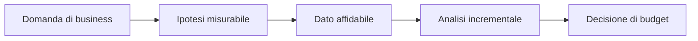

# Server-side tracking e GTM Server

Nel marketing digitale misurare in modo affidabile diventa ogni anno più difficile. Cookie bloccati, modalità di consenso, ad blocker e redirect fanno perdere eventi nel browser. Il server-side tracking e GTM Server non servono a tracciare di più. Servono a controllare meglio i dati, rispettare la privacy e ridurre errori come la duplicazione delle conversioni.

## Problema reale

Il marketing ha bisogno di dati stabili per tradurre budget, canali e creatività in decisioni che si possano misurare. Il passaggio al server-side nasce dal bisogno di alzare la qualità dei dati e la governance, senza confondere volume e attribuzione con incrementality. Quando non colleghi il concetto a una scelta reale, la conoscenza resta decorativa.

## Modello concettuale



Il processo procede in ordine. Formuli la domanda, la traduci in unità osservabili, valuti la qualità del dato e solo alla fine decidi. Quando salti un passaggio ottieni analisi fragili.

| Passaggio | Domanda guida | Output atteso |
|---|---|---|
| Framing | Quale decisione deve cambiare? | Una scelta concreta |
| Misura | Quale segnale rappresenta il fenomeno? | Metrica, fonte, granularità |
| Confronto | Rispetto a quale baseline interpreto il risultato? | Benchmark o controfattuale |
| Azione | Che cosa faccio se il segnale supera la soglia? | Decisione e controllo successivo |

## Formalizzazione rigorosa

Il server-side tracking e GTM Server si formalizzano come una relazione tra unità di analisi, segnale, baseline e decisione.

| Elemento | Definizione operativa |
|---|---|
| Unità | campagna, coorte, touchpoint o segmento cliente |
| Segnale | margine incrementale, CAC payback, conversion rate corretto, lift o retention |
| Baseline | periodo precedente, gruppo holdout, mercato comparabile, benchmark storico |
| Decisione | spostare risorse, cambiare messaggio, fermare o scalare una tattica |
| Rischio | confondere correlazione, qualità del dato e causalità |

Una misura è utile solo se riduce l'incertezza su una decisione specifica.

## Il tramonto del tracciamento client-side

Per quasi vent'anni il tracciamento client-side ha dominato, basandosi su JavaScript eseguito nel browser per inviare dati a terze parti. Tre forze hanno minato questo modello. La prima è la difesa attiva dell'utente: oltre il 40% degli utenti desktop usa ad-blocker che fermano le richieste agli endpoint di tracking. La seconda è la stretta dei browser sulla privacy, con Safari e Firefox che limitano o bloccano i cookie di terze parti e anche quelli di prima parte, accorciandone la durata e riducendo l'analisi a lungo termine. La terza è il quadro normativo: GDPR e CCPA impongono consenso esplicito e limitano la raccolta indiscriminata, alzando il rischio di non conformità. Messe insieme, queste forze hanno reso il tracciamento client-side una fonte di dati incompleti e rischiosi.

## Architettura e meccanica del tracciamento server-side

Il server-side tracking inserisce un server controllato dall'azienda tra il browser e le piattaforme di marketing. Il flusso di un evento `add_to_cart` è questo:

1. L'evento nasce nel browser e viene catturato da GTM Web.
2. Il tag GA4 invia i dati a un endpoint di prima parte, ad esempio `metrics.miosito.com`, che gli ad-blocker non bloccano.
3. Il GTM Server Container riceve e standardizza l'evento.
4. Il server arricchisce o filtra i dati, ad esempio rimuove le PII e aggiunge margini o categorie.
5. I tag server-to-server inviano i dati a GA4, Facebook CAPI, al data warehouse e ad altre destinazioni.

I vantaggi seguono dall'architettura. Il tracciamento regge meglio ad ad-blocker e restrizioni sui cookie, i cookie first-party persistono e abilitano analisi longitudinali, il sito gira più veloce perché meno codice carica nel browser, e la governance dei dati diventa centralizzata e più sicura.

## Facebook Conversions API come motore dell'adozione

La CAPI è stata la risposta a iOS 14.5, che ha limitato il tracciamento cross-app. Permette di inviare gli eventi direttamente dai server dell'azienda a Facebook, alzando il match rate e la qualità dell'attribuzione.

Per evitare doppi conteggi, ogni evento porta un `event_id` univoco. L'email e gli altri identificatori vengono hashati con SHA-256 a tutela della privacy.

Questo è un esempio Python che invia un evento `Purchase` alla CAPI:

```python
import requests
import hashlib
import time

def send_facebook_capi_purchase(pixel_id, access_token, order_id, order_value, user_email, user_ip, user_agent):
    normalized_email = user_email.strip().lower()
    hashed_email = hashlib.sha256(normalized_email.encode('utf-8')).hexdigest()
    event_time = int(time.time())
    payload = {
        "data": [{
            "event_name": "Purchase",
            "event_time": event_time,
            "event_id": order_id,
            "action_source": "website",
            "user_data": {
                "em": [hashed_email],
                "client_ip_address": user_ip,
                "client_user_agent": user_agent,
            },
            "custom_data": {
                "currency": "EUR",
                "value": order_value,
            }
        }]
    }
    url = f"https://graph.facebook.com/v18.0/{pixel_id}/events"
    params = {'access_token': access_token}
    try:
        response = requests.post(url, json=payload, params=params)
        response.raise_for_status()
        return response.json()
    except requests.exceptions.RequestException as e:
        print(f"Errore invio evento: {e}")
        return None
```

## Caso di studio ASOS

ASOS ha migrato da un sistema client-side a un'architettura server-side con GTM Server Container su Google Cloud Run. Prima il tasso di match degli eventi Facebook stava tra il 40% e il 70%, mentre dopo la migrazione è salito al 92%.

Il risultato è stato un calo del 25% del CPA sulle campagne di retargeting dinamico e un sito più veloce di 200 ms. Il progetto ha ripagato l'investimento in meno di tre mesi grazie alla sola efficienza su Facebook.

## Esempio o caso studio

Un team growth valuta se aumentare il budget su un canale con CPA basso ma vendite marginali deboli. Con il server-side tracking mette in tabella l'evidenza, una lettura prudente e la decisione conseguente.

| Evidenza | Interpretazione prudente | Decisione |
|---|---|---|
| Segnale positivo ma non isolato | Fenomeno esiste, causa incerta | Cercare baseline o holdout |
| Segmento con risposta diversa | Effetto medio nasconde eterogeneità | Analizzare coorti o sottogruppi |
| Costo operativo crescente | Valutare sul margine | Applicare soglie economiche |

## Lab / esercizio

### Livello base

Descrivi in cinque righe una decisione reale collegata a server-side tracking: obiettivo, metrica primaria, baseline, rischio e azione.

### Livello intermedio

Costruisci una tabella con almeno tre segmenti, indicando segnale, possibile spiegazione e controllo necessario.

### Livello research-grade

Disegna un piano di validazione con ipotesi, dati, criteri di esclusione, soglia decisionale e controllo post-decisione. Specifica cosa cambierebbe idea.

### Dataset e materiali consigliati

Usa export campagne, costi media, eventi web/app, CRM, transazioni, survey brand e log consenso. Se non hai dati reali, crea un dataset sintetico con almeno 200 righe, una colonna temporale, una segmento, una metrica outcome e una variabile esposizione.

## Errore tipico da evitare

Trattare server-side tracking come una definizione da ricordare, non come un protocollo decisionale. Presentare metriche senza baseline, grafici senza ipotesi o raccomandazioni senza costo dell'errore è un errore.

Chiediti sempre: "Se questo risultato fosse falso, quale decisione sbaglierei?" Se non sai rispondere, la lezione non è stata applicata.

## Quiz o checkpoint

1. Quale decisione concreta migliora questa lezione?
2. Quale baseline rende interpretabile il risultato?
3. Quale assunzione, se sbagliata, cambierebbe la conclusione?
4. Quale controllo minimo useresti prima di raccomandare?

## Riepilogo operativo

Server-side tracking e GTM Server sono competenze utili quando collegano concetto, dato e decisione. Studiale partendo da un problema reale, formalizza il segnale, cerca una baseline credibile, costruisci esempi e chiudi con controlli pratici.
