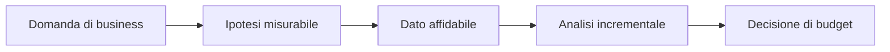

# Social media analytics


Un post genera molti commenti, un altro pochi ma con sentiment migliore e traffico più qualificato. Se guardi solo reach o like, premi rumore; se guardi solo conversioni, perdi segnali di domanda futura. **Social media analytics** serve a leggere visibilità, conversazione e impatto con metriche coerenti.

## Una scena da cui partire

Leggi la lezione come diagnosi della qualità dell'attenzione. Engagement, sentiment, share of voice e referral hanno valore solo se collegati a un obiettivo: awareness, reputazione, community, traffico qualificato o risposta a una crisi.

- **Contesto:** Quale obiettivo social stai misurando davvero?
- **Metodo:** Quale metrica evita di premiare volume senza qualità?
- **Applicazione:** Come useresti sentiment e traffico per cambiare il calendario editoriale?

## Oltre la Vanità: Un Framework Gerarchico per la Misurazione

L'errore più comune nell'analisi dei social media è trattare tutte le metriche come se avessero lo stesso peso. Un "like" su un post di brand awareness ha un valore intrinseco e un obiettivo completamente diversi da un click su un annuncio di retargeting. Per uscire da questa palude analitica, è necessario adottare un framework gerarchico che mappi le metriche agli obiettivi di business, tipicamente modellati su un funnel di marketing.

1.  **Awareness (Consapevolezza):** L'obiettivo qui è raggiungere nuove audience qualificate. Le metriche di vanità come i follower totali sono quasi inutili. Un account con 1 milione di follower inattivi o non in target è meno prezioso di uno con 50.000 follower altamente coinvolti. Le metriche che contano sono:
    *   **Reach (Copertura):** Il numero di utenti unici che hanno visualizzato un contenuto. È il vero numeratore della nostra audience potenziale.
    *   **Impressions (Visualizzazioni):** Il numero totale di volte che un contenuto è stato mostrato. Il rapporto `Impressions / Reach` ci dà la **Frequenza** media, un indicatore chiave per capire se stiamo raggiungendo persone nuove o "martellando" sempre le stesse.
    *   **Share of Voice (SoV):** La percentuale di menzioni del nostro brand rispetto al totale delle menzioni nel nostro settore (noi + competitor). Si calcola con strumenti di social listening e indica la nostra "presenza" nella conversazione di mercato. Un aumento del SoV post-campagna è un indicatore di successo nell'awareness.

2.  **Engagement (Coinvolgimento):** Questo livello misura la qualità dell'interazione, non la quantità. L'obiettivo è capire se il contenuto "risuona" con l'audience.
    *   **Engagement Rate by Reach (ERR):** `(Likes + Comments + Shares + Saves) / Reach`. Questa è la formula più onesta. Usare i follower al denominatore è un errore metodologico, poiché la reach organica su piattaforme come Instagram e Facebook è spesso limitata al 5-15% della base follower. Un post con un ERR del 10% è dieci volte più efficace di uno con l'1% nel catturare l'attenzione dell'audience effettivamente raggiunta.
    *   **Qualità dei Commenti:** Un'analisi qualitativa (o un'analisi di sentiment automatizzata) è più utile del conteggio totale. 10 commenti con domande specifiche sul prodotto valgono più di 100 commenti con emoji.
    *   **Save Rate (Tasso di Salvataggio):** `Saves / Reach`. Metrica potentissima, soprattutto su Instagram e Pinterest. Un salvataggio è un segnale di alta intenzione o utilità. L'utente sta dicendo: "Questo contenuto è così valido che voglio tornarci in futuro".

3.  **Conversion (Conversione):** Qui leghiamo l'attività social a risultati economici.
    *   **Click-Through Rate (CTR):** `Clicks sul link / Impressions`. Misura l'efficacia del contenuto nel generare traffico.
    *   **Conversion Rate (CR) dal Canale Social:** `Conversioni / Sessioni originate dai social`. Misurato tramite UTM o pixel di tracciamento, ci dice quanto è efficace il traffico social nel convertire, una volta atterrato sul sito.
    *   **Assisted Conversions:** I social media spesso giocano un ruolo di "assist" nel percorso di conversione. Un utente potrebbe vedere un post, non cliccare, ma cercare il brand su Google il giorno dopo. I modelli di attribuzione multi-touch (MTA) sono essenziali per attribuire un valore parziale a questi touchpoint iniziali.

Adottare questo framework significa passare da report che dicono "Abbiamo ottenuto 500.000 like" a insight che dicono "La nostra campagna video ha raggiunto 2 milioni di utenti unici nel nostro target demografico (Awareness), generando un Save Rate del 3% su contenuti educativi (Engagement) e influenzando 150.000€ di vendite in conversioni assistite (Conversion)".

## Paid Social Analytics: Integrazione Dati e Ottimizzazione del ROAS

Le campagne a pagamento sui social media sono un ecosistema analitico a sé stante, più vicino al performance marketing tradizionale che alla gestione della community. L'obiettivo primario è quasi sempre massimizzare il Return On Ad Spend (ROAS). Per farlo in modo scientifico, sono necessari tre pilastri: un'infrastruttura dati unificata, un'analisi granulare delle performance creative e una solida strategia di misurazione.

Il primo passo è superare i report nativi delle singole piattaforme (Meta Ads, TikTok Ads, LinkedIn Ads). Ogni piattaforma ha le sue definizioni, le sue finestre di attribuzione e i suoi bias. Un data engineer costruisce pipeline (usando strumenti come Fivetran, Airbyte o API custom) per centralizzare tutti i dati di spesa, performance e audience in un data warehouse (es. BigQuery, Snowflake, Redshift). Qui, i dati vengono puliti, standardizzati e uniti in un modello dati unificato, spesso gestito con dbt (Data Build Tool). Questo permette di rispondere a domande cross-canale come: "Qual è il nostro CPA (Cost Per Acquisition) complessivo per la campagna Q4, confrontando le performance su Instagram Reels e TikTok For You Page per il segmento di pubblico 'under 25'?".

```sql
-- Esempio di modello dbt per unificare i dati di spesa da diverse piattaforme social

WITH facebook_ads AS (
    SELECT
        date_start AS ad_date,
        'Facebook Ads' AS platform,
        campaign_name,
        adset_name,
        spend,
        impressions,
        reach,
        clicks,
        inline_link_clicks,
        -- Utilizziamo le conversioni tracciate dall'azione primaria (es. 'purchase')
        (SELECT value FROM UNNEST(actions) WHERE action_type = 'purchase') AS conversions
    FROM {{ ref('stg_facebook_ads__basic_ad') }}
),

tiktok_ads AS (
    SELECT
        stat_time_day AS ad_date,
        'TikTok Ads' AS platform,
        campaign_name,
        adgroup_name AS adset_name,
        spend,
        impressions,
        reach,
        clicks,
        NULL AS inline_link_clicks, -- TikTok non distingue sempre i tipi di click
        complete_payment_events AS conversions
    FROM {{ ref('stg_tiktok_ads__adgroup_report_daily') }}
)

SELECT * FROM facebook_ads
UNION ALL
SELECT * FROM tiktok_ads
```
Questa vista unificata è la base per analisi più complesse. Ad esempio, l'analisi della **creative fatigue**. Tracciando il CTR e il CPA di un singolo annuncio nel tempo, possiamo identificare il punto esatto in cui la sua efficacia inizia a diminuire a causa della sovraesposizione (alta frequenza). Un'analisi automatizzata può generare alert per il team creativo: "L'annuncio video `PROMO20_VIDEO_B` ha visto un aumento del CPA del 30% e un calo del CTR del 50% negli ultimi 7 giorni. È tempo di rimpiazzarlo".

### Caso di Studio: L'ottimizzazione del ROAS di Zalando

Zalando, il colosso europeo dell'e-commerce di moda, investe centinaia di milioni di euro in paid social. Il loro approccio è un esempio di eccellenza analitica. Invece di ottimizzare per metriche superficiali come il click, si concentrano sul ROAS a livello di SKU (Stock Keeping Unit) e sul LTV (Lifetime Value) dei clienti acquisiti. Durante la preparazione per la stagione Autunno/Inverno 2023, il loro team di data science ha analizzato le performance storiche. Hanno scoperto che, per la categoria "sneakers di lusso", le creatività su Instagram Stories che mostravano il prodotto in un contesto "street style" (user-generated content o look da influencer) generavano un ROAS superiore del 18% rispetto alle classiche foto di prodotto su sfondo bianco. Inoltre, l'analisi di coorte ha rivelato che i clienti acquisiti tramite queste creatività avevano un AOV (Average Order Value) più alto del 12% nel loro primo acquisto. Armati di questo insight, hanno riallocato il 25% del budget della categoria verso la produzione e promozione di questo tipo di contenuti, ottenendo un aumento complessivo del ROAS di 7 punti percentuali per la campagna e riducendo il CPA per i clienti di alto valore.

## L'Economia degli Influencer: Dal Reach al Ritorno sull'Investimento

L'influencer marketing è spesso considerato una "scatola nera" analitica, un'area guidata più dall'istinto che dai dati. Questo approccio è obsoleto e pericoloso per il budget. È possibile e necessario misurare l'impatto dell'influencer marketing con lo stesso rigore degli altri canali.

Il primo livello di misurazione, spesso l'unico utilizzato, si basa su metriche di performance del contenuto: reach, visualizzazioni, like, commenti. Questi dati, forniti dall'influencer o da piattaforme dedicate, sono utili per una valutazione iniziale del rapporto costo/visibilità (es. Costo Per Mille Impression - CPM), ma non dicono nulla sull'impatto di business.

Il secondo livello, più efficace, è il tracciamento diretto delle conversioni. I due metodi principali sono:
1.  **Link Tracciabili (UTM):** Fornire a ogni influencer un link unico con parametri UTM (es. `utm_source=instagram&utm_medium=influencer&utm_campaign=winter_promo&utm_content=nome_influencer`). Questo permette di isolare il traffico e le conversioni generate da quella specifica persona in Google Analytics o in altri strumenti di web analytics.
2.  **Codici Sconto Unici:** Assegnare un codice sconto univoco (es. "MARIA15") a ogni influencer. Tracciando l'utilizzo di questi codici nel database degli ordini, si possono attribuire direttamente le vendite.

Questo approccio, sebbene migliore, ha dei limiti. Cattura solo le conversioni dirette e immediate, ignorando l'effetto "awareness" e le conversioni che avvengono in un secondo momento.

Il terzo e più sofisticato livello di analisi utilizza metodi quasi-sperimentali e l'analisi di coorte.
*   **Geo-Lift o Matched Market Test:** Si seleziona un gruppo di aree geografiche (es. città o regioni) dove la campagna con l'influencer viene promossa intensamente, e un gruppo di controllo con caratteristiche demografiche simili dove la campagna non è attiva. Si misura quindi il "lift", ovvero l'aumento incrementale delle vendite o di un'altra metrica chiave (es. ricerche organiche del brand) nelle aree di test rispetto al controllo. Questo metodo è complesso ma è l'unico che misura la causalità.
*   **Analisi di Coorte degli Acquisiti:** Si isolano i clienti che hanno fatto il loro primo acquisto usando il codice di un influencer. Si analizza poi il loro comportamento nel tempo (tasso di riacquisto, LTV, churn rate) e lo si confronta con le coorti di clienti acquisiti da altri canali (es. paid search, organico). Questo risponde alla domanda: "L'influencer X ci porta clienti di alta o bassa qualità?".

### Caso di Studio: L'Approccio di Airbnb ai Travel Creator

Airbnb ha trasformato il suo approccio all'influencer marketing, passando da una semplice metrica di reach a una di "engagement qualificato". Invece di pagare i creator solo per postare belle foto delle loro proprietà, hanno iniziato a collaborare per creare contenuti che ispirassero l'azione di pianificazione di un viaggio. Nel 2023, hanno lanciato una campagna globale focalizzata non sulle prenotazioni dirette, ma sull'aumento delle "Aggiunte alla Wishlist". A ogni creator è stato fornito un link tracciato che portava a una collezione di alloggi curata. La metrica di successo principale non era il CTR, ma il **Wishlist Add Rate (WAR)**: `(Utenti che hanno aggiunto almeno un alloggio alla wishlist) / (Utenti unici che hanno cliccato sul link)`. Hanno scoperto che i micro-influencer (10k-50k follower), specializzati in nicchie di viaggio (es. "cabine isolate", "viaggi con animali"), generavano un WAR medio del 9%, quasi il doppio rispetto ai mega-influencer generalisti (WAR del 5%). Questo insight ha portato a una riallocazione strategica del budget verso una rete più ampia di creator di nicchia, migliorando l'efficienza della spesa e costruendo un database di utenti con un'intenzione di viaggio molto più alta.

## Social Listening e Analisi del Contenuto: La Voce del Mercato

Un'analisi social completa non si limita a misurare la performance dei propri canali, ma ascolta attivamente le conversazioni che avvengono sull'intero ecosistema digitale. Il social listening è il processo di monitorare le piattaforme social per menzioni del proprio brand, dei competitor, di prodotti e di parole chiave pertinenti al settore. Questo fornisce dati non strutturati di valore inestimabile per la strategia di marketing, prodotto e customer service.

Le applicazioni principali sono tre:

1.  **Brand Health Monitoring:** Tracciare metriche come il **Volume di Menzioni** e il **Sentiment Score** nel tempo. Un picco improvviso di menzioni con sentiment negativo è un segnale d'allarme che può indicare una crisi PR, un problema con un prodotto o un'interruzione del servizio. Ad esempio, una compagnia aerea potrebbe impostare alert automatici per picchi di menzioni negative associate a parole chiave come "ritardo", "cancellato" o "bagaglio perso", permettendo al team di comunicazione di intervenire rapidamente.

2.  **Competitive Intelligence:** Il calcolo dello **Share of Voice (SoV)**, menzionato in precedenza, è una delle applicazioni più potenti. Tracciare il SoV su base settimanale o mensile permette di valutare l'impatto delle proprie campagne rispetto a quelle dei concorrenti. Se lanciamo una nuova campagna prodotto e il nostro SoV aumenta di 5 punti percentuali mentre quello del nostro principale competitor diminuisce, abbiamo un forte indicatore del successo della nostra iniziativa nel catturare l'attenzione del mercato.

3.  **Product & Content Insights:** Analizzando i temi e gli argomenti delle conversazioni, le aziende possono scoprire bisogni non soddisfatti dei clienti o idee per nuovi contenuti. Un'azienda di cosmetici potrebbe scoprire, tramite topic clustering delle menzioni, che un gran numero di utenti discute di come usare il loro fondotinta per pelli sensibili. Questo è un insight diretto per creare una serie di tutorial video o un post sul blog che affronti specificamente questo argomento, rispondendo a un bisogno reale del pubblico.

Per eseguire queste analisi si possono usare piattaforme enterprise come Brandwatch o Sprinklr. Tuttavia, è anche possibile costruire soluzioni più semplici internamente. Ad esempio, si può usare l'API di Twitter (ora X) o di altre piattaforme per raccogliere i dati e poi analizzarli con Python.

```python
# Esempio funzionante di Sentiment Analysis su commenti social con TextBlob
# Per installare la libreria: pip install textblob
# Per scaricare i corpora necessari: python -m textblob.download_corpora

from textblob import TextBlob

# Ipotetico stream di commenti raccolti da un post
comments = [
    "Questo prodotto è assolutamente fantastico, ha cambiato la mia routine!",
    "La spedizione è stata un disastro, tre settimane di ritardo e pacco danneggiato.",
    "Non male, fa il suo lavoro. Forse un po' caro.",
    "Lo adoro! Lo comprerò di nuovo sicuramente. Consigliatissimo.",
    "Pessima esperienza con il servizio clienti, non rispondono mai.",
    "Il prodotto è ok, ma la descrizione sul sito non era chiara."
]

positive_count = 0
neutral_count = 0
negative_count = 0
total_polarity = 0

print("Analisi del Sentiment dei Commenti:")
for comment in comments:
    analysis = TextBlob(comment)
    # La polarità è un float tra [-1.0, 1.0] dove -1 è molto negativo e 1 è molto positivo
    polarity = analysis.sentiment.polarity
    total_polarity += polarity

    if polarity > 0.1:
        sentiment = "Positivo"
        positive_count += 1
    elif polarity < -0.1:
        sentiment = "Negativo"
        negative_count += 1
    else:
        sentiment = "Neutro"
        neutral_count += 1
    
    print(f"- '{comment[:50]}...' -> Sentiment: {sentiment} (Polarity: {polarity:.2f})")

# Calcolo di un Sentiment Score complessivo
total_comments = len(comments)
if (positive_count + negative_count) > 0:
    sentiment_score = (positive_count - negative_count) / (positive_count + negative_count)
    print(f"\nSentiment Score Complessivo: {sentiment_score:.2f}")
else:
    print("\nNessun commento polarizzato per calcolare lo score.")

print(f"Riepilogo: {positive_count} Positivi, {neutral_count} Neutri, {negative_count} Negativi")

```
Questo script, seppur semplice, illustra come sia possibile trasformare dati testuali non strutturati in metriche quantitative che possono essere tracciate nel tempo per monitorare la percezione del brand.

## Esercitazione Pratica: Dall'Insight all'Azione

Ora applichiamo questi concetti. Immaginate di essere un data analyst per un brand D2C di caffè in capsule. Vi viene fornito un dataset che riassume la performance dei post Instagram degli ultimi 90 giorni. La tabella, chiamata `instagram_posts`, ha la seguente struttura:
`post_id` (INT), `publish_date` (DATE), `content_type` (VARCHAR: 'Video', 'Carousel', 'Image'), `content_pillar` (VARCHAR: 'Educational', 'Promotional', 'Community'), `reach` (INT), `likes` (INT), `comments` (INT), `shares` (INT), `saves` (INT), `website_clicks` (INT).

**Esercizio 1: Calcolo delle Metriche di Engagement Fondamentali**
Scrivere una query SQL per calcolare, per ogni `content_type`, il numero di post, la reach media e l'Engagement Rate by Reach (ERR) medio. Ricordate, `ERR = (Likes + Comments + Shares + Saves) / Reach`. Ordinate i risultati per ERR decrescente per identificare il formato più performante.

*Suggerimento:* Calcolate l'ERR per ogni post e poi fate la media, per evitare errori di aggregazione.

**Esercizio 2: Identificazione dei Contenuti "Traffic-Driver" Silenziosi**
Il vostro manager vuole trovare i post che, pur non avendo un engagement virale, sono stati molto efficaci nel portare traffico al sito. Modificate la query precedente o scrivetene una nuova per identificare i 5 post con il più alto numero di `website_clicks` che hanno un ERR inferiore alla media complessiva di tutti i post. Quali `content_pillar` e `content_type` appaiono più spesso in questo gruppo? Che ipotesi strategica potreste formulare basandovi su questo risultato?

**Esercizio 3: Analisi Qualitativa con Python**
Il team di social media vi fornisce un piccolo campione di 5 commenti reali ricevuti sotto un post promozionale. Utilizzando lo scheletro del codice Python fornito nella sezione precedente, analizzate il sentiment di questi commenti e calcolate un sentiment score complessivo.
Commenti:
1. "Ho appena fatto l'ordine, non vedo l'ora di provarlo! La promo è fantastica."
2. "Perché il mio codice sconto non funziona? È frustrante."
3. "Il caffè è buono ma il packaging è arrivato un po' ammaccato."
4. "Siete i migliori! Cliente fedele da anni."
5. "Il prezzo è aumentato di nuovo? Non sono sicuro che convenga."

Questa analisi, anche se su piccola scala, come potrebbe informare la risposta del team di community management e la pianificazione delle future promozioni?

## Riepilogo

L'analisi dei social media, se condotta con rigore, è una disciplina che unisce marketing strategico, data engineering e data science. Abbiamo visto come abbandonare le metriche di vanità in favore di un framework gerarchico allineato agli obiettivi di business (Awareness, Engagement, Conversion). Abbiamo esplorato la necessità di un'infrastruttura dati centralizzata per analizzare le campagne paid, ottimizzando il ROAS attraverso l'analisi della creative fatigue, come dimostrato dal caso di Zalando. Per l'influencer marketing, siamo andati oltre il tracciamento dei codici sconto, introducendo metodologie come i test geo-lift e l'analisi di coorte per misurare il valore reale dei creator, seguendo l'esempio di Airbnb. Infine, abbiamo visto come il social listening e l'analisi del sentiment trasformino le conversazioni online da rumore di fondo a fonte di insight strategici per il brand, il prodotto e la concorrenza, con applicazioni pratiche che vanno dal monitoraggio della brand health all'ispirazione per nuovi contenuti.

## References

*   Pang, B., & Lee, L. (2008). Opinion mining and sentiment analysis. *Foundations and trends® in information retrieval*, 2(1-2), 1-135.
*   Stephen, A. T. (2016). The role of digital and social media marketing in consumer behavior. *Current Opinion in Psychology*, 10, 17-21.
*   Hofacker, C. F., & Belanche, D. (2016). Eight social media challenges for marketing managers. *Spanish Journal of Marketing-ESIC*, 20(2), 73-80.

## Problema reale

Nel lavoro su marketing analytics, **Social media analytics** serve a risolvere un problema concreto: trasformare budget, canali, creativita e audience in decisioni misurabili senza confondere volume, attribuzione e incrementalita. La domanda non è se il concetto sia interessante in astratto, ma quale decisione migliora quando lo applichi con dati affidabili e con una soglia di errore esplicita.

Questa lezione va studiata come uno strumento operativo: entro la fine devi saper Comprendere il problema analitico e il contesto decisionale; Applicare esempi, metriche e controlli a casi reali. Se non riesci a collegare il concetto a una scelta reale, la conoscenza resta decorativa e non diventa competenza.

## Modello concettuale



Il modello mentale e sequenziale: prima si formula la domanda, poi si traduce in unità osservabili, quindi si valuta la qualità del dato e solo alla fine si decide. Saltare un passaggio produce analisi eleganti ma fragili.

| Passaggio | Domanda guida | Output atteso |
|---|---|---|
| Framing | Quale decisione deve cambiare? | Una scelta concreta, non una curiosità |
| Misura | Quale segnale rappresenta il fenomeno? | Metrica, fonte e granularità |
| Confronto | Rispetto a quale baseline interpreto il risultato? | Benchmark o controfattuale plausibile |
| Azione | Che cosa faccio se il segnale supera la soglia? | Decisione, owner e prossimo controllo |

## Formalizzazione rigorosa

Formalizza **Social media analytics** come una relazione tra quattro elementi: unità di analisi, segnale, baseline e decisione. Nel contesto di questa lezione l'unità principale e **campagna, coorte, touchpoint o segmento cliente**. Il segnale da osservare deve essere collegato a **margine incrementale, CAC payback, conversion rate corretto, lift o retention generata**, mentre la baseline deve essere scelta tra **periodo precedente, gruppo holdout, mercato comparabile o benchmark storico**.

Una formulazione robusta segue questa logica:

| Elemento | Definizione operativa per questa lezione |
|---|---|
| Unità | campagna, coorte, touchpoint o segmento cliente |
| Segnale | margine incrementale, CAC payback, conversion rate corretto, lift o retention generata |
| Baseline | periodo precedente, gruppo holdout, mercato comparabile o benchmark storico |
| Decisione | spostare risorse, cambiare messaggio, fermare una tattica o scalare un esperimento |
| Rischio | Confondere correlazione, qualità del dato e causalità decisionale |

La regola pratica e semplice: una misura e utile solo se riduce l'incertezza su una decisione specifica. Se non cambia una scelta, e documentazione; se cambia una scelta senza controlli, e rischio.

## Esempio o caso studio

Un team growth deve decidere se aumentare il budget su un canale che mostra CPA basso ma vendite marginali deboli. La lezione aiuta a separare il segnale utile dal rumore operativo, collegando metrica, modello mentale e decisione economica.

Applicando **Social media analytics**, il team costruisce una lettura in tre colonne: cosa sappiamo, cosa assumiamo e quale decisione prendiamo. Questo formato impedisce di presentare un numero come se fosse una conclusione autosufficiente.

| Evidenza | Interpretazione prudente | Decisione conseguente |
|---|---|---|
| Segnale positivo ma non isolato | Il fenomeno esiste, ma la causa e ancora incerta | Cercare baseline o holdout |
| Segmento con risposta diversa | L'effetto medio nasconde eterogeneita | Analizzare coorti o sottogruppi |
| Costo operativo crescente | Il risultato va valutato sul margine | Applicare soglie economiche |

## Lab / esercizio

### Livello base

Prendi una decisione reale collegata a **Social media analytics** e scrivi in cinque righe: obiettivo, metrica primaria, baseline, rischio principale e azione prevista. Non usare più di una metrica primaria.

### Livello intermedio

Costruisci una tabella con almeno tre segmenti o scenari. Per ciascuno indica segnale, possibile spiegazione alternativa e controllo necessario prima di decidere.

### Livello research-grade

Disegna un piano di validazione: ipotesi, dati necessari, criterio di esclusione, soglia decisionale e controllo post-decisione. Specifica anche che cosa ti farebbe cambiare idea.

### Dataset e materiali consigliati

Usa export campagne, costi media, eventi web o app, CRM, transazioni, survey brand e log di consenso. Se non hai dati reali, crea un dataset sintetico con 200-500 righe e almeno una colonna temporale, una colonna segmento, una metrica di outcome e una variabile di esposizione.

## Errore tipico da evitare

L'errore più frequente e trattare **Social media analytics** come una definizione da ricordare invece che come un protocollo decisionale. In pratica succede quando si presenta una metrica senza baseline, un grafico senza ipotesi, o una raccomandazione senza costo dell'errore.

Un controllo utile è chiedersi: "se questo risultato fosse falso o instabile, quale decisione sbaglierei?". Se la risposta non è chiara, la lezione non è ancora stata applicata davvero.

## Quiz o checkpoint

1. Qual è la decisione concreta che questa lezione dovrebbe migliorare?
2. Quale baseline rende interpretabile il risultato?
3. Quale assunzione, se sbagliata, cambierebbe la conclusione?
4. Quale controllo minimo useresti prima di presentare la raccomandazione?

## Riepilogo operativo

**Social media analytics** e una competenza utile quando collega concetto, dato e decisione. Studiala partendo da un problema reale, formalizza il segnale, cerca una baseline credibile, costruisci un esempio e chiudi con un controllo pratico. Categoria: Tecnico. Difficoltà: advanced. Tempo stimato: 22 min.
