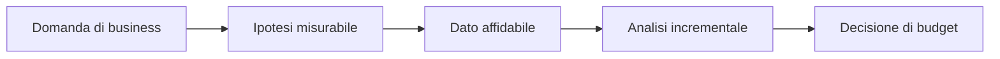

# Social media analytics

Il valore dei social media non sta nei numeri assoluti di like o visualizzazioni, ma nel saper tradurre quei dati in decisioni strategiche prese sotto incertezza. Un post può raccogliere molti commenti, un altro pochi ma con un sentiment migliore e traffico più qualificato. Se guardi solo reach o like rischi di premiare il rumore, e se guardi solo le conversioni perdi i segnali di domanda futura. Il punto è leggere visibilità, conversazione e impatto con metriche coerenti e messe nel contesto giusto.

## Problema reale

Nel marketing analytics, la social media analytics serve a tradurre budget, canali, creatività e audience in decisioni che si possano misurare, senza confondere volume e attribuzione con incrementalità. La domanda centrale è quale decisione migliora quando applichi dati affidabili con una soglia di errore dichiarata. Trattala come uno strumento operativo per inquadrare il problema analitico e il contesto in cui decidi, lavorando su esempi concreti. Quando non colleghi il concetto a una scelta reale, la conoscenza resta decorativa.

## Modello concettuale



Il processo procede in ordine. Prima formuli la domanda, poi la traduci in unità osservabili, valuti la qualità del dato e infine decidi. Quando salti un passaggio ottieni analisi fragili.

| Passaggio | Domanda guida | Output atteso |
|---|---|---|
| Framing | Quale decisione deve cambiare? | Scelta concreta |
| Misura | Quale segnale rappresenta il fenomeno? | Metrica, fonte, granularità |
| Confronto | Rispetto a quale baseline interpreto il risultato? | Benchmark o controfattuale |
| Azione | Che cosa faccio se il segnale supera la soglia? | Decisione, owner, prossimo controllo |

## Formalizzazione rigorosa

La social media analytics si formalizza come una relazione tra unità di analisi, segnale, baseline e decisione. L'unità è una campagna, una coorte, un touchpoint o un segmento cliente. Il segnale va collegato al margine incrementale, al CAC payback, al conversion rate corretto, al lift o alla retention generata. La baseline è un periodo precedente, un gruppo holdout, un mercato comparabile o un benchmark storico.

| Elemento | Definizione |
|---|---|
| Unità | campagna, coorte, touchpoint, segmento cliente |
| Segnale | margine incrementale, CAC payback, conversion rate corretto, lift, retention |
| Baseline | periodo precedente, gruppo holdout, mercato comparabile, benchmark storico |
| Decisione | spostare risorse, cambiare messaggio, fermare tattica, scalare esperimento |
| Rischio | confondere correlazione, qualità del dato e causalità |

Una misura è utile solo se riduce l'incertezza su una decisione specifica. Se non cambia una scelta è solo documentazione, e se la cambia senza controlli è rischio.

## Esempio o caso studio

Un team growth deve decidere se aumentare il budget su un canale con CPA basso ma vendite marginali deboli. La social media analytics aiuta a separare il segnale dal rumore, collegando la metrica, il modello mentale e la decisione economica.

| Evidenza | Interpretazione prudente | Decisione |
|---|---|---|
| Segnale positivo ma non isolato | Fenomeno esiste, causa incerta | Cercare baseline o holdout |
| Segmento con risposta diversa | Effetto medio nasconde eterogeneità | Analizzare coorti o sottogruppi |
| Costo operativo crescente | Valutare sul margine | Applicare soglie economiche |

## Lab / esercizio

### Livello base

Definisci una decisione reale collegata a social media analytics: obiettivo, metrica primaria, baseline, rischio e azione prevista. Usa una sola metrica primaria.

### Livello intermedio

Costruisci tabella con tre segmenti/scenari. Per ciascuno indica segnale, possibile spiegazione alternativa e controllo necessario prima di decidere.

### Livello research-grade

Disegna piano di validazione: ipotesi, dati necessari, criteri di esclusione, soglia decisionale e controllo post-decisione. Specifica cosa cambierebbe idea.

### Dataset e materiali consigliati

Usa export campagne, costi media, eventi web/app, CRM, transazioni, survey brand, log consenso. Se non hai dati reali, crea dataset sintetico con 200-500 righe, colonna temporale, segmento, metrica outcome e variabile esposizione.

## Errore tipico da evitare

Trattare social media analytics come definizione da ricordare anziché protocollo decisionale. Presentare metrica senza baseline, grafico senza ipotesi o raccomandazione senza costo dell'errore. Chiediti: "Se questo risultato fosse falso, quale decisione sbaglierei?" Se non sai rispondere, non hai applicato la lezione.

## Quiz o checkpoint

1. Quale decisione concreta migliora questa lezione?
2. Quale baseline rende interpretabile il risultato?
3. Quale assunzione, se errata, cambia la conclusione?
4. Quale controllo minimo useresti prima di raccomandare?

## Riepilogo operativo

Social media analytics è utile quando collega concetto, dato e decisione. Studiala partendo da un problema reale, formalizza il segnale, cerca baseline credibile, costruisci esempio e chiudi con controllo pratico.

---

## Oltre la Vanità: Un Framework Gerarchico per la Misurazione

Non tutte le metriche social hanno lo stesso peso. Un like su un post di awareness non vale un click su un annuncio di retargeting. Serve un framework che mappi metriche agli obiettivi di business, tipicamente un funnel di marketing:

1. Awareness: misuriamo reach, impressions, frequenza e share of voice per capire la dimensione dell'audience raggiunta e la presenza nel mercato.
2. Engagement: misuriamo engagement rate by reach, qualità dei commenti, save rate per valutare la qualità dell'interazione.
3. Conversion: misuriamo CTR, conversion rate dal canale social e assisted conversions per collegare social a risultati economici.

Adottare questo framework sposta l'analisi da numeri isolati a insight azionabili.

## Paid Social Analytics: Integrazione Dati e Ottimizzazione del ROAS

Le campagne a pagamento richiedono un'infrastruttura dati unificata e analisi granulare. Superare i report nativi con pipeline che centralizzano dati di spesa, performance e audience in un data warehouse permette analisi cross-canale e ottimizzazione.

Un esempio di modello dbt unifica dati Facebook e TikTok, facilitando analisi di creative fatigue e alert automatici per sostituire annunci meno efficaci.

### Caso di Studio: Zalando

Zalando ottimizza il ROAS a livello SKU e LTV clienti. Ha scoperto che creatività Instagram Stories con contenuti street style generano ROAS superiore del 18% e AOV più alto del 12%. Riallocando budget verso questi contenuti ha aumentato ROAS del 7% e ridotto CPA per clienti di alto valore.

## L'Economia degli Influencer: Dal Reach al Ritorno sull'Investimento

L'influencer marketing non è solo reach e like. Serve misurare conversioni dirette con link UTM e codici sconto unici, ma anche effetti indiretti con metodi quasi-sperimentali come geo-lift e analisi di coorte.

### Caso di Studio: Airbnb

Airbnb ha spostato focus da reach a engagement qualificato, misurando "Wishlist Add Rate" (WAR). Micro-influencer di nicchia generano WAR doppio rispetto a mega-influencer, portando a riallocazione budget e utenti con maggiore intenzione di viaggio.

## Social Listening e Analisi del Contenuto: La Voce del Mercato

Il social listening monitora menzioni, competitor e temi per brand health, competitive intelligence e product insights. Un esempio è l'analisi del sentiment con Python usando TextBlob per trasformare dati testuali in metriche quantitative.

```python
from textblob import TextBlob

comments = [
    "Questo prodotto è assolutamente fantastico, ha cambiato la mia routine!",
    "La spedizione è stata un disastro, tre settimane di ritardo e pacco danneggiato.",
    "Non male, fa il suo lavoro. Forse un po' caro.",
    "Lo adoro! Lo comprerò di nuovo sicuramente. Consigliatissimo.",
    "Pessima esperienza con il servizio clienti, non rispondono mai.",
    "Il prodotto è ok, ma la descrizione sul sito non era chiara."
]

positive_count = 0
neutral_count = 0
negative_count = 0

print("Analisi del Sentiment dei Commenti:")
for comment in comments:
    polarity = TextBlob(comment).sentiment.polarity
    if polarity > 0.1:
        sentiment = "Positivo"
        positive_count += 1
    elif polarity < -0.1:
        sentiment = "Negativo"
        negative_count += 1
    else:
        sentiment = "Neutro"
        neutral_count += 1
    print(f"- '{comment[:50]}...' -> Sentiment: {sentiment} (Polarity: {polarity:.2f})")

sentiment_score = (positive_count - negative_count) / max(1, positive_count + negative_count)
print(f"\nSentiment Score Complessivo: {sentiment_score:.2f}")
print(f"Riepilogo: {positive_count} Positivi, {neutral_count} Neutri, {negative_count} Negativi")
```

## Esercitazione Pratica: Dall'Insight all'Azione

Immagina di essere data analyst per un brand D2C di caffè in capsule con dati Instagram degli ultimi 90 giorni.

**Esercizio 1:** calcola per ogni tipo di contenuto (Video, Carousel, Image) numero di post, reach media e Engagement Rate by Reach (ERR) medio, ordinando per ERR decrescente.

**Esercizio 2:** identifica i 5 post con più website_clicks ma ERR inferiore alla media complessiva. Analizza content_pillar e content_type più frequenti e formula ipotesi strategica.

**Esercizio 3:** con i 5 commenti reali forniti, usa il codice Python per analizzare sentiment e calcolare sentiment score complessivo. Rifletti su come questo influenzi community management e promozioni future.

---

Questa lezione integra la disciplina di prendere decisioni sotto incertezza con strumenti concreti per trasformare dati social in azioni efficaci e misurabili.
