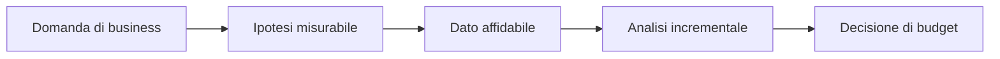

# Social media analytics

Il valore dei social media non sta nei numeri assoluti di like o visualizzazioni, ma nel saper tradurre quei dati in decisioni strategiche prese sotto incertezza. Un post può raccogliere molti commenti, un altro pochi ma con un sentiment migliore e traffico più qualificato. Se guardi solo reach o like rischi di premiare il rumore, e se guardi solo le conversioni perdi i segnali di domanda futura. Il punto è leggere visibilità, conversazione e impatto con metriche coerenti e messe nel contesto giusto.

## Problema reale

Nel marketing analytics, la social media analytics serve a tradurre budget, canali, creatività e audience in decisioni che si possano misurare, senza confondere volume e attribuzione con incrementalità. La domanda centrale è quale decisione migliora quando applichi dati affidabili con una soglia di errore dichiarata. Trattala come uno strumento operativo per inquadrare il problema analitico e il contesto in cui decidi, lavorando su esempi concreti. Quando non colleghi il concetto a una scelta reale, la conoscenza resta decorativa.

## Modello concettuale



Il processo procede in ordine. Prima formuli la domanda, poi la traduci in unità osservabili, valuti la qualità del dato e infine decidi. Quando salti un passaggio ottieni analisi fragili.

| Passaggio | Domanda guida | Output atteso |
|---|---|---|
| Framing | Quale decisione deve cambiare? | Scelta concreta |
| Misura | Quale segnale rappresenta il fenomeno? | Metrica, fonte, granularità |
| Confronto | Rispetto a quale baseline interpreto il risultato? | Benchmark o controfattuale |
| Azione | Che cosa faccio se il segnale supera la soglia? | Decisione, owner, prossimo controllo |

## Formalizzazione rigorosa

La social media analytics si formalizza come una relazione tra unità di analisi, segnale, baseline e decisione. L'unità è una campagna, una coorte, un touchpoint o un segmento cliente. Il segnale va collegato al margine incrementale, al CAC payback, al conversion rate corretto, al lift o alla retention generata. La baseline è un periodo precedente, un gruppo holdout, un mercato comparabile o un benchmark storico.

| Elemento | Definizione |
|---|---|
| Unità | campagna, coorte, touchpoint, segmento cliente |
| Segnale | margine incrementale, CAC payback, conversion rate corretto, lift, retention |
| Baseline | periodo precedente, gruppo holdout, mercato comparabile, benchmark storico |
| Decisione | spostare risorse, cambiare messaggio, fermare tattica, scalare esperimento |
| Rischio | confondere correlazione, qualità del dato e causalità |

Una misura è utile solo se riduce l'incertezza su una decisione specifica. Se non cambia una scelta è solo documentazione, e se la cambia senza controlli è rischio.

## Esempio o caso studio

Un team growth deve decidere se aumentare il budget su un canale con CPA basso ma vendite marginali deboli. La social media analytics aiuta a separare il segnale dal rumore, collegando la metrica, il modello mentale e la decisione economica.

| Evidenza | Interpretazione prudente | Decisione |
|---|---|---|
| Segnale positivo ma non isolato | Fenomeno esiste, causa incerta | Cercare baseline o holdout |
| Segmento con risposta diversa | Effetto medio nasconde eterogeneità | Analizzare coorti o sottogruppi |
| Costo operativo crescente | Valutare sul margine | Applicare soglie economiche |

## Lab / esercizio

### Livello base

Definisci una decisione reale collegata alla social media analytics: obiettivo, metrica primaria, baseline, rischio e azione prevista. Tieni una sola metrica primaria.

### Livello intermedio

Costruisci una tabella con tre segmenti o scenari. Per ciascuno indica il segnale, una possibile spiegazione alternativa e il controllo necessario prima di decidere.

### Livello research-grade

Disegna un piano di validazione con ipotesi, dati necessari, criteri di esclusione, soglia decisionale e controllo dopo la decisione. Indica che cosa ti farebbe cambiare idea.

### Dataset e materiali consigliati

Usa export delle campagne, costi media, eventi web o app, CRM, transazioni, survey brand e log di consenso. Se non hai dati reali, crea un dataset sintetico con 200-500 righe, una colonna temporale, una di segmento, una metrica di outcome e una variabile di esposizione.

## Errore tipico da evitare

L'errore è trattare la social media analytics come una definizione da ricordare anziché come un protocollo per decidere. Capita quando presenti una metrica senza baseline, un grafico senza ipotesi o una raccomandazione senza il costo dell'errore. Chiediti: se questo risultato fosse falso, quale decisione sbaglierei? Quando non sai rispondere, non hai applicato la lezione.

## Quiz o checkpoint

1. Quale decisione concreta migliora questa lezione?
2. Quale baseline rende interpretabile il risultato?
3. Quale assunzione, se errata, cambia la conclusione?
4. Quale controllo minimo useresti prima di raccomandare?

## Riepilogo operativo

La social media analytics è utile quando collega concetto, dato e decisione. Parti da un problema reale, formalizza il segnale, cerca una baseline credibile, costruisci un esempio e chiudi con un controllo pratico.

---

## Un framework gerarchico per la misurazione

Non tutte le metriche social pesano allo stesso modo. Un like su un post di awareness non vale un click su un annuncio di retargeting. Serve un framework che mappi le metriche sugli obiettivi di business, di solito lungo un funnel di marketing. In awareness misuri reach, impressions, frequenza e share of voice, per capire quanta audience hai raggiunto e quanto sei presente sul mercato. In engagement misuri l'engagement rate by reach, la qualità dei commenti e il save rate, per valutare la qualità dell'interazione. In conversione misuri CTR, conversion rate dal canale social e assisted conversions, per legare il social ai risultati economici. Con questo schema l'analisi passa dai numeri isolati a indicazioni su cui puoi agire.

## Paid social e ottimizzazione del ROAS

Le campagne a pagamento richiedono un'infrastruttura dati unificata e analisi granulari. Andando oltre i report nativi, con pipeline che centralizzano spesa, performance e audience in un data warehouse, ottieni analisi cross-canale e margine di ottimizzazione. Un modello dbt che unifica i dati di Facebook e TikTok, per esempio, abilita analisi di creative fatigue e alert automatici per sostituire gli annunci meno efficaci.

### Caso di studio Zalando

Zalando ottimizza il ROAS a livello di SKU e di LTV dei clienti. Ha scoperto che le creatività Instagram Stories con contenuti street style generano un ROAS superiore del 18% e un AOV più alto del 12%. Riallocando budget verso questi contenuti ha aumentato il ROAS del 7% e ridotto il CPA per i clienti di alto valore.

## L'economia degli influencer

L'influencer marketing non si esaurisce in reach e like. Devi misurare le conversioni dirette con link UTM e codici sconto unici, ma anche gli effetti indiretti con metodi quasi-sperimentali come il geo-lift e l'analisi di coorte.

### Caso di studio Airbnb

Airbnb ha spostato il focus dalla reach all'engagement qualificato, misurando il Wishlist Add Rate (WAR). I micro-influencer di nicchia generano un WAR doppio rispetto ai mega-influencer, e questo ha portato a riallocare budget verso utenti con maggiore intenzione di viaggio.

## Social listening e analisi del contenuto

Il social listening monitora menzioni, competitor e temi per leggere la brand health, fare competitive intelligence e ricavare product insights. Un esempio concreto è l'analisi del sentiment in Python con TextBlob, che trasforma i dati testuali in metriche quantitative.

```python
from textblob import TextBlob

comments = [
    "Questo prodotto è assolutamente fantastico, ha cambiato la mia routine!",
    "La spedizione è stata un disastro, tre settimane di ritardo e pacco danneggiato.",
    "Non male, fa il suo lavoro. Forse un po' caro.",
    "Lo adoro! Lo comprerò di nuovo sicuramente. Consigliatissimo.",
    "Pessima esperienza con il servizio clienti, non rispondono mai.",
    "Il prodotto è ok, ma la descrizione sul sito non era chiara."
]

positive_count = 0
neutral_count = 0
negative_count = 0

print("Analisi del Sentiment dei Commenti:")
for comment in comments:
    polarity = TextBlob(comment).sentiment.polarity
    if polarity > 0.1:
        sentiment = "Positivo"
        positive_count += 1
    elif polarity < -0.1:
        sentiment = "Negativo"
        negative_count += 1
    else:
        sentiment = "Neutro"
        neutral_count += 1
    print(f"- '{comment[:50]}...' -> Sentiment: {sentiment} (Polarity: {polarity:.2f})")

sentiment_score = (positive_count - negative_count) / max(1, positive_count + negative_count)
print(f"\nSentiment Score Complessivo: {sentiment_score:.2f}")
print(f"Riepilogo: {positive_count} Positivi, {neutral_count} Neutri, {negative_count} Negativi")
```

## Esercitazione pratica

Immagina di essere data analyst per un brand D2C di caffè in capsule, con i dati Instagram degli ultimi 90 giorni. Il primo esercizio è calcolare, per ogni tipo di contenuto (Video, Carousel, Image), numero di post, reach media ed Engagement Rate by Reach (ERR) medio, ordinando per ERR decrescente. Il secondo è individuare i cinque post con più website_clicks ma ERR sotto la media complessiva: analizza il content_pillar e il content_type più frequenti e formula un'ipotesi strategica. Il terzo è usare il codice Python qui sopra sui cinque commenti reali per ricavare il sentiment e il sentiment score complessivo, ragionando poi su come questo cambi il community management e le promozioni successive.

## Conclusioni

La lezione unisce due cose: la disciplina di decidere sotto incertezza e gli strumenti concreti per trasformare i dati social in azioni che puoi misurare.
