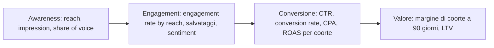

## Due post, due verdetti opposti

Scenario costruito con numeri di esempio. Un marchio di cosmetici pubblica due contenuti nello stesso mese. Il post A, un video di prodotto, raccoglie 1.200 interazioni (reazioni, commenti, condivisioni, salvataggi) su una reach di 40.000 persone. Il post B, una guida all'uso con tre routine, ne raccoglie 540 su una reach di 9.000 persone. Chi guarda il totale premia il post A, che ha più del doppio delle interazioni. Chi guarda il rapporto tra interazioni e persone raggiunte arriva alla conclusione opposta: il post A ha 1.200 / 40.000 = 3,0% e il post B ha 540 / 9.000 = 6,0%.

Il rapporto non basta da solo, perché dice quanto il pubblico raggiunto ha reagito, non se quella reazione vale denaro. Se il post B porta 220 visite al sito e il post A 150, il verdetto del rapporto si rafforza. Se il post B non porta traffico, il suo 6% è un pubblico affezionato che non compra. Le metriche dei social non hanno un valore in sé: lo assumono dentro una domanda decisionale, e ogni decisione richiede una metrica diversa.

> **Idea chiave:** nei social il valore non sta nei like assoluti ma nel tradurre visibilità, qualità della conversazione e risultato economico in decisioni, leggendo ogni metrica dentro il livello del funnel a cui appartiene.

Chi guarda solo reach e like premia il rumore. Chi guarda solo le conversioni perde i segnali di domanda futura, perché il social lavora a lungo anche su chi non compra nella finestra di attribuzione.

## Un framework a livelli: awareness, engagement, conversione

Le metriche si raggruppano in tre livelli e ciascun livello risponde a una sola domanda. Mescolarli produce giudizi che sembrano ragionevoli e non lo sono: il like su un contenuto di notorietà non pesa quanto un clic su un annuncio di retargeting.



In awareness si misura quanta audience viene raggiunta e quanto spazio il marchio occupa rispetto ai concorrenti (la quota di conversazione, o share of voice). In engagement si misura la qualità dell'interazione. In conversione si misura il legame con i risultati economici, e nel livello del valore si chiude il conto contro il margine. Organico, paid e influencer rispondono a domande diverse e un solo report nativo di piattaforma non li tiene insieme: ogni settimana conviene riconciliare la spesa con le conversioni registrate nel backend, perché ciascuna piattaforma tende a rivendicare gli ordini che ha toccato, e la somma delle rivendicazioni supera i ricavi reali. Le metriche che non muovono nessuna decisione si archiviano.

## Engagement rate by reach

Le piattaforme offrono vari denominatori: follower, impression, reach. Il rapporto sui follower è fuorviante, perché la maggior parte dei follower non vede il contenuto. Quello sulle impression è gonfiato dalle ripetizioni sulla stessa persona. Il denominatore più onesto è la reach, cioè le persone distinte che hanno avuto il contenuto davanti, perché risponde alla domanda: tra chi lo ha visto, quanti hanno fatto qualcosa.

La formula è engagement rate by reach = (reazioni + commenti + condivisioni + salvataggi) / reach. Conviene pesare le azioni, perché un salvataggio o una condivisione segnalano più intenzione di una reazione. Un esempio: il post B ha 540 interazioni, di cui 300 reazioni, 40 commenti, 60 condivisioni e 140 salvataggi. Con pesi 1 per reazioni, 3 per commenti, 4 per condivisioni e 4 per salvataggi, il totale pesato è 300 + 120 + 240 + 560 = 1.220, che su 9.000 persone dà 13,6%. Il post A ha 1.200 interazioni quasi tutte reazioni: 1.000 reazioni, 60 commenti, 40 condivisioni, 100 salvataggi, totale pesato 1.000 + 180 + 160 + 400 = 1.740, su 40.000 persone fa 4,35%. La distanza tra i due cresce quando si pesa la qualità, e la scelta dei pesi va dichiarata per iscritto, altrimenti ogni analista produce un numero diverso.

```python
import pandas as pd

# Interazioni per post: reach, reazioni, commenti, condivisioni, salvataggi
post = pd.DataFrame({
    "post": ["A_video_prodotto", "B_guida_routine"],
    "reach": [40_000, 9_000],
    "reazioni": [1_000, 300],
    "commenti": [60, 40],
    "condivisioni": [40, 60],
    "salvataggi": [100, 140],
})

# Pesi dichiarati: un salvataggio o una condivisione valgono più di una reazione
pesi = {"reazioni": 1, "commenti": 3, "condivisioni": 4, "salvataggi": 4}

post["interazioni"] = post[["reazioni", "commenti", "condivisioni", "salvataggi"]].sum(axis=1)
post["er_reach_pct"] = 100 * post["interazioni"] / post["reach"]
post["er_pesato_pct"] = 100 * sum(post[c] * w for c, w in pesi.items()) / post["reach"]

print(post[["post", "er_reach_pct", "er_pesato_pct"]].round(2))
# A: 3.00 e 4.35 ; B: 6.00 e 13.56
```

## Paid social: ROAS di primo ordine contro margine di coorte

Le campagne a pagamento si valutano con dati unificati nel warehouse: spesa, performance e audience di tutte le piattaforme in un modello comune, per esempio un modello dbt che normalizza Meta e TikTok con le stesse colonne. La domanda che il pannello della piattaforma non risolve è se i clienti acquisiti pagano il costo con cui sono stati acquisiti.

Un caso con numeri di esempio. Una campagna spende 10.000 euro e acquisisce 250 nuovi clienti. Il costo di acquisizione è 10.000 / 250 = 40 euro. Il primo ordine vale in media 55 euro: ricavo di primo ordine 250 × 55 = 13.750 euro, ROAS di primo ordine 13.750 / 10.000 = 1,375. A 90 giorni, con riacquisti, ogni cliente ha generato in media 85 euro di ricavo: 250 × 85 = 21.250 euro, ROAS di coorte 21.250 / 10.000 = 2,125. Il ROAS di 2,1 sembra sano, ma con un margine lordo del 40% il margine per cliente è 85 × 0,40 = 34 euro, contro un CAC di 40: il rapporto è 34 / 40 = 0,85 e la campagna perde 6 euro a cliente anche dopo 90 giorni. Un ROAS superiore a 2 non protegge un marchio con margini sottili: il confronto che conta è tra margine di coorte e costo di acquisizione.

```sql
-- Coorte di nuovi clienti per campagna: ricavo e margine a 90 giorni vs CAC
WITH coorte AS (
  SELECT
    c.campaign_id,
    c.customer_id,
    SUM(o.revenue_eur)                          AS ricavo_90g_eur,
    SUM(o.revenue_eur * o.gross_margin_pct)     AS margine_90g_eur
  FROM marketing.acquired_customers c
  JOIN shop.orders o
    ON o.customer_id = c.customer_id
   AND o.created_at BETWEEN c.first_order_at AND c.first_order_at + INTERVAL '90 day'
  GROUP BY c.campaign_id, c.customer_id
)
SELECT
  s.campaign_id,
  s.spend_eur,
  COUNT(*)                                                   AS nuovi_clienti,
  ROUND(s.spend_eur / COUNT(*), 2)                           AS cac_eur,
  ROUND(SUM(ricavo_90g_eur) / s.spend_eur, 3)                AS roas_coorte_90g,
  ROUND(SUM(margine_90g_eur) / COUNT(*), 2)                  AS margine_per_cliente_eur
FROM coorte
JOIN marketing.social_spend s USING (campaign_id)
GROUP BY s.campaign_id, s.spend_eur;
-- Decisione: margine_per_cliente_eur >= cac_eur, altrimenti la campagna brucia cassa
```

Mescolare prospecting e retargeting nello stesso conto premia chi raccoglie la domanda già esistente e affama chi la crea. Le due famiglie vanno separate nel report, con giudizi diversi: il retargeting si valuta sull'incrementalità, il prospecting sulla qualità di coorte.

## Creative fatigue per fascia di frequenza

Una creatività logora il proprio pubblico prima di quanto i report aggregati suggeriscano. Il segnale è il calo del CTR a parità di audience quando cresce la frequenza, cioè il numero medio di volte che la stessa persona vede l'annuncio. Conviene guardare le fasce di frequenza, non la media del periodo, perché la media nasconde il fatto che una parte dell'audience è già satura mentre un'altra non l'ha ancora vista.

| Fascia di frequenza | Impression | Click | CTR | Variazione sulla fascia 1-2 |
| --- | ---: | ---: | ---: | ---: |
| 1-2 | 200.000 | 3.600 | 1,80% | base |
| 3-4 | 120.000 | 1.800 | 1,50% | −17% |
| 5 e oltre | 80.000 | 720 | 0,90% | −50% |

I CTR derivano dalla divisione dei click per le impression: 3.600 / 200.000 = 1,80%, 1.800 / 120.000 = 1,50%, 720 / 80.000 = 0,90%. La variazione dell'ultima fascia è (0,90 − 1,80) / 1,80 = −50%. Una regola semplice di alert scatta quando il CTR di una fascia scende sotto il 70% di quello della fascia iniziale: qui la fascia 3-4 è all'83% e non scatta, la fascia 5 e oltre è al 50% e scatta. L'azione conseguente è sostituire la creatività, limitare il tetto di frequenza o allargare il pubblico, a seconda di quale delle tre leve costa meno.

## Influencer: il costo per azione qualificata

Giudicare un influencer sulla reach dichiarata premia la fama, mentre l'obiettivo di una collaborazione è di solito un comportamento: una registrazione, un'aggiunta ai preferiti, un acquisto. Le conversioni dirette si misurano con link con parametri UTM e codici sconto unici per ciascun creatore. Gli effetti indiretti, quelli che non passano da un link, si stimano con metodi quasi sperimentali come il confronto tra aree geografiche esposte e non esposte, o con l'analisi di coorte sui nuovi clienti.

Un confronto con numeri di esempio. L'influencer X costa 3.000 euro e porta 2.000 nuovi follower e 30 azioni qualificate (iscrizioni alla lista con codice dedicato). Il costo per follower è 3.000 / 2.000 = 1,50 euro, il costo per azione qualificata è 3.000 / 30 = 100 euro. L'influencer Y costa 800 euro e porta 300 follower e 40 azioni qualificate: costo per follower 800 / 300 = 2,67 euro, costo per azione qualificata 800 / 40 = 20 euro. Sul costo per follower vince X, sul costo per azione qualificata Y costa un quinto. Chi compra reach compra pubblico, chi compra azioni qualificate compra domanda, e un micro-creatore di nicchia con un pubblico piccolo e coinvolto batte spesso un grande nome. Con campioni così piccoli (30 e 40 azioni) il confronto resta indicativo, e prima di spostare il budget conviene ripeterlo su una seconda collaborazione.

## Social listening e sentiment

Il social listening raccoglie menzioni del marchio, dei concorrenti e dei temi di categoria e le trasforma in indicatori su salute del marchio, intelligenza competitiva e segnali di prodotto. Il sentiment score più semplice è (positivi − negativi) / (positivi + negativi), con valori tra −1 e +1. Il numero da solo dice poco, perché lo stesso punteggio su volumi molto diversi racconta storie diverse.

Un esempio costruito. Prima del lancio di una nuova linea, 400 commenti in una settimana: 220 positivi, 80 negativi, 100 neutri. Il punteggio è (220 − 80) / (220 + 80) = 140 / 300 = +0,47. Dopo il lancio, 1.200 commenti: 300 positivi, 540 negativi, 360 neutri. Il punteggio è (300 − 540) / (300 + 540) = −240 / 840 = −0,29. Il punteggio è peggiorato di 0,76 punti e i volumi sono triplicati: un lancio che divide il pubblico, con più conversazione e più critiche. Se il punteggio fosse rimasto a +0,47 con volumi stabili, nessun evento sarebbe avvenuto. Il lavoro vero è sui temi: in quei 540 commenti negativi, una parte riguarda la consegna, una il prezzo, una l'efficacia, e solo l'ultima richiede una decisione di prodotto.

```python
def sentiment_score(positivi: int, negativi: int) -> float:
    # Punteggio tra -1 e +1: 0 se non ci sono commenti polarizzati
    totale = positivi + negativi
    return (positivi - negativi) / totale if totale else 0.0

prima = sentiment_score(220, 80)    # 0.4667
dopo = sentiment_score(300, 540)    # -0.2857

# Un punteggio isolato non basta: riporta sempre volume e temi
print(f"prima {prima:+.2f} su 400 commenti, dopo {dopo:+.2f} su 1200 commenti")
```

Le etichette positivo, negativo e neutro devono venire da un modello calibrato sulla lingua reale dei commenti. Le librerie a lessico come TextBlob nascono con un dizionario inglese e su commenti in italiano, con ironia, gergo e abbreviazioni, danno risultati inaffidabili finché non vengono addestrate o sostituite da un modello multilingue validato su un campione etichettato a mano.

## Tre errori ricorrenti

### Il like usato per giudicare il fatturato

Il sintomo è un contenuto con molte reazioni celebrato in riunione mentre le vendite dello stesso periodo non si muovono. Succede perché la reazione è la metrica più visibile e quindi la più facile da citare. La correzione è collegare ogni contenuto a un livello del funnel prima della pubblicazione e valutarlo sulla metrica di quel livello: salvataggi e condivisioni per l'engagement, click e conversioni solo per i contenuti che li hanno come obiettivo.

### ROAS di primo ordine scambiato per redditività

Il sintomo è una campagna con ROAS 2,1 che continua a ricevere budget mentre il margine complessivo del mese cala. Il numero sembra rassicurante perché supera la soglia abituale. La correzione è confrontare il margine di coorte a 90 giorni con il CAC, come nel caso della query sopra, e fissare la soglia di scala sul rapporto tra i due, non sul ROAS.

### Un punteggio di sentiment letto senza volume né temi

Il sintomo è un sentiment «stabile» a +0,3 che nasconde un raddoppio dei commenti negativi compensato da un raddoppio dei positivi. Succede perché il rapporto assorbe i cambi di scala. La correzione è affiancare al punteggio il numero di commenti e la distribuzione per tema, e un controllo mensile a campione, con lettura manuale di almeno 100 commenti, per verificare che le etichette del modello corrispondano a ciò che si legge.

## Verifica sul tuo piano social

1. Un post ha 3.000 interazioni e 60.000 di reach, un altro 800 interazioni e 10.000 di reach. Quale ha l'engagement rate by reach più alto?

<details>
<summary>Mostra risposta</summary>

Il primo ha 3.000 / 60.000 = 5,0%, il secondo 800 / 10.000 = 8,0%. Il secondo ha il tasso più alto pur avendo meno di un terzo delle interazioni: il denominatore è la reach, quindi la dimensione del pubblico non pesa sul confronto.

</details>

2. Una campagna spende 6.000 euro per 200 nuovi clienti, ciascuno con ricavo a 90 giorni di 70 euro e margine lordo del 45%. Qual è il CAC e la campagna recupera il costo?

<details>
<summary>Mostra risposta</summary>

CAC = 6.000 / 200 = 30 euro. Margine per cliente = 70 × 0,45 = 31,50 euro. Il margine supera il CAC di 1,50 euro per cliente, quindi la campagna recupera il costo entro i 90 giorni con un rapporto di 31,50 / 30 = 1,05, un margine di sicurezza minimo. Il ROAS di coorte è 70 × 200 / 6.000 = 2,33.

</details>

3. Una creatività ha CTR 2,0% nella fascia di frequenza 1-2 e 1,2% nella fascia 5 e oltre. Con soglia di alert al 70% del CTR iniziale, scatta l'allarme?

<details>
<summary>Mostra risposta</summary>

Sì. 1,2 / 2,0 = 60%, sotto il 70%. La variazione è −40%. Si sostituisce la creatività, si abbassa il tetto di frequenza o si allarga il pubblico, scegliendo la leva meno costosa.

</details>

4. L'influencer P costa 1.500 euro e porta 25 azioni qualificate, l'influencer Q costa 600 euro e ne porta 8. Chi conviene sul costo per azione qualificata?

<details>
<summary>Mostra risposta</summary>

P: 1.500 / 25 = 60 euro per azione. Q: 600 / 8 = 75 euro per azione. Conviene P, anche se costa di più in assoluto. Con campioni di 25 e 8 azioni la differenza è però piccola e va riconfermata con una seconda collaborazione prima di spostare il budget.

</details>

5. Il sentiment passa da +0,4 a −0,2 mentre i commenti salgono da 300 a 900. Che cosa fai prima di decidere?

<details>
<summary>Mostra risposta</summary>

Leggo i temi dei commenti negativi e li classifico per causa: consegna, prezzo, efficacia, comunicazione. Verifico a mano un campione di almeno 100 commenti per controllare che il modello li etichetti bene. Solo dopo decido se la risposta è operativa (assistenza, logistica), commerciale o di prodotto.

</details>
