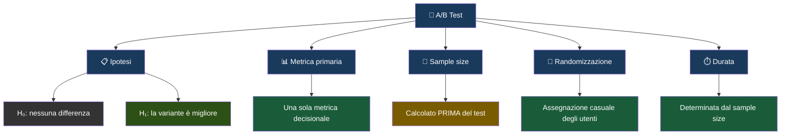
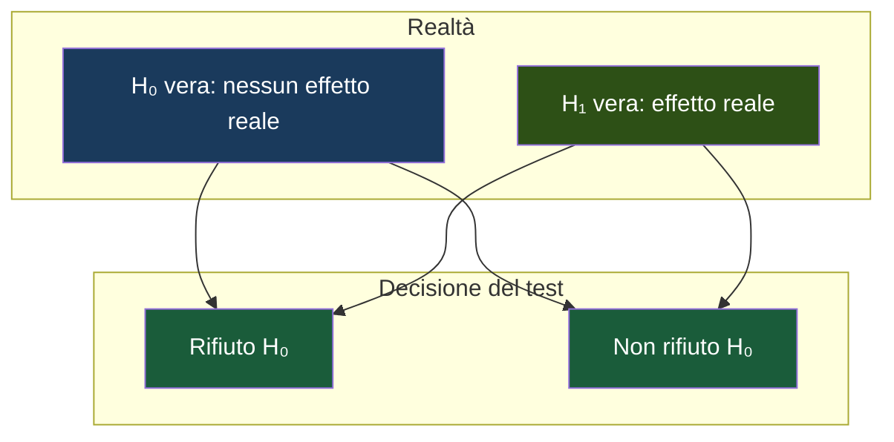
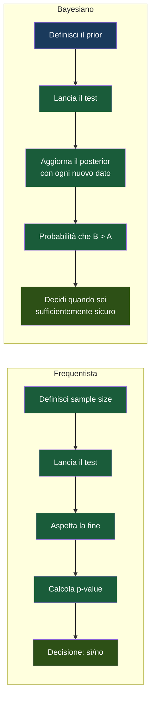
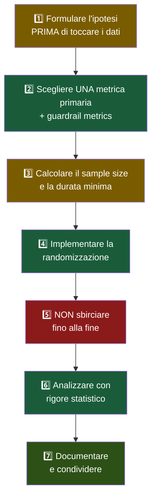
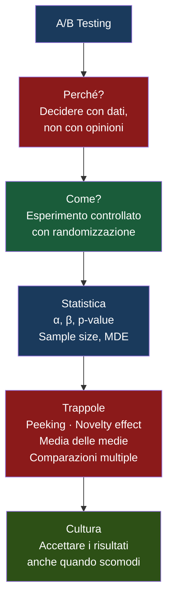

import { Aside } from '@astrojs/starlight/components'

## A/B TESTING: DECIDERE CON I DATI, NON CON LE OPINIONI

Un **A/B test** è un esperimento controllato in cui si confrontano due varianti — A (controllo) e B (variante) — per determinare quale produce un risultato migliore rispetto a una metrica definita in anticipo.

L'idea è semplice: invece di discutere in sala riunioni se il pulsante debba essere verde o rosso, lo mostri verde a metà degli utenti e rosso all'altra metà, poi guardi i dati. **La realtà batte l'opinione.**

Ma dietro questa semplicità concettuale si nasconde un mondo di rigore statistico che, se ignorato, porta a decisioni sbagliate con la falsa sicurezza di averle prese "con i dati".

## Le origini: l'esperimento del tè

Nel 1935, il biostatistico Ronald Fisher raccontò un aneddoto che sarebbe diventato uno dei casi fondativi della statistica moderna. Una collega, Muriel Bristol, affermava di poter distinguere se in una tazza il latte fosse stato versato prima o dopo il tè.

Fisher progettò un esperimento rigoroso: otto tazze, quattro con latte prima e quattro con latte dopo, presentate in ordine casuale. Il punto non era il tè — era il **metodo**: randomizzazione, gruppo di controllo, ipotesi nulla, test statistico.

Da quell'esperimento nascono i principi che usiamo ancora oggi nell'A/B testing digitale.

## L'anatomia di un esperimento

Ogni A/B test ben progettato ha cinque componenti fondamentali:



### 1. L'ipotesi

Ogni test parte da due ipotesi contrapposte:

**Ipotesi nulla (H₀):** non c'è differenza tra controllo e variante. Questa è l'ipotesi "di default" — il tribunale statistico parte dal presupposto di innocenza.

**Ipotesi alternativa (H₁):** esiste una differenza significativa. Questa è ciò che speriamo di dimostrare.

> **Regola fondamentale:** l'ipotesi va formulata **prima** di guardare i dati. Formulare l'ipotesi dopo aver visto i risultati è come tirare la freccia e poi disegnare il bersaglio attorno.

### 2. La metrica primaria

Un test deve avere **una sola metrica primaria** (OEC — Overall Evaluation Criterion). Può avere metriche secondarie e guardrail, ma la decisione si prende su una sola.

Perché? Perché più metriche testi, più è probabile trovare un falso positivo per puro caso (problema delle comparazioni multiple).

| Tipo di metrica | Ruolo | Esempio |
|---|---|---|
| **Primaria (OEC)** | Decide l'esito del test | Tasso di conversione |
| **Secondaria** | Approfondiscono il meccanismo | Revenue per utente, click-through rate |
| **Guardrail** | Non devono peggiorare | Tempo di caricamento, tasso di errore |

### 3. Il sample size

Il numero di utenti necessari si calcola **prima** di lanciare il test, non dopo. Dipende da quattro parametri:

**Baseline** — il valore attuale della metrica (es. conversion rate = 5%)

**MDE (Minimum Detectable Effect)** — la differenza minima che vuoi essere in grado di rilevare (es. un aumento dal 5% al 5,5%, cioè un MDE relativo del 10%)

**Significatività (α)** — la probabilità massima di falso positivo che accetti (tipicamente 5%)

**Potenza (1−β)** — la probabilità di rilevare un effetto reale se esiste (tipicamente 80%)

La formula approssimativa per un test su due proporzioni è:

> **n ≈ 16 × σ² / δ²**

dove σ² è la varianza della metrica e δ è l'effetto minimo che vuoi rilevare. Per le proporzioni, σ² = p(1−p), quindi:

> **n per gruppo ≈ 16 × p(1−p) / (p × MDE_relativo)²**

Con p = 0,05 e MDE relativo = 10%:

> n ≈ 16 × 0,05 × 0,95 / (0,005)² ≈ **30.400 utenti per gruppo**

Servono circa 60.800 utenti totali. Se il tuo sito ne ha 2.000 al giorno, il test durerà circa un mese.

## Errori statistici: il dilemma del tribunale

L'A/B testing è, fondamentalmente, un sistema giudiziario per le decisioni di prodotto. E come ogni sistema giudiziario, può commettere due tipi di errori.



| | H₀ vera (nessun effetto) | H₁ vera (effetto reale) |
|---|---|---|
| **Rifiuto H₀** | ❌ Errore Tipo I (α) — Falso positivo | ✅ Decisione corretta |
| **Non rifiuto H₀** | ✅ Decisione corretta | ❌ Errore Tipo II (β) — Falso negativo |

**Errore di Tipo I (α = 5%):** dichiari un vincitore quando in realtà non c'è differenza. È il "condannare un innocente". Con α = 5%, accetti che 1 test su 20 darà un falso positivo.

**Errore di Tipo II (β = 20%):** non rilevi un effetto che esiste davvero. È "lasciare libero un colpevole". Con potenza dell'80%, hai il 20% di probabilità di perderti un miglioramento reale.

> **Esempio pratico:** La tua azienda lancia 20 test l'anno e la maggior parte delle idee non funziona (diciamo il 90% non ha effetto reale). Con α = 5%, dei 18 test senza effetto reale, circa 1 risulterà comunque "significativo". Quel test è un falso positivo — e tu implementerai una modifica inutile credendo che funzioni.

## Il p-value: cosa dice davvero (e cosa no)

Il **p-value** è la probabilità di osservare un risultato almeno altrettanto estremo, assumendo che H₀ sia vera.

**Cosa NON è il p-value:**
- Non è la probabilità che H₀ sia vera
- Non è la probabilità che il risultato sia dovuto al caso
- Non misura l'entità dell'effetto

**Cosa È:**
- Una misura di quanto i dati siano "sorprendenti" sotto l'ipotesi nulla

Se p = 0,03, significa: "Ammesso che non ci sia differenza reale, c'è il 3% di probabilità di osservare dati così estremi o più estremi". Siccome 3% < 5% (la soglia α), rifiutiamo H₀.

> **Attenzione:** un p-value basso con un effetto minuscolo non è necessariamente utile. Un aumento dello 0,01% nel conversion rate può essere statisticamente significativo su milioni di utenti, ma praticamente irrilevante. **La significatività statistica non implica significatività pratica.**

## Frequentista vs Bayesiano: due filosofie

### L'approccio frequentista

È quello classico: definisci sample size, lanci il test, aspetti la fine, calcoli il p-value. La risposta è binaria: "significativo" o "non significativo".

**Vantaggi:**
- Ben consolidato, facile da spiegare agli stakeholder
- Garanzie matematiche sugli errori (se le regole vengono rispettate)

**Svantaggi:**
- Non puoi "sbirciare" i dati prima della fine (peeking problem)
- La risposta è solo sì/no, non una stima della probabilità

### L'approccio bayesiano

Parte da una credenza iniziale (prior) e la aggiorna man mano che arrivano i dati (posterior). La risposta non è "significativo o no" ma "c'è il 95% di probabilità che B sia migliore di A del 2-8%".

**Vantaggi:**
- Puoi guardare i risultati in qualsiasi momento senza inflazionare gli errori
- Fornisce una distribuzione di probabilità sull'effetto, non solo un sì/no
- Più naturale per i decisori: "Qual è la probabilità che B sia meglio?"

**Svantaggi:**
- Richiede la scelta di un prior (che può essere controversa)
- Computazionalmente più pesante
- Meno diffuso nei tool standard



Nella pratica, molte aziende usano l'approccio frequentista con correzioni per il peeking (sequential testing), che è un ibrido tra i due mondi.

## Il peeking problem

Il problema più comune e più pericoloso nell'A/B testing è guardare i risultati troppo presto e fermare il test quando si vede un risultato "significativo".

Perché è un problema? Perché il p-value oscilla nel tempo. Se controlli ogni giorno, prima o poi vedrai un p-value sotto 0,05 anche quando non c'è nessun effetto reale. È la stessa ragione per cui, lanciando una moneta equa abbastanza a lungo, prima o poi avrai una serie di 10 teste consecutive.

**Quanto è grave?** Con un test senza effetto reale, controllando 5 volte durante l'esperimento, la probabilità di un falso positivo sale dal 5% al ~15%. Controllando ogni giorno per un mese, può superare il 30%.

### Come risolvere

1. **Pre-registrare la durata** — decidi in anticipo quando guarderai i risultati e rispetta il piano
2. **Sequential testing** — usa metodi come il Wald Sequential Probability Ratio Test (SPRT) o le α spending functions che ti permettono di controllare i risultati in modo continuo con garanzie statistiche
3. **Approccio bayesiano** — il posterior non è soggetto al peeking problem

## L'effetto della novità e i test a lungo termine

Un cambio nell'interfaccia spesso produce un effetto positivo temporaneo semplicemente perché è **nuovo**. Gli utenti sono curiosi, cliccano di più, esplorano la variante. Dopo qualche settimana, l'effetto svanisce.

Questo **novelty effect** (o il suo opposto, il **primacy effect** — gli utenti abituali resistono al cambiamento) può distorcere pesantemente i risultati se il test è troppo breve.

**Come gestirlo:**
- Analizzare i risultati separatamente per utenti nuovi e utenti di ritorno
- Estendere il test oltre il minimo statistico (almeno 2-3 settimane complete)
- Usare l'analisi di coorte: confrontare il comportamento della variante B nella prima settimana vs la terza

## Caso studio: il colore del pulsante che costò 100 milioni

Nel 2009, Bing (Microsoft) testò 24 sfumature di blu per i link dei risultati di ricerca. La variante vincente generò un incremento di revenue stimato in **80-100 milioni di dollari** all'anno.

Ma il punto non è il colore. Il punto è che:
- Il team non aveva previsto questo effetto — era uno dei tanti test
- La differenza di colore era quasi impercettibile all'occhio umano
- Solo un test rigoroso, con milioni di utenti e metriche chiare, poteva rilevare un effetto così piccolo ma economicamente enorme

> **Lezione:** i test più redditizi sono spesso quelli che sembrano banali. Le "grandi idee" strategiche raramente funzionano come previsto; i micro-miglioramenti iterativi, testati rigorosamente, generano crescita composta nel tempo.

## Caso studio: il fallimento dell'HiPPO

Un'azienda SaaS B2B decide di riprogettare completamente la pagina di pricing. Il CEO (la "Highest Paid Person's Opinion" — HiPPO) è convinto che il nuovo design sia superiore.

Il team di product gestisce un A/B test. Risultati:
- Conversione pagina pricing → trial: −12% (peggioramento)
- Tempo sulla pagina: +40% (gli utenti erano confusi, non più coinvolti)
- Tasso di rimbalzo: +8%

Il CEO inizialmente rifiuta i risultati. Il team mostra che il test ha un p-value di 0,001 su 15.000 utenti — la differenza è inequivocabile.

**Lezione:** l'A/B testing è un antidoto contro l'opinione del capo. Ma funziona solo se l'organizzazione accetta di farsi guidare dai dati anche quando contraddicono le intuizioni.

## Metriche di rapporto: l'errore della media delle medie

Un errore subdolo nell'A/B testing è calcolare il tasso di conversione come media dei tassi giornalieri, invece che come rapporto globale.

| Giorno | Visitatori A | Conversioni A | CR giornaliero A |
|---|---:|---:|---:|
| Lunedì | 1.000 | 50 | 5,0% |
| Martedì | 100 | 8 | 8,0% |
| **Totale** | **1.100** | **58** | **5,27%** |

La media dei tassi giornalieri è (5,0% + 8,0%) / 2 = **6,5%**. Ma il tasso reale è 58/1.100 = **5,27%**. Il martedì con 100 visitatori ha lo stesso peso del lunedì con 1.000, distorcendo il risultato.

> **Regola:** per le metriche di rapporto (conversione, ARPU, bounce rate), usa sempre il rapporto dei totali, mai la media dei rapporti.

## Quando NON fare un A/B test

L'A/B testing non è sempre la risposta giusta:

1. **Traffico insufficiente** — se servono 60.000 utenti e ne hai 500 al giorno, il test dura 4 mesi. L'effetto novità avrà distorto tutto.

2. **Cambiamenti irreversibili** — migrare a un nuovo database, cambiare il modello di pricing per tutti, lanciare un prodotto completamente nuovo. Non puoi mostrare due database diversi a due gruppi.

3. **Evidenza ovvia** — se la pagina ha un bug che impedisce il checkout al 50% degli utenti, non serve un test per decidere di correggerlo.

4. **Decisioni strategiche di lungo termine** — l'A/B test misura effetti a breve. Se la decisione riguarda il posizionamento del brand a 5 anni, i dati di un test di 2 settimane non sono sufficienti.

5. **Problemi etici** — testare un prezzo diverso su gruppi diversi di utenti solleva questioni di equità. Testare feature di sicurezza (es. segnali di allarme per frodi) potrebbe esporre il gruppo di controllo a rischi reali.

## Checklist operativa per il tuo prossimo test



- [ ] L'ipotesi è stata scritta prima di vedere qualsiasi dato
- [ ] La metrica primaria è una e una sola
- [ ] Il sample size è stato calcolato con α, β e MDE definiti
- [ ] La randomizzazione avviene a livello utente, non sessione
- [ ] La durata minima copre almeno 1-2 cicli settimanali completi
- [ ] È stato definito chi guarda i risultati e quando
- [ ] Le metriche guardrail sono state identificate
- [ ] C'è un piano per il caso in cui i risultati siano inconcludenti

## Riepilogo



Tre cose da portare a casa:

1. **Il rigore viene prima di tutto** — un A/B test senza calcolo del sample size, senza ipotesi pre-registrata e con peeking continuo è peggio di nessun test, perché dà l'illusione della scientificità.

2. **La significatività statistica non basta** — serve significatività pratica. Un miglioramento dello 0,01% può essere "significativo" su milioni di utenti ma irrilevante per il business.

3. **L'A/B testing è una cultura, non uno strumento** — funziona solo in organizzazioni disposte ad accettare che i dati contraddicano le opinioni dei capi. Altrimenti diventa un esercizio cosmetico.

## Errori comuni che invalidano i test

La maggior parte degli A/B test che girano nelle aziende sono statisticamente corrotti — non perché le persone siano disoneste, ma perché i pericoli sono controintuitivi. Conoscerli è la differenza tra prendere decisioni migliori e prendere decisioni sbagliate con la falsa sicurezza della "data-drivenness".

### Il problema delle comparazioni multiple (Multiple Comparisons Problem)

Ogni volta che testi una singola ipotesi con α = 5%, accetti il 5% di probabilità di un falso positivo. Ma cosa succede quando testi 10 ipotesi contemporaneamente?

La probabilità di avere almeno un falso positivo in 10 test indipendenti è:

> **P(almeno un FP) = 1 − (1 − 0,05)¹⁰ = 1 − 0,95¹⁰ ≈ 40%**

Non il 5% — il 40%. Con 20 test, supera il 60%. Con 50 test, è quasi certo avere un falso positivo.

Questo problema colpisce in tre scenari tipici:

**Scenario 1 — Test multi-variante (A/B/C/D...):** testi quattro varianti contemporaneamente. Ogni confronto a coppie (A vs B, A vs C, A vs D, B vs C, B vs D, C vs D) è un test separato. Sei confronti con α = 5% ciascuno danno circa il 26% di probabilità di un falso positivo totale.

**Scenario 2 — Metriche multiple:** dichiari "vittoria" se una delle dieci metriche secondarie migliora significativamente. Anche se nessuna metrica ha effetto reale, il 40% delle volte vedrai almeno un risultato "significativo".

**Scenario 3 — Segmentazione post-hoc:** il test non è significativo globalmente, ma lo è "per gli utenti su mobile in Italia tra i 25-34 anni". Quante segmentazioni hai controllato prima di trovare questa?

**La correzione di Bonferroni** è la soluzione più semplice: dividi la soglia α per il numero di test paralleli. Se fai 10 test, usa α = 0,005 invece di 0,05. È conservativa (aumenta il rischio di falsi negativi), ma garantisce il controllo sul tasso di errore familiare.

Metodi più sofisticati — come il Benjamini-Hochberg False Discovery Rate — offrono un compromesso migliore tra falsi positivi e falsi negativi quando i test sono numerosi.

### Il peeking problem in dettaglio

Abbiamo introdotto il peeking problem, ma val la pena approfondirne la meccanica per capire perché è così insidioso.

Supponi di lanciare un test e controllare i risultati ogni giorno per 30 giorni. Il tuo criterio di stop è: "se p < 0,05, mi fermo e dichiaro un vincitore". Sembra ragionevole. È matematicamente disastroso.

Il p-value è calcolato assumendo che tu guardi i dati UNA SOLA VOLTA, alla fine del test. Se lo controlli ogni giorno, stai effettivamente facendo 30 test separati sullo stesso dataset crescente. Il tasso di errore complessivo non è più 5% — può arrivare al 30% o oltre.

Un'analogia: immagina di lanciare una moneta equa. Se la controlli dopo ogni lancio e ti fermi appena ottieni "5 teste di fila", sembrerà che la moneta sia truccata. In realtà, hai solo aspettato abbastanza da trovare una sequenza favorevole per caso.

**Il sequential testing come soluzione corretta:** i metodi di Sequential Probability Ratio Test (SPRT), sviluppati da Abraham Wald nel 1945, permettono di controllare i risultati in modo continuo con garanzie matematiche precise. Il segreto sta nell'aggiustare il valore critico α in funzione del numero di osservazioni: invece di confrontare il p-value con una soglia fissa, si usano "spending functions" che distribuiscono il budget di errore nel tempo.

Tool come Optimizely (con Stats Engine bayesiano) e VWO implementano versioni di questi metodi, permettendo di fermare i test in anticipo senza inflazionare il tasso di falsi positivi.

### Network effects e contaminazione dei gruppi

L'assunzione fondamentale di un A/B test è che i due gruppi siano **indipendenti**: ciò che accade al gruppo A non influenza il gruppo B e viceversa. Questa assunzione regge per molti prodotti, ma crolla completamente in presenza di network effects.

**Esempio 1 — Prodotti social:** testi una nuova feature di notifiche per il gruppo B. Gli utenti del gruppo B iniziano a interagire di più. I loro amici nel gruppo A ricevono più notifiche, aumentano l'attività, e la loro retention migliora — anche se loro vedono la vecchia versione. Il gruppo A è contaminato dall'effetto del gruppo B.

**Esempio 2 — Marketplace:** testi un nuovo algoritmo di pricing per i venditori nel gruppo B. I venditori del gruppo B abbassano i prezzi. I compratori (che possono essere in entrambi i gruppi) migrano verso il gruppo B. Il comportamento dei compratori nel gruppo A cambia perché meno venditori sono disponibili.

**Esempio 3 — Strumenti di collaborazione:** in Slack o Notion, un utente può essere nel gruppo A ma lavorare con colleghi nel gruppo B. Il testing a livello di utente singolo contamina i risultati. La soluzione è il **cluster randomization**: invece di randomizzare per utente, randomizzi per unità organizzativa (team, azienda, area geografica).

LinkedIn, per esempio, usa il **member randomization** per alcune feature e il **network randomization** per quelle che riguardano le connessioni, assegnando interi cluster di utenti connessi alla stessa variante.

### La formula corretta per il sample size

Il sample size è la variabile che più frequentemente viene ignorata o calcolata male. Ecco la formula completa con tutti i parametri:

Per un test su due proporzioni (il caso più comune nell'A/B testing di conversione):

```
n per gruppo = (z_α/2 + z_β)² × [p₁(1-p₁) + p₂(1-p₂)] / (p₁ - p₂)²
```

Dove:
- `z_α/2` = quantile normale per la significatività (α = 0,05 → z = 1,96; α = 0,01 → z = 2,576)
- `z_β` = quantile normale per la potenza (potenza 80% → z = 0,842; potenza 90% → z = 1,282)
- `p₁` = tasso di conversione baseline (gruppo di controllo)
- `p₂` = tasso di conversione atteso (gruppo variante)

Esempio pratico con Python:

```python
from scipy import stats
import numpy as np

def calcola_sample_size(p_baseline, mde_relativo, alpha=0.05, potenza=0.80):
    """
    Calcola il sample size per un A/B test su proporzioni.

    Args:
        p_baseline: tasso di conversione attuale (es. 0.05 per 5%)
        mde_relativo: minimum detectable effect relativo (es. 0.10 per +10%)
        alpha: livello di significatività (default 5%)
        potenza: potenza del test (default 80%)

    Returns:
        n: numero di utenti per gruppo
    """
    p2 = p_baseline * (1 + mde_relativo)

    z_alpha = stats.norm.ppf(1 - alpha / 2)  # test two-tailed
    z_beta = stats.norm.ppf(potenza)

    numeratore = (z_alpha + z_beta)**2 * (p_baseline*(1-p_baseline) + p2*(1-p2))
    denominatore = (p_baseline - p2)**2

    n = numeratore / denominatore
    return int(np.ceil(n))

# Esempio: conversione 5%, voglio rilevare un +10% relativo
n = calcola_sample_size(p_baseline=0.05, mde_relativo=0.10)
print(f"Utenti per gruppo: {n:,}")  # Output: ~30,400
print(f"Totale: {n*2:,}")           # Output: ~60,800
```

Il risultato (circa 30.400 per gruppo) è lo stesso della formula approssimativa, ma questa versione gestisce correttamente anche MDE assoluti e metriche continue come il revenue medio.

**Un errore frequente:** usare la formula per le proporzioni quando la metrica è continua (revenue per utente, session duration). Per le metriche continue, la formula è diversa e richiede la stima della deviazione standard della metrica, non solo del valore medio.

<Aside type="tip">
Usa sempre un calcolatore di sample size specializzato — Evan Miller's A/B Test Sample Size Calculator, Optimizely's Stats Engine, o la libreria `statsmodels` in Python — piuttosto che formule approssimative. I calcolatori gestiscono automaticamente le assunzioni sul tipo di metrica e sul tipo di test (one-tailed vs two-tailed).
</Aside>

### Checklist anti-errori per il tuo team

Prima di dichiarare un risultato "significativo" e implementare la variante vincente, verifica:

- [ ] Il sample size era stato calcolato prima del lancio e il test ha raggiunto la dimensione prevista
- [ ] Il test non è stato fermato prima della durata minima (peeking)
- [ ] La metrica primaria era UNA sola, definita prima del test
- [ ] Le metriche secondarie non sono state usate per "salvare" un test fallito sulla metrica primaria
- [ ] Non ci sono state contaminazioni tra i gruppi (verifica: le caratteristiche demografiche dei due gruppi sono bilanciate?)
- [ ] Il risultato è stato replicato o è coerente con esperimenti precedenti
- [ ] La significatività pratica (entità dell'effetto) giustifica il costo di implementazione
- [ ] Il test è durato almeno un ciclo settimanale completo (effetti diversi lunedì vs venerdì)
