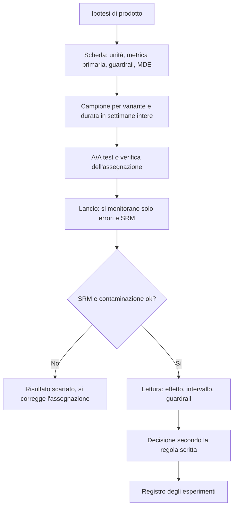

Nel 2012 un ingegnere di Bing propose di allungare i titoli degli annunci nella pagina dei risultati. L'idea restò ferma per più di sei mesi perché nessuno la riteneva prioritaria. Quando finalmente qualcuno la mise in un esperimento controllato, il ricavo crebbe del 12%, più di 100 milioni di dollari l'anno nei soli Stati Uniti, senza peggiorare le metriche di esperienza utente. Lo racconta Ron Kohavi, che guidava la piattaforma di sperimentazione di Microsoft, in un articolo su [Harvard Business Review](https://hbr.org/2017/09/the-surprising-power-of-online-experiments). La lezione di quel caso non è che ogni test trova cento milioni. È che l'intuizione del team, anche esperto, è un pessimo stimatore dell'effetto di una modifica, e che solo un esperimento ben costruito separa l'effetto dal rumore.

Per tutta la lezione seguiamo un esempio con numeri di esempio, cioè uno scenario costruito: FitLoop, un'app di allenamento in abbonamento. Il team di onboarding vuole sostituire il tutorial a schermate con una checklist di tre azioni ("scegli un obiettivo", "programma il primo allenamento", "completa il primo allenamento"). Il product manager chiede all'analista: "Possiamo lanciarla in A/B test e sapere tra due settimane se funziona?".

> **Idea chiave:** un A/B test è una scommessa dichiarata in anticipo. Ipotesi, metrica primaria, guardrail, campione, durata e regola di decisione si scrivono prima del lancio; durante l'esperimento si controlla solo che la macchina funzioni, non chi sta vincendo.

## Perché la randomizzazione misura la causa

Un'analisi osservazionale confronta utenti che hanno scelto di fare qualcosa con utenti che non l'hanno fatto. Chi completa il tutorial è diverso da chi lo salta già prima di vederlo: più motivato, più spesso su iOS, più spesso arrivato da passaparola. Qualsiasi differenza di retention tra i due gruppi mescola l'effetto del tutorial con queste differenze preesistenti.

La randomizzazione rompe il legame. Se un generatore casuale decide chi vede la checklist, motivazione, piattaforma e canale si distribuiscono in media allo stesso modo nei due bracci. L'unica differenza sistematica rimasta è la modifica, quindi la differenza nella metrica, al netto del caso, è il suo effetto causale. Il "caso" è la parte che la statistica quantifica: con due gruppi finiti la differenza osservata oscilla anche quando l'effetto vero è zero, e l'intervallo di confidenza dice quanto.

Il prezzo da pagare è che l'esperimento risponde solo alla domanda per cui è stato disegnato. Misura l'effetto medio della checklist sugli utenti assegnati, nel periodo del test, con quella metrica. Non dice perché funziona, non dice se l'effetto dura un anno e non autorizza a cercare a posteriori altre domande nella stessa tabella. Per i casi in cui un test non è possibile (un cambio di prezzo imposto dal mercato, un lancio già avvenuto in un solo paese) servono i metodi della lezione sull'[inferenza causale osservazionale](/course/analisi-prodotto/inferenza-causale-osservazionale/).



## La scheda di esperimento

La scheda è un documento di una pagina, approvato prima che il codice arrivi in produzione. Contiene sette campi, e ognuno chiude una porta a un errore specifico.

L'**ipotesi** collega la modifica a un meccanismo e a una metrica: "Una checklist con tre azioni concrete riduce l'incertezza sul primo passo e aumenta la quota di nuovi utenti che completano tre allenamenti nei primi sette giorni". Un'ipotesi senza meccanismo ("la checklist è più bella") non permette di imparare niente quando il test fallisce.

L'**unità di randomizzazione** è l'entità che riceve la variante. Di solito è l'utente, identificato in modo stabile: se randomizzi per sessione, lo stesso utente vede le due versioni in giorni diversi e il confronto si inquina. Nei prodotti B2B l'unità corretta è spesso l'account, perché i colleghi si parlano. L'unità di analisi deve coincidere con quella di randomizzazione; quando non coincide (randomizzi utenti ma misuri il click-through per sessione) la varianza va calcolata con metodi specifici, trattati negli [esperimenti avanzati](/course/analisi-prodotto/esperimenti-avanzati/).

La **popolazione** dice chi entra nel test: qui i nuovi iscritti da app mobile, assegnati al momento della registrazione. Entra solo chi può vedere la modifica. Se la checklist comparisse in una schermata raggiunta dal 40% degli assegnati, analizzare tutti diluirebbe l'effetto: un +5 punti sui raggiunti diventa +2 punti sul totale, e il campione necessario cresce di circa $1/0{,}4^{2} = 6{,}25$ volte.

La **metrica primaria** è una sola, è quella su cui si decide, e deve essere sensibile in pochi giorni e legata al valore di lungo periodo. Per FitLoop è l'attivazione: quota di nuovi utenti con almeno tre allenamenti completati entro sette giorni dall'iscrizione, una metrica che nei dati storici predice la retention a 60 giorni.

I **guardrail** sono le metriche che non devono peggiorare oltre un margine dichiarato: cancellazioni dell'abbonamento entro sette giorni, crash dell'app, tempo di caricamento della schermata iniziale. Le metriche **secondarie** aiutano a capire il meccanismo (quante persone completano ogni voce della checklist) ma non decidono.

Infine **MDE e regola di decisione**. Il Minimum Detectable Effect è il più piccolo effetto che vale la pena rilevare, perché sotto quella soglia la modifica non ripaga sviluppo e manutenzione. La regola traduce i possibili esiti in azioni prima di vederli.

| Campo | Valore per FitLoop | Errore che previene |
|---|---|---|
| Unità di randomizzazione | Utente, assegnato all'iscrizione | Stesso utente esposto a entrambe le varianti |
| Metrica primaria | Attivazione a 7 giorni, baseline 34% | Scegliere a posteriori la metrica che è uscita significativa |
| Guardrail | Cancellazioni a 7 giorni, margine +1 pp | Vincere sull'attivazione perdendo abbonati |
| MDE | +2 punti percentuali assoluti | Test infiniti per effetti irrilevanti |
| Alfa e potenza | 0,05 bilaterale, 80% | Falsi positivi e falsi negativi non controllati |
| Regola di decisione | Rilascio se limite inferiore dell'IC > 0 e guardrail entro margine | Decisioni negoziate dopo aver visto i numeri |

## Campione e durata: il calcolo che precede il lancio

Per una metrica binaria il campione per variante, con test bilaterale, si ottiene da:

$$
n = \frac{(z_{1-\alpha/2} + z_{1-\beta})^{2}\,\big[p_1(1-p_1) + p_2(1-p_2)\big]}{(p_2 - p_1)^{2}}
$$

dove $p_1$ è la baseline, $p_2 = p_1 + \text{MDE}$, $z_{1-\alpha/2} = 1{,}96$ per alfa 0,05 e $z_{1-\beta} = 0{,}84$ per potenza 80%. Una scorciatoia mentale utile è $n \approx 16\,p(1-p)/\delta^{2}$, dove 16 approssima $2\,(1{,}96+0{,}84)^{2} \approx 15{,}7$.

Calcoliamo il caso FitLoop passo per passo, con baseline 34% e MDE di +2 punti.

1. $p_1 = 0{,}34$ e $p_2 = 0{,}36$, quindi $\delta = 0{,}02$.
2. Varianza dei due bracci: $0{,}34 \times 0{,}66 + 0{,}36 \times 0{,}64 = 0{,}2244 + 0{,}2304 = 0{,}4548$.
3. Fattore z: $(1{,}96 + 0{,}8416)^{2} = 7{,}849$.
4. Numeratore: $7{,}849 \times 0{,}4548 = 3{,}5697$.
5. Campione per variante: $3{,}5697 / 0{,}0004 = 8.924$ utenti, quindi 17.848 in totale.

Con la scorciatoia otteniamo $16 \times 0{,}34 \times 0{,}66 / 0{,}0004 = 8.976$, a pochi utenti dal valore esatto. FitLoop registra in media 1.300 nuovi iscritti al giorno da app: $17.848 / 1.300 = 13{,}7$ giorni. La scheda fissa **14 giorni**, due settimane intere, perché chi si iscrive il sabato si comporta in modo diverso da chi si iscrive il martedì e un test di 10 giorni sovrapeserebbe alcuni giorni della settimana.

Il quadrato al denominatore è la cosa da ricordare. Dimezzare l'MDE quadruplica il campione: con MDE +1 punto servirebbero circa 35.000 utenti per variante e quasi otto settimane. Con MDE +4 punti ne bastano circa 2.260, meno di quattro giorni di traffico, ma la durata resta comunque di almeno una settimana intera. Se la direzione non può aspettare, la leva legittima è alzare l'MDE e accettare di vedere solo effetti grandi. Non è legittimo tenere l'MDE piccolo e fermarsi al primo risultato favorevole.

```python
# Campione per variante e durata per una metrica binaria
from math import ceil
from statistics import NormalDist

def campione_per_variante(p1, mde_assoluto, alfa=0.05, potenza=0.80):
    p2 = p1 + mde_assoluto
    z = NormalDist().inv_cdf(1 - alfa / 2) + NormalDist().inv_cdf(potenza)
    return z**2 * (p1 * (1 - p1) + p2 * (1 - p2)) / (p2 - p1) ** 2

def durata_giorni(n_variante, varianti, traffico_giornaliero):
    giorni = n_variante * varianti / traffico_giornaliero
    return ceil(giorni / 7) * 7  # settimane intere

for mde in (0.01, 0.02, 0.04):
    n = campione_per_variante(0.34, mde)
    print(f"MDE {mde:.0%}: {n:,.0f} per variante, {durata_giorni(n, 2, 1300)} giorni")
# MDE 1%: 35,469 per variante, 56 giorni
# MDE 2%: 8,924 per variante, 14 giorni
# MDE 4%: 2,257 per variante, 7 giorni
```

Due dettagli pratici. Se il test ha tre varianti invece di due, il traffico si divide in tre e la durata cresce del 50%, senza contare la correzione per confronti multipli. Se la metrica è continua (minuti di allenamento, ricavo per utente) la formula diventa $n = 2\,(z_{1-\alpha/2}+z_{1-\beta})^{2}\,\sigma^{2}/\delta^{2}$, dove $\sigma$ è la deviazione standard della metrica: ricavi molto asimmetrici hanno $\sigma$ grande e richiedono campioni enormi, ed è lì che conviene ridurre la varianza con CUPED.

## Integrità dell'esperimento: SRM, A/A e contaminazione

Prima di chiederti quale variante ha vinto devi verificare che l'esperimento sia stato eseguito come progettato. Il controllo principale è il **Sample Ratio Mismatch**: con un'assegnazione 50/50 i volumi nei due bracci devono essere compatibili con quel rapporto. Un gruppo di ricercatori di Microsoft e Booking.com ne ha pubblicato una tassonomia con regole pratiche di diagnosi ([Fabijan et al., KDD 2019](https://doi.org/10.1145/3292500.3330722)). Tra le cause tipiche ci sono redirect che perdono utenti in un solo braccio, bot filtrati in modo diverso, varianti che fanno crashare l'app prima che l'evento di esposizione venga registrato, utenti che cambiano braccio. In tutti questi casi i due gruppi non sono più confrontabili e la differenza nella metrica non è un effetto causale.

Il test è un chi quadro di bontà di adattamento con un grado di libertà. FitLoop ha raccolto in 14 giorni 18.200 utenti, quindi l'atteso è 9.100 per braccio. Osservati: 9.080 nel controllo e 9.120 nella variante.

$$
\chi^{2} = \frac{(9.080 - 9.100)^{2}}{9.100} + \frac{(9.120 - 9.100)^{2}}{9.100} = 0{,}044 + 0{,}044 = 0{,}088
$$

Il valore p è 0,77: nessun segnale di squilibrio. Se invece avessimo osservato 9.350 e 8.850, lo scarto di 250 per braccio avrebbe dato $\chi^{2} = 2 \times 250^{2}/9.100 = 13{,}7$ e un valore p di 0,0002. La soglia di allarme usata in pratica è molto severa, di solito $p < 0{,}001$, perché il controllo si ripete su ogni test e non deve generare falsi allarmi continui; 13,7 supera anche quella. Con un SRM il risultato non si legge, nemmeno "con cautela": si cerca la causa, la si corregge e si rilancia.

Il secondo controllo è l'**A/A test**: due bracci identici, stessa esperienza. Serve una volta, quando si introduce o si modifica la piattaforma, e verifica che circa il 5% delle metriche risulti significativo con alfa 0,05, non il 20%. Se ne escono troppe, la varianza è calcolata male, di solito perché l'unità di analisi non coincide con quella di randomizzazione.

Il terzo è la **contaminazione**: utenti che hanno visto entrambe le varianti, per esempio reinstallando l'app con un identificativo nuovo. La query seguente, su una tabella `assignments(experiment_id, user_id, variant, assigned_at)` e sullo schema eventi del modulo, calcola in un colpo volumi, contaminazione, metrica primaria e guardrail.

```sql
-- Volumi, contaminazione, attivazione a 7 giorni e cancellazioni a 7 giorni per variante
WITH prima_assegnazione AS (
    SELECT
        user_id,
        variant,
        assigned_at,
        ROW_NUMBER() OVER (PARTITION BY user_id ORDER BY assigned_at) AS rn
    FROM assignments
    WHERE experiment_id = 'onboarding_checklist'
),
varianti_per_utente AS (
    SELECT user_id, COUNT(DISTINCT variant) AS varianti_viste
    FROM assignments
    WHERE experiment_id = 'onboarding_checklist'
    GROUP BY user_id
),
assegnati AS (
    SELECT p.user_id, p.variant, p.assigned_at, v.varianti_viste
    FROM prima_assegnazione p
    JOIN varianti_per_utente v ON v.user_id = p.user_id
    WHERE p.rn = 1
),
per_utente AS (
    SELECT
        a.user_id,
        a.variant,
        a.varianti_viste,
        COUNT(CASE WHEN e.event_name = 'workout_completed' THEN 1 END)      AS allenamenti_7g,
        MAX(CASE WHEN e.event_name = 'subscription_cancelled' THEN 1 ELSE 0 END) AS cancellato_7g
    FROM assegnati a
    LEFT JOIN events e
        ON e.user_id = a.user_id
       AND e.event_time >= a.assigned_at
       AND e.event_time <  a.assigned_at + INTERVAL '7 days'
    GROUP BY a.user_id, a.variant, a.varianti_viste
)
SELECT
    variant,
    COUNT(*)                                                     AS utenti,
    SUM(CASE WHEN varianti_viste > 1 THEN 1 ELSE 0 END)          AS contaminati,
    ROUND(100.0 * AVG(CASE WHEN allenamenti_7g >= 3 THEN 1 ELSE 0 END), 2) AS attivazione_pct,
    ROUND(100.0 * AVG(cancellato_7g), 2)                         AS cancellazioni_pct
FROM per_utente
GROUP BY variant
ORDER BY variant;
```

Il `LEFT JOIN` conserva nel denominatore anche chi non ha generato eventi: escluderli gonfierebbe l'attivazione in entrambi i bracci e, se la variante cambia la probabilità di aprire l'app, creerebbe un bias. Gli utenti contaminati restano nel braccio di prima assegnazione (analisi intention-to-treat); se sono più dell'1-2% va capito perché.

## Leggere il risultato: effetto, intervallo, decisione

Superati i controlli, la tabella finale di FitLoop è questa.

| Braccio | Utenti | Attivati | Attivazione | Cancellazioni a 7 giorni |
|---|---:|---:|---:|---:|
| Controllo (tutorial) | 9.080 | 3.087 | 34,00% | 372 (4,10%) |
| Variante (checklist) | 9.120 | 3.265 | 35,80% | 392 (4,30%) |
| Differenza | | | +1,80 pp | +0,20 pp |

La lettura procede in quattro passaggi, sempre nello stesso ordine.

1. **Stima puntuale.** $35{,}80\% - 34{,}00\% = +1{,}80$ punti, cioè $+1{,}80 / 34{,}00 = +5{,}3\%$ relativo.
2. **Errore standard e intervallo.** $SE = \sqrt{0{,}34 \times 0{,}66 / 9.080 + 0{,}358 \times 0{,}642 / 9.120} = 0{,}00707$. L'intervallo al 95% è $1{,}80 \pm 1{,}96 \times 0{,}707$, cioè **da +0,42 a +3,19 punti**.
3. **Test.** Con l'errore standard sotto l'ipotesi nulla (proporzione aggregata 34,90%) si ottiene $z = 0{,}0180/0{,}00707 = 2{,}55$ e un valore p bilaterale di 0,011.
4. **Guardrail.** Le cancellazioni salgono di 0,20 punti con intervallo da $-0{,}38$ a $+0{,}78$ punti. Il limite superiore resta sotto il margine di +1 punto dichiarato nella scheda: il peggioramento massimo compatibile con i dati è accettabile.

La regola scritta prima del lancio dice di rilasciare se il limite inferiore dell'intervallo è sopra zero e il guardrail è entro il margine: entrambe le condizioni sono vere, quindi si rilascia. Il valore p da solo non basta a decidere, perché dice solo quanto il risultato sarebbe sorprendente se l'effetto fosse nullo. L'intervallo è più utile: dice che l'effetto plausibile va da quasi mezzo punto a più di tre punti. Se il team avesse stimato che la checklist ripaga i costi solo sopra un punto, la decisione sarebbe meno netta, perché una parte dell'intervallo cade sotto quella soglia; in quel caso conviene dichiararlo nel memo invece di presentare +1,8 come certo.

Nota anche che la stima osservata, +1,80, è sotto l'MDE di +2 punti eppure è significativa. Non c'è contraddizione: l'MDE è l'effetto che il test rileva con probabilità 80%, non una soglia sotto cui i risultati non contano. Al contrario, quando un test con potenza bassa trova un effetto significativo, la stima tende a essere gonfiata, perché passa la soglia solo chi per caso è uscito grande. Per questo un "+18%" su un test sottodimensionato va quasi sempre ridimensionato.

| Esito | Cosa dicono i dati | Decisione tipica |
|---|---|---|
| IC tutto sopra zero, guardrail entro margine | Effetto positivo credibile | Rilascio, con stima e intervallo nel registro |
| IC che include zero, test con potenza adeguata | Effetto, se esiste, più piccolo dell'MDE | Si scarta o si tiene per ragioni non metriche, dichiarandolo |
| IC tutto sotto zero | La modifica peggiora la metrica | Si scarta e si documenta l'apprendimento |
| Guardrail oltre il margine | Vittoria locale con danno altrove | Nessun rilascio senza un nuovo disegno |
| SRM o contaminazione elevata | Esperimento non valido | Nessuna lettura, si corregge e si rilancia |

## Segmenti: test di interazione, non caccia al vincitore

Dopo il risultato aggregato arriva sempre la domanda: "Funziona meglio su iOS o su Android?". È una domanda legittima, a patto di farla nel modo giusto. Ecco i numeri di FitLoop per piattaforma.

| Piattaforma | Controllo | Variante | Differenza | Valore p |
|---|---:|---:|---:|---:|
| iOS | 1.650 / 4.540 = 36,34% | 1.790 / 4.560 = 39,25% | +2,91 pp | 0,004 |
| Android | 1.437 / 4.540 = 31,65% | 1.475 / 4.560 = 32,35% | +0,69 pp | 0,48 |

La lettura sbagliata è "funziona solo su iOS, rilasciamo solo lì". Il fatto che un segmento sia significativo e l'altro no non dimostra che gli effetti siano diversi: ogni segmento ha metà del campione e quindi molta meno potenza. La domanda corretta è se la **differenza tra le differenze** sia distinguibile da zero. Calcoliamola.

1. Differenza tra gli effetti: $2{,}91 - 0{,}69 = 2{,}22$ punti.
2. Errore standard: $\sqrt{1{,}016^{2} + 0{,}978^{2}} = 1{,}41$ punti, combinando gli errori dei due segmenti.
3. $z = 2{,}22 / 1{,}41 = 1{,}57$, valore p 0,12.

I dati non permettono di dire che l'effetto sia diverso tra piattaforme. La decisione resta il rilascio a tutti; l'ipotesi "su Android funziona meno" diventa, se interessa, l'ipotesi primaria di un prossimo test. Se avessi guardato dieci segmenti (paese, canale, dispositivo, fascia d'età) cercando quello significativo, la probabilità di trovarne almeno uno per caso sarebbe stata del 40%: $1 - 0{,}95^{10} = 0{,}40$. I segmenti dichiarati nella scheda prima del lancio sono confermativi; tutti gli altri sono esplorazione.

Un caso particolare merita attenzione: un effetto aggregato nullo che nasconde due effetti opposti, per esempio positivo sui nuovi utenti e negativo su chi torna dopo una pausa. Se esiste una ragione di prodotto per aspettarselo, il segmento va dichiarato in anticipo e il campione dimensionato per vederlo.

## Errori che invalidano il test

### Peeking: fermarsi al primo valore p sotto 0,05

Il sintomo è un team che apre la dashboard ogni mattina e ferma il test quando il valore p scende sotto 0,05. Ogni controllo è una nuova occasione per imbattersi in una fluttuazione favorevole: con cinque controlli equidistanti su un test in cui l'effetto vero è zero, la probabilità di dichiarare un vincitore sale dal 5% a circa il 14%, e con controlli quotidiani per un mese supera il 25%. La correzione è nascondere il valore p fino alla data di fine, oppure adottare fin dall'inizio un disegno sequenziale con soglie corrette per i controlli intermedi. Guardare i dati per sicurezza va bene: crash, SRM, guardrail gravi possono fermare un test in qualsiasi momento, perché fermarsi per un danno non gonfia i falsi positivi sulla metrica primaria.

### Cambiare metrica dopo aver visto i risultati

Il sintomo è una scheda che parla di attivazione e un report che celebra il tempo in app. Con venti metriche osservate, la probabilità che almeno una superi 0,05 per caso è del 64% ($1 - 0{,}95^{20}$). Formulare l'ipotesi dopo aver visto i dati (HARKing) trasforma un test confermativo in una pesca a strascico. La correzione è il registro: metrica primaria scritta prima, tutto il resto riportato come esplorazione da confermare.

### Test troppo brevi o lanciati su un periodo anomalo

Il sintomo è un test di cinque giorni durante una promozione. Oltre a non coprire una settimana intera, il periodo promozionale porta utenti diversi da quelli normali e l'effetto non si generalizza. Anche l'effetto novità, cioè la curiosità per qualcosa di nuovo che svanisce in pochi giorni, si confonde con l'effetto vero nei test corti. La durata minima è di una settimana intera, meglio due, e il periodo va scelto lontano da eventi eccezionali.

### Dichiarare "nessun effetto" con un test sottodimensionato

Il sintomo è un test con 800 utenti per braccio, un intervallo da $-4$ a $+6$ punti e la conclusione "la modifica non serve". L'assenza di evidenza non è evidenza di assenza: con quell'intervallo i dati sono compatibili sia con un danno sia con un grande beneficio. Il risultato corretto è "inconclusivo", e la potenza va calcolata prima, non giustificata dopo.

Quando il traffico è davvero poco, come in molti SaaS B2B con qualche centinaio di nuovi account al mese, un test sul dettaglio d'interfaccia non è praticabile. Le alternative sono testare solo modifiche ad alto impatto atteso, usare metriche più sensibili e vicine all'azione, ridurre la varianza con covariate pre-esperimento o ricorrere ai metodi osservazionali con le loro ipotesi esplicite.

## Domande di verifica

1. Un servizio ha baseline di conversione del 10% e vuoi rilevare +1 punto assoluto con alfa 0,05 e potenza 80%. Quanti utenti servono per variante con la scorciatoia, e quanti giorni con 2.000 utenti al giorno?

<details>
<summary>Mostra risposta</summary>

Con la scorciatoia $n \approx 16 \times 0{,}10 \times 0{,}90 / 0{,}01^{2} = 14.400$ utenti per variante, 28.800 in totale. Con 2.000 utenti al giorno servono 14,4 giorni, che si arrotondano a 21 giorni per coprire tre settimane intere. La formula esatta con $p_2 = 0{,}11$ dà circa 14.750 per variante, stesso ordine di grandezza.

</details>

2. Un test 50/50 riporta 5.200 utenti nel controllo e 4.800 nella variante. La variante converte il 12% in più. Che cosa fai?

<details>
<summary>Mostra risposta</summary>

Prima il controllo SRM: atteso 5.000 per braccio, $\chi^{2} = 2 \times 200^{2}/5.000 = 16$, valore p circa 0,00006. C'è un Sample Ratio Mismatch, quindi il +12% non è interpretabile: la variante potrebbe perdere proprio gli utenti meno propensi a convertire (per esempio per un crash su dispositivi lenti). Si cerca la causa, la si corregge e si rilancia il test.

</details>

3. La metrica primaria mostra +0,6 punti con intervallo al 95% da $-0{,}4$ a $+1{,}6$, in un test dimensionato per MDE +1 punto. Il tempo in app risulta significativo con p = 0,03. Quale conclusione riporti?

<details>
<summary>Mostra risposta</summary>

L'esito sulla metrica primaria è neutro: l'intervallo include lo zero, e il test aveva potenza adeguata per effetti da un punto in su, quindi un effetto grande è poco plausibile. Il tempo in app è una metrica secondaria osservata tra molte e non decide nulla. Nel registro il test risulta neutro; se l'ipotesi sul tempo in app è interessante diventa la metrica primaria di un nuovo esperimento.

</details>

4. Un collega nota che la checklist ha un effetto significativo solo tra gli utenti arrivati da TikTok, su dodici canali analizzati. Propone di mostrarla solo a loro. Che cosa obietti?

<details>
<summary>Mostra risposta</summary>

Con dodici segmenti la probabilità di trovarne almeno uno significativo per caso è $1 - 0{,}95^{12} = 46\%$. Il segmento non era dichiarato e manca un test di interazione che mostri un effetto diverso dagli altri canali. Il risultato è un'ipotesi da confermare con un nuovo test, dimensionato su quel segmento, non una base per una decisione.

</details>

5. Perché un team può fermare un test al terzo giorno per un aumento dei crash, ma non perché la variante "sta già vincendo"?

<details>
<summary>Mostra risposta</summary>

Fermarsi per un danno su un guardrail è una decisione di protezione: non produce un falso vincitore sulla metrica primaria e lo stop è previsto dalla scheda. Fermarsi quando la metrica primaria è favorevole sfrutta le fluttuazioni casuali dei primi giorni: ripetendo il controllo più volte, il tasso di falsi positivi sale ben oltre il 5% nominale. Se servono stop anticipati per efficacia, vanno pianificati con un disegno sequenziale e soglie corrette.

</details>
