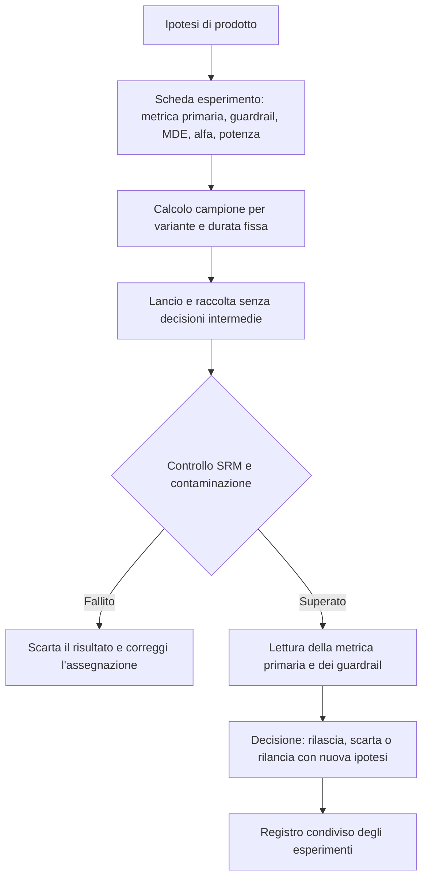

Un team di growth di un e-commerce B2B italiano apre la dashboard dell'esperimento ogni mattina. Al quarto giorno la variante con il nuovo pulsante di preventivo mostra `+18%` di clic rispetto al controllo e un valore p di `0,03`: il test viene fermato e la modifica rilasciata a tutti gli utenti (caso ricostruito, con numeri di esempio). Tre settimane dopo le richieste di preventivo completate non sono cresciute e i ticket al supporto sono aumentati.

Lo strumento di test non ha sbagliato nulla. Ha sbagliato il protocollo: il team ha guardato i dati troppo presto, ha scelto come obiettivo un clic intermedio e non ha mai calcolato quanti utenti servivano per distinguere un effetto reale dal rumore.

> **Idea chiave:** un A/B test è una scommessa dichiarata in anticipo. Campione, durata, metrica primaria e guardrail si scrivono prima del lancio e non si toccano mentre l'esperimento gira.

## Perché un test fermato presto illude

Il valore p di un test statistico è valido solo se il numero di osservazioni è deciso in anticipo. Se invece controlli i risultati ogni giorno e ti fermi alla prima occasione in cui scende sotto `0,05`, ogni controllo è una nuova possibilità di imbatterti in una fluttuazione favorevole. Con cinque controlli equidistanti la probabilità complessiva di dichiarare vincente una variante che in realtà non cambia nulla sale da `5%` a circa `14%`.

Nei primi giorni, poi, il campione è piccolo e le curve oscillano molto. Un `+18%` osservato su poche centinaia di utenti ha un intervallo di confidenza così largo da essere compatibile sia con un miglioramento forte sia con un peggioramento. La metrica che hai scelto, i clic sul pulsante, è inoltre un passaggio intermedio: un utente può cliccare per curiosità e abbandonare il modulo al secondo campo.



## La scheda di esperimento e i quattro parametri

Prima di scrivere una riga di codice il team compila una scheda condivisa con quattro numeri. La **baseline** è il valore attuale della metrica primaria, misurato su un periodo recente e stabile. Il **Minimum Detectable Effect** (MDE) è il miglioramento minimo che giustifica il costo di sviluppo e manutenzione della modifica: se un `+2%` relativo non cambia le decisioni, non ha senso progettare un test capace di rilevarlo. Il livello di significatività **alfa**, di norma `0,05`, fissa la probabilità accettata di un falso positivo. La **potenza**, di norma `0,80`, fissa la probabilità di accorgersi dell'effetto quando esiste davvero.

Accanto alla metrica primaria unica la scheda elenca i **guardrail**, cioè le metriche che non devono peggiorare: latenza della pagina, tasso di errore, ticket al supporto, rimborsi. Un guardrail non serve a vincere il test, serve a impedire che una vittoria locale danneggi il resto del prodotto. Infine la scheda dichiara la durata, che deve coprire cicli settimanali interi perché il comportamento del lunedì non è quello della domenica.

| Parametro | Cosa fissa | Valore tipico | Che cosa accade se lo ignori |
|---|---|---|---|
| Metrica primaria unica | L'unico indicatore su cui si decide | Richiesta di preventivo completata | Con molte metriche qualcuna risulta significativa per caso |
| Guardrail | Limiti oltre cui la vittoria non vale | Ticket per 1.000 utenti, latenza p95 | Una vittoria locale peggiora l'esperienza complessiva |
| MDE | Miglioramento minimo economicamente rilevante | `+10%` relativo | Test lunghissimi per effetti irrilevanti |
| Durata fissa | Finestra di raccolta in settimane intere | 14 o 28 giorni | Distorsioni da giorno della settimana |

## Dimensione del campione: derivazione con numeri

Per una metrica binaria come la conversione, una formula di uso comune con alfa `0,05` e potenza `0,80` stima gli utenti necessari per ciascuna variante:

$$
n \approx \frac{16\, p\,(1-p)}{\delta^{2}}
$$

dove $p$ è la baseline e $\delta$ la differenza assoluta che vuoi rilevare. Il fattore `16` è un'approssimazione di $2\,(1{,}96 + 0{,}84)^{2} \approx 15{,}7$.

Applichiamola al nostro e-commerce. Esempio numerico: la baseline di conversione in richiesta di preventivo è `4%`, l'MDE relativo è `+10%`, quindi la variante deve arrivare a `4,4%`. La differenza assoluta è $\delta = 4{,}4\% - 4{,}0\% = 0{,}4\ \text{pp} = 0{,}004$. Calcoliamo:

1. Numeratore: $16 \times 0{,}04 \times 0{,}96 = 0{,}6144$.
2. Denominatore: $0{,}004^{2} = 0{,}000016$.
3. Campione per variante: $0{,}6144 / 0{,}000016 = 38.400$ utenti.
4. Campione totale con due varianti: $2 \times 38.400 = 76.800$ utenti.

Il sito riceve `3.200` utenti unici al giorno nel flusso di preventivo. Durata minima: $76.800 / 3.200 = 24$ giorni. Poiché il test deve coprire settimane intere, la durata fissata sulla scheda è di `28` giorni, cioè quattro cicli settimanali completi. Se la direzione non può aspettare quattro settimane, la leva legittima è alzare l'MDE, per esempio a `+20%`: il campione per variante scende a circa un quarto, `9.600` utenti, perché $\delta$ compare al quadrato. Non è legittimo accorciare la durata mantenendo l'MDE e poi fermarsi al primo risultato favorevole.

Le stesse quantità si possono calcolare in Python, utile quando devi provare scenari diversi di baseline e MDE.

```python
# Campione per variante per una conversione binaria (alfa 0,05 bilaterale, potenza 0,80)
from statistics import NormalDist

def campione_per_variante(baseline, mde_relativo, alfa=0.05, potenza=0.80):
    p1 = baseline
    p2 = baseline * (1 + mde_relativo)
    z_alfa = NormalDist().inv_cdf(1 - alfa / 2)
    z_beta = NormalDist().inv_cdf(potenza)
    varianza = p1 * (1 - p1) + p2 * (1 - p2)
    return (z_alfa + z_beta) ** 2 * varianza / (p2 - p1) ** 2

print(round(campione_per_variante(0.04, 0.10)))  # circa 39.500 con la formula esatta
print(round(campione_per_variante(0.04, 0.20)))  # circa 10.300 con MDE a +20%
```

La formula esatta dà un valore leggermente più alto dell'approssimazione con il fattore `16`, perché tiene conto della varianza di entrambe le proporzioni. Usa la stima rapida per capire l'ordine di grandezza e la funzione per la scheda definitiva.

## Controllare l'integrità prima di guardare il vincitore

Prima di chiederti quale variante ha convertito di più, devi verificare che l'esperimento sia stato eseguito come progettato. Il controllo principale è il **Sample Ratio Mismatch** (SRM): se hai assegnato gli utenti al `50%` e `50%`, i volumi osservati devono essere compatibili con quel rapporto. Se non lo sono, c'è un difetto tecnico nell'assegnazione, per esempio un redirect lento che fa perdere utenti in una sola variante, un blocco di alcuni browser o un filtro dei bot applicato solo a metà del traffico.

Riprendiamo il test dei `76.800` utenti. Il rapporto atteso prevede `38.400` utenti per braccio. Supponi che le tabelle riportino `39.300` utenti nel controllo e `37.500` nella variante. Lo scarto di `900` utenti sembra piccolo, ma calcoliamo il chi quadro con un grado di libertà:

$$
\chi^{2} = \frac{(39.300-38.400)^{2}}{38.400} + \frac{(37.500-38.400)^{2}}{38.400} = 21{,}09 + 21{,}09 = 42{,}19
$$

La soglia critica al livello `0,001` è circa `10,83`: con `42,19` il valore p è inferiore a `0,0001`. Lo squilibrio non è dovuto al caso e qualsiasi confronto di conversione sui due gruppi è inaffidabile finché non trovi la causa. Con il campione ben bilanciato, invece, si passa alla lettura. Se nel braccio di controllo `1.536` utenti su `38.400` completano la richiesta (`4,00%`) e nella variante `1.690` su `38.400` (`4,40%`), la differenza è $154 / 38.400 = 0{,}40\ \text{pp}$. La proporzione aggregata è $3.226 / 76.800 = 4{,}20\%$, l'errore standard della differenza vale $\sqrt{0{,}0420 \times 0{,}9580 \times 2 / 38.400} \approx 0{,}00145$ e quindi $z \approx 0{,}0040 / 0{,}00145 = 2{,}77$, con valore p bilaterale di circa `0,006`. L'effetto è significativo e coincide con l'MDE progettato.

```sql
-- Controllo integrità: utenti unici per variante, contaminazioni e guardrail (ClickHouse)
WITH per_utente AS (
    SELECT
        user_id,
        uniqExact(variant) AS varianti_viste,
        any(variant) AS variante_assegnata,
        max(converted) AS ha_convertito,
        max(opened_support_ticket) AS ha_aperto_ticket
    FROM ab_test_events
    WHERE test_id = 'preventivo_v2'
      AND event_time >= '2026-10-01'
      AND event_time < '2026-10-29'
    GROUP BY user_id
)
SELECT
    variante_assegnata,
    count() AS utenti_unici,
    countIf(varianti_viste > 1) AS utenti_contaminati,
    round(avg(ha_convertito) * 100, 2) AS conversione_pct,
    round(avg(ha_aperto_ticket) * 100, 2) AS ticket_pct
FROM per_utente
GROUP BY variante_assegnata
ORDER BY variante_assegnata;
```

La colonna `utenti_contaminati` conta chi ha visto entrambe le varianti, per esempio passando da telefono a desktop con una sessione non collegata. Se la quota è trascurabile e i volumi sono coerenti con il disegno, la lettura procede. Il valore di `ticket_pct` è il guardrail: una conversione migliore accompagnata da più ticket va discussa, non festeggiata.

## Tre anti-pattern che invalidano il risultato

### Peeking continuo

Il sintomo è un team che commenta il test ogni mattina e lo ferma quando il valore p scende sotto `0,05`. Sembra ragionevole perché la dashboard mostra numeri aggiornati e aspettare pare uno spreco. Il costo nascosto è l'aumento dei falsi positivi descritto sopra. La correzione è doppia: nascondere il valore p fino alla data di fine oppure adottare fin dall'inizio un metodo sequenziale con soglie corrette per i controlli intermedi, dichiarando nella scheda quanti sono.

### Metric switching e HARKing

Il sintomo è una scheda che parla di conversione e un report che celebra il tempo sulla pagina. Quando la metrica primaria resta piatta, è naturale cercare nella tabella di risultati un altro indicatore significativo; con venti metriche, una supera `0,05` per puro caso con probabilità superiore al `60%` (circa $1 - 0{,}95^{20} = 64\%$). L'HARKing, cioè formulare l'ipotesi dopo aver visto i dati, trasforma un test confermativo in una pesca a strascico. La correzione è scrivere la metrica primaria nel registro prima del lancio e trattare tutto il resto come esplorazione da verificare con un nuovo test.

### Ignorare il costo dei test neutri

Il sintomo è la pressione a trovare comunque un vincitore. Un test neutro è un risultato valido: ti ha impedito di mantenere in produzione codice senza effetto. Un archivio condiviso, con ipotesi, campione, durata, esito sulla metrica primaria e stato dei guardrail, evita di ripetere dopo sei mesi un esperimento già fallito e diffonde conoscenza su che cosa funziona davvero per i tuoi utenti.

## Quando il traffico è poco: il caso B2B

Molti SaaS B2B ricevono qualche centinaio di nuovi account al mese. Con `400` account mensili e due varianti, il campione da `38.400` per braccio dell'esempio richiederebbe sedici anni. In questi contesti un A/B test classico su un dettaglio di interfaccia non è praticabile e bloccarlo per mesi paralizza il prodotto.

Le strade percorribili sono tre. Puoi testare solo cambiamenti ad alto impatto atteso, con MDE superiore al `30%`, sui flussi che concentrano più traffico. Puoi sostituire il test sul singolo elemento con un cambiamento più ampio, come un nuovo onboarding guidato, confrontato su coorti sequenziali ben documentate. Puoi infine combinare test di usabilità su cinque utenti, rilasci progressivi monitorati con guardrail e confronti pre-post su coorti omogenee, dichiarando che la prova è meno forte di un esperimento controllato. In ogni caso valgono le stesse regole: ipotesi scritta prima, metrica unica, durata fissa, registro condiviso.

## Verifica sul protocollo di test

1. Un servizio ha baseline di conversione del `10%` e vuoi rilevare un miglioramento relativo del `10%`. Con la formula rapida, quanti utenti servono per variante?

<details>
<summary>Mostra risposta</summary>

La variante deve arrivare all'`11%`, quindi $\delta = 0{,}01$. Il campione è $16 \times 0{,}10 \times 0{,}90 / 0{,}01^{2} = 1{,}44 / 0{,}0001 = 14.400$ utenti per variante, cioè `28.800` in totale.

</details>

2. Con `76.800` utenti totali necessari e `3.200` utenti al giorno, perché la scheda indica `28` giorni e non `24`?

<details>
<summary>Mostra risposta</summary>

La derivazione dà `24` giorni di traffico, ma il test deve coprire settimane intere per includere sia i giorni feriali sia il weekend. Il multiplo di sette giorni immediatamente superiore a `24` è `28`.

</details>

3. Un test 50/50 riporta `5.200` utenti nel controllo e `4.800` nella variante, su `10.000` totali. Si tratta di SRM?

<details>
<summary>Mostra risposta</summary>

L'atteso è `5.000` per braccio. Il chi quadro vale $(200^{2}/5.000) \times 2 = 8 + 8 = 16$, superiore alla soglia `10,83` del livello `0,001`. Sì, c'è un Sample Ratio Mismatch: il risultato non va letto finché non si trova il difetto di assegnazione.

</details>

4. La metrica primaria dichiarata resta piatta, ma il tempo sulla pagina risulta significativo con valore p `0,04`. Che cosa decidi?

<details>
<summary>Mostra risposta</summary>

L'esito sulla metrica primaria è neutro e questa è la conclusione del test. Il tempo sulla pagina era una delle molte metriche osservabili e la sua significatività può essere casuale. Registra il test come neutro e, se l'ipotesi ti sembra plausibile, progetta un nuovo esperimento con quella metrica come primaria.

</details>
