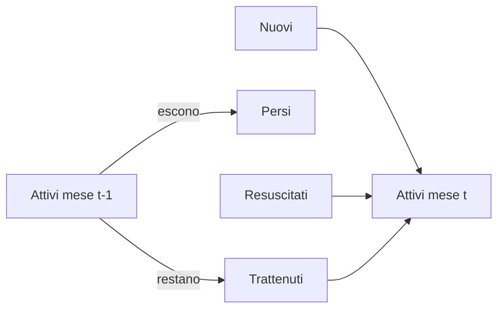

Un gestionale di fatturazione per piccole imprese chiude marzo con `11.880` utenti attivi mensili, il `15%` in più di febbraio (scenario costruito, con numeri di esempio). Il marketing festeggia la campagna di inizio mese. Ad aprile gli attivi scendono a `11.190` e nessuno sa spiegare perché, visto che la campagna era «andata benissimo». La risposta era già nei dati di marzo, ma il grafico degli utenti attivi la nascondeva: una linea sola somma flussi che vanno in direzioni opposte.

La curva di retention della lezione precedente segue una coorte di iscritti nel tempo. Qui servono tre strumenti complementari: il **growth accounting**, che scompone gli attivi di ogni mese in flussi in entrata e in uscita; la **coorte comportamentale**, che raggruppa gli utenti per ciò che hanno fatto e non per quando sono arrivati; la **matrice di transizione**, che segue gli utenti tra stati di intensità d'uso.

> **Idea chiave:** il numero di utenti attivi è un saldo, non un flusso. Per capire se un prodotto cresce davvero devi separare chi entra, chi resta, chi torna e chi se ne va, e confrontare le entrate con le uscite.

## Tre modi di raggruppare gli utenti

Una coorte è un gruppo di utenti che condividono una caratteristica fissata a un istante preciso e che segui nel tempo. Il tipo di caratteristica decide la domanda a cui la coorte risponde.

| Tipo di coorte | Criterio di ingresso | Domanda tipica | Rischio principale |
|---|---|---|---|
| Di acquisizione | Settimana o mese di iscrizione | La retention dei nuovi iscritti migliora dopo il rilascio di maggio? | Confondere un cambio di canale con un miglioramento del prodotto |
| Comportamentale | Azione compiuta, o soglia raggiunta, entro una finestra | Chi importa i clienti nella prima settimana resta di più? | Leggere una correlazione come una causa |
| Di attributo | Canale, piano, paese, piattaforma al momento dell'iscrizione | Gli utenti iOS trattengono meglio degli Android? | Segmenti piccoli e intervalli di confidenza larghi |
| Di stato | Stato d'uso in un mese (Core, Saltuario, Dormiente) | Quanti Saltuari diventano Core il mese dopo? | Soglie cambiate nel tempo che rendono le matrici non confrontabili |

Le prime tre si fissano una volta sola e non cambiano più: un utente iscritto a gennaio resta nella coorte di gennaio per sempre. La quarta è dinamica, perché lo stesso utente cambia stato da un mese all'altro, ed è proprio questo movimento che la matrice di transizione misura.

Ogni coorte richiede tre decisioni scritte prima di guardare i numeri: il criterio di ingresso, il momento zero da cui conti il tempo e la definizione di «attivo». Per un gestionale di fatturazione «attivo» significa aver emesso almeno una fattura o creato un report nel mese, non aver aperto l'app: un login senza azione di valore non dice nulla sul valore ricevuto.

## Growth accounting: quattro flussi dietro gli utenti attivi

Il growth accounting classifica ogni utente attivo nel mese $t$ in una e una sola categoria, confrontandolo con il mese $t-1$:

- **Nuovo**: attivo in $t$ e mai attivo prima. Il primo mese di attività, non il mese di iscrizione.
- **Trattenuto**: attivo in $t$ e attivo in $t-1$.
- **Resuscitato**: attivo in $t$, non attivo in $t-1$, ma attivo in almeno un mese precedente.
- **Perso**: attivo in $t-1$ e non attivo in $t$. Non compare tra gli attivi di $t$: si conta come flusso in uscita.

Da queste definizioni discende un'identità contabile che deve tornare ogni mese, al singolo utente:

$$
MAU_t = MAU_{t-1} + \text{nuovi}_t + \text{resuscitati}_t - \text{persi}_t
$$

e, in modo equivalente, $MAU_t = \text{trattenuti}_t + \text{nuovi}_t + \text{resuscitati}_t$. Se una delle due uguaglianze non torna, la classificazione ha un difetto (di solito utenti duplicati o mesi mancanti nel calendario) e nessun indicatore derivato va pubblicato.

Due rapporti riassumono la dinamica. Il **tasso di retention mese su mese** è $\text{trattenuti}_t / MAU_{t-1}$: la frazione degli attivi del mese scorso ancora attivi oggi. Il **quick ratio** confronta entrate e uscite:

$$
\text{Quick ratio}_t = \frac{\text{nuovi}_t + \text{resuscitati}_t}{\text{persi}_t}
$$

Sopra `1` gli attivi crescono, sotto `1` calano. Il nome e la formula vengono dalla pratica di due diligence di Social Capital, descritta da Jonathan Hsu nel 2015 in [Diligence at Social Capital, Part 1](https://medium.com/swlh/diligence-at-social-capital-part-1-accounting-for-user-growth-4a8a449fddfc). Nello stesso articolo Hsu osserva che per molte app consumer il quick ratio mensile resta poco sopra `1`, e che un valore stabile tra `1,5` e `2` è già molto buono per un prodotto consumer. Trattalo come un ordine di grandezza da un investitore, non come una soglia universale: un SaaS B2B con contratti annuali ha flussi diversi.



Il quick ratio ha un limite che conviene dichiarare: è un rapporto tra flussi e non dice nulla sulla dimensione. Un prodotto con `40` nuovi, `0` resuscitati e `20` persi ha quick ratio `2`, come un prodotto con `40.000` nuovi e `20.000` persi. Leggilo sempre accanto ai valori assoluti e al tasso di retention.

## Calcolo svolto: la campagna di marzo

Riprendiamo il gestionale dell'apertura. A gennaio gli attivi sono `10.000`. La tabella riporta i flussi dei tre mesi successivi.

| Mese | Nuovi | Trattenuti | Resuscitati | Persi | MAU | Retention MoM | Quick ratio |
|---|---:|---:|---:|---:|---:|---:|---:|
| Febbraio | 3.500 | 6.000 | 800 | 4.000 | 10.300 | 60,0% | 1,08 |
| Marzo | 5.000 | 6.180 | 700 | 4.120 | 11.880 | 60,0% | 1,38 |
| Aprile | 3.400 | 6.890 | 900 | 4.990 | 11.190 | 58,0% | 0,86 |

Verifichiamo l'identità passo per passo.

1. Febbraio: $10.000 + 3.500 + 800 - 4.000 = 10.300$. Controllo con l'altra forma: $6.000 + 3.500 + 800 = 10.300$. Il quick ratio è $(3.500 + 800) / 4.000 = 1{,}075$.
2. Marzo: $10.300 + 5.000 + 700 - 4.120 = 11.880$. I persi sono $10.300 - 6.180 = 4.120$, la retention è $6.180 / 10.300 = 60{,}0\%$, il quick ratio $(5.000 + 700) / 4.120 = 1{,}38$.
3. Aprile: $11.880 + 3.400 + 900 - 4.990 = 11.190$. La retention è $6.890 / 11.880 = 58{,}0\%$, il quick ratio $(3.400 + 900) / 4.990 = 0{,}86$.

La lettura cambia rispetto al grafico degli attivi. A marzo la crescita viene da `1.500` nuovi in più rispetto a febbraio: la retention degli utenti esistenti non si muove dal `60%`. Ad aprile la retention scende di due punti proprio perché la base ora contiene molti utenti arrivati con la campagna, che trattengono peggio. I nuovi tornano al livello normale, i persi salgono di `870` e il quick ratio va sotto `1`.

Per confermare l'ipotesi separi i trattenuti di aprile per mese del primo utilizzo. Supponi che dei `5.000` nuovi di marzo solo `2.400` siano ancora attivi ad aprile (`48%`), contro una retention dei restanti $6.880$ attivi di marzo pari a $(6.890 - 2.400) / 6.880 = 65{,}3\%$. La campagna ha portato utenti con una retention del primo mese di `17` punti inferiore.

La decisione non è «la campagna ha fallito». È più precisa: il costo per utente attivo della campagna va ricalcolato sugli utenti ancora attivi al secondo mese, non sugli iscritti, e il team di onboarding deve capire perché quel pubblico non arriva all'azione di valore. Senza la scomposizione, aprile sarebbe stato attribuito alla stagionalità.

## Growth accounting in SQL

Lo schema usato in tutto il modulo è `events(user_id, event_name, event_time, properties)`. La query definisce l'attività come almeno un evento di valore nel mese, costruisce una griglia utente per mese a partire dal primo mese di attività e confronta ogni mese con il precedente tramite `LAG`.

```sql
-- Growth accounting mensile: nuovi, trattenuti, resuscitati, persi, MAU, quick ratio
WITH attivita AS (
    SELECT DISTINCT user_id, DATE_TRUNC('month', event_time) AS mese
    FROM events
    WHERE event_name IN ('report_created', 'invoice_sent')   -- azioni di valore, non login
),
primo AS (
    SELECT user_id, MIN(mese) AS primo_mese
    FROM attivita
    GROUP BY user_id
),
mesi AS (
    -- calendario: usa una tabella di date se un mese può non avere eventi
    SELECT DISTINCT mese FROM attivita
),
griglia AS (
    SELECT p.user_id, m.mese, p.primo_mese,
           (a.user_id IS NOT NULL) AS attivo
    FROM primo AS p
    JOIN mesi AS m ON m.mese >= p.primo_mese
    LEFT JOIN attivita AS a ON a.user_id = p.user_id AND a.mese = m.mese
),
stati AS (
    SELECT g.*,
           LAG(attivo) OVER (PARTITION BY user_id ORDER BY mese) AS attivo_prima
    FROM griglia AS g
),
conti AS (
    SELECT mese,
           SUM(CASE WHEN attivo AND mese = primo_mese THEN 1 ELSE 0 END) AS nuovi,
           SUM(CASE WHEN attivo AND attivo_prima THEN 1 ELSE 0 END)      AS trattenuti,
           SUM(CASE WHEN attivo AND NOT attivo_prima THEN 1 ELSE 0 END)  AS resuscitati,
           SUM(CASE WHEN NOT attivo AND attivo_prima THEN 1 ELSE 0 END)  AS persi,
           SUM(CASE WHEN attivo THEN 1 ELSE 0 END)                       AS mau
    FROM stati
    GROUP BY mese
)
SELECT mese, nuovi, trattenuti, resuscitati, persi, mau,
       ROUND((nuovi + resuscitati) * 1.0 / NULLIF(persi, 0), 2) AS quick_ratio
FROM conti
ORDER BY mese;
```

Tre dettagli rendono la query corretta. Nel primo mese di un utente `attivo_prima` è `NULL`, quindi le condizioni su trattenuti, resuscitati e persi risultano false e l'utente conta solo come nuovo. La griglia parte dal primo mese di attività, così un iscritto che non ha mai compiuto un'azione di valore non entra mai nei persi. `NULLIF` evita la divisione per zero nel primo mese, quando non ci sono persi.

Il controllo da automatizzare è l'identità: per ogni mese, `mau` deve essere uguale a `nuovi + trattenuti + resuscitati`, e la differenza tra `mau` e il `mau` del mese precedente deve essere uguale a `nuovi + resuscitati - persi`. Se la tabella dei mesi salta un mese, `LAG` confronta mesi non consecutivi e l'identità si rompe: è il motivo per cui in produzione si usa un calendario completo.

La stessa scomposizione si applica ai ricavi (nuovo MRR, espansione, contrazione, churn), come vedrai nella [lezione sulla monetization](/course/analisi-prodotto/monetization-analytics/).

## Coorti comportamentali senza bias di sopravvivenza

Una coorte comportamentale si definisce con tre elementi fissati per iscritto:

1. **Azione o soglia**: per esempio «ha importato l'anagrafica clienti» oppure «ha emesso almeno `3` fatture».
2. **Finestra**: l'intervallo dall'iscrizione in cui l'azione conta, per esempio i giorni da `0` a `7`.
3. **Denominatore**: tutti gli iscritti validi del periodo, inclusi quelli che l'azione non l'hanno compiuta.

Esiste però un errore che produce differenze enormi e false: il **bias del tempo immortale** (in inglese *immortal time bias*, noto in epidemiologia). Se misuri la retention a 30 giorni di chi ha usato l'export entro 30 giorni, chi ha abbandonato il terzo giorno non ha mai avuto la possibilità di usarlo e finisce per forza nel gruppo «senza export». Il gruppo «con export» è composto da sopravvissuti per costruzione.

### Calcolo svolto: export e retention

In un mese si iscrivono `1.000` aziende (numeri di esempio). Il confronto ingenuo dà questo quadro:

| Definizione | Utenti con export | Retention settimana 4 | Utenti senza export | Retention settimana 4 | Divario |
|---|---:|---:|---:|---:|---:|
| Export entro 30 giorni, retention al giorno 30 | 300 | 70% | 700 | 35% | 35 punti |
| Export entro 7 giorni, solo attivi dopo il giorno 7, retention giorni 22–28 | 180 | 61% | 440 | 44% | 17 punti |

La seconda riga corregge il bias in due passi. Prima chiude la finestra dell'azione al giorno `7` e misura l'esito dopo, nei giorni da `22` a `28`, così l'azione precede sempre l'esito. Poi limita il confronto agli utenti ancora attivi dopo il giorno `7` (`620` su `1.000`), perché solo loro avevano un futuro da misurare.

Il divario passa da `35` a `17` punti: metà della differenza era un artefatto della definizione. I `17` punti restanti sono un'ipotesi seria ma ancora osservazionale, perché chi esporta presto può essere più motivato o avere un bisogno più urgente. La decisione corretta è un esperimento sull'onboarding che renda l'export più visibile a metà degli utenti, con la retention della settimana `4` come metrica primaria.

## Matrici di transizione tra stati d'uso

La retention divide gli utenti in attivi e persi. Una matrice di transizione usa più stati, **mutuamente esclusivi e collettivamente esaustivi**: ogni utente, ogni mese, sta in uno e un solo stato. Per il gestionale definiamo gli stati sul numero di azioni di valore nel mese: **Core** da `10` in su, **Saltuario** da `1` a `9`, **Dormiente** `0`, **Nuovo** per il primo mese.

La cella $(i, j)$ della matrice è la probabilità di passare dallo stato $i$ al mese $t$ allo stato $j$ al mese $t+1$:

$$
p_{ij} = \frac{\text{utenti in } i \text{ al mese } t \text{ e in } j \text{ al mese } t+1}{\text{utenti in } i \text{ al mese } t}
$$

Il denominatore è la riga, quindi ogni riga somma al `100%`.

| Stato al mese t | Core (t+1) | Saltuario (t+1) | Dormiente (t+1) |
|---|---:|---:|---:|
| Nuovo | 38% | 27% | 35% |
| Core | 82% | 13% | 5% |
| Saltuario | 24% | 46% | 30% |
| Dormiente | 6% | 9% | 85% |

La diagonale misura la persistenza: l'`82%` dei Core resta Core. Le celle fuori diagonale misurano il movimento. La cella Saltuario → Core (`24%`) misura quanto il prodotto crea abitudine; la cella Core → Saltuario (`13%`) misura l'erosione del valore. Se la seconda sale di tre o quattro punti per due mesi consecutivi, hai un segnale di erosione che il totale degli attivi nasconde.

### Proiezione al mese successivo

La base ha `1.000` account: Nuovo `200`, Core `300`, Saltuario `250`, Dormiente `250`. Per ogni stato di arrivo moltiplichi gli utenti di ciascuna riga per la probabilità della colonna e sommi.

- Core: $200 \times 0{,}38 + 300 \times 0{,}82 + 250 \times 0{,}24 + 250 \times 0{,}06 = 76 + 246 + 60 + 15 = 397$.
- Saltuario: $200 \times 0{,}27 + 300 \times 0{,}13 + 250 \times 0{,}46 + 250 \times 0{,}09 = 54 + 39 + 115 + 22{,}5 = 230{,}5$.
- Dormiente: $200 \times 0{,}35 + 300 \times 0{,}05 + 250 \times 0{,}30 + 250 \times 0{,}85 = 70 + 15 + 75 + 212{,}5 = 372{,}5$.

Il controllo $397 + 230{,}5 + 372{,}5 = 1.000$ conferma che nessuno è sparito. I valori frazionari sono attese, non persone. Senza i `200` Nuovi i Core sarebbero $246 + 60 + 15 = 321$: la differenza tra `397` e `321` è crescita comprata con l'acquisizione, la stessa lezione del growth accounting vista da un'altra angolazione.

Dove conviene intervenire? Una campagna che sposta `5` punti dalla riga Saltuario alla colonna Core porta $250 \times 0{,}05 = 12{,}5$ Core in più al mese. La stessa spinta sulla riga Dormiente, dove la base di ritorno è solo il `6%`, costa di più per utente raggiunto e parte da utenti che hanno già smesso di trovare valore. Di solito la leva migliore sta nella riga Saltuario.

## Costruire la matrice in Python

La query SQL produce lo stato mensile per utente; Python ricostruisce i mesi senza eventi come Dormienti e conta le transizioni. L'esempio usa un file con le colonne `user_id`, `mese`, `azioni`, ottenuto contando le azioni di valore per utente e mese.

```python
import pandas as pd

conti = pd.read_csv("azioni_mensili.csv", parse_dates=["mese"])  # user_id, mese, azioni

# Griglia completa utente x mese dal primo mese di attività: i mesi senza eventi valgono 0 azioni
mesi = pd.date_range(conti["mese"].min(), conti["mese"].max(), freq="MS")
primo = conti.groupby("user_id")["mese"].min().rename("primo_mese")
griglia = (pd.MultiIndex.from_product([conti["user_id"].unique(), mesi], names=["user_id", "mese"])
           .to_frame(index=False)
           .merge(primo, on="user_id"))
griglia = griglia[griglia["mese"] >= griglia["primo_mese"]]
completo = griglia.merge(conti, on=["user_id", "mese"], how="left").fillna({"azioni": 0})

def stato(riga):
    if riga["mese"] == riga["primo_mese"]:
        return "Nuovo"
    if riga["azioni"] >= 10:
        return "Core"
    return "Saltuario" if riga["azioni"] >= 1 else "Dormiente"

completo["stato"] = completo.apply(stato, axis=1)
completo = completo.sort_values(["user_id", "mese"])
completo["stato_dopo"] = completo.groupby("user_id")["stato"].shift(-1)
transizioni = completo.dropna(subset=["stato_dopo"])

matrice = pd.crosstab(transizioni["stato"], transizioni["stato_dopo"], normalize="index")
print((matrice * 100).round(1))
assert (matrice.sum(axis=1).round(6) == 1).all(), "una riga non somma al 100%"
```

L'`assert` finale è il controllo di qualità: se una riga non somma a uno, gli stati non sono esaustivi o ci sono utenti duplicati, e la matrice non va usata. Le soglie (`10` azioni per Core) vanno scelte guardando la distribuzione delle azioni per utente, dove la curva cambia pendenza, e poi congelate per almeno due trimestri, altrimenti le matrici di periodi diversi non sono confrontabili. Se il ciclo d'uso naturale è trimestrale, come per una dichiarazione IVA, costruisci gli stati su finestre trimestrali: con finestre mensili quasi tutti apparirebbero Dormienti per due mesi su tre.

## Errori frequenti nella lettura delle coorti

### Sommare coorti immature

Il sintomo è una retention a 90 giorni che sembra peggiorare negli ultimi mesi. Succede perché le coorti recenti non hanno ancora 90 giorni di storia e contano come «non trattenuti» utenti che semplicemente non hanno avuto tempo. Si evita filtrando le sole coorti mature, cioè quelle con almeno 90 giorni di osservazione, e mostrando le celle immature come vuote, non come zero.

### Concentrare il budget sui Dormienti

Il sintomo è un CRM che spende quasi tutto per riattivare chi non usa più il prodotto. La matrice spiega perché rende poco: dalla riga Dormiente solo il `6%` torna Core. Si evita misurando il costo per Core recuperato per ciascuna riga di partenza e allocando il budget dove quel costo è minore, di solito sui Saltuari.

### Confondere stagionalità e abbandono

Il sintomo è un churn «alto» in settori come turismo, logistica o consulenza fiscale, dove pause di 60 o 90 giorni sono normali. Trattare quei Dormienti come persi gonfia i persi nel growth accounting e attribuisce alle campagne ritorni che appartengono al calendario del cliente. Si evita confrontando ogni mese con lo stesso mese dell'anno precedente e separando i resuscitati attesi per stagionalità da quelli generati da un intervento.

## Domande di verifica sulle coorti

1. Un prodotto ha `20.000` attivi a maggio. A giugno registri `4.000` nuovi, `1.000` resuscitati e `13.000` trattenuti. Quanti sono gli attivi di giugno, i persi e il quick ratio?

<details>
<summary>Mostra risposta</summary>

Gli attivi di giugno sono $13.000 + 4.000 + 1.000 = 18.000$. I persi sono $20.000 - 13.000 = 7.000$. Il quick ratio è $(4.000 + 1.000) / 7.000 = 0{,}71$: le uscite superano le entrate e la base si riduce di `2.000` utenti, coerente con $20.000 + 5.000 - 7.000 = 18.000$.

</details>

2. Due prodotti hanno entrambi quick ratio `1,5`. Il primo ha `30.000` nuovi e `20.000` persi al mese, il secondo `3.000` nuovi e `2.000` persi su una base simile di `50.000` attivi. Quale è più sano?

<details>
<summary>Mostra risposta</summary>

Il secondo. Con la stessa base, il primo perde il `40%` degli attivi ogni mese e li sostituisce con acquisizione continua, che costa e prima o poi satura il mercato. Il secondo perde il `4%`. Il quick ratio da solo non distingue i due casi: va letto con il tasso di retention e i flussi assoluti.

</details>

3. Un collega mostra che chi usa la funzione «promemoria di pagamento» nei primi 30 giorni ha una retention a 30 giorni doppia. Quale controllo chiedi prima di credere al risultato?

<details>
<summary>Mostra risposta</summary>

Chiedi di separare la finestra dell'azione da quella dell'esito e di limitare il confronto a chi era ancora attivo alla fine della finestra dell'azione. Per esempio: azione nei giorni da 0 a 7, solo utenti attivi dopo il giorno 7, esito nei giorni da 22 a 28. Così elimini il bias del tempo immortale. Anche dopo, il risultato resta un'ipotesi da testare con un esperimento.

</details>

4. In una matrice di transizione la riga Saltuario somma al `93%`. Che cosa è successo e che cosa fai?

<details>
<summary>Mostra risposta</summary>

Una parte degli utenti è uscita dalla griglia: di solito mesi senza eventi non ricostruiti come Dormienti, oppure uno stato non previsto (per esempio account cancellati). Prima di interpretare la matrice completi la griglia utente per mese o aggiungi uno stato esplicito «Cancellato», finché ogni riga somma al `100%`.

</details>

5. Con la matrice della lezione, una base di `400` Core e `600` Saltuari senza nuovi ingressi: quanti Core ti aspetti il mese dopo?

<details>
<summary>Mostra risposta</summary>

$400 \times 0{,}82 + 600 \times 0{,}24 = 328 + 144 = 472$ Core. I Saltuari promossi contribuiscono per il `30,5%` del totale, a conferma che la riga Saltuario è la leva principale.

</details>
