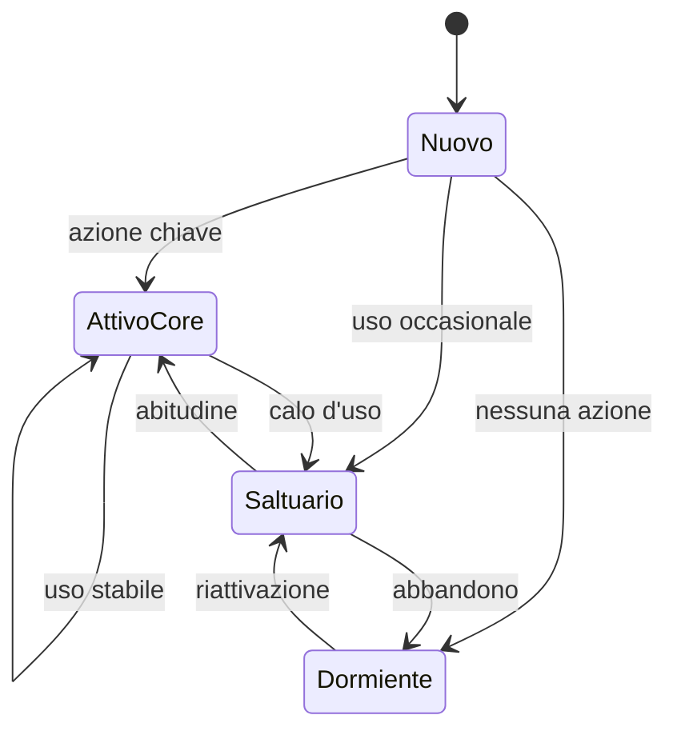

Due aziende si iscrivono lo stesso giorno a un software gestionale B2B, con lo stesso piano tariffario e nello stesso settore. A novanta giorni una è diventata un cliente fedele e l'altra ha disdetto (scenario costruito, con numeri di esempio). Raggruppare per mese di iscrizione o per dimensione aziendale non spiega la differenza: a separarle sono le azioni compiute nei primi sette giorni, per esempio importare l'anagrafica clienti e invitare un collega.

Una coorte temporale mette insieme chi condivide la data di ingresso. Una coorte comportamentale raggruppa chi ha compiuto una certa azione, o raggiunto una soglia d'uso, entro una finestra definita. La matrice di transizione aggiunge il tempo: mostra come gli utenti si spostano tra stati di coinvolgimento da un mese al successivo.

> **Idea chiave:** la retention classica divide gli utenti in attivi e persi; la matrice di transizione li tiene tutti, mese dopo mese, e mostra da dove nasce davvero l'erosione.

## Dalla coorte temporale alla coorte comportamentale

I tratti demografici spiegano di rado perché un prodotto viene adottato. Le azioni precoci rivelano invece dove sta il valore: chi compie l'azione chiave nelle prime ore ha usato il prodotto per ciò che sa fare. Una coorte comportamentale si definisce con tre elementi dichiarati per iscritto: l'azione (o la soglia di utilizzo), la finestra temporale dall'iscrizione e il denominatore, cioè tutti gli iscritti validi di quel periodo, anche quelli che non l'hanno compiuta.

Il denominatore va fissato al momento zero e non cambia. Se a gennaio si iscrivono `500` aziende e `140` invitano un collega entro sette giorni, la coorte «invitanti» pesa `28%` degli iscritti. Le altre `360` formano la coorte di confronto: omettere i non invitanti dal confronto toglie il termine di paragone e rende ogni retention apparentemente brillante.

La curva classica di retention tratta l'utente in modo binario: o è attivo nel periodo N oppure è perso. Per vedere i movimenti reali servono stati mutuamente esclusivi e collettivamente esaustivi, tali che ogni utente, in ogni mese, stia in uno e un solo stato.



## Definire gli stati e leggere la matrice

Gli stati dell'esempio si basano sul numero di azioni di valore compiute in un mese. **Attivo Core** significa almeno `10` azioni, **Saltuario** da `1` a `9` azioni, **Dormiente** nessuna azione, **Nuovo** un account nel suo primo mese. Le soglie vanno congelate per almeno due trimestri: cambiarle ogni mese impedisce di confrontare le matrici nel tempo.

La matrice di transizione elenca, per ogni stato al mese T, la percentuale di utenti che finisce in ciascuno stato al mese T+1. Ogni riga somma al `100%`, perché gli utenti non spariscono: o restano, o scendono, o diventano dormienti.

| Stato al mese T | Core (T+1) | Saltuario (T+1) | Dormiente (T+1) | Lettura |
|---|---:|---:|---:|---|
| Nuovo | 38% | 27% | 35% | L'attivazione della prima settimana decide molto |
| Attivo Core | 82% | 13% | 5% | Base stabile, da proteggere ed espandere |
| Saltuario | 24% | 46% | 30% | La zona dove un intervento rende di più |
| Dormiente | 6% | 9% | 85% | Ritorni rari, spesso stagionali |

Le diagonali raccontano la persistenza: l'`82%` dei Core resta Core, l'`85%` dei Dormienti resta Dormiente. Le altre celle raccontano il movimento. Il passaggio da Saltuario a Core (`24%`) misura quanto il prodotto sa creare abitudine; il passaggio da Core a Saltuario (`13%`) misura quanto sta erodendo il valore. Se questa seconda cella cresce di tre o quattro punti per due mesi consecutivi, hai un segnale di erosione che il totale degli utenti attivi nasconde, perché i nuovi ingressi compensano le uscite.

## Proiettare la distribuzione degli utenti: calcolo svolto

Con la matrice puoi prevedere come si distribuiranno gli utenti al mese successivo. Esempio numerico: la base contiene `1.000` account, così distribuiti al mese T: Nuovo `200`, Core `300`, Saltuario `250`, Dormiente `250` (somma `1.000`). Per ogni stato di arrivo moltiplichi gli utenti di ciascuna riga per la probabilità di quella colonna e sommi.

- Core al mese T+1: $200 \times 0{,}38 + 300 \times 0{,}82 + 250 \times 0{,}24 + 250 \times 0{,}06 = 76 + 246 + 60 + 15 = 397$ account.
- Saltuario al mese T+1: $200 \times 0{,}27 + 300 \times 0{,}13 + 250 \times 0{,}46 + 250 \times 0{,}09 = 54 + 39 + 115 + 22{,}5 = 230{,}5$ account.
- Dormiente al mese T+1: $200 \times 0{,}35 + 300 \times 0{,}05 + 250 \times 0{,}30 + 250 \times 0{,}85 = 70 + 15 + 75 + 212{,}5 = 372{,}5$ account.

Controllo: $397 + 230{,}5 + 372{,}5 = 1.000$ account. I valori frazionari sono attese statistiche e non persone: indicano la dimensione media dei gruppi, non un conteggio esatto. Nel mese successivo i Core crescono da `300` a `397`, ma lo fanno anche grazie ai `200` Nuovi che entrano nel conteggio; senza nuovi ingressi, i Core sarebbero $300 \times 0{,}82 + 250 \times 0{,}24 + 250 \times 0{,}06 = 246 + 60 + 15 = 321$. È la differenza tra crescita apparente e crescita strutturale.

## Costruire gli stati in SQL e la matrice in Python

Il lavoro si divide in due passi. Il primo calcola lo stato mensile di ogni utente dal log degli eventi; il secondo, più comodo in Python, allinea i mesi consecutivi e conta le transizioni. Nel primo passo gli utenti senza alcuna azione in un mese non compaiono: lo stato Dormiente si ricostruisce dopo, a partire da un calendario completo.

```sql
-- Stato mensile per utente (ClickHouse): Core da 10 azioni in su, altrimenti Saltuario
SELECT
    user_id,
    toStartOfMonth(event_time) AS mese,
    count() AS azioni,
    if(count() >= 10, 'Core', 'Saltuario') AS stato
FROM product_events
WHERE event_name IN ('report_creato', 'fattura_emessa', 'collega_invitato')
GROUP BY user_id, mese
ORDER BY user_id, mese;
```

```python
# Matrice di transizione dalle righe (user_id, mese, stato) con Dormiente ricostruito
import pandas as pd

stati = pd.read_csv("stati_mensili.csv", parse_dates=["mese"])
mesi = pd.date_range(stati["mese"].min(), stati["mese"].max(), freq="MS")
utenti = stati["user_id"].unique()

# Griglia completa utente x mese: i mesi senza eventi diventano Dormiente
griglia = pd.MultiIndex.from_product([utenti, mesi], names=["user_id", "mese"])
completo = (stati.set_index(["user_id", "mese"])["stato"]
            .reindex(griglia, fill_value="Dormiente")
            .reset_index())

completo["stato_successivo"] = completo.groupby("user_id")["stato"].shift(-1)
transizioni = completo.dropna(subset=["stato_successivo"])

# Percentuali di riga: ogni riga deve sommare al 100%
matrice = pd.crosstab(transizioni["stato"], transizioni["stato_successivo"], normalize="index")
print((matrice * 100).round(1))
print(matrice.sum(axis=1))  # controllo: tutti uguali a 1,0
```

L'ultima riga dello script verifica che ogni riga sommi a uno. Se non succede, hai stati non esaustivi o utenti duplicati, e la matrice non va usata. Per un dataset con stato «Nuovo» servirebbe aggiungere una regola su `data_iscrizione`; qui l'abbiamo omessa per mantenere la griglia leggibile.

## Dal comportamento al margine atteso

Una volta note le transizioni, puoi stimare il margine atteso per stato di partenza. Supponi che un account Core generi `90 €` di margine lordo al mese, un Saltuario `30 €` e un Dormiente `0 €`. Calcoliamo il margine atteso nei prossimi due mesi per un account che oggi è Core e per uno che oggi è Saltuario.

Account Core. Distribuzione a T+1: Core `82%`, Saltuario `13%`, Dormiente `5%`. Margine del primo mese: $0{,}82 \times 90 + 0{,}13 \times 30 = 73{,}80 + 3{,}90 = 77{,}70$ €. Distribuzione a T+2: Core $0{,}82 \times 0{,}82 + 0{,}13 \times 0{,}24 + 0{,}05 \times 0{,}06 = 0{,}7066$, Saltuario $0{,}82 \times 0{,}13 + 0{,}13 \times 0{,}46 + 0{,}05 \times 0{,}09 = 0{,}1709$, Dormiente $0{,}1225$ (somma `1,0000`). Margine del secondo mese: $0{,}7066 \times 90 + 0{,}1709 \times 30 = 63{,}59 + 5{,}13 = 68{,}72$ €. Totale a due mesi: $77{,}70 + 68{,}72 = 146{,}42$ €.

Account Saltuario. Distribuzione a T+1: Core `24%`, Saltuario `46%`, Dormiente `30%`. Margine del primo mese: $0{,}24 \times 90 + 0{,}46 \times 30 = 21{,}60 + 13{,}80 = 35{,}40$ €. A T+2: Core $0{,}24 \times 0{,}82 + 0{,}46 \times 0{,}24 + 0{,}30 \times 0{,}06 = 0{,}3252$, Saltuario $0{,}24 \times 0{,}13 + 0{,}46 \times 0{,}46 + 0{,}30 \times 0{,}09 = 0{,}2698$, Dormiente $0{,}4050$ (somma `1,0000`). Margine del secondo mese: $0{,}3252 \times 90 + 0{,}2698 \times 30 = 29{,}27 + 8{,}09 = 37{,}36$ €. Totale a due mesi: $35{,}40 + 37{,}36 = 72{,}76$ €.

Il rapporto è $146{,}42 / 72{,}76 \approx 2{,}0$: già su due mesi un Core vale il doppio di un Saltuario. Questo cambia le decisioni di acquisizione, perché un canale che porta utenti capaci di raggiungere lo stato Core entro due settimane può permettersi un costo per acquisizione più alto, mentre un canale che genera molte registrazioni destinate a restare Dormienti va ridimensionato. Segmentare la matrice per canale o per dimensione cliente rende il confronto operativo: spesso la probabilità di entrare nello stato Core è molto diversa tra ricerca organica e annunci generici.

## Tre errori nella lettura delle coorti

### Scambiare la correlazione precoce per causalità

Il sintomo è la frase «chi invita un collega nella prima settimana resta quattro volte di più, quindi forziamo l'invito». Sembra ragionevole perché il divario è enorme. In realtà chi invita un collega è spesso già più motivato o ha un bisogno più urgente: la coorte comportamentale produce ipotesi, non prove. La correzione è un esperimento controllato sull'onboarding, con la metrica dichiarata in anticipo, che sposti l'azione e misuri l'effetto sulla retention.

### Concentrare il budget sui dormienti

Il sintomo è un CRM che spende quasi tutto per riattivare chi non usa più il software. La matrice spiega perché rende poco: dalla riga Dormiente solo il `6%` torna Core e il `9%` Saltuario. La leva migliore sta quasi sempre nella riga Saltuario, dove il `24%` passa a Core spontaneamente e una piccola spinta, come un report settimanale via email, sposta molti più utenti con meno sforzo.

### Ignorare ritorni stagionali e soglie mobili

Il sintomo è un churn «alto» in settori come logistica, turismo o consulenza fiscale, dove pause di sessanta o novanta giorni sono fisiologiche. Trattare quei Dormienti come persi distorce il Lifetime Value e attribuisce alle campagne ritorni che appartengono al calendario del cliente. Si corregge confrontando lo stesso mese dell'anno precedente e tenendo congelate le soglie degli stati, così le matrici di trimestri diversi restano confrontabili.

## Controllo sulla tua matrice

1. In una riga della matrice le percentuali sommano al `96%`. Che cosa può essere successo?

<details>
<summary>Mostra risposta</summary>

Gli stati non sono esaustivi o ci sono utenti che spariscono dalla griglia, per esempio account senza eventi non ricostruiti come Dormienti. La somma di ogni riga deve essere esattamente `100%`; prima di interpretare la matrice va corretta la costruzione degli stati.

</details>

2. Una base ha `400` account Core e `600` Saltuari. Quanti Core ti aspetti al mese successivo usando la matrice dell'esempio, senza nuovi ingressi?

<details>
<summary>Mostra risposta</summary>

Calcolo: $400 \times 0{,}82 + 600 \times 0{,}24 = 328 + 144 = 472$ account Core. Gli account Saltuari che diventano Core pesano per il `30%` del totale.

</details>

3. La quota Core verso Saltuario passa da `13%` a `16%` a `19%` in due mesi, mentre gli utenti attivi totali crescono. Che segnale è?

<details>
<summary>Mostra risposta</summary>

È un segnale precoce di erosione del valore: i nuovi ingressi coprono le uscite dai Core e nascondono il problema nel totale. Conviene indagare cause tecniche o di prodotto prima che aumentino le disdette e attivare un avviso di customer success sui Core che scendono.

</details>

4. Perché un +20% di retention nella coorte degli invitanti non basta per decidere di rendere obbligatorio l'invito?

<details>
<summary>Mostra risposta</summary>

Perché gli invitanti possono essere già più motivati: il confronto è osservazionale. Serve un esperimento controllato in cui l'invito sia incoraggiato in modo casuale, misurando retention e guardrail come ticket e tempo di setup.

</details>
