## ANALISI DI COORTE: LEGGERE IL TEMPO ATTRAVERSO I DATI

Una **coorte** è un gruppo di persone che condividono un evento comune in un determinato periodo di tempo — di solito la data in cui sono entrate nel sistema (registrazione, primo acquisto, installazione dell'app).

L'analisi di coorte è il metodo che ci permette di **seguire questi gruppi nel tempo** e capire come si comportano, quanto spendono, quanto restano. È il passaggio fondamentale da una visione statica ("quanti utenti abbiamo oggi") a una dinamica ("cosa succede a ogni generazione di utenti mese dopo mese").

## Perché le metriche aggregate mentono

La tentazione è guardare il fatturato totale, gli utenti attivi giornalieri, il tasso di conversione medio. Numeri comodi, facili da leggere, perfetti per una slide. Il problema è che **nascondono le dinamiche reali**.

Questi indicatori aggregati sono le cosiddette *vanity metrics*: mescolano il comportamento degli utenti fedeli da anni con quello di chi si è appena registrato. Non permettono di capire se una variazione dipende da un cambiamento nel prodotto, dalla stagionalità o semplicemente dal fatto che la base utenti sta invecchiando.

> **Esempio pratico:** il fatturato mensile cresce del 10%. Ottima notizia? Non necessariamente. Potrebbe essere che le nuove coorti spendono meno delle vecchie, ma il volume di nuove acquisizioni compensa. Stai crescendo oggi, ma stai costruendo un problema per domani.

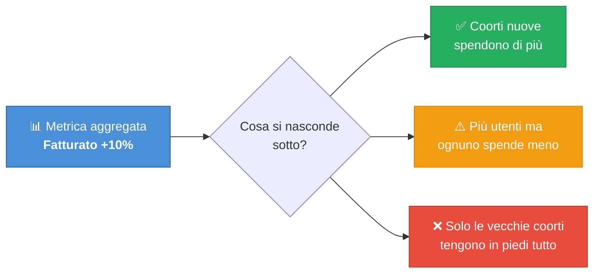

L'analisi di coorte risolve esattamente questo: **disaggrega il dato** e permette di confrontare mele con mele.

## Tipi di coorti

Non esiste un solo modo di definire una coorte. I tre principali sono:

**Coorti di acquisizione** — raggruppano gli utenti per il momento in cui sono entrati nel sistema. Sono le più comuni. Servono a capire se le campagne di marketing migliorano, se l'onboarding funziona, se la qualità degli utenti acquisiti cambia nel tempo. *Esempio: "tutti gli utenti registrati a maggio 2025".*

**Coorti comportamentali** — raggruppano per un'azione specifica, indipendentemente dalla data di registrazione. Sono fondamentali per capire quali comportamenti predicono la fedeltà a lungo termine. *Esempio: "utenti che hanno creato una playlist nella prima settimana".*

**Coorti demografiche** — raggruppano per caratteristiche statiche. *Esempio: "utenti tra i 25 e i 34 anni" oppure "utenti su dispositivi iOS".*

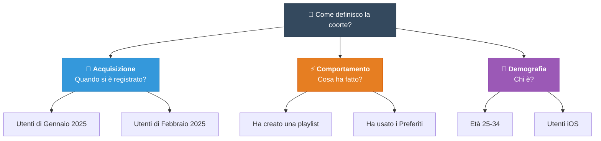

## La finestra di calcolo: confrontare mele con mele

Le coorti hanno "età" diverse. Una coorte acquisita nel 2020 ha avuto quattro anni per generare valore, una del 2024 solo pochi mesi. **Confrontare il ricavo totale delle due non ha senso.**

La soluzione è definire una **finestra di calcolo** fissa — 30, 90 o 365 giorni — e misurare le metriche solo entro quella finestra, a partire dal "tempo zero" di ciascun utente (il giorno della registrazione).

Una finestra annuale dà l'indicazione più accurata del valore a lungo termine, ma nel business digitale aspettare un anno per valutare una modifica è impraticabile. Per questo si usano finestre più brevi come proxy: se l'ARPU a 30 giorni è migliorato, probabilmente lo sarà anche a 365.

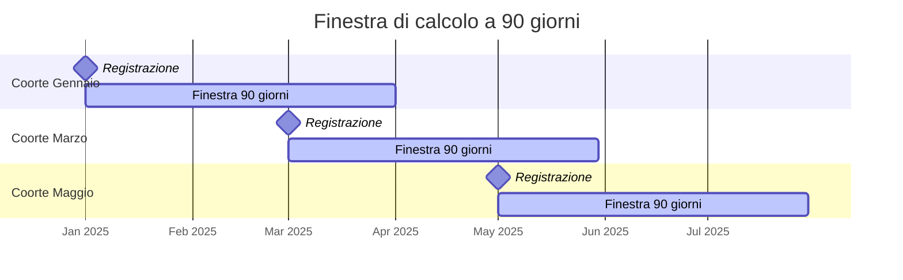

> **La regola d'oro:** per confrontare due coorti in modo equo, misura la stessa metrica nella stessa finestra temporale relativa. ARPU al giorno 30 della coorte A vs ARPU al giorno 30 della coorte B. Mai il totale cumulato assoluto.

## L'analogia dei due ristoranti

Per capire intuitivamente perché la finestra di calcolo è indispensabile, immaginiamo una situazione concreta.

Marco possiede due ristoranti nella stessa città. Il primo, **Trattoria Vecchia Posta**, è aperto da otto anni. Il secondo, **Bistrot Luce**, ha aperto diciotto mesi fa con un concept completamente nuovo: menù più snello, ingredienti locali, prenotazione solo via app.

A fine anno, Marco guarda i numeri e vede che la Trattoria Vecchia Posta ha fatturato 800.000€, mentre il Bistrot Luce ha fatturato 320.000€. La conclusione istintiva è che il vecchio format funziona meglio.

**Ma è un confronto sbagliato.** La Trattoria ha otto anni di clienti abituali, una reputazione consolidata, recensioni accumulate. Il Bistrot è partito da zero diciotto mesi fa.

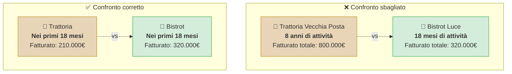

Il confronto corretto è un altro: **come andava la Trattoria nei suoi primi 18 mesi di vita?** Se Marco va a recuperare i vecchi registri, scopre che al diciottesimo mese la Trattoria fatturava 210.000€. Il Bistrot, alla stessa "età", ne fattura 320.000€.

Il nuovo format non solo funziona — **funziona molto meglio**, ma non si vedeva a causa dell'asimmetria temporale.

Questo è esattamente ciò che facciamo con l'analisi di coorte:
- **La Trattoria** rappresenta le coorti vecchie (gli early adopter). Hanno accumulato molto valore nel tempo, ma partivano con un prodotto meno raffinato.
- **Il Bistrot** rappresenta le coorti nuove. Hanno generato meno in assoluto perché sono giovani, ma usano un prodotto migliorato.

Per sapere se le nuove funzionalità funzionano, non confrontiamo il totale. **Confrontiamo l'ARPU alla stessa età relativa** — ad esempio al giorno 30 o al giorno 90.

## Il modello Età-Periodo-Coorte

Dietro la semplicità apparente dell'analisi di coorte si nasconde uno dei problemi statistici più affascinanti dei dati longitudinali. Capirlo bene è essenziale per non attribuire cause sbagliate agli effetti osservati.

### Le tre componenti

Quando una metrica cambia nel tempo — il tasso di abbandono, la spesa media — la variazione può dipendere da tre fattori:

**Effetto Età (α)** — variazioni legate all'"invecchiamento" dell'utente nel sistema. In un prodotto SaaS, il rischio di abbandono tende a diminuire con l'anzianità: chi è rimasto un anno probabilmente resterà anche il secondo (effetto lock-in).

**Effetto Periodo (β)** — eventi esterni che colpiscono tutti contemporaneamente: crisi economiche, stagionalità, il Black Friday, un'interruzione tecnica della piattaforma.

**Effetto Coorte (γ)** — caratteristiche intrinseche del gruppo di utenti entrati nello stesso momento: qualità del traffico di acquisizione, promozione di lancio, canale marketing.

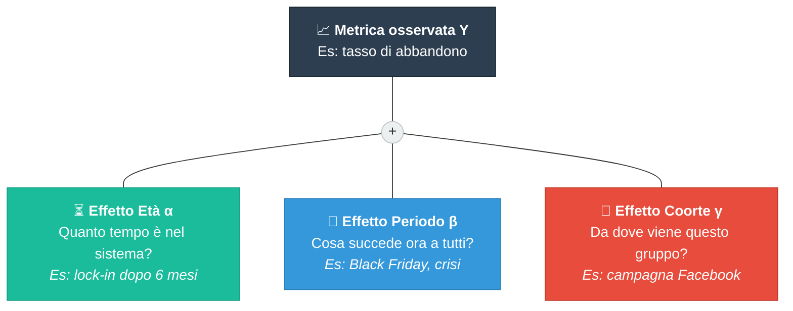

Il modello formale dice:

> **Y = μ + α(età) + β(periodo) + γ(coorte) + errore**

### Il problema dell'identificazione

Ecco la parte difficile. Le tre variabili non sono indipendenti. Esiste una relazione perfetta:

> **Coorte = Periodo − Età**

Se conosco l'anno in cui osservo il dato e l'anzianità dell'utente, so automaticamente quando si è registrato. Questa dipendenza lineare perfetta rende il modello **non identificabile**: esistono infinite combinazioni di coefficienti che spiegano ugualmente bene i dati. Non posso distinguere, dai soli dati, se un trend di crescita dipende dal miglioramento delle coorti (le nuove generazioni spendono di più) o da un effetto periodo che alza la spesa di tutti.

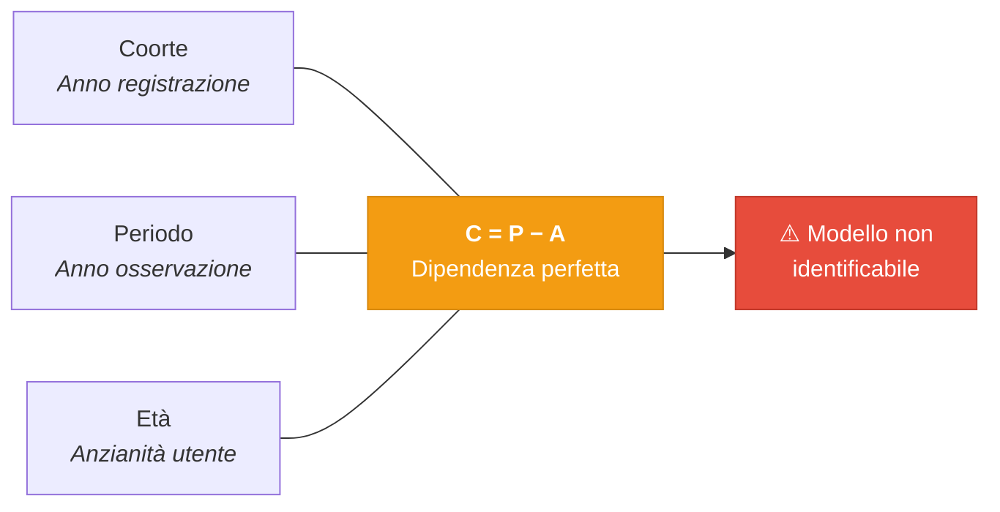

### Come si risolve nella pratica

**Vincoli esterni** — si assume che uno dei tre effetti sia nullo o noto. Se non ci sono stati eventi esterni rilevanti, si può porre l'effetto periodo a zero.

**Variabili proxy** — si sostituisce la variabile temporale con qualcosa di misurabile. Invece dell'anno di coorte generico, si usa il costo di acquisizione o il canale marketing. Questo "rompe" la dipendenza lineare.

**Analisi visiva delle curve** — nella pratica del Product Management, il metodo più usato è tracciare le curve ARPU-vs-Età per diverse coorti. Se le curve sono parallele ma traslate verticalmente, c'è un effetto coorte. Se mostrano picchi nello stesso momento di calendario, c'è un effetto periodo.

## Le metriche fondamentali

### ARPU e ARPPU

Due metriche da tenere sempre distinte:

**ARPU** (Average Revenue Per User) = Ricavo totale ÷ Numero totale di utenti. Include anche chi non paga. Misura il valore medio di un utente qualsiasi.

**ARPPU** (Average Revenue Per Paying User) = Ricavo totale ÷ Numero di utenti paganti. Isola il comportamento di spesa di chi acquista.

La relazione tra le due è:

> **ARPU = ARPPU × Tasso di Conversione**

Questa scomposizione è fondamentale per la diagnosi: se l'ARPU cala, può essere perché i paganti spendono meno (ARPPU in calo) oppure perché meno utenti decidono di pagare (conversione in calo). Due problemi diversi, due soluzioni diverse.

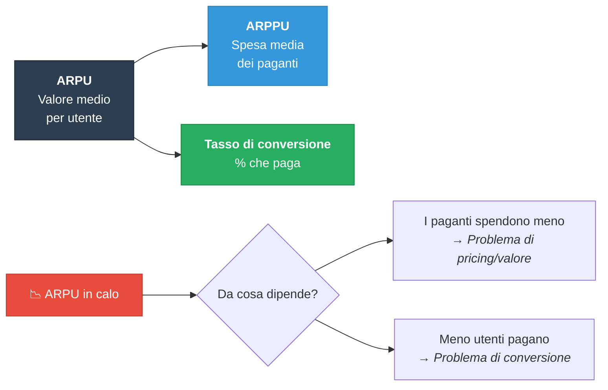

### Da dove viene la formula del Lifetime Value

Il Customer Lifetime Value (LTV) è il valore attuale netto dei profitti futuri di un cliente. Si vede spesso la formula **LTV = ARPU / Churn**, ma pochi sanno da dove arriva.

Assumiamo: tempo discreto, un margine *m* costante per periodo, un tasso di ritenzione *r* costante (quindi churn *c = 1−r*), e nessuno sconto finanziario per semplicità.

Il valore atteso è la somma di tutti i flussi futuri, ciascuno pesato per la probabilità che il cliente sia ancora attivo:

> **LTV = m × Σ r^t** (con t da 0 a infinito)

Questa è una serie geometrica. Converge se r < 1 (sempre vero per un tasso di ritenzione), e la somma è:

> **LTV = m / (1 − r) = m / c = ARPU / Churn**

**Attenzione:** questa formula assume un tasso di churn costante (modello esponenziale). Nella realtà, il churn tende a diminuire nel tempo — chi resta dopo i primi mesi è più fedele. Per modelli più accurati serve l'analisi di sopravvivenza.

### L'analisi di sopravvivenza

L'analisi di coorte è, formalmente, un caso di **analisi di sopravvivenza**. La variabile di interesse è il tempo fino all'abbandono.

La funzione chiave è la **funzione di sopravvivenza S(t)**: la probabilità che un utente sia ancora attivo dopo il tempo *t*. È in pratica la curva di ritenzione.

Il problema pratico è che molti utenti sono "censurati": sono ancora attivi alla fine dell'osservazione e non sappiamo quando abbandoneranno. Lo **stimatore di Kaplan-Meier** gestisce questo calcolando la sopravvivenza come prodotto di probabilità condizionate:

> **Ŝ(t) = Π (1 − dᵢ/nᵢ)** per ogni istante tᵢ ≤ t

dove *dᵢ* = abbandoni al tempo *tᵢ* e *nᵢ* = utenti a rischio appena prima.

La **funzione di rischio λ(t)** rappresenta il tasso istantaneo di abbandono. La sua forma dice molto sul prodotto:

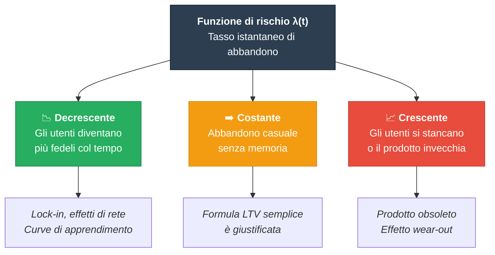

### Significatività statistica

Quando confrontiamo l'ARPU di due coorti, dobbiamo assicurarci che la differenza non sia dovuta al caso. Si usa tipicamente il **t-test di Student**.

La regola pratica più importante: **su campioni piccoli non si prendono decisioni.** Differenze enormi in percentuale su coorti di 10–20 utenti sono quasi sempre rumore statistico. Prima di trarre conclusioni, servono calcoli di dimensione campionaria e verifica degli intervalli di confidenza.

## Caso studio: l'algoritmo di prioritizzazione

Passiamo dalla teoria alla pratica. Abbiamo i dati di un'azienda digitale che vuole usare l'analisi di coorte per decidere dove allocare le risorse di sviluppo.

### Il metodo in quattro passi

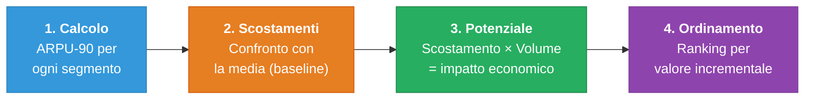

**Passo 1 — Calcolo.** Si calcola l'ARPU a 90 giorni per tutti i segmenti disponibili: piattaforme, uso delle funzionalità, demografia, comportamenti.

**Passo 2 — Scostamenti.** Si confronta l'ARPU di ogni segmento con la media generale (baseline) per individuare le deviazioni positive e negative.

**Passo 3 — Potenziale.** Si moltiplica lo scostamento per il volume del segmento. Questo è il passaggio chiave: un segmento con ARPU altissimo ma dieci utenti conta poco. Un segmento con ARPU leggermente sopra la media ma migliaia di utenti ha un potenziale enorme.

> **Potenziale = (ARPU segmento − ARPU non-segmento) × Volume target**

**Passo 4 — Ordinamento.** Si classificano i progetti per valore economico incrementale.

### I dati

Baseline: ARPU medio generale di **958 euroi** su 12.667 utenti.

| Segmento | Sottogruppo | Utenti | ARPU-90 | Scostamento |
|---|---|---:|---:|---:|
| Piattaforma | Web | 13.121 | 574 | −40% |
| Piattaforma | App iOS | 12.227 | 1.270 | +33% |
| Piattaforma | App Android | 7.329 | 1.000 | +4% |
| Feature | Preferiti (sì) | 1.920 | 1.134 | +18% |
| Feature | Preferiti (no) | 34.856 | 940 | −2% |
| Playlist | > 1 playlist | 1.225 | 1.570 | +64% |
| Playlist | 1 playlist | 8.040 | 1.078 | +13% |
| Playlist | 0 playlist | 23.102 | 671 | −30% |
| Sconto | 20% promo | 1.570 | 300 | −69% |
| Recensioni | Negative | 890 | 1.530 | +60% |
| Recensioni | Positive | 2.104 | 1.187 | +24% |
| Demografia | 25-34 anni | 5.306 | 1.430 | +49% |
| Demografia | < 18 anni | 15.760 | 782 | −18% |

### Le tre priorità strategiche

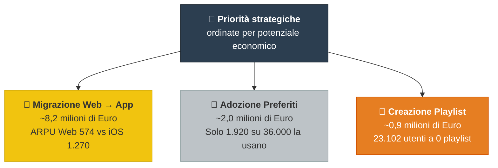

#### Priorità 1: Migrazione da Web ad App (~8,2 milioni di Euro)

Il divario è enorme: ARPU Web 574, ARPU iOS 1.270. Più del doppio. Spostare gli utenti dalla piattaforma web alle app mobili ha il potenziale economico più alto in assoluto.

Azioni possibili: banner mirati su mobile web che invitano a scaricare l'app, incentivi esclusivi per chi usa l'app, eventualmente ridurre le funzionalità web per spingere la migrazione.

#### Priorità 2: Adozione dei Preferiti (~2,0 milioni di Euro)

Chi usa i Preferiti ha un ARPU di 1.134, quasi il 20% in più della media. Ma solo 1.920 utenti su 36.000 la usano. Se anche solo il 30% dei non-utilizzatori adottasse la feature, il guadagno sarebbe massiccio.

Azioni: rendere il pulsante più visibile, aggiungere un tutorial al primo accesso, inviare notifiche mirate.

#### Priorità 3: Creazione di playlist (~0,9 milioni di Euro)

Passare da zero a una sola playlist genera un salto di ARPU da 671 a 1.078. Il segmento "0 playlist" è enorme: 23.102 utenti.

Azioni: gamification ("crea la tua prima playlist"), playlist suggerite pre-compilate e modificabili, prompt contestuali dopo l'ascolto.

### Due insight controintuitivi

#### Il paradosso delle recensioni negative

Gli utenti che lasciano recensioni negative hanno un ARPU di **1.530 Euro** — quasi il doppio della media e superiore a chi lascia recensioni positive (1.187). Sembra un paradosso, ma ha una spiegazione chiara: chi spende molto è anche più coinvolto emotivamente e più sensibile ai difetti.

Una recensione negativa da questo segmento non è un fastidio: **è una richiesta di aiuto dai clienti più preziosi.**

Ignorare queste segnalazioni è un errore finanziario grave. Un team di supporto dedicato e la risoluzione prioritaria dei bug segnalati da questo cluster possono avere un ROI altissimo in termini di ritenzione.

#### Il fallimento dello sconto

Il segmento "sconto 20% al primo acquisto" mostra un ARPU di **300 Euro**, quasi il 70% sotto la media. La promozione non sta fidelizzando: sta attirando cacciatori di occasioni che spendono il minimo e poi se ne vanno.

L'analisi di coorte qui è un campanello d'allarme: **la strategia di acquisizione basata sul prezzo sta distruggendo valore a lungo termine.**

## Gli errori da evitare

### Bias del sopravvissuto

Si verifica quando si calcolano le metriche solo sugli utenti ancora attivi alla fine del periodo, ignorando chi ha abbandonato. L'ARPU al mese 12 sembra altissimo — ma è perché tutti gli utenti con bassa spesa se ne sono andati prima. La coorte si è auto-selezionata.

**Correzione:** analizzare sempre l'ARPU insieme al tasso di ritenzione. Un ARPU in crescita con ritenzione in crollo è un segnale negativo. E calcolare l'ARPU sulla coorte iniziale (inclusi gli abbandoni) per avere il valore atteso reale.

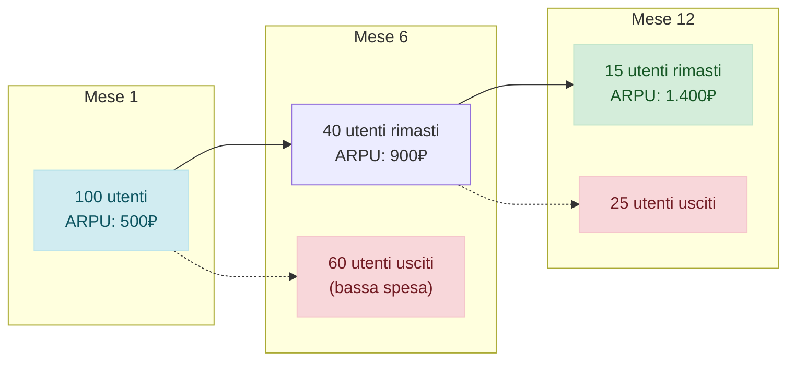

> **L'ARPU cresce, ma la base si sgretola.** Il dato isolato mente — servono entrambe le metriche.

### Correlazione non è causalità

Chi usa i Preferiti spende di più. Ma è la funzione a causare la spesa, o sono gli utenti alto-spendenti a essere naturalmente curiosi? Se la relazione è solo correlativa, investire milioni per forzare tutti a usare i Preferiti non cambierà nulla.

**Correzione:** un A/B test. Si prende una coorte di nuovi utenti, si disabilita la funzione per metà, e si confrontano i risultati. Solo così si può parlare di causalità.

### Campioni troppo piccoli

Differenze enormi in percentuale su coorti di 10–20 utenti sono quasi sempre rumore. Prima di trarre conclusioni, servono calcoli di dimensione campionaria e verifica degli intervalli di confidenza.

## Riepilogo

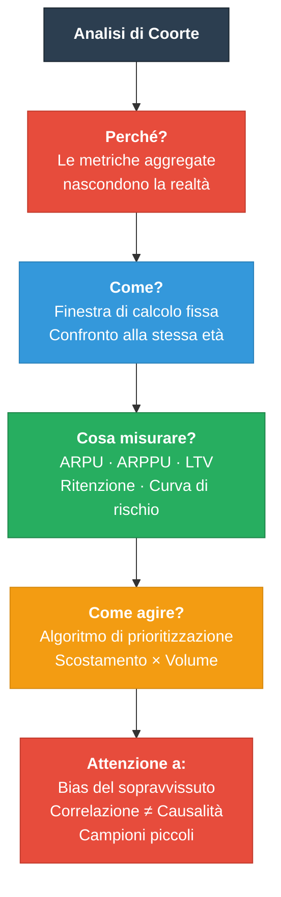

L'analisi di coorte permette di passare da una visione aggregata e statica a una disaggregata e longitudinale. Tre cose da portare a casa:

1. **Confronta alla stessa età** — come l'analogia dei due ristoranti ci insegna, solo misurando entità allo stesso stadio evolutivo si traggono inferenze valide.

2. **Usa gli strumenti giusti** — dal modello APC all'analisi di sopravvivenza, dalla serie geometrica del LTV allo stimatore di Kaplan-Meier, il rigore matematico protegge da conclusioni sbagliate.

3. **Trasforma i dati in decisioni** — l'algoritmo di prioritizzazione trasforma numeri grezzi in una roadmap operativa, identificando le leve di crescita con il potenziale economico più alto.

In un mercato competitivo, questa competenza non è più opzionale per chi gestisce un prodotto. È indispensabile.
