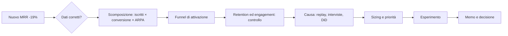

Agenda Pro è un software in abbonamento con cui parrucchieri, centri estetici e piccoli studi professionali ricevono prenotazioni online. Il modello è una prova gratuita di 30 giorni, poi un piano a pagamento intorno ai 32 euro al mese per studio. A fine settembre la responsabile di prodotto porta in riunione due numeri: le iscrizioni del terzo trimestre sono cresciute del 12% rispetto al secondo, ma il nuovo MRR, cioè il ricavo ricorrente mensile portato dai nuovi clienti, è sceso di quasi un quinto. La direzione propone di rispondere con una serie di funzioni di intelligenza artificiale «per giustificare il prezzo». Il team chiede all'analista di prodotto che cosa stia succedendo. Tutto il caso è uno **scenario costruito** con numeri di esempio, coerenti tra loro e verificati con il codice che trovi più avanti.

Questa lezione rimette insieme il modulo in una sola indagine: ogni passo usa una lezione precedente, e l'ordine dei passi conta quanto i calcoli.

> **Idea chiave:** una diagnosi seria va dal numero più grande al passo più piccolo che si è mosso, esclude le spiegazioni alternative con dati indipendenti e si chiude solo quando un esperimento ha confermato la causa e un memo ha trasformato il risultato in una decisione.

## La mappa dell'indagine

Prima di aprire un editor SQL conviene scrivere la sequenza delle domande. Ognuna ha una prova che la chiude e una lezione del modulo che spiega lo strumento.

| Passo | Domanda | Prova che chiude il passo | Lezione di riferimento |
| :--- | :--- | :--- | :--- |
| 1 | Che cosa misuriamo e perché conta? | North Star e albero delle metriche | [North Star e metric tree](/course/analisi-prodotto/north-star-metric-tree/) |
| 2 | I numeri sono veri? | Conteggi confrontati con il database | [Tracking plan](/course/analisi-prodotto/tracking-plan-event-model/) |
| 3 | Quale fattore si è mosso? | Scomposizione logaritmica e controllo del mix | [Diagnosi di un calo](/course/analisi-prodotto/diagnosi-calo-metrica/) |
| 4 | In quale passo del percorso? | Funnel di attivazione ordinato | [Funnel analysis](/course/analisi-prodotto/funnel-analysis/) |
| 5 | Il valore del prodotto è cambiato? | Retention, engagement e NRR stabili | [Retention](/course/analisi-prodotto/retention-framework/) |
| 6 | Perché? | Session replay, interviste, difference-in-differences | [Inferenza causale](/course/analisi-prodotto/inferenza-causale-osservazionale/) |
| 7 | Quanto vale correggerlo e cosa fare prima? | Opportunity sizing e confronto delle opzioni | [Prioritizzazione](/course/analisi-prodotto/prioritizzazione-feature/) |
| 8 | La correzione funziona? | Esperimento con guardrail | [A/B test](/course/analisi-prodotto/ab-testing/) |
| 9 | Che cosa decidiamo? | Memo con raccomandazione e incertezza | [Comunicare un insight](/course/analisi-prodotto/comunicare-insight/) |



Il primo passo è definire che cosa si sta difendendo. La North Star di Agenda Pro è il numero di prenotazioni online ricevute ogni settimana dagli studi clienti: misura il valore che il prodotto consegna, perché ogni prenotazione online è un appuntamento che lo studio non ha dovuto gestire al telefono. Il nuovo MRR non è la North Star, ma è il risultato economico a valle, e nel metric tree si collega alla North Star attraverso il numero di studi che arrivano a ricevere la prima prenotazione. Già questa riga orienta la diagnosi: se il nuovo MRR scende, la prima domanda è se meno studi arrivino a ricevere prenotazioni.

## I numeri sono veri

Il +12% di iscrizioni viene dal conteggio dell'evento `account_created` nello strumento di product analytics: 5.620 eventi nel terzo trimestre contro 5.000 nel secondo. L'analista non lo prende per buono e fa il controllo più economico: confrontare il conteggio degli eventi con un sistema indipendente, qui la tabella degli account nel database applicativo. Il database registra 5.300 account nel terzo trimestre, non 5.620.

La differenza, 320 eventi, è concentrata su una sola versione dell'app iOS, la 6.1, uscita a luglio. Quella versione ripete l'invio dell'evento quando la rete è lenta, e lo stesso `anonymous_id` compare due volte a pochi secondi di distanza. È il caso di duplicazione descritto nella lezione sul tracking plan: si deduplica sulla coppia identificativo ed evento entro una finestra breve, e si apre un ticket per correggere l'SDK.

Dopo la deduplicazione la crescita reale delle iscrizioni è del 6% (5.300 su 5.000), non del 12%. Il dato cambia già la storia raccontata in riunione: metà della «crescita dell'acquisizione» era un artefatto di misura. Per il resto dell'indagine si usano solo gli account del database, collegati agli eventi tramite `user_id`.

Il secondo controllo riguarda la completezza: l'ultimo giorno del trimestre è caricato per intero e la definizione di cliente pagante non è cambiata nella pipeline. Il nuovo MRR, che viene dal sistema di fatturazione e non dal tracking, è affidabile. Il calo del ricavo è reale.

## Quale fattore si è mosso

Il nuovo MRR di un trimestre è il prodotto di tre fattori: iscritti, conversione da prova a pagamento entro 30 giorni e ARPA, il ricavo medio mensile per account pagante. I valori sono questi.

| Fattore | Secondo trimestre | Terzo trimestre | Variazione | ln(nuovo / vecchio) |
| :--- | ---: | ---: | ---: | ---: |
| Iscritti (account) | 5.000 | 5.300 | +6,0% | +0,058 |
| Conversione a pagamento | 12,1% | 9,4% | −22,3% | −0,252 |
| ARPA | 32,0 € | 31,6 € | −1,3% | −0,013 |
| Nuovo MRR | 19.360 € | 15.743 € | −18,7% | −0,207 |

La verifica dei prodotti: 5.000 × 12,1% = 605 nuovi clienti, e 605 × 32 = 19.360 euro; 5.300 × 9,4% = 498,2 clienti, e 498,2 × 31,6 = 15.743 euro. La somma dei logaritmi, 0,058 − 0,252 − 0,013 = −0,207, coincide con il logaritmo della variazione totale, perché ln(15.743 / 19.360) = −0,207. La scomposizione dice che il calo viene quasi tutto dalla conversione: le iscrizioni spingono in su, l'ARPA quasi non si muove. È la tecnica della lezione sulla [diagnosi di un calo di metrica](/course/analisi-prodotto/diagnosi-calo-metrica/): si cerca il fattore con il logaritmo più grande in valore assoluto e si scende lì.

Prima di scendere bisogna escludere l'effetto mix. Un tasso aggregato può peggiorare perché cresce il peso di un segmento che converte meno, senza che nessun segmento peggiori. Il segmento ovvio per Agenda Pro è la piattaforma di iscrizione: il 70% degli account nasce dal sito web e il 30% dalle app. La quota web è identica nei due trimestri, 3.500 su 5.000 e 3.710 su 5.300. Lo stesso controllo per canale di acquisizione e per tipo di studio dà pesi stabili entro un punto. Senza cambi di composizione, l'effetto mix è nullo e tutto il calo è effetto tasso: la conversione è peggiorata dentro i segmenti.

Resta da capire quale passo della conversione. Gli studi che ricevono almeno una prenotazione online entro 14 giorni dall'iscrizione, cioè gli studi attivati secondo la definizione scelta con il metodo della lezione su [onboarding e attivazione](/course/analisi-prodotto/onboarding-attivazione/), pagano nel 28% dei casi; gli altri nel 3%. Le due percentuali sono stabili nei due trimestri. La conversione totale è quindi una media pesata: tasso di attivazione × 28% + (1 − tasso di attivazione) × 3%. Con un tasso di attivazione del 36,4% nel secondo trimestre si ottiene 0,364 × 28% + 0,636 × 3% = 10,19% + 1,91% = 12,1%. Nel terzo trimestre il tasso di attivazione è sceso al 25,6%, e la formula dà 7,17% + 2,23% = 9,4%. Il problema non è il passaggio da attivato a pagante: è che si attivano meno studi.

## Dove si rompe il percorso

Il tasso di attivazione per piattaforma separa subito i due mondi: sul web passa dal 37% al 22%, nelle app dal 35% al 34%. Il calo è tutto sul web. Per trovare il passo, l'analista costruisce il funnel di attivazione degli studi iscritti dal web, con l'ordine dei passi e la finestra di 14 giorni dall'iscrizione, come nella lezione sulla [funnel analysis](/course/analisi-prodotto/funnel-analysis/). I passi sono quelli definiti nel tracking plan: profilo completato, pagina delle prenotazioni pubblicata, prima prenotazione ricevuta.

```sql
-- Funnel di attivazione degli studi iscritti dal web, per trimestre.
-- Schema del modulo: users(user_id, signup_time, channel, country, platform)
--                    events(user_id, event_name, event_time, properties)
-- Ogni passo conta solo se avviene dopo il precedente ed entro 14 giorni dall'iscrizione.
-- DATE_TRUNC e INTERVAL in sintassi Postgres/DuckDB; in BigQuery: TIMESTAMP_TRUNC e TIMESTAMP_ADD.
WITH coorte AS (
    SELECT user_id,
           signup_time,
           DATE_TRUNC('quarter', signup_time) AS trimestre
    FROM users
    WHERE platform = 'web'
      AND signup_time >= TIMESTAMP '2026-04-01'
      AND signup_time <  TIMESTAMP '2026-10-01'
),
profilo AS (
    SELECT c.user_id, MIN(e.event_time) AS t
    FROM coorte c
    JOIN events e
      ON e.user_id = c.user_id
     AND e.event_name = 'profile_completed'
     AND e.event_time >= c.signup_time
     AND e.event_time <  c.signup_time + INTERVAL '14' DAY
    GROUP BY c.user_id
),
pubblicata AS (
    SELECT c.user_id, MIN(e.event_time) AS t
    FROM coorte c
    JOIN profilo p ON p.user_id = c.user_id
    JOIN events e
      ON e.user_id = c.user_id
     AND e.event_name = 'booking_page_published'
     AND e.event_time >= p.t
     AND e.event_time <  c.signup_time + INTERVAL '14' DAY
    GROUP BY c.user_id
),
attivati AS (
    SELECT c.user_id, MIN(e.event_time) AS t
    FROM coorte c
    JOIN pubblicata pb ON pb.user_id = c.user_id
    JOIN events e
      ON e.user_id = c.user_id
     AND e.event_name = 'booking_received'
     AND e.event_time >= pb.t
     AND e.event_time <  c.signup_time + INTERVAL '14' DAY
    GROUP BY c.user_id
)
SELECT c.trimestre,
       COUNT(*)            AS iscritti,
       COUNT(p.user_id)    AS profilo,
       COUNT(pb.user_id)   AS pubblicata,
       COUNT(a.user_id)    AS attivati,
       ROUND(100.0 * COUNT(pb.user_id) / NULLIF(COUNT(p.user_id), 0), 1) AS pct_pubblica_su_profilo,
       ROUND(100.0 * COUNT(a.user_id)  / NULLIF(COUNT(pb.user_id), 0), 1) AS pct_prenotazione_su_pubblicata,
       ROUND(100.0 * COUNT(a.user_id)  / COUNT(*), 1)                     AS tasso_attivazione
FROM coorte c
LEFT JOIN profilo    p  ON p.user_id  = c.user_id
LEFT JOIN pubblicata pb ON pb.user_id = c.user_id
LEFT JOIN attivati   a  ON a.user_id  = c.user_id
GROUP BY c.trimestre
ORDER BY c.trimestre;
```

Le CTE in sequenza garantiscono l'ordine: la pagina pubblicata conta solo se arriva dopo il profilo, e la prenotazione solo se arriva dopo la pubblicazione. Senza questo vincolo uno studio che pubblica una pagina vuota e completa il profilo il giorno dopo verrebbe contato due volte nel passo sbagliato, e i tassi per passo potrebbero superare il 100%. Il risultato, sui dati dello scenario:

| Passo (web) | Secondo trimestre | Tasso sul passo precedente | Terzo trimestre | Tasso sul passo precedente |
| :--- | ---: | ---: | ---: | ---: |
| Iscritti | 3.500 | | 3.710 | |
| Profilo completato | 2.870 | 82,0% | 3.005 | 81,0% |
| Pagina pubblicata | 1.820 | 63,4% | 1.113 | 37,0% |
| Prima prenotazione (attivati) | 1.295 | 71,2% | 816 | 73,3% |
| Tasso di attivazione | | 37,0% | | 22,0% |

La lettura è netta. Il completamento del profilo non cambia, la conversione da pagina pubblicata a prima prenotazione non cambia, mentre il passaggio da profilo completato a pagina pubblicata crolla da 63,4% a 37,0%. Gli studi che pubblicano la pagina ricevono prenotazioni come prima: il valore del prodotto, quando arriva, funziona. È la pubblicazione che si è inceppata.

### Il valore del prodotto è cambiato?

Prima di concentrarsi sulla pubblicazione l'analista esclude l'ipotesi opposta: che il prodotto sia diventato meno utile e che l'attivazione sia solo il primo sintomo. Se fosse così, peggiorerebbero anche gli studi già clienti. Tre controlli bastano.

Il primo è la retention per coorte dei clienti paganti, con il metodo della lezione sulla [retention](/course/analisi-prodotto/retention-framework/): la quota di clienti ancora paganti al terzo mese è 82% per la coorte di gennaio-marzo e 81% per quella di aprile-giugno, l'ultima matura. La differenza di un punto su coorti di circa 600 clienti è dentro il rumore. Il secondo è l'NRR a dodici mesi della lezione sulla [monetization](/course/analisi-prodotto/monetization-analytics/): 101% sia a giugno sia a settembre, con espansione, contrazione e churn dei clienti esistenti fermi. Il terzo è l'intensità d'uso degli studi attivati, misurata come nella lezione sulle [metriche di engagement](/course/analisi-prodotto/engagement-metriche/): la mediana delle prenotazioni online nella prima settimana dopo l'attivazione è 9 in entrambi i trimestri.

Il quadro esclude un problema di valore: chi arriva al prodotto lo usa e resta come prima. Il controllo evita anche l'errore più costoso del caso, cioè costruire per tre mesi funzioni per clienti esistenti che non hanno nessun problema.

## Perché la pubblicazione si è fermata

Il calendario dei rilasci, primo controllo delle cause interne, mostra un candidato: il 1° luglio il sito web ha introdotto un nuovo onboarding guidato in cinque schermate. La quarta chiede di collegare un conto per i pagamenti online prima di poter pubblicare la pagina. Le app sono rimaste sul vecchio onboarding, dove i pagamenti si collegano in un secondo momento. Una coincidenza di date non è una prova. Servono tre evidenze indipendenti.

La prima viene dal comportamento osservato. L'analista estrae un campione casuale di 40 sessioni registrate di studi che hanno completato il profilo senza pubblicare, con il metodo della lezione sulla [UX research](/course/analisi-prodotto/ux-research/). In 26 casi su 40, il 65%, la sessione termina sulla schermata dei pagamenti, spesso dopo aver aperto e chiuso il modulo dell'IBAN.

La seconda viene dalle persone. Otto interviste a titolari che non hanno pubblicato, condotte con le domande su fatti passati della lezione sul [customer development](/course/analisi-prodotto/customer-development/), danno un racconto coerente. Sei titolari su otto descrivono lo stesso momento: volevano provare a ricevere qualche prenotazione prima di dare i dati bancari, e hanno chiuso la scheda quando il prodotto li ha chiesti. Nessuno cita il prezzo o la mancanza di funzioni.

La terza è quantitativa. Il nuovo onboarding è arrivato solo sul web, quindi le app fanno da gruppo di confronto naturale per un difference-in-differences, la tecnica della lezione sull'[inferenza causale senza esperimento](/course/analisi-prodotto/inferenza-causale-osservazionale/).

| Tasso di attivazione | Gen-mar | Apr-giu | Lug-set | Variazione apr-giu → lug-set |
| :--- | ---: | ---: | ---: | ---: |
| Web (nuovo onboarding da luglio) | 36% | 37% | 22% | −15 punti |
| App (onboarding invariato) | 34% | 35% | 34% | −1 punto |
| Differenza web − app | 2 punti | 2 punti | −12 punti | −14 punti |

La stima difference-in-differences è (22 − 37) − (34 − 35) = −15 + 1 = −14 punti di attivazione attribuibili al nuovo onboarding. L'ipotesi chiave è che, senza il cambiamento, web e app avrebbero continuato a muoversi in parallelo. I due trimestri precedenti la sostengono: entrambe le serie salgono di un punto e la distanza resta di due punti. L'analista controlla anche che a luglio non sia cambiato altro solo sul web, come una campagna o un cambio di prezzo nella pagina di iscrizione, e non trova nulla.

Il limite va dichiarato. Web e app non hanno gli stessi utenti, e i trend paralleli su due soli punti sono una prova debole. Per questo la stima non chiude la questione: giustifica un esperimento. Le tre evidenze, osservazione, racconto e confronto, convergono sulla stessa causa, ed è questa convergenza a rendere l'ipotesi abbastanza forte da meritare un test.

## Quanto vale correggerlo e che cosa fare prima

Prima di proporre la correzione l'analista ne stima il valore, con l'opportunity sizing della lezione sulla [prioritizzazione delle feature](/course/analisi-prodotto/prioritizzazione-feature/). Se l'attivazione web tornasse al 37%, il tasso di attivazione complessivo sarebbe 0,70 × 37% + 0,30 × 34% = 36,1%. La conversione a pagamento diventerebbe 0,361 × 28% + 0,639 × 3% = 12,0%, contro il 9,4% attuale. Su 5.300 iscritti a trimestre sono 5.300 × (12,0% − 9,4%) ≈ 139 nuovi clienti in più, che a 31,6 euro di ARPA valgono circa 4.400 euro di nuovo MRR in più ogni trimestre, cioè circa 52.800 euro di ricavo annuo per ogni trimestre di iscritti prima del churn. È il tetto massimo: una correzione reale recupererà una parte di quel valore.

Con questo numero le opzioni sul tavolo diventano confrontabili.

| Opzione | Chi tocca | Evidenza che funzioni | Sforzo | Valore atteso |
| :--- | :--- | :--- | :--- | :--- |
| A. Pubblica subito, pagamenti dopo | 3.710 iscritti web a trimestre | Alta: replay, interviste e DiD convergono | 2 settimane | Fino a circa 4.400 € di nuovo MRR a trimestre |
| B. Funzioni di intelligenza artificiale | Clienti esistenti | Nessuna: retention e NRR sono stabili | 3 mesi | Non stimabile con i dati attuali |
| C. Sconto sul primo mese | Tutti gli iscritti | Bassa: nessuna intervista cita il prezzo | 1 settimana | Incerto, e riduce l'ARPA |

L'opzione A è la più economica, quella con più evidenza e quella che agisce esattamente sul passo rotto. L'opzione B risponde a un problema che i dati non mostrano. L'opzione C tratta un sintomo con un costo certo sul ricavo. La raccomandazione è testare A subito. B può tornare in discussione con un'analisi dedicata ai clienti esistenti, non come risposta a questo calo.

## L'esperimento che conferma la causa

L'onboarding «pubblica subito» lascia collegare i pagamenti dopo la prima prenotazione, con un promemoria nella dashboard. Il disegno segue il protocollo della lezione sull'[A/B test](/course/analisi-prodotto/ab-testing/):

- **Unità e popolazione:** nuovi studi iscritti dal web, assegnati al momento dell'iscrizione con un rapporto 50/50 e un identificativo stabile.
- **Metrica primaria:** tasso di attivazione a 14 giorni, cioè la quota di iscritti che riceve almeno una prenotazione online. È scelta perché si muove in due settimane ed è legata alla conversione con un rapporto stabile di 28% contro 3%.
- **Metrica secondaria:** conversione a pagamento a 30 giorni, che si legge ma non decide, perché a questo volume il test non ha la potenza per vederla.
- **Guardrail:** quota di studi attivati che collegano i pagamenti entro 30 giorni, con un peggioramento relativo massimo accettato del 10%, e ticket di assistenza ogni 100 iscritti.
- **Effetto minimo rilevabile:** +8 punti sul 22% di base. La stima DiD è −14 punti; un MDE di 8 punti significa accettare di non vedere un recupero inferiore a poco più di metà della perdita.

Il sito riceve circa 285 iscrizioni web a settimana (3.710 diviso 13 settimane). Il codice calcola il campione e, a test concluso, legge il risultato.

```python
from math import sqrt
from scipy.stats import norm, chisquare

def n_per_braccio(p1, p2, alfa=0.05, potenza=0.80):
    za, zb = norm.ppf(1 - alfa / 2), norm.ppf(potenza)
    pm = (p1 + p2) / 2
    num = za * sqrt(2 * pm * (1 - pm)) + zb * sqrt(p1 * (1 - p1) + p2 * (1 - p2))
    return (num / (p2 - p1)) ** 2

# Disegno: baseline 22%, MDE +8 punti, 285 iscritti web a settimana
n = n_per_braccio(0.22, 0.30)
print(f"campione per braccio: {n:.0f}, settimane: {2 * n / 285:.1f}")

# Lettura: attivati / assegnati per braccio
x_c, n_c = 127, 565   # controllo: onboarding attuale
x_t, n_t = 188, 570   # trattamento: pubblica subito
print(f"SRM p-value: {chisquare([n_c, n_t]).pvalue:.2f}")

p_c, p_t = x_c / n_c, x_t / n_t
p_pool = (x_c + x_t) / (n_c + n_t)
z = (p_t - p_c) / sqrt(p_pool * (1 - p_pool) * (1 / n_c + 1 / n_t))
se = sqrt(p_c * (1 - p_c) / n_c + p_t * (1 - p_t) / n_t)
diff = p_t - p_c
print(f"controllo {p_c:.1%}, trattamento {p_t:.1%}, differenza {diff * 100:+.1f} punti")
print(f"z = {z:.2f}, p = {2 * (1 - norm.cdf(abs(z))):.5f}")
print(f"IC 95%: [{(diff - 1.96 * se) * 100:+.1f}; {(diff + 1.96 * se) * 100:+.1f}] punti")
```

Il disegno chiede 471 studi per braccio, 942 in tutto, cioè 3,3 settimane di iscrizioni. Si arrotonda a 4 settimane intere, per coprire due volte ogni giorno della settimana, e si aspettano altri 14 giorni perché anche gli ultimi iscritti completino la finestra di attivazione. Nessuno guarda il risultato prima: la data di lettura è scritta nel documento di disegno, per evitare il peeking.

L'output della lettura è questo:

```text
campione per braccio: 471, settimane: 3.3
SRM p-value: 0.88
controllo 22.5%, trattamento 33.0%, differenza +10.5 punti
z = 3.95, p = 0.00008
IC 95%: [+5.3; +15.7] punti
```

Il primo controllo è il sample ratio mismatch: 565 contro 570 con un'attesa di 50/50 dà p = 0,88, nessun segnale di assegnazione rotta. La metrica primaria passa dal 22,5% al 33,0%, +10,5 punti con un intervallo di confidenza tra +5,3 e +15,7. L'effetto è chiaro e compatibile con la stima DiD di 14 punti. Il dubbio su novelty e primacy, discusso negli [esperimenti avanzati](/course/analisi-prodotto/esperimenti-avanzati/), qui non si pone: tutti gli utenti sono nuovi e non hanno un'abitudine precedente da cambiare.

I guardrail tengono. Tra gli studi attivati, il collegamento dei pagamenti entro 30 giorni scende dal 70,1% (89 su 127) al 66,0% (124 su 188), un calo relativo del 5,9%, dentro la soglia del 10%; in valore assoluto gli studi con i pagamenti collegati sono 124 contro 89. I ticket di assistenza passano da 4,1 a 4,4 ogni 100 iscritti, una differenza che non cambia il carico del supporto. La conversione a pagamento a 30 giorni va dal 9,0% all'11,6%, con p = 0,16: la direzione è quella attesa, ma il test non ha la potenza per confermarla, come previsto nel disegno. La si conferma nei mesi successivi con il monitoraggio delle coorti.

## Il memo che chiude il caso

L'ultima parte del lavoro è far prendere la decisione. L'analista scrive un memo di una pagina con la struttura della lezione su come [comunicare un insight](/course/analisi-prodotto/comunicare-insight/): prima la raccomandazione, poi le prove, poi l'incertezza e le azioni.

> **Raccomandazione:** rilasciare a tutti gli iscritti web l'onboarding «pubblica subito», con promemoria per i pagamenti dopo la prima prenotazione. Non avviare ora le funzioni di intelligenza artificiale come risposta al calo.
>
> **Perché:** il nuovo MRR del terzo trimestre è sceso del 18,7%. Il calo viene dalla conversione e, dentro la conversione, dalla pubblicazione della pagina sul web, crollata dopo il nuovo onboarding di luglio. Retention, NRR ed engagement dei clienti sono stabili. Replay, interviste e un confronto web-app indicano la schermata dei pagamenti come causa.
>
> **Prova:** in un A/B test di 4 settimane l'attivazione a 14 giorni passa dal 22,5% al 33,0% (IC 95% da +5,3 a +15,7 punti). I guardrail su pagamenti e supporto sono entro le soglie.
>
> **Incertezza:** l'effetto sulla conversione a pagamento è nella direzione attesa ma non ancora significativo. Valore stimato del recupero: fino a circa 4.400 euro di nuovo MRR a trimestre.
>
> **Prossimi passi:** rilascio entro la settimana; correzione dell'SDK iOS che duplica le iscrizioni; monitoraggio di attivazione e conversione delle coorti di ottobre e novembre.

Il memo non segue l'ordine dell'indagine: mette in testa la decisione, lascia il metodo a un'appendice, dichiara che cosa non si sa e dice chi fa che cosa. La correzione del tracking è tra i passi successivi, altrimenti il prossimo trimestre qualcuno festeggerà una crescita che non esiste.

## Errori che questo caso evita

### Credere al primo numero della riunione

Il +12% di iscrizioni era per metà un errore di tracking. Chi avesse cercato le cause di una crescita dell'acquisizione avrebbe spiegato un artefatto. Il controllo contro il database costa dieci minuti e va fatto sempre, come primo passo, anche quando il numero è positivo.

### Rispondere con la soluzione già in tasca

La direzione aveva una risposta, le funzioni di intelligenza artificiale, prima di avere una diagnosi. I controlli su retention, NRR ed engagement mostrano che il valore per i clienti esistenti non era il problema. Separare la domanda dalla soluzione proposta è il servizio più utile che un analista rende a un team sotto pressione.

### Fermarsi alla media e al funnel aggregato

Il tasso di attivazione complessivo, dal 36,4% al 25,6%, diceva solo che qualcosa era peggiorato. La separazione web-app e il funnel ordinato per passo hanno portato la domanda da «perché convertiamo meno» a «perché gli studi web non pubblicano la pagina», che ha un solo proprietario e una sola schermata da guardare.

### Scambiare una coincidenza di date per una causa

Il rilascio del 1° luglio era un candidato, non una prova. Sono servite tre evidenze indipendenti per giustificare un esperimento, e l'esperimento per decidere.

## Verifica sul caso

1. Perché l'analista confronta il conteggio di `account_created` con la tabella degli account prima di qualsiasi altra analisi, e che cosa sarebbe successo saltando il controllo?

<details>
<summary>Mostra risposta</summary>

Perché il tracking può sbagliare in modi che il prodotto non mostra, mentre il database applicativo registra gli account realmente creati. Il controllo ha rivelato 320 eventi duplicati dalla versione 6.1 dell'app iOS: la crescita reale delle iscrizioni era del 6%, non del 12%. Senza il controllo la diagnosi sarebbe partita da un'acquisizione in forte crescita e da una conversione ancora più bassa di quella reale, perché calcolata su un denominatore gonfiato.

</details>

2. La scomposizione logaritmica dà +0,058 per gli iscritti, −0,252 per la conversione e −0,013 per l'ARPA. Che cosa ti dicono questi numeri e quale controllo serve prima di scendere sulla conversione?

<details>
<summary>Mostra risposta</summary>

La somma, −0,207, è il logaritmo della variazione totale del nuovo MRR, e quasi tutto il contributo negativo viene dalla conversione: è lì che si scende. Prima va escluso l'effetto mix, cioè un peggioramento del tasso aggregato dovuto solo a un cambio di composizione. Nel caso la quota di iscritti web è il 70% in entrambi i trimestri e i pesi per canale sono stabili, quindi il calo è effetto tasso dentro i segmenti.

</details>

3. Nel funnel web il passo «profilo → pagina pubblicata» scende dal 63,4% al 37,0%, mentre «pagina pubblicata → prima prenotazione» passa dal 71,2% al 73,3%. Perché il secondo dato è importante quanto il primo?

<details>
<summary>Mostra risposta</summary>

Il primo dice dove si perdono gli studi; il secondo dice che, una volta pubblicata la pagina, il prodotto consegna valore come prima. Insieme localizzano il problema in un punto preciso dell'onboarding e escludono che sia peggiorata l'utilità del prodotto. È la stessa conclusione che danno retention, NRR ed engagement stabili, ottenuta da una fonte diversa.

</details>

4. La stima difference-in-differences attribuisce al nuovo onboarding −14 punti di attivazione. Quale ipotesi la regge e perché, nonostante questo, serve comunque un esperimento?

<details>
<summary>Mostra risposta</summary>

L'ipotesi è che web e app, senza il cambiamento, avrebbero continuato a muoversi in parallelo; i due trimestri precedenti, con la stessa distanza di due punti, la sostengono. Ma i trend paralleli su due soli punti sono una prova debole e web e app hanno utenti diversi. Un altro cambiamento solo sul web, non visto, potrebbe spiegare parte del calo. L'esperimento randomizzato elimina queste alternative e misura l'effetto della correzione proposta, non solo quello del problema.

</details>

5. Nell'esperimento la conversione a pagamento a 30 giorni passa dal 9,0% all'11,6% con p = 0,16. Un collega propone di non rilasciare perché «la metrica di business non è significativa». Come rispondi?

<details>
<summary>Mostra risposta</summary>

Il test era dimensionato sull'attivazione, la metrica primaria scelta prima del lancio, e su quella l'effetto è chiaro: +10,5 punti con IC da +5,3 a +15,7. La conversione era dichiarata come secondaria proprio perché a questo volume il test non ha la potenza per vederla. La sua direzione è coerente con il legame stabile tra attivazione e pagamento, 28% contro 3%. La decisione corretta è rilasciare e confermare l'effetto sulla conversione con le coorti dei mesi successivi, senza cambiare la metrica di decisione a test concluso.

</details>
