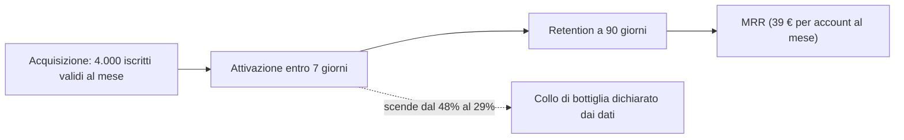

Un software SaaS italiano di fatturazione elettronica e gestione scadenze per PMI vede crescere le nuove iscrizioni del `15%` al mese, ma il ricavo ricorrente mensile (MRR) è fermo da due trimestri. Il team commerciale lamenta lead di prova sempre più scarsi e la direzione chiede nuove funzioni di intelligenza artificiale per giustificare un aumento di prezzo (scenario costruito, con numeri di esempio).

Prima di impegnare mesi di sviluppo, l'analista di prodotto applica una sequenza diagnostica che parte dal sintomo economico e arriva a un esperimento verificabile. Questo caso la segue passo per passo.

> **Idea chiave:** davanti a un blocco di crescita non si costruisce niente finché i dati non dicono in quale fase si perde il valore: acquisizione, attivazione o retention.

## Il sintomo: iscritti in crescita, ricavi fermi

Il primo grafico che arriva sul tavolo mette insieme due serie. Le iscrizioni mensili salgono, l'MRR è piatto. Da solo il grafico ammette molte spiegazioni: clienti che pagano meno, sconti, churn crescente, mix di piani cambiato. L'analista le riduce a una domanda: i nuovi iscritti diventano clienti che pagano e restano, oppure si perdono lungo la strada?

Per rispondere divide il percorso in tre tratti. L'acquisizione porta persone nel prodotto, l'attivazione le porta a compiere la prima azione di valore, la retention le trattiene. Nel prodotto in esame l'azione di valore è l'importazione della prima fattura; l'evento `first_invoice_imported` entro sette giorni dall'iscrizione definisce l'attivazione. I numeri del mese corrente sono `4.000` nuovi account validi, con prezzo medio di `39 €` al mese.



## La sequenza diagnostica in quattro passaggi

L'ordine conta. Si comincia dal fondo del percorso, la retention delle coorti già attivate, perché se anche chi usa il prodotto lo abbandona il problema sarebbe di valore. Poi si passa all'attivazione nei primi sette giorni. Terzo passo è la segmentazione per canale di acquisizione, che serve a escludere un effetto mix: se il calo riguarda un solo canale, è la promessa pubblicitaria a essere sbagliata. L'ultimo passo è qualitativo: poche conversazioni con utenti del segmento critico rispondono al «perché» che i numeri non spiegano.

| Passo | Dato osservato | Conclusione intermedia | Passo successivo |
|---|---|---|---|
| Retention coorti | Chi si attiva resta al `64%` a 90 giorni | Il prodotto trattiene bene chi arriva al valore | Il valore centrale non è il problema |
| Attivazione a 7 giorni | Scende dal `48%` al `29%` in due mesi | Il blocco è nella prima settimana | Ispezionare il funnel di onboarding |
| Segmenti per canale | Calo uniforme su ricerca organica, ads e partner | Non è effetto mix delle campagne | Cercare attrito dentro il prodotto |
| Cinque interviste | 4 su 5 si fermano all'importazione XML o CSV | Timore di inviare dati reali al Sistema di Interscambio | Testare una modalità di prova sicura |

## Quanto costa il calo di attivazione

Prima di proporre qualsiasi soluzione, l'analista traduce il calo in euro, perché è con l'MRR che si decide la priorità. Il calcolo è un esempio numerico su una coorte mensile di `4.000` iscritti validi.

1. Account attivati con il tasso precedente: $4.000 \times 0{,}48 = 1.920$ account.
2. Account attivati oggi: $4.000 \times 0{,}29 = 1.160$ account.
3. Differenza: $1.920 - 1.160 = 760$ account attivati in meno ogni mese.
4. Account persi che sarebbero rimasti a 90 giorni, con retention `64%`: $760 \times 0{,}64 = 486{,}4$, circa `486` account.
5. MRR mancante per ogni coorte mensile: $486{,}4 \times 39 = 18.969{,}60$ € al mese.

Ogni coorte mensile perde dunque circa `19.000 €` di ricavo ricorrente rispetto a due mesi fa. Il dato sposta il dibattito: la direzione voleva funzioni di intelligenza artificiale che avrebbero interessato soprattutto gli utenti già attivi, cioè un segmento di `1.160` account, mentre il collo di bottiglia fa perdere ogni mese `760` account che non arrivano a vedere il valore.

## Tre errori che avrebbero fatto fallire la diagnosi

### Costruire funzioni su richiesta della direzione

Il sintomo è una roadmap piena di moduli avanzati mentre il `71%` dei nuovi iscritti (`100% - 29%`) non completa la configurazione. Sembra ragionevole perché le funzioni nuove giustificano un prezzo più alto e sono visibili ai clienti. Il problema è che il secchio perde all'ingresso: aggiungere funzioni serve a chi è già dentro. Si corregge ordinando il lavoro per il punto del percorso con la perdita maggiore in euro, come nel calcolo sopra.

### Dare la colpa al marketing senza segmentare

Il team commerciale sospettava campagne fuori target. La segmentazione per canale mostra però un calo di circa quindici punti percentuali di attivazione anche per la ricerca organica, che non dipende dalle campagne a pagamento. Se il problema fosse stato un solo canale, la contromisura sarebbe stata cambiare il messaggio pubblicitario; con un calo uniforme il guasto è nel prodotto.

### Fermarsi al funnel senza leggere log e persone

Il grafico del funnel mostrava un abbandono generico alla schermata «Collega l'archivio aziendale». Nessuna tabella spiega perché. Il log degli errori di validazione e cinque brevi telefonate con chi aveva abbandonato la settimana prima hanno chiarito che gli utenti temevano di trasmettere fatture di prova reali al Sistema di Interscambio. Un funnel dice dove, le persone dicono perché.

## Query di baseline per l'esperimento

Con la diagnosi chiara, l'analista prepara la misura di partenza su cui confrontare l'esperimento. Le due query sono scritte per ClickHouse; la prima ricostruisce la crescita di iscritti e MRR, la seconda calcola attivazione e ticket per coorte settimanale.

```sql
-- Iscritti e MRR per mese: il sintomo economico di partenza (ClickHouse)
SELECT
    toStartOfMonth(created_at) AS mese,
    uniqExact(account_id) AS iscritti,
    sum(mrr_eur) AS mrr_eur
FROM accounts
WHERE is_internal = 0
GROUP BY mese
ORDER BY mese;
```

```sql
-- Baseline di attivazione a 7 giorni e ticket di importazione per coorte settimanale
SELECT
    cohort_week,
    count() AS nuovi_account,
    round(avg(attivato_7d) * 100, 1) AS attivazione_7d_pct,
    round(avg(ticket_import) * 100, 1) AS ticket_import_pct
FROM
(
    SELECT
        a.account_id AS account_id,
        toStartOfWeek(a.created_at) AS cohort_week,
        maxIf(1, e.event_name = 'first_invoice_imported'
                 AND dateDiff('day', a.created_at, e.event_time) <= 7) AS attivato_7d,
        maxIf(1, t.ticket_category = 'import_error') AS ticket_import
    FROM accounts AS a
    LEFT JOIN product_events AS e ON a.account_id = e.account_id
    LEFT JOIN support_tickets AS t ON a.account_id = t.account_id
    WHERE a.is_internal = 0
      AND a.created_at >= today() - 56
    GROUP BY account_id, cohort_week
)
GROUP BY cohort_week
ORDER BY cohort_week;
```

Il filtro `is_internal = 0` esclude account di test e personale interno dal numeratore e dal denominatore: senza questo filtro la baseline sarebbe diversa da quella dei report direzionali e la discussione si sposterebbe sui numeri invece che sulla decisione.

## Il piano sperimentale: campione, durata, guardrail

L'ipotesi è che una modalità «Simulazione sicura», con tre fatture di esempio già pronte e un avviso visibile che nessun dato viene trasmesso al fisco, aumenti l'attivazione a sette giorni. La scheda dell'esperimento fissa: metrica primaria `attivazione_7d_pct`, baseline `29%`, MDE `+20%` relativo, quindi un obiettivo di `34,8%` e differenza assoluta di `5,8 pp`. Guardrail: ticket di errore di importazione (baseline `8,0%`) e retention alla quarta settimana.

Il campione per variante, con alfa `0,05` e potenza `0,80`, vale circa $16 \times 0{,}29 \times 0{,}71 / 0{,}058^{2} = 3{,}2944 / 0{,}003364 \approx 979$ account. Il prodotto riceve circa `1.000` nuovi account validi a settimana, quindi in due settimane (`14` giorni, due cicli settimanali completi) arrivano circa `2.000` account, cioè `1.000` per braccio: oltre la soglia di `979`. La durata fissa di quattordici giorni è dichiarata prima del lancio, senza controlli intermedi sul valore p.

Al termine del test il controllo registra `290` attivati su `1.000` (`29,0%`) e la variante `410` su `1.000` (`41,0%`). La differenza è `12 pp`; con errore standard $\sqrt{0{,}35 \times 0{,}65 \times 2 / 1.000} \approx 0{,}0213$ si ottiene $z \approx 0{,}12 / 0{,}0213 = 5{,}6$, ben oltre la soglia di `1,96`. Il guardrail sui ticket scende da `8,0%` a `5,2%` (riduzione del `35%`, cioè $8{,}0 \times 0{,}65 = 5{,}2$) e la retention alla quarta settimana resta stabile.

Traducendo il risultato in euro, con le stesse `4.000` iscrizioni al mese l'attivazione sale da `1.160` a `1.640` account (`+480`). Con retention `64%` e prezzo `39 €`, il recupero di MRR per coorte è $480 \times 0{,}64 \times 39 = 11.980{,}80$ €: circa il `63%` dei `18.969,60 €` mancanti, ottenuto con due settimane di sviluppo e senza nuove funzioni di intelligenza artificiale.

## Quando il trimestre non aspetta

Nella realtà raramente hai due settimane di calma: il management chiede risultati entro fine trimestre e le risorse tecniche sono poche. La tentazione è saltare la fase qualitativa o rilasciare a tutti senza gruppo di controllo. Il protocollo breve resta praticabile: tre giorni bastano per estrarre coorti e log, due giorni per cinque telefonate agli utenti che hanno abbandonato nei giorni precedenti, una settimana per un prototipo della modalità simulata.

Se il traffico non permette un A/B test pulito, un rilascio progressivo monitorato con la stessa query di baseline e con i guardrail sui ticket dà comunque una risposta difendibile. Quello che non si può fare è modificare la definizione di attivazione a metà percorso, perché cambierebbe il denominatore e renderebbe incomparabili le coorti. Documentare il percorso, dalla domanda iniziale alle query e alle interviste, crea un precedente: la volta successiva ogni proposta di funzione viene valutata con lo stesso rigore.

## Verifica sul caso

1. Con `5.000` iscritti validi al mese, attivazione passata dal `50%` al `30%`, retention a 90 giorni del `60%` e prezzo di `40 €`, quanto MRR mancante genera ogni coorte?

<details>
<summary>Mostra risposta</summary>

Attivati prima: $5.000 \times 0{,}50 = 2.500$; oggi: $5.000 \times 0{,}30 = 1.500$; differenza `1.000` account. Con retention `60%` restano $1.000 \times 0{,}60 = 600$ account, che a `40 €` valgono $600 \times 40 = 24.000$ € di MRR mancante per coorte mensile.

</details>

2. Perché la retention a 90 giorni del `64%` tra gli attivati esclude un problema di valore centrale?

<details>
<summary>Mostra risposta</summary>

Perché chi arriva alla prima azione di valore resta in misura elevata: il prodotto, una volta usato, soddisfa il bisogno. Il blocco sta prima, nel percorso che porta all'importazione della prima fattura, e la diagnosi va concentrata sull'onboarding.

</details>

3. Un calo di attivazione che riguarda un solo canale a pagamento e lascia stabili gli altri, che cosa suggerisce?

<details>
<summary>Mostra risposta</summary>

Un effetto mix o una promessa pubblicitaria non coerente con il prodotto: il problema è nell'acquisizione di quel canale. Servono analisi del messaggio, della landing page e del target, non una revisione dell'interfaccia di onboarding.

</details>

4. Con baseline di attivazione `29%` e MDE `+20%` relativo, perché il campione per braccio è circa `979` e non `9.790`?

<details>
<summary>Mostra risposta</summary>

La baseline alta e l'effetto assoluto di `5,8 pp` rendono la differenza grande rispetto alla variabilità: $n \approx 16 \times 0{,}29 \times 0{,}71 / 0{,}058^{2} \approx 979$. Per rilevare effetti piccoli su conversioni basse, come `4%`, servono invece decine di migliaia di utenti.

</details>
