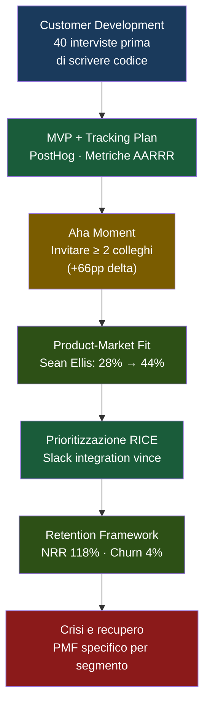

Questo caso studio mette insieme tutto il modulo in una sequenza plausibile di decisioni, errori, metriche e correzioni. L'obiettivo non e' solo capire i framework, ma vedere come cambiano davvero le scelte di un team quando il prodotto incontra il mercato.

Seguiremo una startup fittizia ma costruita su dinamiche realistiche, cosi' ogni lezione precedente diventa uno strumento operativo dentro una storia unica e coerente.

## CASO STUDIO: FLOWBOARD — DA ZERO A PRODUCT-MARKET FIT

Questo caso studio segue il percorso di **FlowBoard**, una startup SaaS B2B fittizia ma realistica, che sviluppa un tool di project management per team di prodotto. Ogni fase del percorso applica i concetti visti nelle lezioni precedenti.

FlowBoard nasce dall'osservazione di Marco, ex Product Manager in una scale-up, che ogni giorno usava 5 tool diversi per gestire il lavoro del team: Jira per i ticket, Notion per la documentazione, Miro per i workshop, Google Sheets per il tracking OKR, Slack per la comunicazione. La sua ipotesi: un tool integrato ridurrebbe la frizione e aumenterebbe la produttività.

---

## Fase 1: Customer Development

Marco segue il processo di Steve Blank. Si dà una regola: **nessuna riga di codice prima di 40 interviste.**

### Le interviste (Discovery)

Intervista 40 Product Manager e Team Lead in aziende tra 20 e 200 dipendenti. Le domande seguono le regole della UX Research:

- "Raccontami come gestisci il lavoro del tuo team nella settimana tipica"
- "Qual è stata l'ultima volta che hai perso tempo per colpa degli strumenti?"
- "Quanto tempo dedichi alla settimana al coordinamento (non al lavoro vero)?"

**Risultati chiave:**
- Il 75% usa 4+ strumenti per gestire il lavoro del team
- Il 60% cita "il context switching tra tool" come la frustrazione principale
- La media indica 6-8 ore/settimana perse in coordinamento e allineamento
- Il problema principale NON è la mancanza di feature, ma la **frammentazione**

> **Lezione applicata:** Marco non ha chiesto "Vorresti un tool unico?" (domanda leading). Ha chiesto del lavoro quotidiano e ha lasciato che il problema emergesse.

### La validazione (Validation)

Marco identifica il segmento target: **team di prodotto (5-15 persone) in aziende SaaS B2B tra 50 e 200 dipendenti**.

Costruisce un MVP: una landing page che descrive FlowBoard con un video di 2 minuti (mockup, non codice reale) e chiede l'email per la waiting list. Lancia 500€ di Google Ads su keyword specifiche.

| Metrica | Risultato | Interpretazione |
|---------|:---------:|-----------------|
| Visitatori landing page | 1.200 | — |
| Iscrizioni waiting list | 180 | **15% conversion** — segnale forte |
| "Pagheresti 20€/utente/mese?" | 35% sì | Validazione willingness to pay |

---

## Fase 2: Costruire l'MVP e Misurare

Marco e il suo co-founder tecnico costruiscono un MVP in 8 settimane. Feature minime: board kanban, documenti collaborativi, timeline. Niente integrazioni, niente mobile, niente API. Il minimo per testare la proposta di valore.

### Il Tracking Plan

Prima di scrivere il codice, Marco prepara il tracking plan. Sceglie PostHog (self-hosted, free, all-in-one):

| Evento | Trigger | Proprietà chiave |
|--------|---------|-----------------|
| `user_signed_up` | Completamento registrazione | `company_size`, `role`, `source` |
| `project_created` | Primo progetto creato | `template_used`, `team_size` |
| `task_created` | Creazione task | `project_id`, `assigned` |
| `doc_created` | Creazione documento | `project_id`, `from_template` |
| `teammate_invited` | Invito inviato | `invite_method` |
| `weekly_active` | Accesso settimanale | — |

### I primi 90 giorni — i numeri

Invita i 180 utenti della waiting list. 95 si registrano nel primo mese.

| Metrica | Settimana 1 | Settimana 4 | Settimana 8 | Settimana 12 |
|---------|:-----------:|:-----------:|:-----------:|:------------:|
| Utenti registrati | 95 | 95 | 95 | 95 |
| WAU (Weekly Active) | 72 | 38 | 25 | 22 |
| Retention settimanale | 76% | 40% | 26% | **23%** |
| Progetti creati | 45 | 12 | 5 | 3 |
| Task create (totale) | 800 | 350 | 180 | 150 |

La retention si stabilizza intorno al 23% — ma è un nucleo troppo piccolo. Il Sean Ellis test su chi è rimasto dà il **28%** di "Molto deluso" — sotto la soglia del 40%.

---

## Fase 3: Trovare l'Aha Moment

Marco applica il metodo visto nella lezione sull'Onboarding. Divide gli utenti in "attivati" (tornati ≥ 3 volte nelle prime 4 settimane) e "non-attivati".

| Azione (prime 48h) | % tra attivati | % tra non-attivati | Delta |
|---|---:|---:|---:|
| Ha invitato ≥ 2 colleghi | 78% | 12% | **+66 pp** |
| Ha creato un progetto con ≥ 5 task | 71% | 18% | +53 pp |
| Ha creato un documento condiviso | 55% | 22% | +33 pp |
| Ha personalizzato il board | 40% | 35% | +5 pp |
| Ha guardato il video tutorial | 30% | 28% | +2 pp |

**L'aha moment candidato:** invitare almeno 2 colleghi. FlowBoard è un tool collaborativo — usarlo da soli è come usare Slack in un canale vuoto.

Marco lancia un A/B test (lezione A/B Testing applicata):
- **Controllo:** onboarding standard (tour del prodotto)
- **Variante:** l'onboarding chiede come primo step di invitare 2 colleghi, con un template email precompilato

| | Controllo | Variante |
|---|---:|---:|
| Utenti che invitano ≥ 2 colleghi | 18% | **52%** |
| Retention W4 | 28% | **41%** |
| p-value | — | 0,003 |

L'effetto è causale. L'invito dei colleghi non è solo un indicatore — **guidare l'utente verso la collaborazione migliora davvero la retention.**

---

## Fase 4: Iterare verso il PMF

Marco ristruttura tutto l'onboarding e applica le strategie della lezione sull'attivazione:

### Nuovo onboarding (Checklist + Quick Win)

1. ✅ Registrazione (pre-completata)
2. Invita 2 colleghi (email pre-compilata)
3. Crea il tuo primo progetto (template pronto)
4. Assegna il primo task a un collega
5. Crea un documento condiviso

Il progresso parte da 1/5 (effetto Zeigarnik). Il template pre-populated elimina lo "schermo bianco".

### Email di re-engagement

Per chi non completa l'onboarding al primo accesso:
- +24h: "Il tuo team ti aspetta su FlowBoard" (se ha invitato colleghi)
- +24h: "Invita il tuo team per partire" (se NON ha invitato)
- +72h: Quick win — "Crea il tuo primo progetto in 3 minuti"
- +7g: Case study di un team simile

### Risultati dopo 3 mesi di iterazione

Marco fa un nuovo round di Sean Ellis test:

| | Prima | Dopo |
|---|---:|---:|
| Sean Ellis "Molto deluso" | 28% | **44%** |
| Activation Rate (W1) | 18% | **48%** |
| Retention W4 | 23% | **38%** |
| Retention W12 | 15% | **31%** |

Il PMF è raggiunto (44% > 40%).

---

## Fase 5: Prioritizzare le Feature

Con il PMF raggiunto, Marco riceve molte richieste. Usa RICE per prioritizzare:

| Feature | Reach | Impact | Confidence | Effort | RICE |
|---|---:|---:|---:|---:|---:|
| Integrazione Slack | 2.000 | 2 | 80% | 4 | **800** |
| App mobile | 1.500 | 1 | 50% | 12 | **63** |
| Timeline Gantt | 800 | 2 | 70% | 6 | **187** |
| SSO enterprise | 100 | 3 | 100% | 8 | **38** |
| Template library | 3.000 | 1 | 60% | 3 | **600** |

L'integrazione Slack vince — e ha senso: il team è già su Slack, e le notifiche FlowBoard nel canale di lavoro sono un trigger esterno naturale (Hook Model).

Classifica Kano: Slack integration è un **Performance** (più integrazione = più soddisfazione). SSO è un **Must-Have** per il segmento enterprise (non differenzia, ma blocca le vendite se manca).

Decisione: costruire Slack integration ora, SSO nel prossimo quarter quando il team sales enterprise sarà pronto.

---

## Fase 6: Monitorare la Retention

Marco imposta un dashboard di retention con tre metriche:

### 1. Bracket Retention (settimanale)

Scelta bracket (non N-day) perché FlowBoard ha uso variabile — non tutti devono accedere ogni giorno, ma almeno una volta alla settimana.

### 2. Net Revenue Retention

Dopo 6 mesi con pricing attivo (20€/utente/mese):

| Metrica | Mese 1 | Mese 3 | Mese 6 |
|---------|---:|---:|---:|
| Clienti (logo) | 45 | 52 | 68 |
| Logo churn | — | 8% | 5% |
| NRR | — | 102% | **112%** |
| MRR | 4.500€ | 7.800€ | 14.200€ |

NRR > 100% significa che i clienti esistenti espandono (aggiungono utenti) più di quanto perdono per churn. FlowBoard cresce anche senza nuove acquisizioni.

### 3. NPS Transazionale

Marco implementa un tNPS dopo ogni milestone:
- Post-onboarding (completamento checklist): **NPS +38**
- Post-primo mese: **NPS +45**
- Post-integrazione Slack: **NPS +52**

Il tNPS post-integrazione è il più alto → conferma che l'integrazione Slack è stata la scelta giusta.

---

## Fase 7: Il quasi-fallimento

Al mese 8, il churn mensile sale dal 5% al 9% senza motivo apparente.

Marco usa il framework anti-churn della lezione Retention:

**Step 1: Identifica i churner.** Analisi di coorte per mese di registrazione → il problema è concentrato nei clienti acquisiti dal mese 5 in poi.

**Step 2: Confronta con i churner precedenti.** I nuovi churner hanno un profilo diverso: sono team più grandi (15-30 persone, vs 5-15 del core target).

**Step 3: Diagnosi.** Interviste con 8 churner. Risultato: FlowBoard non scala bene per team grandi. Il board kanban diventa caotico oltre 15 persone. I permessi non sono granulari. La ricerca non funziona su volumi elevati.

**Step 4: Decisione.** Marco ha due opzioni:
1. Costruire feature per team grandi (costoso, 3+ mesi)
2. Tornare al core target (5-15 persone) e rifiutare i team grandi

Sceglie l'opzione 2 per ora. Aggiorna il messaging e il pricing per scoraggiare i team > 20 persone. Il churn torna al 4%.

> **Lezione:** il PMF non è universale — è specifico per un segmento. Allargare il segmento prima di avere le fondamenta per servirlo distrugge il PMF.

---

## I numeri finali (mese 12)

| Metrica | Mese 1 | Mese 6 | Mese 12 |
|---------|---:|---:|---:|
| Clienti | 45 | 68 | 120 |
| MRR | 4.500€ | 14.200€ | 28.000€ |
| NRR | — | 112% | 118% |
| Sean Ellis | 28% | 44% | 48% |
| Retention W12 | 15% | 31% | 35% |
| NPS relazionale | +18 | +35 | +42 |
| Churn mensile | 8% | 5% | 4% |

---

## Riepilogo: i concetti applicati

| Lezione del modulo | Dove è stata applicata |
|---|---|
| Customer Development | Fase 1: 40 interviste, MVP landing page |
| Analisi di Coorte | Fase 3, 6, 7: retention per coorte, diagnosi churn |
| A/B Testing | Fase 3: test onboarding originale vs collaborativo |
| Onboarding e Attivazione | Fase 3-4: aha moment, checklist, email sequence |
| Product-Market Fit | Fase 4: Sean Ellis test iterativo |
| Prioritizzazione | Fase 5: RICE + Kano per roadmap |
| NPS | Fase 6: tNPS post-touchpoint |
| Retention Framework | Fase 6-7: bracket retention, NRR, anti-churn |
| Strumenti Analytics | Tutto: PostHog come piattaforma unica |
| UX Research | Fase 1, 7: interviste utente, diagnosi churner |
