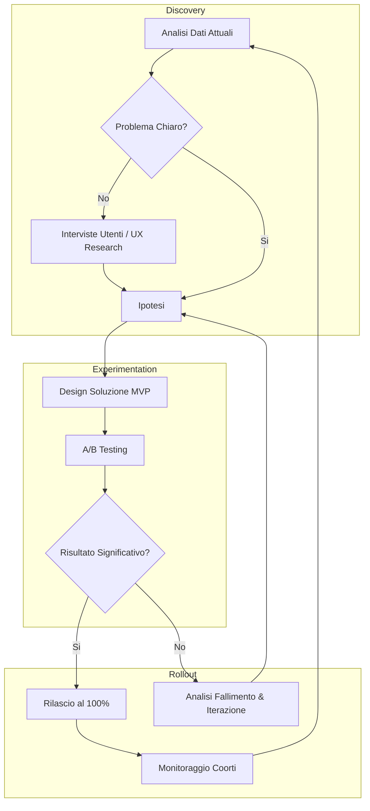
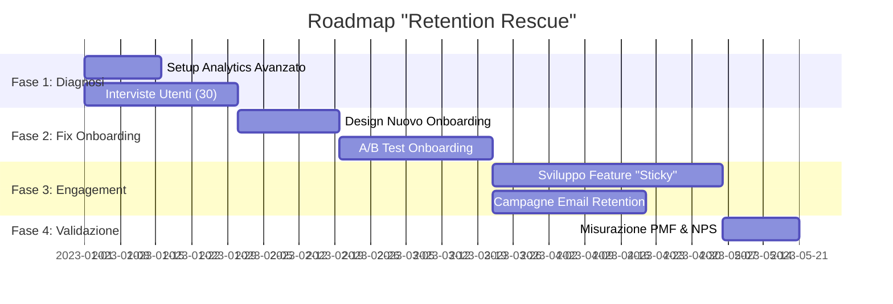
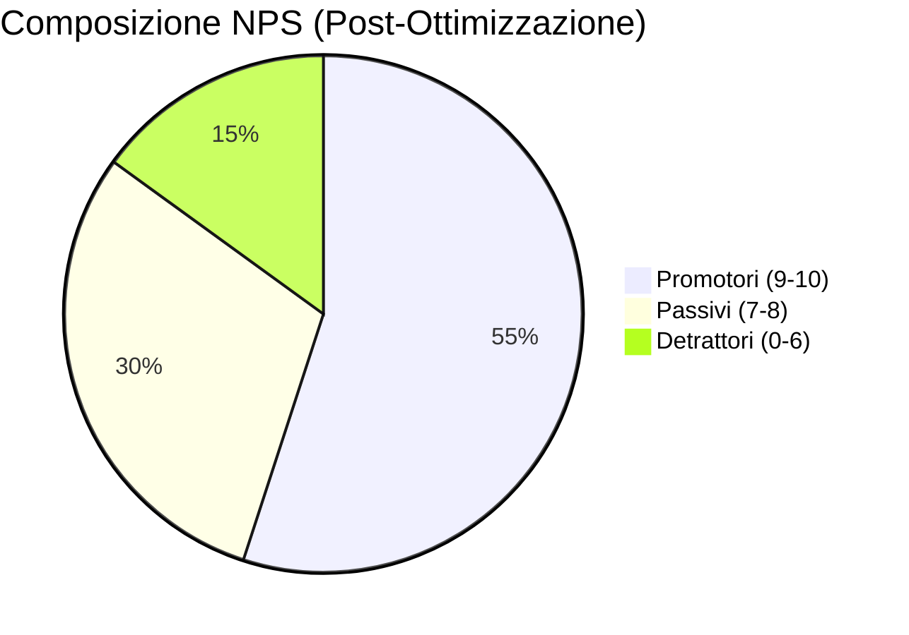

## Contesto Aziendale

**Azienda:** *TaskFlow S.p.A.* (nome fittizio)
**Settore:** B2B SaaS (Project Management)
**Target:** PMI e Agenzie Creative
**Stadio:** Post-Seed, alla ricerca del Product-Market Fit

TaskFlow ha lanciato il suo prodotto beta 6 mesi fa. Nonostante un buon afflusso di nuovi utenti (acquisizione), la maggior parte abbandona la piattaforma dopo la prima settimana. Il team di prodotto sta "spedendo" nuove feature velocemente, ma senza una direzione chiara basata sui dati.

### Dati Iniziali

| Metrica | Valore Attuale | Benchmark Settore | Note |
| :--- | :--- | :--- | :--- |
| **Attivazione** | 18% | 30-40% | Utenti che completano il setup |
| **Churn Mensile** | 12% | < 5% | Insostenibile a lungo termine |
| **NPS** | +15 | +40 | Molti "Passivi" |
| **PMF Score** | 22% | > 40% | "Sean Ellis Test" (molto delusi senza prodotto) |
| **Feature Usage** | Dispersivo | Concentrato | Molte feature poco usate |

**Problema Principale:** TaskFlow soffre di una "Leaky Bucket" (secchio bucato). Acquisisce utenti ma non riesce ad attivarli e trattenerli. Non è chiaro quale sia il valore chiave (Core Value) per l'utente.

## Obiettivi del Progetto

Il progetto "Retention Rescue" si pone i seguenti obiettivi per i prossimi 6 mesi:

1.  **Raddoppiare il Tasso di Attivazione** (dal 18% al 36%) ridisegnando l'onboarding.
2.  **Dimezzare il Churn Mensile** (dal 12% al 6%) focalizzandosi sull'engagement.
3.  **Raggiungere il Product-Market Fit** (score > 40%) validando le feature con gli utenti.
4.  **Aumentare l'NPS a +40** migliorando la UX e risolvendo i pain point critici.

**Vincoli:** Risorse di sviluppo limitate (2 sviluppatori), tempo limitato (runway di 12 mesi).

## Analisi e Strategia

Utilizzeremo un approccio misto Qualitativo (per capire il "Perché") e Quantitativo (per capire il "Cosa").

### 1. Discovery & Customer Development
Inizieremo con **Interviste in Profondità** (modello *Get Out of the Building*) su due segmenti: gli utenti "Churned" (perché hanno lasciato?) e i "Power Users" (perché restano?). Cercheremo di mappare il **Customer Journey** reale.

### 2. Product Analytics & Coorti
Implementeremo uno **Strumento di Product Analytics** per tracciare eventi chiave. Analizzeremo le **Coorti di Ritenzione** per identificare il momento esatto dell'abbandono e scoprire l'eventuale correlazione tra feature usate e retention ("Aha! Moment").

### 3. Sperimentazione (A/B Testing)
Una volta identificato il collo di bottiglia nell'onboarding, lanceremo **A/B Test** per validare le soluzioni prima del rilascio completo, misurando la significatività statistica.

### 4. Prioritizzazione RICE
Smetteremo di costruire feature a caso. Useremo il framework **RICE** (Reach, Impact, Confidence, Effort) per decidere cosa entra nella roadmap.

### Diagramma del Processo di Ottimizzazione

**Decisioni Chiave:**
*   **Focus sull'Onboarding:** I dati mostrano che il 60% del churn avviene nella prima settimana. L'onboarding è la priorità #1.
*   **Kill Feature:** Rimuovere o nascondere feature che complicano l'interfaccia senza aggiungere valore (feature bloat).
*   **Segmentazione:** Trattare diversamente le PMI (self-serve) dalle Agenzie (high-touch), poiché hanno esigenze diverse.

## Implementazione

### Timeline Operativa

### Dati Intermedi: Analisi Coorti (Mese 3)

L'analisi delle coorti ha mostrato che gli utenti che invitano almeno 2 colleghi nella prima settimana hanno una retention del 60% al mese 3, contro il 10% della media.
**Insight:** L'invito dei colleghi è l'Aha! Moment.

| Coorte (Mese) | Mese 1 (Retention) | Mese 2 (Retention) | Mese 3 (Retention) | Azione |
| :--- | :--- | :--- | :--- | :--- |
| Gennaio (Base) | 40% | 25% | 15% | Baseline |
| Febbraio (Fix UX) | 45% | 30% | 20% | Miglioramento UX base |
| Marzo (Nuovo Onboarding) | 65% | 55% | 48% | Focus su "Invita Colleghi" |

**Problema Incontrato:** Gli utenti non volevano invitare colleghi perché temevano di dover pagare subito per loro.
**Soluzione:** Modificato il copy in "Invita gratis il tuo team per 14 giorni" (rimozione frizione psicologica).

## Risultati

A 6 mesi, i risultati confermano la strategia.

### KPI Prima vs Dopo

| KPI | Prima (T0) | Dopo (T6) | Variazione | Obiettivo |
| :--- | :--- | :--- | :--- | :--- |
| **Attivazione** | 18% | 42% | +133% | Superato |
| **Churn Mensile** | 12% | 5.5% | -54% | Quasi Raggiunto |
| **NPS** | +15 | +48 | +220% | Superato |
| **PMF Score** | 22% | 38% | +72% | Vicino al 40% |

### Analisi ROI

Il costo del team prodotto per 6 mesi è stato fisso (sunk cost).
Il valore generato dalla riduzione del churn è calcolabile sul LTV.
LTV Iniziale: €50 / 12% churn = €416
LTV Finale: €50 / 5.5% churn = €909
**Incremento Valore Cliente:** +118%

Su una base di 1000 clienti, questo vale **€493.000** di valore generato in LTV potenziale.

### Composizione NPS Finale

## Lezioni Apprese

1.  **L'opinione non è un fatto:** Senza A/B test, avremmo implementato una feature richiesta a gran voce che però non impattava sulla retention.
2.  **L'attivazione è la chiave:** Migliorare l'onboarding ha un effetto a cascata su tutte le metriche successive (Retention, LTV, Referral).
3.  **Il contesto è tutto:** L'NPS da solo non dice nulla. I commenti qualitativi associati al voto ("Perché ci hai dato 8?") sono la vera miniera d'oro.
4.  **CUPED funziona:** Usare tecniche statistiche avanzate (CUPED) ci ha permesso di chiudere gli A/B test in 2 settimane invece che 4.
5.  **Prioritizzare significa dire NO:** Abbiamo dovuto dire no a feature "cool" per concentrarci sulla stabilità e sull'onboarding.

## Domande di Discussione

1.  Se il test di Sean Ellis avesse dato un risultato del 15%, avresti consigliato di continuare l'ottimizzazione o di fare un Pivot radicale?
2.  Come gestiresti la tensione tra la richiesta di nuove feature da parte dei "Power Users" e la necessità di semplificare il prodotto per i nuovi utenti?
3.  Quali sono i limiti dell'A/B testing in una startup B2B con bassi volumi di traffico?
4.  Come si differenzia la strategia di "Customer Development" in un mercato B2B rispetto a un B2C?
5.  Se il Churn fosse dovuto a fattori esterni (es. recessione economica), come cambierebbe la tua analisi di coorte?

**Cosa faresti diversamente?**
*   *Se avessi più budget:* Assumerei un UX Researcher dedicato per condurre test di usabilità continui, non solo a inizio progetto.
*   *Se il prodotto fosse B2C:* Mi concentrerei molto di più sulla viralità (K-factor) e meno sulla retention a lungo termine nelle prime fasi (modello "Growth Hacking").
