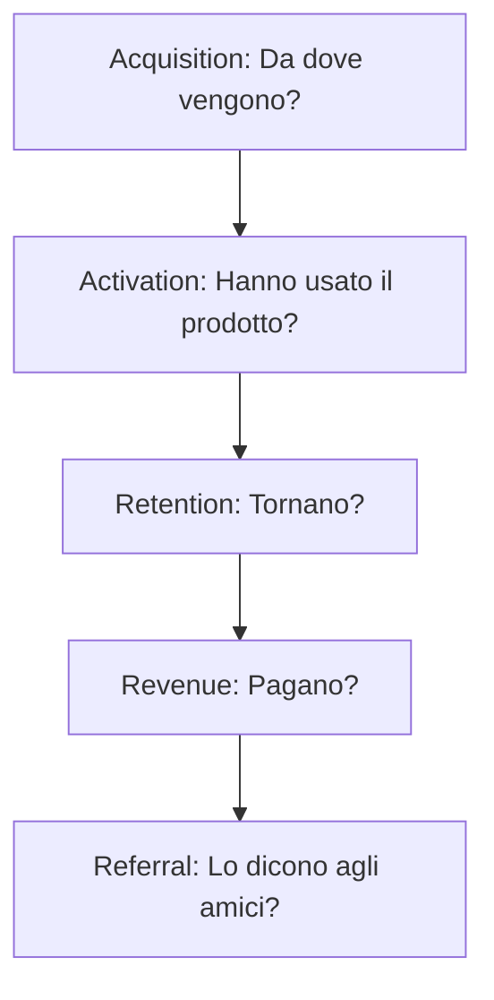
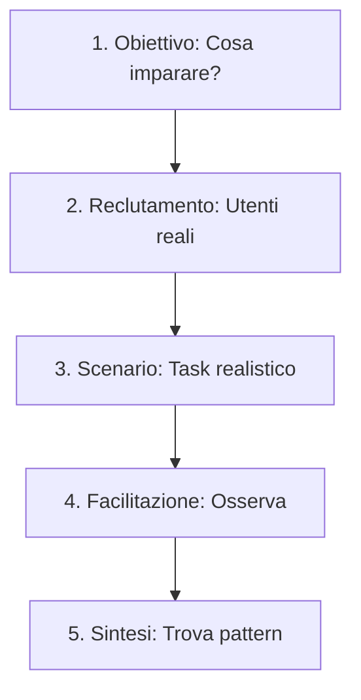

## Concetti Chiave

- **Product-Market Fit (PMF)**: Il momento in cui il mercato "vuole" il tuo prodotto. L'obiettivo primario di ogni startup.
- **UX Research**: Processo per comprendere i bisogni degli utenti (Generativa) o testare soluzioni (Valutativa).
- **A/B Testing**: Metodo scientifico per confrontare due versioni (A e B) e determinare quale performa meglio su una metrica specifica.
- **NPS (Net Promoter Score)**: Metrica di lealtà basata sulla domanda "Quanto consiglieresti questo prodotto a un amico?".
- **Cohort Analysis**: Analisi comportamentale che raggruppa gli utenti in base alla data di acquisizione per tracciare la retention nel tempo.
- **Churn Rate**: La percentuale di utenti che abbandonano il prodotto in un dato periodo.
- **Activation**: Il momento "Aha!" in cui l'utente percepisce per la prima volta il valore del prodotto.
- **Stickiness**: La frequenza con cui gli utenti tornano (`DAU / MAU`).
- **Card Sorting**: Tecnica UX per organizzare l'architettura dell'informazione chiedendo agli utenti di raggruppare i contenuti.
- **Usability Testing**: Osservare utenti reali mentre tentano di completare task specifici (spesso con protocollo "Think Aloud").

## Formule e Metriche

| Metrica | Formula | Uso |
|---------|---------|-----|
| **NPS** | `% Promoters (9-10) - % Detractors (0-6)` | Misurare la soddisfazione e il potenziale passaparola. |
| **Retention Rate** | `(Utenti a fine periodo - Nuovi utenti) / Utenti inizio` | Capire quanti utenti rimangono nel tempo. |
| **Churn Rate** | `Utenti persi / Utenti totali` | Velocità di abbandono. Se alto, il prodotto ha un buco. |
| **Stickiness** | `DAU (Daily Active Users) / MAU (Monthly Active Users)` | Misurare l'abitudine. Se > 20%, il prodotto è un'abitudine quotidiana. |
| **PMF Score** | `% utenti "Molto delusi" se il prodotto sparisse` | Se > 40%, hai probabilmente raggiunto il Product-Market Fit (Sean Ellis test). |
| **Win Rate (A/B)** | `(Conversion B - Conversion A) / Conversion A` | Calcolare l'uplift percentuale di un esperimento. |

## Framework e Modelli

### AARRR (Pirate Metrics)
Il funnel completo per la crescita di un prodotto.



### Kano Model
Classificazione delle feature in base alla soddisfazione utente.

```mermaid
quadrantChart
    x-axis Assente --> Presente
    y-axis Insoddisfatto --> Soddisfatto
    quadrant-1 Performance (Più c'è, meglio è)
    quadrant-2 Delighters (Wow effect)
    quadrant-3 Indifferenti
    quadrant-4 Basic Needs (Deve esserci)
```

## Processo Step-by-Step: Usability Testing

1.  **Obiettivo**: Definisci cosa vuoi imparare (es. "Gli utenti riescono a iscriversi?").
2.  **Reclutamento**: Trova 5 utenti rappresentativi del target (non colleghi!).
3.  **Scenario**: Crea task realistici ("Devi comprare un regalo per X") senza guidare i click.
4.  **Facilitazione**: Osserva in silenzio. Chiedi di "pensare ad alta voce" (Think Aloud).
5.  **Sintesi**: Identifica i pattern di errore comuni. Se 3 su 5 falliscono, è un problema di design.



## Errori da Evitare

-   ❌ **Testare con i colleghi** → ✅ I colleghi conoscono il prodotto ("La maledizione della conoscenza"). Usa utenti reali.
-   ❌ **Chiedere "Ti piace?"** → ✅ Le opinioni mentono, i comportamenti no. Osserva cosa *fanno*, non cosa *dicono*.
-   ❌ **Ottimizzare prima del PMF** → ✅ Fare A/B testing sul colore del bottone è inutile se nessuno vuole il prodotto.
-   ❌ **Ignorare i "Detrattori"** → ✅ I voti bassi nel NPS sono la fonte migliore di feedback per migliorare.
-   ❌ **Fermare i test troppo presto** → ✅ Un A/B test deve raggiungere la significatività statistica (es. 95%) per essere valido.
-   ❌ **Feature Factory** → ✅ Misurare il successo in base a "quante feature rilasciamo" invece che "quale impatto abbiamo".

## Quick Reference

| Strumento | A cosa serve | Quando usarlo |
|-----------|--------------|---------------|
| **Hotjar / Clarity** | Heatmaps & Recording | Vedere dove cliccano gli utenti e registrare le sessioni. |
| **Mixpanel / Amplitude** | Product Analytics | Analisi quantitativa del comportamento (Funnel, Retention). |
| **Optimizely / VWO** | A/B Testing | Lanciare esperimenti controllati su segmenti di traffico. |
| **SurveyMonkey / Typeform** | Survey & NPS | Raccogliere feedback qualitativo e calcolare il NPS. |
| **Figma / Miro** | Prototipazione | Creare mockup veloci per testare idee prima del codice. |
