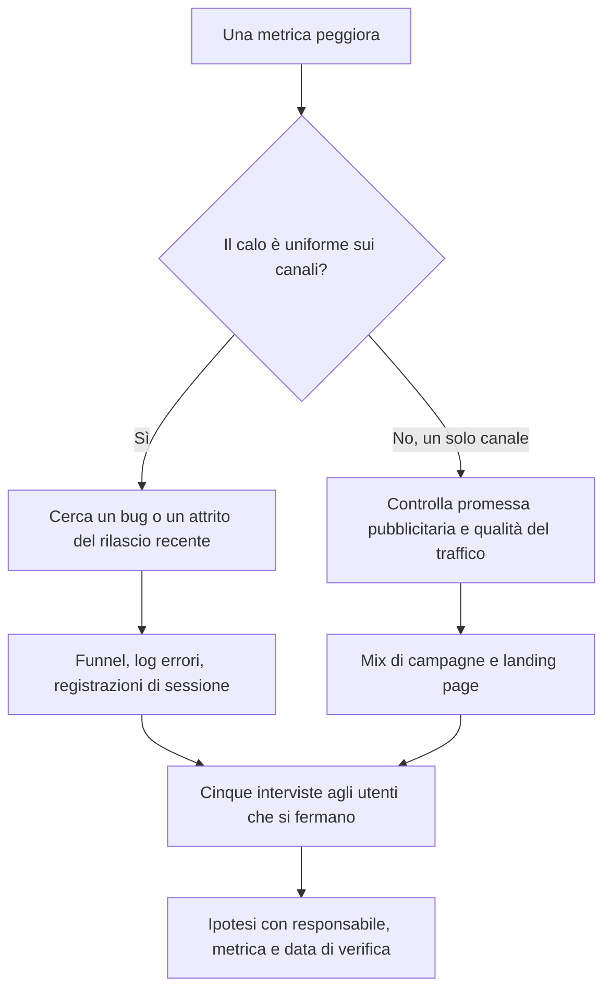

In una riunione mensile di una scale-up B2B italiana il marketing presenta un tasso di attivazione del `62%`, il prodotto uno del `38%` e la finanza segnala un calo dei rinnovi (scenario costruito, con numeri di esempio). Nessuno mente. Ognuno ha usato un denominatore, una finestra temporale e un insieme di esclusioni diverso sulla stessa base dati.

Un cheat sheet di product analytics serve a questo: non a ricordare sigle, ma a far parlare tutta l'azienda con le stesse definizioni quando si diagnostica un problema di crescita, attivazione, retention o monetizzazione.

> **Idea chiave:** ogni metrica ha una sola formula canonica, con numeratore, denominatore, finestra ed esclusioni scritte per iscritto e condivise tra prodotto, marketing e finanza.

## Formule canoniche e prima verifica

Quando un indicatore peggiora, la velocità della diagnosi dipende dalla capacità di collegare il sintomo alla formula corretta e alla prima verifica da eseguire. La regola è non cambiare più cose insieme: prima si isola se il problema nasce dal traffico, dall'onboarding o dalla perdita di valore nel tempo.

| Metrica | Formula operativa | Finestra tipica | Prima verifica se peggiora |
|---|---|---|---|
| Attivazione | Iscritti validi che compiono l'azione core / iscritti validi | 48 ore o 7 giorni | Segmentare per canale e leggere i log degli errori |
| Retention N-day | Attivi al giorno N / coorte al giorno 0 | Giorno 1, 7, 30 | Controllare cadenza d'uso naturale e weekend |
| Bracket retention | Attivi almeno una volta nell'intervallo / coorte iniziale | Settimane 1, 2-4, 5-8 | Controllare onboarding e trigger di ritorno |
| NPS | % promotori (9-10) meno % detrattori (0-6) | Trimestrale, dopo 30 giorni d'uso | Incrociare con rinnovi e ticket |
| SRM | Volumi osservati contro attesi per variante, test del chi quadro | Continuo durante un test | Verificare assegnazione, redirect e filtri bot |

Le formule da sole non bastano senza le esclusioni: account interni, ambienti di test, bot e utenti duplicati per dispositivo vanno tolti sia dal numeratore sia dal denominatore, e la stessa regola vale in dashboard e query ad hoc.



## Riconciliare due numeri: esempio svolto

Torniamo alla riunione. Il dato lordo: `2.000` iscrizioni nel mese, di cui `400` sono account interni, test o bot, quindi gli iscritti validi sono $2.000 - 400 = 1.600$. Il prodotto conta come attivati gli iscritti che compiono l'azione core entro `48` ore: `608`. Attivazione del prodotto: $608 / 1.600 = 38\%$.

Il marketing usa invece come denominatore solo gli iscritti che hanno confermato l'email, `1.000`, e come finestra sette giorni, in cui `620` hanno compiuto l'azione core: $620 / 1.000 = 62\%$. I due numeri non sono in contraddizione: cambiano due cose insieme, denominatore e finestra, e per questo non si possono confrontare.

Per riconciliarli si fissa una definizione canonica, per esempio azione core entro `7` giorni sugli iscritti validi `1.600`. Supponiamo che gli attivati a sette giorni siano `790`: attivazione canonica = $790 / 1.600 = 49{,}4\%$. Lo scarto tra `62%` e `49,4%` è di `12,6 pp` ed è tutto spiegato da due fattori misurabili: l'esclusione degli iscritti senza email confermata dal denominatore e la presenza, nel numeratore del marketing, di utenti non validi. Da quel momento tutti i report usano `49,4%` come numero ufficiale e le altre varianti restano ammesse solo con il loro nome esplicito.

## Query canonica di igiene dati

Prima di portare una tabella in riunione applica sempre un filtro unico, che esclude gli utenti interni e i bot, separa le coorti per settimana di iscrizione e mantiene fisso il denominatore. La query seguente è scritta per ClickHouse e va salvata come vista condivisa o come modello centralizzato, in modo che nessuno la riscriva a mano con filtri diversi.

```sql
-- Attivazione a 48 ore per coorte settimanale e canale (ClickHouse)
SELECT
    toStartOfWeek(u.created_at) AS cohort_week,
    u.acquisition_channel AS canale,
    uniqExact(u.user_id) AS iscritti_validi,
    uniqExactIf(u.user_id, e.activated_48h = 1) AS attivati,
    round(attivati * 100.0 / nullIf(iscritti_validi, 0), 1) AS attivazione_pct
FROM users AS u
LEFT JOIN user_activation_summary AS e ON u.user_id = e.user_id
WHERE u.is_internal = 0
  AND u.is_bot = 0
  AND u.created_at >= today() - 56
GROUP BY cohort_week, canale
ORDER BY cohort_week DESC, iscritti_validi DESC;
```

Quando il numero scende su un solo canale, il problema è quasi sempre nella promessa pubblicitaria o nella qualità del traffico; quando scende su tutti i canali insieme, cerca un bug recente o un attrito introdotto nell'ultimo rilascio. In ogni caso la regola resta la stessa: una variazione è un sintomo, e la causa si cerca incrociando i log, le registrazioni di sessione e almeno tre brevi interviste con utenti che si sono fermati nello stesso punto.

## Tre errori ricorrenti nell'uso di un riferimento rapido

### Applicare soglie di settore senza adattarle

Il sintomo è un giudizio come «la nostra retention mensile è del `85%` e la soglia online è `95%`, siamo indietro». Sembra ragionevole perché una soglia dà un riferimento immediato. Il problema è che prezzo, complessità del setup e mercato cambiano completamente le dinamiche: un gestionale enterprise con onboarding assistito non si confronta con un'app gratuita. Si corregge confrontando i numeri con la serie storica per coorte della propria azienda e usando le soglie esterne solo come ordine di grandezza.

### Calcolare la stessa metrica in due modi

Il sintomo è una dashboard che esclude gli account interni e una query ad hoc che li include, con risultati che non coincidono mai. Succede perché la definizione vive nella testa degli analisti e non in un oggetto condiviso. La correzione è salvare le definizioni canoniche in viste SQL o in modelli dbt centralizzati, così calcolare la metrica in un altro modo diventa impossibile, o almeno visibile.

### Scambiare il sintomo con la causa

Il sintomo è un calo del completamento al secondo passaggio del funnel e un ticket di sviluppo per ridisegnare la pagina. Il calo dice dove, non perché. Prima di toccare l'interfaccia incrocia il dato con registrazioni di sessione e log degli errori di validazione; spesso la causa è un messaggio ambiguo, un campo obbligatorio inatteso o un timore degli utenti, non il disegno della pagina.

## Prodotti ibridi con vendite e self-service

Molte aziende tecnologiche italiane combinano un canale self-service online con una rete commerciale che segue al telefono i clienti più grandi. In questi modelli ibridi, applicare le formule standard senza distinguere i due flussi produce letture distorte: i clienti seguiti dal commerciale hanno attivazione altissima ma costo di acquisizione molto diverso rispetto a chi si iscrive da solo dal sito.

La soluzione è tenere nel cheat sheet aziendale la separazione tra canale assistito e canale self-service per ogni metrica di funnel, retention e monetizzazione. Solo con due righe separate puoi ottimizzare l'onboarding digitale senza che l'intervento umano dei consulenti falsi le medie. Quando poi il prodotto passa dalle microimprese alle medie aziende, rivedi le finestre: un ciclo di approvazione interna più lungo richiede una finestra di attivazione di quattordici giorni invece di quarantotto ore, ma resta identico il principio di coerenza tra numeratore, denominatore ed esclusioni.

Il cheat sheet va aggiornato nello stesso sprint in cui cambia un evento di tracciamento o il significato di un passaggio dell'onboarding. Trattare la documentazione delle metriche come parte del codice di produzione evita che le definizioni invecchino, e riduce il tempo che un nuovo analista impiega per trovare la tabella degli eventi affidabile e i filtri corretti.

## Controllo prima di una riunione

1. Su `1.000` iscritti, `120` sono account interni e `880` sono validi; `352` compiono l'azione core entro 48 ore. Quanto vale l'attivazione canonica?

<details>
<summary>Mostra risposta</summary>

Il denominatore corretto è `880`, non `1.000`. Attivazione = $352 / 880 = 40\%$. Con il denominatore lordo avresti ottenuto `35,2%`, un dato sottostimato per colpa degli account interni.

</details>

2. In un questionario NPS su `100` risposte ci sono `45` promotori, `30` passivi e `25` detrattori. Qual è l'NPS?

<details>
<summary>Mostra risposta</summary>

NPS = % promotori meno % detrattori = $45\% - 25\% = +20$. I passivi non entrano nel calcolo ma restano nel denominatore.

</details>

3. Un test 50/50 su `20.000` utenti riporta `10.500` e `9.500`. Il test è valido?

<details>
<summary>Mostra risposta</summary>

L'atteso è `10.000` per braccio. Chi quadro: $(500^{2}/10.000) \times 2 = 25 + 25 = 50$, molto sopra la soglia `10,83` del livello `0,001`. Sample Ratio Mismatch: il risultato non va letto finché non si corregge l'assegnazione.

</details>

4. L'attivazione scende solo nel canale degli annunci a pagamento. Quale verifica fai per prima?

<details>
<summary>Mostra risposta</summary>

Controlli la qualità del traffico e la coerenza tra messaggio pubblicitario e prodotto: landing page, target, creatività. Un calo su un solo canale indica un problema di acquisizione, non di onboarding, e la revisione dell'interfaccia sarebbe prematura.

</details>
