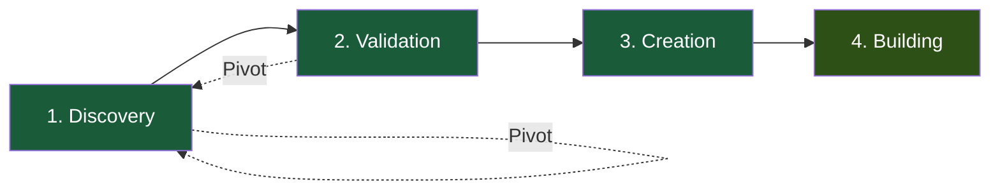

Questa scheda sintetica serve per ripassare il modulo senza perdere le soglie, le formule e i framework che tornano piu' spesso nel lavoro quotidiano di prodotto. Va letta come riferimento operativo, non come sostituto delle lezioni complete.

Usala per preparare review, workshop, analisi retrospettive o discussioni con team prodotto, growth e leadership, mantenendo allineati i concetti fondamentali.

## CHEAT SHEET: ANALISI DI PRODOTTO

Tutto il modulo condensato in riferimento rapido.

---

## Metriche Fondamentali

### Retention

| Formula | Descrizione |
|---------|-------------|
| **N-day** = Attivi al giorno N / Registrati | Torna esattamente al giorno N |
| **Unbounded** = Attivi al giorno N o dopo / Registrati | Torna al giorno N o dopo |
| **Bracket** = Attivi nella finestra / Registrati | Attivo in un periodo |

### Revenue

| Formula | Descrizione |
|---------|-------------|
| **ARPU** = Ricavo / Totale utenti | Revenue medio per utente |
| **ARPPU** = Ricavo / Utenti paganti | Revenue medio pagante |
| **LTV** = ARPU / Churn | Lifetime Value |
| **NRR** = (Rev + Expansion − Contraction − Churn) / Rev | Net Revenue Retention |

### Crescita e PMF

| Formula | Descrizione |
|---------|-------------|
| **K-factor** = N × C | Viralità (N=inviti, C=conversione) |
| **DAU/MAU** | Stickiness |
| **Activation Rate** = Attivati / Registrati | Raggiungimento aha moment |
| **NPS** = % Promotori − % Detrattori | Fedeltà (range −100/+100) |
| **Sean Ellis** ≥ 40% "Molto deluso" | Product-Market Fit |

---

## A/B Testing

| Concetto | Regola |
|----------|--------|
| Sample size | n ≈ 16 × p(1−p) / (p × MDE)² per gruppo |
| α (significatività) | 5% — P(falso positivo) |
| Potenza (1−β) | 80% — P(rilevare effetto reale) |
| p-value | P(dati così estremi dato H₀). NON è P(H₀) |
| Peeking | Gonfia falsi positivi al 15-30% |
| Metrica primaria | Una sola OEC |
| Durata | ≥ 1-2 cicli settimanali |

---

## Framework di Prioritizzazione

| Framework | Formula | Uso |
|-----------|---------|-----|
| **RICE** | (Reach × Impact × Confidence) / Effort | Con dati |
| **ICE** | Impact × Confidence × Ease (1-10) | Rapido |
| **Kano** | Must · Performance · Delighter | Classificare |
| **MoSCoW** | Must · Should · Could · Won't | Scope/deadline |
| **Impatto/Effort** | Quick Wins · Big Bets · Fill-ins · Sink Holes | Workshop |

---

## Onboarding

| Pattern | Quando |
|---------|--------|
| Product Tour | UI complessa |
| Checklist | Setup multi-step |
| Template | Prodotti creativi |
| Conversazionale | Use case diversi |
| Empty State | Sezioni vuote |

| Activation Rate | |
|---|---|
| < 20% | 🔴 Rotto |
| 20-40% | 🟡 Media |
| 40-60% | 🟢 Buono |
| > 60% | ⭐ Eccellente |

---

## Benchmark Retention

| Settore | D1 | D7 | D30 |
|---------|:---:|:---:|:---:|
| Social | 40-50% | 25-35% | 15-25% |
| Gaming mobile | 30-40% | 15-20% | 5-10% |
| SaaS B2B | 80-90% | 70-80% | 60-70% |
| E-commerce | 25-35% | 12-18% | 5-10% |
| FinTech | 35-45% | 20-30% | 12-18% |

---

## NPS Benchmark

| Settore | Medio | Top |
|---------|:-----:|:---:|
| SaaS B2B | +30 | +60/+70 |
| E-commerce | +40 | +70/+80 |
| Telco | +10 | +30/+40 |
| Banche | +15 | +40/+50 |

---

## UX Research

| Metodo | Tipo | Sample | Quando |
|--------|------|:------:|--------|
| Usability Testing | Qual | 5-8 | Validare flussi |
| Interviste | Qual | 8-15 | Capire bisogni |
| Card Sorting | Qual | 10-20 | Navigazione |
| Heatmaps | Quant | 1.000+ | Dove cliccano |
| Session Replay | Quant | 50-100 | Diagnostica |
| SUS Score | Quant | 20+ | Benchmark (0-100) |
| Survey in-app | Quant | 100+ | Feedback contestuale |

> **Nielsen:** 5 utenti → 85% dei problemi di usabilità.

---

## Tool di Product Analytics

| Tool | Forza | Free Tier |
|------|-------|-----------|
| Amplitude | Behavioral analysis, warehouse | 10M ev/mese |
| Mixpanel | Semplicità, Group Analytics | 20M ev/mese |
| PostHog | Open-source, all-in-one | 1M ev/mese |
| Heap | Auto-capture | Enterprise |
| GA4 | Gratuito, ecosistema Google | Illimitato |

---

## Unit Economics — Soglie

| Metrica | Soglia sana |
|---------|:-----------:|
| LTV / CAC | ≥ 3x |
| CAC Payback | ≤ 12-18 mesi |
| NRR (SaaS B2B) | > 110% |
| Gross Margin | > 70% (SaaS) |
| Churn mensile | < 5% (consumer) / < 2% (B2B) |

---

## Customer Development

> **Mantra:** "Get out of the building!" — Steve Blank

## Riepilogo Operativo

- Misura activation, retention e feedback utenti insieme, non come metriche isolate.
- Usa A/B test e coorti per decidere con evidenze, non con medie aggregate o opinioni forti.
- Prioritizza le feature con un framework esplicito e con ipotesi verificabili.
- Tieni questo cheat sheet come riferimento rapido per review, planning e diagnosi di prodotto.
