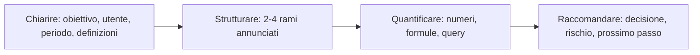

Un candidato preparato sa calcolare una retention, scrivere una window function e spiegare un A/B test. Poi, al colloquio, si sente chiedere: «Le sessioni giornaliere sono salite del 5%, ma il tempo per sessione è sceso del 10%. È una buona notizia?». Inizia a elencare metriche, si perde, e dopo quattro minuti non ha ancora detto che cosa farebbe. Non gli mancavano le conoscenze: gli mancava il modo di metterle in fila sotto pressione.

Le domande di questa lezione sono costruite sul modello di quelle più ricorrenti nei colloqui per ruoli di product analyst e product data scientist, con numeri di esempio. Per ogni domanda c'è una risposta modello: non va imparata a memoria, va usata per riconoscere la struttura che chi intervista si aspetta.

> **Idea chiave:** in un colloquio da product analyst non vince chi conosce più metriche, ma chi chiarisce la domanda, la scompone in modo ordinato, la quantifica e chiude con una raccomandazione che dice che cosa fare.

## Come è fatto il colloquio e come ti valutano

Il processo varia tra aziende, ma le famiglie di domande sono quasi sempre le stesse cinque. Possono stare in prove separate o mescolate nello stesso colloquio.

| Famiglia | Esempio di domanda | Che cosa valutano | Errore che penalizza di più |
| :--- | :--- | :--- | :--- |
| Metriche | Come misureresti il successo della funzione X? | Capacità di collegare metrica e obiettivo | Elencare metriche senza scegliere |
| Product sense | Dovremmo lanciare X? Perché gli utenti fanno Y? | Comprensione di utenti, trade-off, priorità | Opinioni senza ipotesi verificabili |
| SQL | Scrivi la retention a 7 giorni per coorte | Correttezza, casi limite, leggibilità | Denominatore sbagliato, join che duplica |
| Statistica ed esperimenti | Quanti utenti servono? Il test è valido? | Rigore e capacità di spiegare | Formule senza interpretazione |
| Case sul calo | La metrica X è calata del 10%: perché? | Metodo di diagnosi, ordine delle ipotesi | Saltare subito a una causa |

Per le domande aperte la struttura che funziona è sempre la stessa, in quattro mosse.



Chiarire non significa fare dieci domande: due o tre bastano, e se chi intervista non risponde si dichiara un'ipotesi e si prosegue. Strutturare significa annunciare la scaletta prima di riempirla: «guarderei tre cose: dati, segmenti, cause esterne». Quantificare significa portare almeno un numero o una formula, anche approssimata. Raccomandare significa chiudere con una decisione condizionata: «se vediamo A, facciamo B».

## Domande sulle metriche

### 1. Come misureresti il successo di una nuova funzione di messaggi vocali in un'app di chat?

Prima si chiarisce l'obiettivo della funzione: far comunicare di più gli utenti esistenti o attirarne di nuovi? Ipotizziamo il primo.

La metrica primaria deve catturare il valore per l'utente, non l'uso della funzione in sé: per esempio la quota di utenti attivi settimanali che invia almeno un messaggio vocale e riceve una risposta entro 24 ore, perché un vocale senza risposta non crea conversazione. Accanto si mettono le metriche di adozione (utenti che lo provano, utenti che lo usano in più settimane) e i guardrail: messaggi di testo totali, per verificare che i vocali non li stiano solo sostituendo, e segnalazioni o blocchi, per intercettare usi molesti.

La valutazione si fa con un rilascio graduale e un gruppo di controllo: confronto il numero di conversazioni per utente tra i gruppi. Raccomandazione: si considera un successo se le conversazioni per utente crescono senza calo dei messaggi totali né aumento delle segnalazioni.

### 2. Qual è una buona North Star per un marketplace di affitti brevi e perché non il numero di iscritti?

Una buona North Star misura il valore scambiato tra i due lati: per esempio le notti prenotate e non cancellate. Cattura domanda e offerta insieme, cresce solo se ospiti e host ottengono valore, ed è collegata ai ricavi. Il numero di iscritti è una metrica di vanità: cresce con il marketing anche se nessuno prenota, e non scende mai. Le metriche di input che alimentano la North Star sono la liquidità (quota di ricerche che trovano almeno un alloggio disponibile), la conversione dalla ricerca alla prenotazione e la quota di ospiti che ritorna. Il guardrail tipico sono le recensioni negative o le cancellazioni degli host, per evitare di crescere a scapito della qualità.

### 3. Le sessioni giornaliere sono salite del 5%, il tempo per sessione è sceso del 10%. È una buona notizia?

Dipende da che cosa sta facendo l'utente. Il tempo totale per utente è cambiato di 1,05 × 0,90 = 0,945, cioè −5,5%. Ci sono due letture opposte. Se il prodotto è uno strumento, come un'app di pagamenti, sessioni più brevi possono voler dire che l'utente fa la stessa cosa più in fretta: buona notizia, da confermare con il tasso di completamento delle azioni principali. Se il prodotto è di intrattenimento, la frammentazione può indicare che le notifiche portano dentro gli utenti che però escono subito: cattiva notizia. Per distinguere guardo tre cose: il completamento delle azioni chiave per sessione, la distribuzione delle sessioni (sono aumentate quelle sotto i 10 secondi?) e la retention a 7 e 30 giorni dei segmenti più toccati. Controllo anche un cambio di tracking, come una nuova definizione di sessione.

## Product sense

### 4. Un'app di consegna di cibo vuole aggiungere la consegna della spesa. Lo faresti?

Chiarisco l'obiettivo: aumentare la frequenza d'uso dei clienti attuali o acquisirne di nuovi? Poi strutturo in tre parti.

Utenti: chi ordina cibo già fa la spesa online altrove? Lo stimo con un sondaggio e con le ricerche nell'app che oggi non trovano risultati, come «latte» o «supermercato». Valore e costi: la spesa ha carrelli più grandi ma margini più bassi e logistica diversa (prodotti freschi, sostituzioni). Rischi: peggiorare i tempi di consegna del cibo, che è la promessa principale.

Quantifico l'opportunità: se il 20% dei 500.000 clienti mensili fa una spesa al mese con un margine di 4 euro, il contributo è 500.000 × 20% × 4 = 400.000 euro al mese, da confrontare con i costi fissi della logistica. Raccomandazione: test in una sola città con un gruppo di controllo, misurando ordini per cliente su tutte le categorie, tempi di consegna del cibo come guardrail e retention a 60 giorni.

### 5. Le notifiche push di promemoria aumentano il DAU del 3% ma le disinstallazioni del 15%. Che cosa consigli?

È un trade-off tra breve e lungo periodo. Il guadagno di DAU è immediato, la disinstallazione è una perdita permanente dell'utente.

Lo quantifico con un orizzonte: su 1 milione di utenti, un aumento delle disinstallazioni mensili dal 2,0% al 2,3% significa 3.000 utenti persi in più ogni mese, che si sommano; il guadagno del 3% di DAU va confrontato con il valore di quegli utenti nei mesi successivi.

Prima di decidere segmento: di solito pochi utenti, quelli già poco attivi, generano la maggior parte delle disinstallazioni, mentre gli utenti abituali le gradiscono. La raccomandazione tipica è non scegliere tra tutto e niente: limitare la frequenza, inviare le notifiche solo ai segmenti in cui la retention a 30 giorni migliora, e usare la retention a 30 giorni, non il DAU, come metrica primaria del test.

## SQL

Le domande SQL valutano correttezza e attenzione ai casi limite più della sintassi. Le query usano lo schema comune `events(user_id, event_name, event_time, properties)` e `users(user_id, signup_time, channel, country, platform)`, in sintassi Postgres e DuckDB; in BigQuery cambiano le funzioni sulle date.

### 6. Calcola la retention al giorno 7 per settimana di iscrizione.

Il punto chiave è il denominatore: tutti gli iscritti della coorte, anche chi non ha mai fatto un evento, e solo coorti mature, cioè iscritti da più di 7 giorni.

```sql
-- Retention N-day al giorno 7 per coorte settimanale
SELECT
  DATE_TRUNC('week', u.signup_time) AS coorte,             -- BigQuery: DATE_TRUNC(DATE(u.signup_time), WEEK)
  COUNT(DISTINCT u.user_id) AS iscritti,
  COUNT(DISTINCT e.user_id) AS attivi_giorno_7,
  ROUND(100.0 * COUNT(DISTINCT e.user_id) / COUNT(DISTINCT u.user_id), 1) AS retention_g7_pct
FROM users AS u
LEFT JOIN events AS e
  ON  e.user_id = u.user_id
  AND CAST(e.event_time AS DATE) = CAST(u.signup_time AS DATE) + 7
WHERE u.signup_time < CURRENT_DATE - 7
GROUP BY 1
ORDER BY 1;
```

Il `LEFT JOIN` tiene nel denominatore chi non è tornato, e la condizione sul giorno sta nel join e non nel `WHERE`, altrimenti il `LEFT JOIN` diventerebbe un join interno e la retention salirebbe al 100%. Da dire a voce: questa è retention N-day; la versione unbounded conta chi torna dal giorno 7 in poi.

### 7. Per ogni paese, trova i tre utenti con più acquisti nell'ultimo mese.

```sql
-- Top 3 utenti per numero di acquisti in ogni paese
WITH acquisti AS (
  SELECT u.country, e.user_id, COUNT(*) AS n_acquisti
  FROM events AS e
  JOIN users AS u ON u.user_id = e.user_id
  WHERE e.event_name = 'purchase'
    AND e.event_time >= CURRENT_DATE - INTERVAL '30' DAY
  GROUP BY u.country, e.user_id
),
ordinati AS (
  SELECT *, DENSE_RANK() OVER (PARTITION BY country ORDER BY n_acquisti DESC) AS posizione
  FROM acquisti
)
SELECT country, user_id, n_acquisti, posizione
FROM ordinati
WHERE posizione <= 3
ORDER BY country, posizione, user_id;
```

La domanda nascosta è come gestire i pari merito. `ROW_NUMBER` restituisce esattamente tre righe e rompe le parità a caso; `RANK` salta posizioni dopo una parità; `DENSE_RANK` restituisce tutti gli utenti con i primi tre valori distinti. Va dichiarata la scelta.

### 8. Calcola il funnel visualizzazione prodotto, carrello, acquisto con l'ordine dei passi e una finestra di 7 giorni.

```sql
-- Funnel ordinato: ogni passo conta solo se avviene dopo il precedente ed entro 7 giorni dal primo
WITH vista AS (
  SELECT user_id, MIN(event_time) AS t_vista
  FROM events
  WHERE event_name = 'product_view'
    AND event_time >= DATE '2026-11-01' AND event_time < DATE '2026-11-08'
  GROUP BY user_id
),
carrello AS (
  SELECT v.user_id, v.t_vista, MIN(e.event_time) AS t_carrello
  FROM vista AS v
  JOIN events AS e
    ON  e.user_id = v.user_id
    AND e.event_name = 'add_to_cart'
    AND e.event_time >= v.t_vista
    AND e.event_time <  v.t_vista + INTERVAL '7' DAY
  GROUP BY v.user_id, v.t_vista
),
acquisto AS (
  SELECT DISTINCT c.user_id
  FROM carrello AS c
  JOIN events AS e
    ON  e.user_id = c.user_id
    AND e.event_name = 'purchase'
    AND e.event_time >= c.t_carrello
    AND e.event_time <  c.t_vista + INTERVAL '7' DAY
)
SELECT
  (SELECT COUNT(*) FROM vista) AS visualizzano,
  (SELECT COUNT(*) FROM carrello) AS aggiungono,
  (SELECT COUNT(*) FROM acquisto) AS acquistano,
  ROUND(100.0 * (SELECT COUNT(*) FROM acquisto) / (SELECT COUNT(*) FROM vista), 1) AS conversione_pct;
```

Il funnel ordinato garantisce che ogni passo sia un sottoinsieme del precedente, quindi nessun tasso può superare il 100%. Contare gli utenti distinti per evento senza l'ordine è l'errore che chi intervista cerca.

## Statistica ed esperimenti

### 9. Conversione di base 10%, vuoi rilevare un aumento di 1 punto, alfa 5% bilaterale, potenza 80%. Quanti utenti servono e quanto dura il test con 5.000 utenti al giorno?

Per due proporzioni n per gruppo = (z₁₋α/₂ + z₁₋β)² × [p₁(1 − p₁) + p₂(1 − p₂)] / δ². Con z = 1,96 e 0,84: (1,96 + 0,84)² ≈ 7,85; la varianza è 0,10 × 0,90 + 0,11 × 0,89 = 0,090 + 0,098 = 0,188; δ² = 0,01² = 0,0001.

Quindi n ≈ 7,85 × 0,188 / 0,0001 ≈ 14.750 per gruppo, 29.500 in totale. Con 5.000 utenti al giorno bastano 29.500 / 5.000 ≈ 6 giorni, ma si arrotonda a 7 per coprire un ciclo settimanale completo. Da aggiungere: se l'effetto atteso fosse mezzo punto, il campione quadruplicherebbe, perché dipende da 1/δ².

### 10. Come spiegheresti un p-value di 0,03 a una product manager?

«Se la nuova versione non avesse alcun effetto, vedremmo una differenza grande come questa, o più grande, solo in circa 3 esperimenti su 100, per puro caso. È abbastanza raro da considerare l'effetto reale secondo la soglia che ci siamo dati, il 5%.»

Poi due precisazioni: il p-value non è la probabilità che la variante sia migliore, e non dice quanto è grande l'effetto. Per la decisione conta l'intervallo di confidenza: «l'aumento stimato è 0,8 punti, plausibilmente tra 0,1 e 1,5».

### 11. In un test 50/50 hai 50.600 utenti nel controllo e 49.400 nella variante. Puoi leggere il risultato?

No, prima va controllato il Sample Ratio Mismatch. Su 100.000 utenti l'atteso è 50.000 per gruppo. Il test del chi quadro: (600² / 50.000) + (600² / 50.000) = 7,2 + 7,2 = 14,4, con 1 grado di libertà, p ≈ 0,00015. Una differenza così è quasi impossibile per caso: l'assegnazione o il tracking sono rotti, per esempio la variante si carica più lentamente e perde utenti prima di registrare l'esposizione. Il risultato non si legge finché non si trova la causa, perché gli utenti persi non sono casuali.

### 12. Il team ha guardato il test ogni giorno e l'ha fermato appena il p-value è sceso sotto 0,05. Che problema c'è?

È il peeking. Ogni controllo è un'occasione in più per vedere un falso positivo, quindi con controlli quotidiani per alcune settimane la probabilità di dichiarare un effetto inesistente sale ben oltre il 5% nominale. Le soluzioni sono tre: fissare campione e durata prima e leggere solo alla fine; usare un test sequenziale progettato per controlli ripetuti, con soglie più severe; oppure usare la lettura intermedia solo per fermare un test dannoso, mai per dichiarare una vittoria. Nel caso specifico rifarei il test con durata fissata.

## Il case: «la metrica X è calata»

### 13. Gli ordini settimanali sono calati del 12%. Come procedi?

È la domanda più frequente e va risposta con un metodo annunciato. «Procederei in cinque passi: verifica dei dati, confronto con la variazione normale, scomposizione, cause interne ed esterne, conferma.»

Primo, i dati: gli ordini nel database transazionale sono calati quanto quelli tracciati? Un calo solo negli eventi è un problema di tracking. Secondo, l'anomalia: il valore è fuori dalla banda delle ultime 8 settimane e dallo stesso periodo dell'anno prima? Una settimana dopo un picco festivo può calare del 12% senza alcun problema. Terzo, la scomposizione: ordini = utenti attivi × conversione × ordini per acquirente; trovo il fattore che si è mosso, poi segmento per piattaforma, paese, canale, utenti nuovi e abituali, separando effetto mix ed effetto tasso. Quarto, le cause: rilasci, prezzi, campagne, problemi di pagamento da un lato; stagionalità, concorrenti, aggiornamenti dei sistemi operativi dall'altro. Quinto, la conferma: la causa spiega quanto del calo e la firma nei segmenti coincide?

Se chi intervista dà dei numeri, si usano. Esempio: gli utenti attivi sono stabili, la conversione passa dal 5,0% al 4,4%, cioè −12%. Il calo è tutto nella conversione e solo su Android, dove la conversione passa dal 5,0% al 3,8%, mentre iOS è stabile. Con metà degli utenti su ciascuna piattaforma, la conversione totale passa da 5,0% a (5,0 + 3,8) / 2 = 4,4%, il che spiega il 100% del calo. Il primo sospetto è un rilascio Android: si controlla la data della versione e il funnel per versione dell'app. Si chiude con l'azione: «se il calo è concentrato nella nuova versione, propongo di riattivare la versione precedente con il feature flag e di misurare il recupero nelle 48 ore successive».

## Prepararsi in quattro settimane

La preparazione efficace non è leggere: è rispondere ad alta voce, a tempo, e confrontare la propria risposta con un modello.

| Settimana | Focus | Esercizio pratico |
| :--- | :--- | :--- |
| 1 | SQL | 20 query a tempo su retention, funnel, window function, deduplicazione |
| 2 | Statistica ed esperimenti | Calcolo a mano di campione, SRM, intervalli; spiegare p-value e potenza a voce |
| 3 | Metriche e product sense | 10 prodotti reali: North Star, input metric, guardrail in 5 minuti ciascuno |
| 4 | Case e simulazioni | 6 colloqui simulati con un collega, con la griglia di valutazione |

Per ogni prodotto che si usa ogni giorno conviene allenarsi a rispondere a tre domande: qual è la sua North Star, che cosa misureresti per la sua ultima funzione, e che cosa faresti se la metrica principale calasse del 10%. Prima del colloquio si studia il prodotto dell'azienda: come guadagna, chi sono gli utenti, quale funzione è stata lanciata di recente. Nel colloquio si chiede sempre di poter scrivere numeri e scalette: rende visibile il ragionamento.

## Autoverifica prima del colloquio

1. Ti chiedono di misurare il successo di una nuova funzione di ricerca. Quali sono le quattro mosse della risposta, in ordine?

<details>
<summary>Mostra risposta</summary>

Chiarire l'obiettivo, per esempio far trovare più in fretta i prodotti agli utenti esistenti. Strutturare: metrica primaria, adozione, guardrail. Quantificare: per esempio la quota di ricerche che porta a un clic su un risultato entro 30 secondi, con un test randomizzato. Raccomandare: rilascio se la metrica primaria migliora senza peggiorare conversione e tempi di risposta.

</details>

2. Nella query della retention al giorno 7 un candidato mette la condizione sulla data dell'evento nel `WHERE` invece che nella clausola del `LEFT JOIN`. Che cosa succede al risultato?

<details>
<summary>Mostra risposta</summary>

Il filtro nel `WHERE` elimina le righe in cui l'evento è nullo, cioè gli utenti che non sono tornati. Il `LEFT JOIN` diventa di fatto un join interno, il denominatore contiene solo chi è tornato e la retention risulta vicina al 100%. La condizione va nella clausola `ON`.

</details>

3. Conversione di base 20%, aumento minimo da rilevare 2 punti, alfa 5%, potenza 80%. Quanti utenti per gruppo servono, approssimativamente?

<details>
<summary>Mostra risposta</summary>

n ≈ 7,85 × (0,20 × 0,80 + 0,22 × 0,78) / 0,02² = 7,85 × (0,160 + 0,172) / 0,0004 = 7,85 × 0,332 / 0,0004 ≈ 6.500 utenti per gruppo, circa 13.000 in totale.

</details>

4. Un test 50/50 ha 10.100 utenti nel controllo e 9.900 nella variante. C'è un Sample Ratio Mismatch?

<details>
<summary>Mostra risposta</summary>

L'atteso è 10.000 per gruppo. Il chi quadro è 100² / 10.000 + 100² / 10.000 = 1 + 1 = 2, con p ≈ 0,16. Non c'è evidenza di SRM: una differenza così è compatibile con il caso, e il test si può leggere.

</details>

5. Nel case sul calo degli ordini, l'intervistatore dice che il calo è uguale su tutte le piattaforme, i paesi e i canali, e lo stesso calo c'era un anno fa nella stessa settimana. Che cosa concludi?

<details>
<summary>Mostra risposta</summary>

È con buona probabilità un effetto stagionale: colpisce tutti i segmenti allo stesso modo e si ripete nello stesso periodo. Lo confermerei confrontando la variazione con quella dell'anno precedente: se è simile, non serve un intervento. Se il calo di quest'anno è molto più grande di quello dell'anno scorso, la parte in eccesso va diagnosticata con il metodo completo.

</details>
