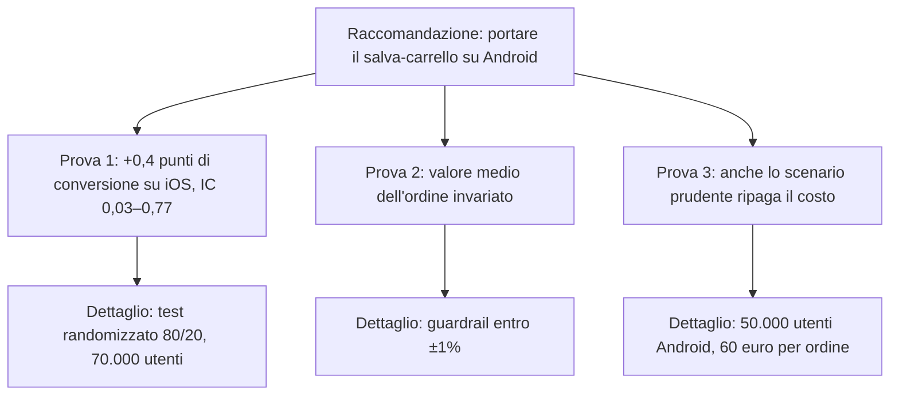

Scenario costruito con numeri di esempio. Martedì una product manager scrive: «Mi tiri fuori quanti utenti usano il salva-carrello?». Il giorno dopo l'analista consegna un grafico: il 18% degli utenti iOS attivi lo ha usato almeno una volta nell'ultima settimana. La PM ringrazia e il grafico finisce in una slide. Due settimane più tardi si scopre che la domanda vera era un'altra: il team doveva decidere se portare il salva-carrello anche su Android, con tre settimane di lavoro. Il 18% di adozione non diceva nulla su quella decisione.

Il lavoro del product analyst non finisce quando la query gira. Finisce quando qualcuno prende una decisione migliore grazie all'analisi. In mezzo ci sono tre passaggi che si imparano come una tecnica: capire la decisione dietro la domanda, scrivere il risultato in modo che si legga in un minuto, e dire quanto si è sicuri senza nascondersi dietro l'incertezza.

> **Idea chiave:** una buona analisi parte dalla decisione da prendere e arriva a una raccomandazione con un numero, un intervallo e una soglia; il grafico è uno strumento per convincere, non il prodotto finale.

## Dalla domanda alla decisione

Le richieste arrivano quasi sempre come domande sui dati: «quanti utenti fanno X?», «puoi farmi un grafico di Y?». Dietro c'è quasi sempre una decisione: investire, rilasciare, fermare, cambiare priorità. Se l'analista risponde alla domanda letterale, consegna un numero; se risponde alla decisione, consegna un'azione.

La tecnica è fare tre domande prima di aprire l'editor SQL. Che cosa farai di diverso in base alla risposta? Quale risultato ti farebbe scegliere un'opzione e quale l'altra? Entro quando ti serve? Nello scenario le risposte sarebbero state: decidiamo se portare il salva-carrello su Android; lo facciamo se aumenta gli acquisti abbastanza da ripagare tre settimane di lavoro; ci serve entro la pianificazione di venerdì. Con queste tre risposte la metrica giusta non è l'adozione ma l'effetto sugli acquisti, e la fonte giusta non è un grafico di utilizzo ma il gruppo di controllo che il team aveva tenuto fuori dal rilascio.

Le domande più frequenti hanno una decisione tipica dietro.

| Richiesta letterale | Decisione probabile | Analisi che serve davvero |
| :--- | :--- | :--- |
| Quanti usano la funzione X? | Investire ancora su X o estenderla | Effetto di X su una metrica di valore, con un confronto |
| Perché è sceso il KPI? | Intervenire o aspettare | [Diagnosi](/course/analisi-prodotto/diagnosi-calo-metrica/): dati, anomalia, scomposizione, causa |
| Fammi una dashboard sulla retention | Monitorare un obiettivo trimestrale | Definizione unica, soglie di allarme, proprietario |
| Il test è andato bene? | Rilasciare la variante | Effetto con intervallo, guardrail, segmenti chiave |
| Quali clienti rischiano di andarsene? | A chi dedicare il customer success | Lista ordinata per rischio e valore, con precisione stimata |

## Il brief di analisi

Il brief è un documento di poche righe concordato con chi chiede l'analisi prima di iniziare. Costa dieci minuti e risparmia giorni, perché fissa che cosa si misura e che cosa si farà con il risultato. Un formato che funziona ha sette campi.

> **Decisione:** portare il salva-carrello su Android nel prossimo trimestre, sì o no.
> **Domanda:** il salva-carrello aumenta la quota di utenti iOS che acquistano nella settimana?
> **Metrica primaria e guardrail:** conversione settimanale all'acquisto; valore medio dell'ordine come guardrail.
> **Popolazione e periodo:** utenti iOS attivi, settimana dal 16 al 22 novembre, gruppo trattato contro gruppo escluso dal rilascio.
> **Soglia di decisione:** si procede se l'impatto stimato su Android supera il costo di tre settimane di lavoro anche nello scenario prudente.
> **Scadenza e formato:** memo di una pagina entro giovedì per la pianificazione di venerdì.
> **Fuori ambito:** analisi dell'adozione per segmento e richieste sul design della funzione.

Il campo più importante è la soglia di decisione, perché va scritto prima di vedere i dati. Se la soglia si fissa dopo, è facile convincersi che qualsiasi risultato giustifichi la scelta che si voleva già fare. Il campo «fuori ambito» protegge invece dall'espansione della richiesta, che è la prima causa di analisi consegnate in ritardo.

## Esempio svolto: dal dato alla raccomandazione

Nello scenario il team aveva rilasciato il salva-carrello all'80% degli utenti iOS e tenuto il 20% come gruppo di controllo, assegnato a caso con un feature flag. Nella settimana analizzata gli utenti esposti sono 70.000: 56.000 nel gruppo trattato, 14.000 nel controllo.

Gli acquirenti sono 2.464 nel gruppo trattato e 560 nel controllo. Le conversioni sono quindi 2.464 / 56.000 = 4,4% e 560 / 14.000 = 4,0%. La differenza è 0,4 punti percentuali, cioè un aumento relativo del 10%. L'errore standard della differenza è √(0,044 × 0,956 / 56.000 + 0,040 × 0,960 / 14.000) = √(0,00000075 + 0,00000274) ≈ 0,00187, cioè 0,187 punti. L'intervallo di confidenza al 95% è 0,4 ± 1,96 × 0,187 = da 0,03 a 0,77 punti. L'effetto è positivo con buona probabilità, ma la sua dimensione è incerta: può essere minimo o quasi doppio della stima centrale.

Ora si traduce l'intervallo nella decisione. Android ha 50.000 utenti attivi a settimana e un valore medio dell'ordine di 60 euro. Ipotizzando che l'effetto su Android sia simile a quello su iOS, la stima centrale è 50.000 × 0,4% = 200 acquirenti in più a settimana, cioè 200 × 60 = 12.000 euro di ricavo settimanale. Lo scenario prudente usa l'estremo basso: 50.000 × 0,03% ≈ 17 acquirenti, circa 1.000 euro a settimana, che in un anno sono circa 52.000 euro. Tre settimane di lavoro di un piccolo team costano una frazione di questa cifra.

La decisione regge anche nello scenario prudente, quindi la raccomandazione è di procedere, con un gruppo di controllo anche su Android per verificare che l'effetto si trasferisca. Il guardrail sul valore medio dell'ordine, stabile tra i due gruppi, conferma che il salva-carrello non sposta gli acquisti verso carrelli più piccoli.

La query produce i numeri di partenza sullo schema comune. L'assegnazione al gruppo è registrata nell'evento `experiment_exposure`, con la variante nelle proprietà.

```sql
-- Conversione settimanale per gruppo del rilascio con controllo (utenti iOS)
WITH esposti AS (
  SELECT DISTINCT
    e.user_id,
    e.properties ->> 'variant' AS gruppo   -- BigQuery: JSON_VALUE(e.properties, '$.variant')
  FROM events AS e
  JOIN users AS u ON u.user_id = e.user_id
  WHERE e.event_name = 'experiment_exposure'
    AND e.properties ->> 'flag' = 'save_cart'
    AND u.platform = 'ios'
),
acquisti AS (
  SELECT DISTINCT user_id
  FROM events
  WHERE event_name = 'purchase'
    AND event_time >= DATE '2026-11-16'
    AND event_time <  DATE '2026-11-23'
)
SELECT
  x.gruppo,
  COUNT(*) AS utenti,
  COUNT(a.user_id) AS acquirenti,
  ROUND(100.0 * COUNT(a.user_id) / COUNT(*), 2) AS conversione_pct
FROM esposti AS x
LEFT JOIN acquisti AS a ON a.user_id = x.user_id
GROUP BY x.gruppo
ORDER BY x.gruppo;
```

Il calcolo dell'intervallo e la sua traduzione in euro stanno in poche righe di Python, che conviene allegare al memo perché chiunque possa rifarle con ipotesi diverse.

```python
from math import sqrt

x_t, n_t = 2_464, 56_000   # trattati
x_c, n_c = 560, 14_000     # controllo
p_t, p_c = x_t / n_t, x_c / n_c
diff = p_t - p_c
se = sqrt(p_t * (1 - p_t) / n_t + p_c * (1 - p_c) / n_c)
lo, hi = diff - 1.96 * se, diff + 1.96 * se
print(f"effetto: {diff:.2%} (IC 95%: {lo:.2%} - {hi:.2%})")

utenti_android, aov = 50_000, 60
for nome, eff in [("prudente", lo), ("centrale", diff), ("ottimista", hi)]:
    print(f"{nome:9s}: {utenti_android * eff:5.0f} acquirenti, {utenti_android * eff * aov:7.0f} euro a settimana")
# effetto: 0.40% (IC 95%: 0.03% - 0.77%)
# prudente :    17 acquirenti,    1009 euro a settimana
# centrale :   200 acquirenti,   12000 euro a settimana
# ottimista:   383 acquirenti,   22991 euro a settimana
```

## L'insight memo: la risposta in apertura

Chi decide legge la prima frase, forse il primo paragrafo. Per questo un insight memo segue il principio della piramide, formalizzato da Barbara Minto nel lavoro di consulenza: prima la conclusione, poi gli argomenti che la sostengono, poi i dati di dettaglio. È l'ordine opposto a quello in cui l'analista ha lavorato, ed è il motivo per cui va scritto con disciplina.



Un memo efficace ha cinque blocchi, e sta in una pagina. Il titolo è la conclusione in una frase, non l'argomento: «Il salva-carrello aumenta gli acquisti: consigliamo di portarlo su Android», non «Analisi del salva-carrello». Segue la raccomandazione con il numero chiave e la sua incertezza. Poi le prove, due o tre, ciascuna con un grafico o una tabella. Poi i limiti: che cosa l'analisi non può dire e quali ipotesi la reggono. Infine i passi successivi, con un proprietario.

Ecco il memo dello scenario nella forma che arriva alla pianificazione:

> **Il salva-carrello aumenta gli acquisti: consigliamo di portarlo su Android con un gruppo di controllo.**
> Su iOS gli utenti con il salva-carrello comprano nel 4,4% dei casi contro il 4,0% del gruppo di controllo, +0,4 punti (intervallo al 95%: da 0,03 a 0,77). Il valore medio dell'ordine non cambia.
> Su Android la stima centrale è di 200 acquirenti e 12.000 euro in più a settimana; nello scenario prudente circa 1.000 euro a settimana, comunque superiore al costo di tre settimane di lavoro su base annua.
> Limite principale: assumiamo che l'effetto su Android sia simile a quello su iOS. Per verificarlo proponiamo un rilascio all'80% con il 20% di controllo.
> Prossimo passo: decisione in pianificazione venerdì; analisi di verifica su Android quattro settimane dopo il rilascio.

## Comunicare l'incertezza senza perdere la decisione

Due errori opposti rovinano la comunicazione dell'incertezza. Il primo è nasconderla: «la funzione aumenta gli acquisti del 10%», come se fosse un fatto. Il secondo è annegarci: «i risultati sono incerti, servono più dati», che lascia chi decide senza indicazioni. La strada giusta è dare un intervallo e dire se la decisione cambia dentro quell'intervallo.

| Situazione | Che cosa dire | Esempio |
| :--- | :--- | :--- |
| L'intero intervallo porta alla stessa decisione | Raccomandazione netta, con l'intervallo | Anche lo scenario prudente ripaga il costo: procediamo |
| L'intervallo attraversa la soglia di decisione | Dire che cosa cambierebbe la decisione e quanto costa saperlo | Con altre due settimane di test l'intervallo si dimezza |
| L'effetto è compatibile con zero | Nessun effetto dimostrato, con il minimo effetto escludibile | Escludiamo effetti superiori a 0,5 punti |
| Dati osservazionali, senza esperimento | Associazione, con le spiegazioni alternative | Chi usa X compra di più, ma è anche più attivo in partenza |

Le parole contano. «Significativo» per un manager significa importante, per un analista significa statisticamente distinguibile da zero: è meglio non usarlo e dire direttamente l'effetto e l'intervallo. Le probabilità verbali come «probabile» o «possibile» vengono interpretate in modo molto diverso da persone diverse; se si usano, conviene ancorarle a un numero. Una frase utile da aggiungere in fondo a ogni memo è che cosa farebbe cambiare idea all'analista: rende esplicite le ipotesi e invita a verificarle.

## Dashboard o analisi ad hoc

Molte richieste di analisi diventano dashboard, e molte dashboard non vengono mai riaperte dopo la prima settimana. La distinzione è semplice: la dashboard serve a monitorare domande che si ripetono con la stessa definizione, l'analisi ad hoc serve a rispondere a una domanda nuova che porta a una decisione.

| Criterio | Dashboard | Analisi ad hoc |
| :--- | :--- | :--- |
| Frequenza della domanda | Ricorrente, ogni giorno o settimana | Una volta o raramente |
| Tipo di domanda | Come stiamo andando? | Perché è successo, che cosa facciamo? |
| Output | Metriche con definizione fissa e soglie | Memo con raccomandazione |
| Costo nascosto | Manutenzione, definizioni che invecchiano | Lavoro non riutilizzabile se non documentato |
| Segnale che è la scelta sbagliata | Nessuno la apre da un mese | La stessa analisi rifatta ogni mese a mano |

Una dashboard utile ha poche metriche, ciascuna con definizione scritta, proprietario, periodo di confronto e soglia oltre la quale qualcuno deve agire. Se una metrica non ha un proprietario né una soglia, è decorazione. Quando la stessa analisi ad hoc viene richiesta per la terza volta, è il momento di trasformarla in un rapporto automatico.

Per i grafici bastano poche regole. Ogni grafico ha un titolo che dice la conclusione, non l'asse. Si usa il tipo più semplice che regge il messaggio: linee per le tendenze, barre per i confronti tra categorie, tabelle quando servono i numeri esatti. Si evidenzia la serie che conta e si attenuano le altre. Si mostrano gli intervalli quando la decisione dipende dall'incertezza.

## Trappole comuni

### Consegnare il numero richiesto e non la risposta

Il sintomo è un'analisi corretta che non viene usata, come il 18% di adozione dello scenario. Succede perché fare domande sulla decisione sembra lento o invadente. Si evita con il brief: dieci minuti di allineamento prima di iniziare, con la decisione e la soglia scritte.

### Raccontare il percorso invece della conclusione

Il sintomo è un memo che inizia con «Abbiamo estratto i dati dal warehouse e...» e arriva alla raccomandazione a pagina tre. Succede perché l'analista racconta nell'ordine in cui ha lavorato. Si evita scrivendo per prima la frase di titolo con la conclusione e mettendo la metodologia in appendice.

### Precisione falsa

Il sintomo sono numeri come «+10,37% di conversione» o «12.418 euro a settimana» calcolati su ipotesi incerte. Succede perché i decimali sembrano rigore. Si evita arrotondando in modo coerente con l'incertezza e mostrando sempre l'intervallo accanto alla stima centrale.

## Verifica la comunicazione

1. Un direttore chiede: «Quanti utenti hanno usato il nuovo filtro di ricerca questo mese?». Quali tre domande fai prima di rispondere?

<details>
<summary>Mostra risposta</summary>

Che cosa deciderai in base al numero, per esempio se continuare a investire sul filtro o toglierlo. Quale risultato ti farebbe scegliere un'opzione e quale l'altra, cioè la soglia di decisione. Entro quando ti serve e in quale contesto, per scegliere il formato. Spesso la risposta sposta l'analisi dall'adozione all'effetto del filtro sulla ricerca riuscita o sugli acquisti.

</details>

2. Un test mostra +0,3 punti di conversione con intervallo al 95% da −0,1 a +0,7. Il rilascio costa poco ed è reversibile. Che cosa raccomandi e come lo scrivi?

<details>
<summary>Mostra risposta</summary>

L'effetto non è distinguibile da zero, ma il rischio è basso: l'estremo negativo è piccolo e il rilascio si può annullare. Si può raccomandare il rilascio con monitoraggio, scrivendo che l'effetto stimato è +0,3 punti, compatibile con un effetto nullo, e che il rischio massimo ragionevole è una perdita di 0,1 punti. In alternativa si prolunga il test se il costo del ritardo è basso. Non si scrive «il test è positivo».

</details>

3. Qual è la differenza tra il titolo «Analisi della retention di ottobre» e un buon titolo di memo?

<details>
<summary>Mostra risposta</summary>

Il primo dice l'argomento, il secondo dice la conclusione. Un buon titolo è per esempio «La retention a 30 giorni scende di 3 punti per gli iscritti da TikTok: proponiamo di rivedere l'onboarding di quel canale». Chi legge solo il titolo conosce già il risultato e l'azione proposta.

</details>

4. Un team chiede una dashboard con 40 metriche «per avere tutto sotto controllo». Come imposti la risposta?

<details>
<summary>Mostra risposta</summary>

Chiedendo quali decisioni ricorrenti deve supportare la dashboard e chi agisce su ogni metrica. Si tengono solo le metriche con definizione scritta, proprietario e soglia di allarme, di solito tra cinque e dieci. Le altre restano consultabili nello strumento di esplorazione. Una dashboard con 40 metriche non mette nulla sotto controllo, perché nessuno sa quale numero deve guardare.

</details>
