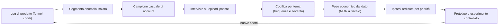

Scenario costruito con numeri di esempio: una piattaforma B2B italiana di gestione ordini registra 1.250 nuovi account in un trimestre. Il funnel dice che 525 di essi, il 42%, si fermano alla schermata di importazione del catalogo e non tornano. Il team di prodotto ha già tre teorie: il file CSV richiesto è troppo rigido, gli utenti temono di sovrascrivere l'archivio esistente, oppure chi si registra non ha i permessi per importare dati. Nessuna delle tre può essere confermata dai log, perché un abbandono sulla stessa schermata ha lo stesso aspetto nei dati qualunque sia la causa.

Questo è il confine tra analytics e ricerca qualitativa. I log sono bravi a dire dove e quanto, ma il perché sta nella testa e nel contesto di lavoro di chi ha chiuso la scheda. Il customer development colma questo vuoto con interviste brevi e strutturate, a condizione che siano guidate dai dati: sono i comportamenti osservati a decidere con chi parlare, e sono i numeri a decidere quanto peso dare a ciò che emerge.

## Dai log alle persone giuste da intervistare

Il primo errore di chi comincia è reclutare chiunque abbia tempo: i clienti più loquaci, quelli che scrivono al supporto, i tre nomi che il commerciale ha in rubrica. Il risultato è un campione che rappresenta la rumorosità, non la popolazione che genera il problema. Per evitarlo si parte dalla domanda opposta: quale segmento comportamentale concentra l'anomalia che stiamo cercando di spiegare, e come lo isoliamo con una query?

> **Idea chiave:** i dati comportamentali sono la mappa di campionamento della ricerca qualitativa: decidono chi intervistare, mentre le interviste spiegano perché quel segmento si comporta così.

Nel caso della piattaforma di ordini, il segmento è chiaro: account creati negli ultimi 14 giorni che hanno aperto la schermata di importazione e non hanno completato nessun caricamento. Il limite dei 14 giorni non è casuale. Dopo due settimane la memoria dell'episodio si degrada, e le risposte tendono a diventare razionalizzazioni piuttosto che ricordi. Chi ha abbandonato ieri ricorda ancora quale messaggio di errore ha visto e quale collega ha interpellato.

La tabella seguente raccoglie i quattro segmenti che più spesso conviene intervistare in un prodotto B2B, con il criterio di selezione nei dati e l'errore di campionamento più comune.

| Segmento comportamentale | Criterio di selezione nei dati | Obiettivo dell'intervista | Errore di campionamento |
| :--- | :--- | :--- | :--- |
| Abbandono precoce | Registrati negli ultimi 14 giorni senza prima azione chiave | Scoprire attriti tecnici o di comprensione | Intervistare utenti vecchi che non ricordano più |
| Utenti convertiti | Setup completato e attivi da almeno 30 giorni | Capire il valore percepito e le alternative usate | Chiedere solo cosa vorrebbero in più |
| Churn recente | Cancellazione negli ultimi 30 giorni | Identificare il momento esatto di rottura | Accettare "costava troppo" senza scavare |
| Power user | Uso settimanale sopra il 90° percentile | Trovare workaround e bisogni non risolti | Costruire solo per utenti esperti |

La query che estrae il campione deve fare tre cose: applicare il criterio comportamentale, escludere gli account interni e di test, e ordinare in modo casuale per non intervistare sempre i primi della lista. In ClickHouse si può scrivere così.

```sql
-- Campione di account da intervistare: bloccati sull'importazione negli ultimi 14 giorni
SELECT
  a.account_id,
  a.company_name,
  a.plan_tier,
  a.created_at
FROM accounts AS a
INNER JOIN (
  SELECT account_id
  FROM product_events
  WHERE event_name = 'import_screen_opened'
    AND event_date >= today() - 14
  GROUP BY account_id
) AS opened USING (account_id)
LEFT ANTI JOIN (
  SELECT DISTINCT account_id
  FROM product_events
  WHERE event_name = 'catalog_import_completed'
) AS done USING (account_id)
WHERE a.is_internal = 0
ORDER BY rand()
LIMIT 20;
```

Si estraggono venti account per ottenerne circa dieci disponibili: in un contesto B2B la quota di risposta ai primi inviti si aggira spesso su metà del campione, quindi conviene contattare il doppio di quanti ne servono. Cinque-otto interviste per segmento bastano di solito a far emergere i pattern ricorrenti; dieci offrono un margine in più per distinguere i temi frequenti da quelli aneddotici.

## Domande su fatti passati, non su opinioni future

Un'intervista di customer development non è un sondaggio a voce e non è una vendita. Il suo scopo è ricostruire l'ultimo episodio reale in cui la persona ha affrontato il problema: cosa stava cercando di fare, quali passaggi ha compiuto, quali strumenti ha usato, quanto tempo ha perso, chi ha coinvolto. Le persone sono pessime nel prevedere il proprio comportamento, ma ricordano con precisione gli intoppi, i fogli di calcolo di appoggio e i messaggi mandati ai colleghi.

**Non chiedere mai a un cliente cosa vorrebbe in futuro: chiedigli cosa ha fatto l'ultima volta che ha affrontato il problema e quanto gli è costato.**

Una buona traccia per il caso dell'importazione contiene poche domande aperte, disposte in sequenza cronologica. Si parte dal contesto: quando ti sei registrato e cosa dovevi ottenere nella prima settimana. Si passa all'episodio: raccontami l'ultima volta che hai provato a caricare il catalogo, dall'apertura del file al momento in cui ti sei fermato. Si scava sul costo: quanto tempo ci hai dedicato e chi ti ha aiutato. Si chiude sull'alternativa: cosa hai fatto poi per portare avanti il lavoro. Nessuna domanda contiene una soluzione suggerita, come "il formato CSV era troppo complicato?", perché la risposta educata sarebbe sempre sì.

Un trucco utile è la regola del silenzio: dopo ogni risposta si attendono tre secondi prima di parlare di nuovo. Quasi sempre l'interlocutore aggiunge il dettaglio che contava, quello che di solito comincia con "in realtà". Un secondo accorgimento è registrare l'intervista, con consenso esplicito, e farsi accompagnare da una seconda persona che prenda appunti: chi conduce non può ascoltare bene e scrivere nello stesso momento.

Quando un utente chiede una funzionalità specifica, il compito è ricostruire il risultato che sta cercando di ottenere. Chi chiede "un pulsante per esportare in Excel" sta quasi sempre dicendo che deve far arrivare i dati a una persona che non ha accesso al prodotto. Ogni workaround manuale, come l'esportazione seguita da una correzione a mano, è una specifica già validata dal mercato: costa tempo al cliente e dunque ha un prezzo misurabile.

## Codificare le interviste: frequenza, severità, peso economico

Appunti sparsi in documenti diversi vengono dimenticati dopo una settimana. Per rendere confrontabili le interviste con i dati quantitativi, ogni colloquio va codificato entro 24 ore in una matrice con una riga per intervista e una colonna per tema. Un tema è un'etichetta descrittiva dell'ostacolo, come "CSV con intestazioni non riconosciute" o "timore di cancellare il catalogo esistente", non una soluzione né un'opinione generica.

Per ogni tema si registrano due dimensioni. La frequenza è il numero di interviste in cui il tema compare spontaneamente, cioè prima che l'intervistatore lo suggerisca. La severità è un voto da 1 a 3 che misura quanto il tema impedisce di raggiungere il valore: 1 rallenta, 2 costringe a un workaround, 3 blocca del tutto. Infine si aggancia il peso economico del segmento, che arriva dai dati e non dalle interviste.



Il diagramma mostra che il percorso non è lineare: l'esperimento che segue le interviste produce nuovi dati, e i nuovi dati disegnano il prossimo campione. Un ciclo di customer development è sano quando si ripete ogni due settimane con tre-quattro interviste, perché in quel modo verifica anche se l'ultimo rilascio ha davvero rimosso l'attrito.

## Esempio numerico: dieci interviste che diventano una classifica

Riprendiamo lo scenario costruito. Dei 525 account fermi sull'importazione, ne abbiamo intervistati 10 estratti a caso. Il MRR medio degli account di quel segmento, misurato dal piano tariffario sottoscritto, è di 180 euro al mese. Dopo la codifica la matrice riporta questi temi, ciascuno contato una volta per intervista in cui è emerso spontaneamente.

| Tema emerso | Interviste (su 10) | Frequenza | Severità (1-3) |
| :--- | :---: | :---: | :---: |
| CSV con intestazioni non riconosciute | 6 | 60% | 3 |
| Timore di sovrascrivere il catalogo esistente | 4 | 40% | 2 |
| Permessi amministrativi mancanti | 2 | 20% | 3 |

Il calcolo procede in tre passaggi.

Primo, si proietta la frequenza sul segmento intero. Il 60% di 525 account è pari a 315 account, il 40% è pari a 210 e il 20% è pari a 105. Si tratta di una stima: dieci interviste non danno una precisione al punto percentuale, quindi leggiamo i numeri come ordini di grandezza.

Secondo, si converte il numero di account in MRR potenzialmente a rischio moltiplicando per 180 euro: 315 × 180 = 56.700 euro, 210 × 180 = 37.800 euro, 105 × 180 = 18.900 euro.

Terzo, si pesa per severità dividendo la severità per 3, il massimo della scala. Il tema CSV vale 56.700 × 3/3 = 56.700 euro, il timore di sovrascrittura vale 37.800 × 2/3 = 25.200 euro, i permessi valgono 18.900 × 3/3 = 18.900 euro. La somma dei tre punteggi è 100.800 euro, di cui il CSV pesa il 56,3% (56.700 / 100.800), il timore di sovrascrittura il 25,0% e i permessi il 18,8%.

La classifica risultante dice di partire dal formato CSV, per esempio con un mapping automatico delle colonne, e di trattare il timore di sovrascrittura con un'anteprima di importazione e un annulla. I permessi, pur severi, toccano pochi account e si risolvono con un messaggio di errore più chiaro. Il punto metodologico è che l'ordine non nasce dal tema più raccontato in modo vivido, ma dalla combinazione di frequenza, severità e valore economico. Prima di investire settimane di sviluppo si può validare la stima con una query che conta quanti degli account fermi hanno effettivamente caricato un file con intestazioni diverse da quelle attese.

```sql
-- Verifica quantitativa dell'ipotesi CSV: tentativi di importazione falliti per motivo
SELECT
  failure_reason,
  count(DISTINCT account_id) AS accounts,
  round(count(DISTINCT account_id) * 100.0 / sum(count(DISTINCT account_id)) OVER (), 1) AS share_pct,
  round(sum(mrr_eur), 0) AS mrr_at_risk_eur
FROM import_attempts
WHERE attempt_date >= today() - 14
  AND status = 'failed'
GROUP BY failure_reason
ORDER BY mrr_at_risk_eur DESC;
```

Se il log conferma che i fallimenti per intestazioni non riconosciute sono la quota maggiore, l'ipotesi qualitativa diventa un'ipotesi quantificata. Se non lo conferma, hai evitato di costruire la soluzione sbagliata: anche questo è un risultato da archiviare nella matrice, accanto ai temi confermati.

## Tre errori che contaminano la ricerca qualitativa

Anche il campione migliore diventa inutile se le domande suggeriscono la risposta o se i risultati restano opinioni non confrontabili.

### Reclutare per comodità invece che per comportamento

Il sintomo è un campione fatto di clienti storici, di sostenitori e dei tre nomi più rumorosi, con risposte che confermano sempre le idee già presenti nel team. Succede perché reclutare chi risponde in fretta è semplice e perché la lista dei contatti del commerciale è già pronta. Il problema è che i clienti storici non ricordano più le difficoltà del primo giorno, mentre chi ha abbandonato la scorsa settimana le ha ancora fresche. La correzione è partire sempre da una coorte estratta dal database negli ultimi 14 giorni, con ordinamento casuale.

### Chiedere opinioni ipotetiche sul futuro

Il sintomo sono risposte cortesi e prive di dettagli, come "sì, la userei", che non si traducono in adozione dopo il rilascio. Succede perché domande come "pagheresti per questa funzione?" sembrano la via più rapida per validare un'idea, e perché l'intervistato vuole essere gentile. In realtà non esiste alcun costo per chi risponde, quindi la risposta non contiene informazione. La correzione è ancorare ogni domanda a un episodio reale e al suo costo: tempo, denaro, errori, persone coinvolte.

### Prendere alla lettera la richiesta di funzionalità

Il sintomo è un backlog pieno di pulsanti e opzioni richiesti da singoli clienti, che però non muovono alcuna metrica. Succede perché la richiesta suona concreta e il cliente è sicuro di ciò che chiede. Spesso però descrive una soluzione ipotizzata dall'utente, non il problema. Per correggerlo si chiede "cosa cercavi di ottenere quando hai pensato a questo?" e si risale al risultato finale. Il segnale più prezioso è il workaround manuale: se il cliente esporta i dati per sistemarli a mano, quel tempo è la misura del valore di una soluzione.

## Clienti B2B con più decisori e sintesi per il team

Nel mercato B2B chi usa il software ogni giorno raramente coincide con chi firma il contratto. Se intervisti solo l'operatore amministrativo scoprirai ottimi miglioramenti di usabilità che non sbloccano il budget di rinnovo, mentre parlare solo con il direttore commerciale porta a costruire cruscotti eleganti che nessuno alimenta, perché il flusso operativo quotidiano è troppo macchinoso. La soluzione è condurre interviste separate per i due ruoli sullo stesso account, mappando da un lato il costo operativo dell'operatore e dall'altro il criterio di ritorno economico del decisore. Un intervento ad alto impatto è quello che riduce l'attrito di chi lavora e rende visibile il valore a chi paga.

Una volta codificate le interviste, la sintesi per il team deve stare in una pagina: segmento intervistato, numero di colloqui, tre temi con frequenza, severità e MRR a rischio, una citazione letterale per tema e la metrica quantitativa che dovrà muoversi dopo il rilascio. Quando sviluppatori e designer leggono le parole esatte con cui un cliente descrive il blocco, le priorità si chiariscono molto più in fretta che con una slide di percentuali. Il legame con i log evita invece di sovrastimare problemi rari ma raccontati in modo molto vivido durante una singola telefonata.

Conviene documentare nella stessa matrice anche le ipotesi smentite. Sapere che un problema sospettato dal team non esiste nella realtà dei clienti fa risparmiare settimane di sviluppo e costruisce un archivio ricercabile: un nuovo collega può consultarlo prima di ripetere le stesse domande a distanza di pochi mesi. Se ogni tema è collegato a una query replicabile, il team ottiene una memoria condivisa tra prodotto, design, vendite e supporto.

## Verifica sul tuo campione di interviste

1. Hai un segmento in cui il funnel perde il 30% degli account tra due passaggi consecutivi. Quale criterio comportamentale usi per scegliere gli account da intervistare, e quale finestra temporale?

<details>
<summary>Mostra risposta</summary>

Seleziona gli account che hanno raggiunto il primo dei due passaggi e non il secondo, con una finestra recente di circa 14 giorni, esclusi gli account interni e ordinati in modo casuale. In questo modo il campione rappresenta il blocco che vuoi spiegare, e la memoria dell'episodio è ancora fresca.

</details>

2. Un intervistato dice "userei volentieri un'integrazione con il mio gestionale". Quale domanda successiva trasformi in un fatto verificabile?

<details>
<summary>Mostra risposta</summary>

Chiedi cosa ha fatto l'ultima volta che ha dovuto portare i dati dal prodotto al gestionale: con quali passaggi, quanto tempo ha impiegato, chi ha coinvolto e quante volte al mese lo ripete. La risposta restituisce un costo misurabile, mentre "userei" resta un'intenzione senza prezzo.

</details>

3. Su 12 interviste il tema A compare in 9 colloqui con severità 2, il tema B in 4 colloqui con severità 3. Il segmento conta 400 account da 150 euro di MRR. Quale tema ha il punteggio pesato più alto?

<details>
<summary>Mostra risposta</summary>

Tema A: frequenza 9/12 = 75%, account 0,75 × 400 = 300, MRR 300 × 150 = 45.000 euro, peso severità 2/3, punteggio 45.000 × 2/3 = 30.000 euro. Tema B: frequenza 4/12 = 33,3%, account circa 133, MRR circa 20.000 euro, severità 3/3, punteggio circa 20.000 euro. Il tema A passa avanti, ma con soli 12 colloqui la differenza va letta come indicazione, da confermare con una query sui log.

</details>

4. Un cliente enterprise e il suo operatore danno indicazioni opposte sulla funzione da migliorare. Come tratti la divergenza?

<details>
<summary>Mostra risposta</summary>

Non la risolvi scegliendo una delle due voci: registri entrambe nella matrice con il ruolo di chi parla, quantifichi il costo operativo per l'operatore e il criterio di ritorno per il decisore, e cerchi l'intervento che riduce il primo e rende visibile il secondo. Se nessun intervento serve entrambi, decide il peso economico del ruolo che controlla il rinnovo.

</details>
