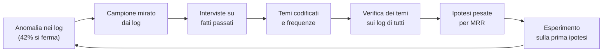

Una piattaforma B2B per la gestione degli ordini registra 1.250 nuovi account in un trimestre (scenario costruito, numeri di esempio). Il funnel mostra che l'importazione del catalogo, primo passo dopo la registrazione, viene avviata da tutti, ma 525 account, il 42%, non la completano entro sette giorni. Il team ha tre teorie: il file CSV richiesto è troppo rigido, gli utenti temono di sovrascrivere l'archivio esistente, chi si registra non ha i permessi per importare. Ognuna porta a un intervento diverso, e i log da soli non le distinguono: un abbandono sulla stessa schermata ha lo stesso aspetto nei dati qualunque sia la causa.

> **Idea chiave:** i dati dicono dove e quanto, le interviste dicono perché. Il customer development fatto da un analista usa i log per scegliere chi ascoltare e torna ai log per misurare quanto pesa ciò che ha sentito.

## Il ruolo delle interviste nel lavoro di un analista

Steve Blank, che ha formalizzato il customer development, definisce la startup come un'organizzazione temporanea che cerca un modello di business ripetibile e scalabile ([Steve Blank, 2010](https://steveblank.com/2010/01/25/whats-a-startup-first-principles/)). La ricerca passa da ipotesi scritte che si verificano parlando con i clienti, non da piani dedotti in ufficio. Lo stesso principio si applica a un prodotto già sul mercato: ogni domanda sul perché di un comportamento è un'ipotesi da verificare fuori dai dati.

Per un product analyst l'intervista non è un'attività separata dalla misura. È uno strumento con una funzione precisa nel ciclo di analisi: genera ipotesi causali quando i dati mostrano un'anomalia ma non la spiegano.

Prima viene la misura, che individua il problema e la sua dimensione; poi l'intervista, che produce spiegazioni candidate; poi di nuovo la misura, che stabilisce quanto ciascuna spiegazione vale sulla popolazione intera; infine l'esperimento, che verifica la correzione.

| Domanda | Strumento adatto | Perché |
| :--- | :--- | :--- |
| Quanti account si fermano all'importazione? | Log e funnel | È un conteggio su tutta la popolazione |
| Perché si fermano? | Interviste a chi si è fermato | Il motivo sta nel contesto di lavoro, non negli eventi |
| Quanto pesa ciascun motivo? | Log con proprietà che fanno da indicatori del motivo | Le interviste sono poche e non rappresentative per costruzione |
| La correzione funziona? | Esperimento o confronto prima e dopo | Solo il comportamento successivo verifica l'ipotesi |
| Che cosa farebbero con una nuova funzione? | Nessuno dei due in modo affidabile | Le previsioni sul proprio comportamento futuro sono deboli |

L'ultima riga è la più importante e la più ignorata. Le persone sono pessimi testimoni del proprio comportamento futuro e buoni testimoni del proprio passato recente. Un'intervista utile chiede che cosa è successo, non che cosa succederebbe.



## Selezionare chi intervistare a partire dai log

L'errore più comune è intervistare chi è disponibile: i clienti che scrivono spesso al supporto, i contatti del commerciale, gli utenti che rispondono per primi a un invito generico. Il campione che ne esce rappresenta la loquacità, non il comportamento da spiegare. Il criterio corretto parte dall'anomalia: chi ha fatto esattamente la cosa che vogliamo capire, quando, e con quale contesto osservabile.

Una buona definizione di campione ha quattro elementi. Il primo è un comportamento osservabile e datato: ha avviato l'importazione e non l'ha completata entro sette giorni. Il secondo è una finestra recente, al massimo 30 giorni, perché la memoria di un episodio si degrada in fretta. Il terzo è una stratificazione per attributi che potrebbero cambiare la causa, come la dimensione dell'account o il ruolo di chi si è iscritto. Il quarto è un gruppo di confronto di account simili che hanno completato il passo, per capire che cosa distingue i due gruppi.

Il gruppo di confronto è ciò che separa una ricerca da una raccolta di lamentele. Se anche chi ha completato l'importazione dice che il formato CSV è scomodo, la scomodità esiste ma non spiega l'abbandono. Se lo dice solo chi si è fermato, è un candidato serio.

```sql
-- Account che hanno avviato l'importazione negli ultimi 30 giorni
-- e non l'hanno completata entro 7 giorni (gruppo da intervistare),
-- piu' un gruppo di confronto che l'ha completata entro 1 giorno.
WITH avvii AS (
  SELECT
    user_id,
    MIN(event_time) AS primo_avvio
  FROM events
  WHERE event_name = 'catalog_import_started'
  GROUP BY user_id
),
completamenti AS (
  SELECT
    user_id,
    MIN(event_time) AS primo_completamento
  FROM events
  WHERE event_name = 'catalog_import_completed'
  GROUP BY user_id
),
classificati AS (
  SELECT
    a.user_id,
    a.primo_avvio,
    CASE
      WHEN c.primo_completamento IS NULL
        OR c.primo_completamento > a.primo_avvio + INTERVAL '7 days' THEN 'abbandono'
      WHEN c.primo_completamento <= a.primo_avvio + INTERVAL '1 day' THEN 'confronto'
      ELSE 'escluso'
    END AS gruppo
  FROM avvii a
  LEFT JOIN completamenti c ON c.user_id = a.user_id
  -- l'avvio deve essere recente ma avere avuto 7 giorni per completarsi
  WHERE a.primo_avvio BETWEEN CURRENT_DATE - INTERVAL '37 days'
                          AND CURRENT_DATE - INTERVAL '7 days'
)
SELECT
  k.gruppo,
  k.user_id,
  u.platform,
  u.country,
  w.properties ->> 'team_size' AS team_size,
  w.properties ->> 'signup_role' AS ruolo,
  ROW_NUMBER() OVER (
    PARTITION BY k.gruppo, w.properties ->> 'team_size'
    ORDER BY RANDOM()
  ) AS ordine_estrazione
FROM classificati k
JOIN users u ON u.user_id = k.user_id
JOIN events w ON w.user_id = k.user_id AND w.event_name = 'workspace_created'
WHERE k.gruppo IN ('abbandono', 'confronto')
ORDER BY k.gruppo, team_size, ordine_estrazione;
```

Il filtro sulla data esclude gli avvii degli ultimi sette giorni: quegli account non hanno ancora avuto il tempo di completare, e classificarli come abbandoni li metterebbe nel gruppo sbagliato. `ORDER BY RANDOM()` dentro la finestra produce un ordine casuale per strato, da cui si invitano i primi della lista fino alla quota decisa. In BigQuery la funzione è `RAND()` e le proprietà si leggono con `JSON_VALUE`.

### Esempio svolto: dal funnel a dodici interviste

Negli ultimi 30 giorni utili la query restituisce 180 account nel gruppo abbandono. Di questi, 150 hanno un contatto utilizzabile e il consenso a essere ricontattati. Il team decide di puntare a 12 interviste con chi ha abbandonato e 6 con il gruppo di confronto. Con un tasso di risposta storico del 20% agli inviti di ricerca, servono 12 / 0,20 = 60 inviti per il primo gruppo e 6 / 0,20 = 30 per il secondo.

Gli inviti si distribuiscono per strato in proporzione al peso economico, non al numero: gli account con più di 20 utenti sono il 20% degli abbandoni ma pesano di più sul fatturato, quindi ricevono 20 inviti su 60 invece di 12. La scelta va dichiarata nel resoconto, perché rende il campione intenzionalmente sbilanciato.

Dodici interviste per gruppo sembrano poche, ed è giusto che lo siano. Lo scopo non è stimare percentuali ma far emergere i motivi. Nella pratica della ricerca qualitativa, dopo una decina di conversazioni su un tema ristretto i motivi nuovi diventano rari; quando due interviste di fila non aggiungono temi, il campione è saturo per quella domanda.

## Domande su fatti passati: come non contaminare le risposte

Il libro di Rob Fitzpatrick [The Mom Test](https://www.momtestbook.com/) riassume il metodo in tre regole: parlare della vita dell'intervistato e non della propria idea, chiedere episodi specifici del passato invece di opinioni generali o previsioni, parlare poco e ascoltare molto. Il nome viene dall'idea che una buona domanda produce risposte utili perfino da chi ti vuole bene e non vuole deluderti.

| Domanda che contamina | Perché fallisce | Domanda su fatti passati |
| :--- | :--- | :--- |
| Il nostro importatore è difficile da usare? | Suggerisce la risposta e chiede un giudizio | Raccontami l'ultima volta che hai provato a caricare il catalogo. Da dove sei partito? |
| Useresti una funzione di mappatura delle colonne? | Chiede una previsione, la risposta cortese è sì | Che cosa hai fatto quando il file non veniva accettato? |
| Quanto pagheresti per un import automatico? | Prezzo ipotetico, nessun costo reale | Quanto tempo ha richiesto preparare il file l'ultima volta, e chi lo ha fatto? |
| Ti piacerebbe un'anteprima prima di sovrascrivere? | Propone la soluzione dell'intervistatore | Che cosa temevi potesse succedere quando hai premuto Importa? |
| Perché non hai completato? | Invita a razionalizzare a posteriori | Che cosa è successo subito dopo che hai chiuso la pagina? |

La traccia di un'intervista di 30 minuti segue una progressione stabile.

Nei primi 5 minuti il contesto: ruolo, come è gestito oggi il catalogo, chi altro è coinvolto. Per 15 minuti la ricostruzione dell'episodio: dove si trovava, che cosa ha provato a fare, che cosa ha visto, che cosa ha fatto dopo, quali alternative ha usato. Negli ultimi 10 minuti i costi reali: tempo speso, persone coinvolte, soldi o lavoro persi, e se ha cercato soluzioni altrove.

Le domande di approfondimento più produttive sono brevi: "Che cosa intendi?", "Puoi farmi un esempio?", "E poi?".

Un segnale forte è un comportamento costoso già sostenuto: un cliente che ha pagato un collaboratore per riformattare il CSV, o che ha costruito un foglio di calcolo per aggirare il problema, sta mostrando quanto vale la soluzione. Un segnale debole è un complimento o un "sarebbe utile". Nelle note i due vanno separati, perché solo il primo conta nella sintesi.

## Dalle note ai temi codificati

Ogni intervista produce una nota strutturata entro 24 ore: episodio, citazioni letterali, comportamenti osservati, costi sostenuti, attributi dell'account. La codifica trasforma le note in dati. Si parte da un codebook, un elenco di temi con definizione e criterio di inclusione, che due persone applicano in modo indipendente alle stesse note; i disaccordi si discutono e il codebook si aggiorna.

Senza questo passaggio la sintesi riflette l'interpretazione di chi ha condotto le interviste.

### Esempio svolto: tre temi e la loro incertezza

Sulle 12 interviste del gruppo abbandono emergono tre temi principali; un'intervista può contenerne più di uno.

| Tema | Definizione nel codebook | Interviste (su 12) | Quota | Intervallo di Wilson al 95% | Nel gruppo di confronto (su 6) |
| :--- | :--- | ---: | ---: | :--- | ---: |
| T1: formato rigido | Il file è stato rifiutato per colonne o formati non riconosciuti | 7 | 58,3% | 32,0% – 80,7% | 1 |
| T2: paura di sovrascrivere | Ha interrotto per timore di perdere dati esistenti | 4 | 33,3% | 13,8% – 60,9% | 0 |
| T3: permessi mancanti | Non aveva il ruolo per completare l'importazione | 3 | 25,0% | 8,9% – 53,2% | 0 |

Gli intervalli sono larghissimi: con 12 interviste T1 può valere un terzo come quattro quinti dei casi. Riportarli serve proprio a impedire che qualcuno legga "58% degli utenti" in una slide. Le interviste dicono che i tre motivi esistono e come si manifestano; non dicono quanto pesano.

Il gruppo di confronto aggiunge un'informazione preziosa: un solo account su 6 che ha completato cita il formato, quindi T1 distingue davvero chi abbandona.

## Verificare i temi sui log di tutta la popolazione

Il passo che trasforma la ricerca qualitativa in analisi è cercare, per ogni tema, un indicatore osservabile nei log e misurarlo su tutti i 525 account che hanno abbandonato. Le interviste servono anche a questo: raccontano che cosa succede sullo schermo, e quindi suggeriscono quale evento o proprietà cercare.

T1 ha un indicatore diretto: l'evento `catalog_import_error` con proprietà `error_type = 'column_mismatch'`. T2 ha solo un indicatore indiretto, cioè l'apertura dell'articolo di aiuto sulla sovrascrittura o il clic su Annulla nella finestra di conferma, che misura il timore in modo approssimato. T3 ha di nuovo un indicatore diretto: il ruolo dell'utente all'iscrizione è `viewer`, che non può importare.

```sql
-- Peso di ciascun tema sui 525 account che hanno abbandonato nel trimestre
WITH avvii AS (
  SELECT user_id, MIN(event_time) AS primo_avvio
  FROM events
  WHERE event_name = 'catalog_import_started'
    AND event_time >= DATE '2026-07-01' AND event_time < DATE '2026-10-01'
  GROUP BY user_id
),
abbandoni AS (
  SELECT a.user_id, a.primo_avvio
  FROM avvii a
  WHERE NOT EXISTS (
    SELECT 1 FROM events c
    WHERE c.user_id = a.user_id
      AND c.event_name = 'catalog_import_completed'
      AND c.event_time <= a.primo_avvio + INTERVAL '7 days'
  )
)
SELECT
  COUNT(DISTINCT a.user_id) AS abbandoni,
  COUNT(DISTINCT CASE WHEN e.event_name = 'catalog_import_error'
                       AND e.properties ->> 'error_type' = 'column_mismatch'
                      THEN a.user_id END) AS t1_formato,
  COUNT(DISTINCT CASE WHEN e.event_name IN ('help_overwrite_viewed', 'import_confirm_cancelled')
                      THEN a.user_id END) AS t2_sovrascrittura,
  COUNT(DISTINCT CASE WHEN e.event_name = 'workspace_created'
                       AND e.properties ->> 'signup_role' = 'viewer'
                      THEN a.user_id END) AS t3_permessi
FROM abbandoni a
LEFT JOIN events e
  ON e.user_id = a.user_id
 AND e.event_time <= a.primo_avvio + INTERVAL '7 days';
```

Il risultato: 289 account su 525 hanno ricevuto un errore di colonne, il 55,0%; 126 hanno mostrato un segnale di timore di sovrascrittura, il 24,0%; 95 si erano iscritti come `viewer`, il 18,1%. Le quote misurate sulla popolazione cadono dentro gli intervalli delle interviste, il che conferma che il campione non era distorto in modo grave. Ora i pesi si possono usare per una decisione.

## Ordinare le ipotesi per MRR a rischio

La priorità di un tema dipende da quanti account tocca, da quanto è bloccante e da quanto vale ogni account recuperato. Nei dati storici il 30% degli account che completano l'importazione diventa pagante con un MRR medio di 150 €. Ogni abbandono vale quindi in attesa 0,30 × 150 = 45 € di MRR, e i 525 abbandoni del trimestre 525 × 45 = 23.625 € di MRR mancato.

Per evitare promesse irrealistiche si applica un tasso di recupero prudente: si assume che una buona correzione recuperi metà degli account colpiti dal tema. Il valore atteso di ciascuna correzione è quota del tema × MRR mancato × 0,5.

| Tema | Quota sui log | MRR mancato associato | Recupero atteso al 50% | Bloccante? |
| :--- | ---: | ---: | ---: | :--- |
| T1: formato rigido | 55,0% | 13.005 € | 6.502 € al trimestre | Sì, il file viene rifiutato |
| T2: paura di sovrascrivere | 24,0% | 5.670 € | 2.835 € al trimestre | No, l'utente può proseguire |
| T3: permessi mancanti | 18,1% | 4.275 € | 2.138 € al trimestre | Sì, l'utente non può proseguire |

Le quote si sovrappongono, perché un account può avere più problemi, e quindi i recuperi non si sommano. Bastano però per l'ordine: T1 viene prima, con un valore circa doppio rispetto agli altri. T3 ha un valore minore ma una correzione economica, un invito all'amministratore direttamente dalla schermata di errore, e può procedere in parallelo.

T2 è meno urgente perché non blocca.

```python
# Ordinamento dei temi per MRR recuperabile e costo stimato della correzione
abbandoni = 525
mrr_atteso_per_account = 0.30 * 150  # conversione a pagante x MRR medio
recupero = 0.5

temi = {
    "T1 formato rigido": {"account": 289, "giorni_sviluppo": 15},
    "T2 paura di sovrascrivere": {"account": 126, "giorni_sviluppo": 8},
    "T3 permessi mancanti": {"account": 95, "giorni_sviluppo": 3},
}

for nome, t in temi.items():
    valore = t["account"] * mrr_atteso_per_account * recupero
    t["valore"] = valore
    t["valore_per_giorno"] = valore / t["giorni_sviluppo"]

for nome, t in sorted(temi.items(), key=lambda kv: kv[1]["valore"], reverse=True):
    print(f"{nome:28s} {t['account']/abbandoni:6.1%}  {t['valore']:8,.0f} EUR/trim  "
          f"{t['valore_per_giorno']:6,.0f} EUR per giorno di sviluppo")
# T1 formato rigido             55.0%     6,502 EUR/trim     434 EUR per giorno di sviluppo
# T2 paura di sovrascrivere     24.0%     2,835 EUR/trim     354 EUR per giorno di sviluppo
# T3 permessi mancanti          18.1%     2,138 EUR/trim     712 EUR per giorno di sviluppo
```

Il valore per giorno di sviluppo cambia la lettura: T3 rende di più per unità di lavoro e si può rilasciare in pochi giorni, T1 rende di più in assoluto. La raccomandazione è rilasciare subito la correzione di T3 e avviare in parallelo quella di T1, con una mappatura delle colonne nell'importatore.

## Dal tema all'esperimento

Ogni ipotesi ordinata diventa un esperimento con una metrica primaria e una soglia scritte prima del rilascio. Per T1: "Se l'importatore propone la mappatura delle colonne, la quota di account che completano l'importazione entro 7 giorni dall'avvio salirà dal 58% di oggi, cioè 725 su 1.250, ad almeno il 66%", con la metrica calcolata sugli account che avviano l'importazione dopo il rilascio. Una guardrail utile è la quota di cataloghi importati con errori di dati nei 14 giorni successivi, per evitare che un importatore più permissivo carichi dati sbagliati. Il disegno dell'esperimento, la dimensione del campione e la lettura del risultato seguono la [lezione sull'A/B testing](/course/analisi-prodotto/ab-testing/).

Dopo il rilascio si torna alle interviste con lo stesso protocollo, su un piccolo campione di chi continua ad abbandonare. Se i temi residui cambiano, il ciclo ricomincia con nuove ipotesi; se restano gli stessi, la correzione non ha colpito la causa.

## Trappole comuni

### Contare le interviste come un sondaggio

Il sintomo è una slide con "il 58% degli utenti vuole la mappatura delle colonne" basata su 12 conversazioni. Succede perché le percentuali sembrano più autorevoli delle citazioni. Si evita riportando i conteggi assoluti con l'intervallo di confidenza e affidando la stima del peso ai log o a un sondaggio quantitativo con un campione adeguato.

### Domande che suggeriscono la risposta

Il sintomo sono interviste in cui tutti approvano l'idea del team e nessuno racconta episodi concreti. Succede quando l'intervistatore presenta la soluzione o chiede giudizi e previsioni. Si evita con una traccia scritta di sole domande su fatti passati, rivista da un collega prima dell'uso, e ascoltando le registrazioni per contare quante volte l'intervistatore parla più dell'intervistato.

### Campione senza gruppo di confronto

Il sintomo è un tema citato da quasi tutti che, una volta corretto, non cambia la metrica. Succede quando il problema è diffuso anche tra chi completa il passo, e quindi non è la causa dell'abbandono. Si evita intervistando sempre un piccolo gruppo di chi ha avuto successo e confrontando le frequenze dei temi tra i due gruppi.

## Domande per verificare la comprensione

1. Il product manager propone di intervistare i 15 clienti che hanno aperto più ticket di supporto nell'ultimo mese per capire perché gli account nuovi abbandonano l'importazione. Che cosa obietti e che cosa proponi?

<details>
<summary>Mostra risposta</summary>

Quei clienti sono selezionati per la propensione a contattare il supporto, non per il comportamento da spiegare, e probabilmente sono account attivi da tempo che l'importazione l'hanno completata. Proponi di estrarre dai log gli account che hanno avviato l'importazione negli ultimi 30 giorni e non l'hanno completata entro 7, stratificati per dimensione e ruolo, più un gruppo di confronto che l'ha completata entro un giorno.

</details>

2. Come riscrivi la domanda "Ti sarebbe utile un'anteprima dei dati prima dell'importazione" in una domanda su fatti passati?

<details>
<summary>Mostra risposta</summary>

Una formulazione corretta è: "L'ultima volta che hai importato il catalogo, che cosa hai controllato prima di confermare, e come?", seguita da "Che cosa temevi potesse succedere?". La domanda originale propone una soluzione e chiede una previsione, quindi ottiene un sì di cortesia. La nuova fa emergere il comportamento reale e il timore, se esiste, senza suggerirlo.

</details>

3. Un tema compare in 9 interviste su 12 tra chi ha abbandonato e in 5 su 6 nel gruppo di confronto. Come lo classifichi?

<details>
<summary>Mostra risposta</summary>

È un fastidio diffuso, non un fattore che distingue chi abbandona: 75% contro 83%, con campioni così piccoli, non indica alcuna differenza. Va registrato come possibile miglioramento dell'esperienza, ma non come causa dell'abbandono, e non dovrebbe salire in cima alla lista delle priorità per il problema che si sta indagando.

</details>

4. Sui log, il tema dei permessi mancanti riguarda 95 account su 525. Con conversione a pagante del 30%, MRR medio di 150 € e recupero atteso del 50%, quanto MRR al trimestre vale la correzione? Perché non puoi sommare questo valore a quello degli altri temi?

<details>
<summary>Mostra risposta</summary>

Vale 95 × 0,30 × 150 × 0,5 = 2.137,5 €, circa 2.138 € di MRR al trimestre. Non si somma perché gli stessi account possono avere più problemi: un utente `viewer` può aver anche ricevuto un errore di colonne. Correggere i permessi lo porterebbe soltanto fino all'ostacolo successivo. Per una stima congiunta servirebbe contare gli account per combinazione di temi.

</details>
