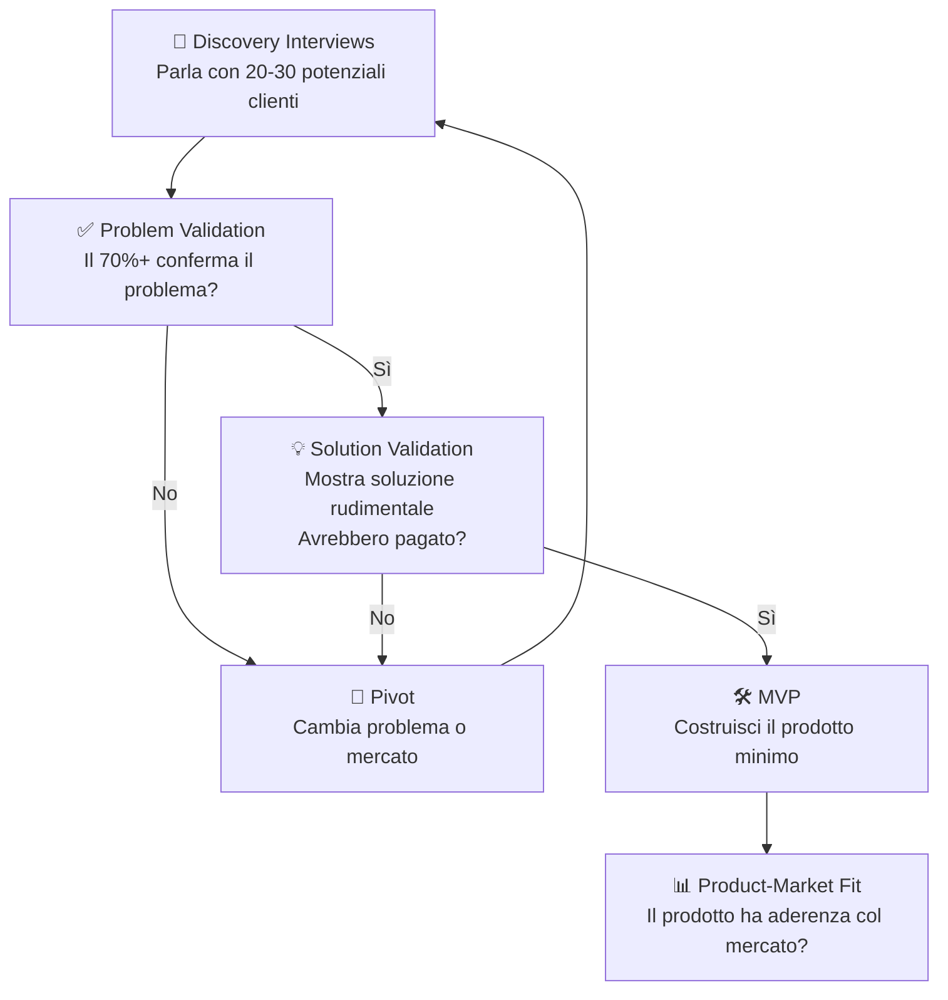

Il Customer Development è il processo di **validare se il problema esiste davvero** prima di iniziare a costruire il prodotto. Sembra ovvio, vero? Eppure il 90% degli imprenditori italiani salta direttamente da "ho un'idea geniale" a "vendo il mio monopattino per finanziare il MVP."

Lo schema di base è semplice:

1. **Problem** — esiste davvero il problema?
2. **Solution** — la nostra soluzione lo risolve?
3. **Product** — facciamo il vero prodotto
4. **Scale** — cresciamo in modo sostenibile

Se sbagli al punto 1 o 2, il punto 3 e 4 sono carta straccia.

## Il ciclo del Customer Development

## Come Satispay ha validato il problema

Satispay nasce intorno al 2013 a Torino, fondata da Alberto Dalmasso. Non è partita dicendo "faremo l'app di pagamento mobile tra amici." Ha iniziato intervistando 50+ utenti a Milano e Bologna:

**Problem Discovery:** "Problemi con i soldi tra amici?" — La risposta non era "mi serve pagare amici online" ma "odio chiedere soldi in prestito, è imbarazzante, e poi non me li danno neanche indietro."

**Solution sketch:** "E se poteste trasferire soldi via app, facilissimo, senza commissioni?" — Il 70% ha detto "ok, lo proverei."

**MVP brutale:** Una landing page con un form. Non un'app. Solo: "Lascia email, ti informeremo quando è pronto." Raccolsero migliaia di email.

**Primo prototipo:** funzionalità minima. Pagamenti peer-to-peer. Punto.

Risultato: oggi Satispay vale oltre 1 miliardo e ha validato il problema prima di scalare. Non perché aveva un'idea geniale — perché ha fatto i passi nel giusto ordine.

## Il caso pivoting: la startup food-tech milanese

Immaginiamo una startup milanese con fondatori ex-Bocconi: "Faremo l'app di consegna cibo smart, algoritmo che apprende le tue preferenze."

Hanno fatto 30 interviste. Ipotesi: il problema è la lentezza della consegna e la poca varietà di ristoranti.

Scoperta: no. Il problema vero era diverso. Il 65% degli intervistati ha detto: "Ordino quasi sempre dai soliti 3 ristoranti. Non ho voglia di cercare, se lo facessi passerei due ore a guardare menu."

**La vera soluzione:** non un'app che impara, ma una lista di 5-10 ristoranti pre-selezionati per te, personalizzati in base a gusti e orari.

Hanno pivotato. Hanno lanciato con soli 10 ristoranti partner (non 500). La retention è salita del 200%.

**Lezione:** non innamorarti della tua idea. Abbraccia il problema del cliente, anche se è diverso da quello che pensavi.

## Le 4 fasi del Customer Development

### Fase 1: Discovery Interviews (Settimane 1-4)

Parla con chiunque sia potenzialmente interessato al tuo prodotto. 20-30 persone minimo. Non amici e familiari — mentono, vogliono farti felice. Stranieri. Persone che alla fine pagheranno.

**Domanda magica:** "Raccontami l'ultima volta che hai avuto questo problema."

Se non riescono a ricordarsi, il problema non è urgente.

### Fase 2: Problem Validation (Settimane 5-8)

Il 70%+ del tuo target ha confermato il problema in modo indipendente, senza che tu suggerissi la soluzione? Avanti.

Se meno del 70%, torna alla fase 1 o pivotta. Non saltare questo passaggio.

### Fase 3: Solution Validation (Settimane 9-16)

Mostra una soluzione **rudimentale** (anche solo mockup Figma). Domanda: "Lo useresti? A che prezzo?"

Non chiedere "Ti piace?" — la risposta è quasi sempre sì. Chiedi "Lo compreresti?" o "Lo useresti settimanalmente?" — questo è il test vero.

### Fase 4: MVP e Testing (Settimane 17+)

Costruisci il prodotto minimo, lancia a un gruppo ristretto, misura il comportamento reale. Non il dichiarato — il comportamento.

## Domande giuste vs domande sbagliate

| Domanda SBAGLIATA | Domanda GIUSTA | Perché |
|---|---|---|
| "Ti piace questa idea?" | "Quando è stata l'ultima volta che hai avuto questo problema?" | Realtà > opinione |
| "Quanto pagheresti per questo?" | "Se domani lanciassi a 29€/mese, lo compresti?" | Azione > dichiarazione d'intenti |
| "Pensi sia un'ottima soluzione?" | "Quale altra soluzione hai provato prima?" | Capisce il contesto competitivo |
| "Lo useresti sicuro?" | "Come lo useresti in una settimana tipo?" | Concretezza > ipotesi |
| "È meglio di X?" | "Cosa cambieresti di questo prodotto?" | Feedback costruttivo > giudizi |

## La trappola della conferma

Il problema più grande: gli imprenditori fanno interviste per **confermare** l'idea, non per imparare.

Segnali che sei in trappola:
- Parli solo con amici e famiglia
- Quando qualcuno dice "no" pensi "non ha capito la visione"
- Hai già deciso cos'è il problema prima di fare una sola intervista
- Parli per il 70% dell'intervista, non ascolti
- Dici "i numeri lo confermano" quando ne hai solo 3

**Rimedio:** assumi un amico scettico che controlli le tue interviste. Se lui dice "sembrava che guidassi il feedback", allora lo eri.

## Perché il CustDev non è opzionale

Costruire il prodotto sbagliato costa tempo e soldi. **Validare il problema costa solo tempo.**

- Intervista: gratis
- Landing page MVP: gratis (Carrd, Webflow)
- Prototipo Figma: gratis
- Focus group: paghi caffè e brioche

Se scopri che il problema non esiste, hai risparmiato 6 mesi e 100k euro.

Il CustDev non è una cosa da fare una volta. Lo rifarai quando entri in un nuovo mercato, quando il prodotto mostra churn, quando vuoi aggiungere una feature importante.

## Problema reale

Il team vuole validare un idea, ma rischia di confondere complimenti educati, opinioni generiche e disponibilita reale a cambiare comportamento.

La domanda pratica non e "so ripetere la teoria?", ma: **quale decisione migliora se applico bene questa lezione?** In product analytics, il rischio tipico e prendere un segnale parziale e trasformarlo in una scelta costosa: una feature lanciata troppo presto, un budget spostato senza causalita, un modello dati fragile o una raccomandazione piu elegante che utile.

## Modello concettuale

Usa questa griglia in tre passaggi: prima definisci il fenomeno, poi scegli l evidenza minima credibile, infine trasformi l evidenza in una decisione esplicita.

| Livello | Domanda guida | Output atteso |
|---|---|---|
| Fenomeno | Che cosa sta davvero succedendo? | Perimetro, segmenti e assunzioni |
| Evidenza | Quale dato cambierebbe la nostra opinione? | Metriche, osservazioni e guardrail |
| Decisione | Che cosa faremo se il segnale regge? | Azione, owner, timing e criterio di stop |

Questo modello evita due estremi: teoria senza applicazione e operativita senza ragionamento.

## Formalizzazione rigorosa

Formalizza la lezione come una catena decisionale:

| Elemento | Definizione operativa | Controllo di qualita |
|---|---|---|
| Input | eventi prodotto, funnel, coorti, survey, ticket supporto e session recording | Fonte, periodo, granularita e completezza dichiarati |
| Ipotesi | Relazione attesa tra comportamento, metrica e decisione | Assunzioni scritte prima dell analisi |
| Metrica | activation, retention, conversione, NPS, churn e valore per utente | Denominatore, segmento e finestra temporale espliciti |
| Guardrail | Cosa non deve peggiorare mentre ottimizzi | Soglie condivise con product, growth e design |
| Decisione | scegliere quali frizioni rimuovere, quali segmenti servire e quali interventi mettere in backlog | Owner, scadenza e criterio di revisione |

Una lezione e formalizzata bene quando un altra persona puo ricostruire il ragionamento e contestare le assunzioni senza chiedere spiegazioni extra.

## Esempio o caso studio

Immagina una review settimanale in cui product, growth e design deve decidere su "Customer Development: validare prima di costruire". Il dato iniziale mostra un segnale promettente, ma il team non si ferma al numero principale. Divide il problema per segmento, controlla i guardrail, cerca spiegazioni alternative e scrive una raccomandazione con tre parti: cosa sappiamo, cosa non sappiamo, cosa faremo adesso.

| Osservazione | Interpretazione prudente | Azione |
|---|---|---|
| Segnale positivo sulla metrica primaria | Potrebbe essere effetto reale o composizione del campione | Controllare segmenti e baseline |
| Guardrail stabile | Il miglioramento non sembra creare danni immediati | Procedere con rollout limitato |
| Evidenza ancora incompleta | Serve una verifica prima di scalare | Definire un secondo ciclo di misura |

Il valore del caso non sta nel trovare una risposta perfetta, ma nel rendere la decisione piu difendibile.

## Lab / esercizio

Usa questo esercizio per trasformare la lezione in pratica verificabile.

| Livello | Attivita | Output |
|---|---|---|
| Livello base | Riassumi il problema in cinque righe e scegli una metrica primaria con un guardrail. | Mini brief decisionale |
| Livello intermedio | Applica il modello a un caso reale o simulato, includendo segmenti, baseline e rischi. | Tabella di analisi con raccomandazione |
| Livello research-grade | Scrivi un memo che confronta due spiegazioni alternative e indica quale evidenza le distinguerebbe. | Decision memo revisionabile |

**Dataset e materiali consigliati:** esportazione eventi o metriche dal tuo prodotto, una dashboard gia usata dal team, note qualitative, risultati di un esperimento o un dataset pubblico coerente con il tema.

## Errore tipico da evitare

L errore piu comune e usare "Customer Development: validare prima di costruire" come etichetta autorevole invece che come metodo. Succede quando il team cita il concetto per giustificare una scelta gia presa, oppure quando ottimizza una metrica locale senza chiedersi quale comportamento sta incentivando.

Correzione pratica: prima di presentare la raccomandazione, scrivi una riga con la decisione proposta, una riga con l evidenza che la sostiene e una riga con la condizione che ti farebbe cambiare idea. Se manca una di queste tre righe, la lezione non e ancora stata applicata con rigore.

## Quiz o checkpoint

1. Quale decisione concreta dovrebbe migliorare applicando questa lezione?
2. Quale metrica useresti come segnale primario e quale come guardrail?
3. Quale spiegazione alternativa potrebbe rendere sbagliata la tua interpretazione?
4. Che cosa dovrebbe succedere nei dati per farti cambiare raccomandazione?
5. Quale output consegneresti a product, growth e design: dashboard, memo, esperimento, backlog o modello dati?

Se non riesci a rispondere in modo specifico, torna al problema reale prima di continuare.

## Riepilogo

- **CustDev è la validazione del problema PRIMA di costruire il prodotto** — non è opzionale
- Il ciclo è: scoperta → validazione problema → validazione soluzione → MVP
- **70%+ di target che conferma il problema in modo indipendente** = puoi procedere
- Le domande giuste sono sulle azioni ("avrebbero pagato?") non sulle opinioni
- **Satispay** ha validato il problema prima di scalare, pivotando da P2P a pagamenti merchant
- **La trappola della conferma** è il killer di quasi tutti gli MVP falliti — non intervistare per confermare, ma per imparare
- Costruire il prodotto sbagliato per un problema che non esiste è il modo più costoso di fallire
