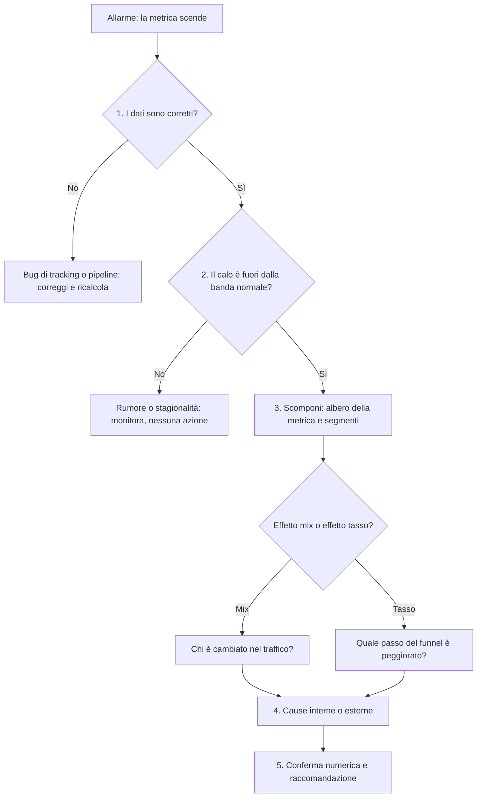

Lunedì mattina, scenario costruito con numeri di esempio. Un'app di e-commerce con circa 100.000 utenti attivi a settimana vede la conversione settimanale, cioè la quota di utenti attivi che compra almeno una volta, scendere dal 3,50% al 3,11%. Il calo relativo è dell'11%. Alle 9:30 il responsabile di prodotto scrive nel canale del team: «Cosa si è rotto?». Alle 10:00 ci sono già tre teorie: il nuovo checkout rilasciato giovedì, un concorrente che ha lanciato una promozione, un bug su Android. Nessuno ha ancora guardato i dati in modo ordinato.

Questa è la domanda più frequente che riceve un product analyst, e anche la più classica nei colloqui. Il lavoro non consiste nell'indovinare la causa, ma nell'eliminare le spiegazioni in un ordine che parte dalle più economiche da verificare e dalle più probabili. Un'ora di metodo evita una settimana passata a correggere il checkout sbagliato.

> **Idea chiave:** prima di cercare una causa di prodotto si dimostra che il calo è reale e anomalo, poi lo si scompone finché il numero che si è mosso ha un solo proprietario e una sola spiegazione verificabile.

## Il metodo in cinque passi

Il metodo è un imbuto di ipotesi. Ogni passo elimina una famiglia di spiegazioni e restringe il campo per il successivo. L'ordine conta: se salti la verifica dei dati e passi subito ai segmenti, puoi passare un pomeriggio a spiegare un calo che in realtà è un evento di tracking smesso di arrivare da una versione dell'app.



La tabella riassume che cosa si cerca in ogni passo e quale prova chiude la domanda.

| Passo | Domanda | Prova che chiude il passo | Tempo tipico |
| :--- | :--- | :--- | :--- |
| 1. Dati | Il numero è misurato come la settimana prima? | Volumi di eventi per versione, piattaforma e fonte stabili | 15–30 min |
| 2. Anomalia | Il valore esce dalla variazione normale? | Confronto con stesse settimane e banda storica | 15 min |
| 3. Scomposizione | Quale componente e quale segmento si è mosso? | Effetto mix ed effetto tasso per segmento, passo del funnel | 1–2 ore |
| 4. Interno o esterno | È stato un cambiamento nostro o del mondo? | Calendario di rilasci, campagne, prezzi, eventi esterni | 30–60 min |
| 5. Conferma | La causa spiega quanto del calo? | Quota del calo spiegata e controllo su un gruppo non esposto | 1–2 ore |

## Passo 1: il calo è reale o è un errore di misura

Una parte sorprendente dei cali urgenti è un problema di dati. Una nuova versione dell'app smette di inviare l'evento `purchase`, una pipeline ETL carica solo metà delle partizioni, qualcuno cambia la definizione di utente attivo in una vista dbt, oppure un filtro anti-bot nuovo toglie traffico vero. In tutti questi casi il prodotto funziona e il grafico mente.

I controlli si fanno in quest'ordine, perché il primo è il più rapido:

- **Volumi grezzi per fonte.** Conta gli eventi chiave per giorno, piattaforma e versione dell'app. Una versione con zero acquisti, mentre le altre sono stabili, indica quasi sempre un evento mancante, non utenti che hanno smesso di comprare.
- **Sistema di riferimento indipendente.** Confronta gli acquisti tracciati con gli ordini nel database transazionale o con gli incassi del fornitore di pagamenti. Se gli ordini reali sono stabili e quelli tracciati scendono, il problema è nel tracking.
- **Completezza della pipeline.** Controlla che l'ultimo giorno sia completo: molti cali «del lunedì» sono una domenica caricata a metà.
- **Definizioni.** Verifica nel versionamento del codice di trasformazione che la definizione della metrica non sia cambiata.

Nello scenario gli ordini nel database transazionale scendono quanto quelli tracciati, e i volumi per versione sono coerenti. Il calo è reale: si passa al punto successivo.

## Passo 2: il calo è anomalo o è variazione normale

Ogni metrica oscilla. Prima di attivare il team bisogna sapere quanto oscilla di solito. Due confronti risolvono la maggior parte dei casi. Il primo è con la stessa settimana dell'anno precedente, o con lo stesso giorno della settimana, per togliere la stagionalità: il lunedì di un'app di consegne non si confronta con il sabato, e la settimana dopo il Black Friday non si confronta con quella del Black Friday. Il secondo è con una banda costruita sulle ultime settimane stabili.

Nello scenario la conversione delle otto settimane precedenti è stata: 3,42%, 3,55%, 3,47%, 3,51%, 3,44%, 3,53%, 3,49%, 3,50%. La media è 3,49% e la deviazione standard campionaria è 0,044 punti percentuali. La banda di due deviazioni standard va quindi da 3,49 − 2 × 0,044 = 3,40% a 3,49 + 2 × 0,044 = 3,58%. Il valore attuale, 3,11%, sta 0,38 punti sotto la media, cioè circa 8,6 deviazioni standard. Lo stesso periodo dell'anno precedente non mostrava cali. Il calo è anomalo e merita la diagnosi.

Se il valore fosse stato 3,43%, dentro la banda, la risposta corretta sarebbe stata «non c'è ancora un segnale, ricontrolliamo la settimana prossima». Rispondere così è una competenza, non una mancanza di impegno: evita di inseguire il rumore. La banda va costruita su un periodo senza promozioni o festività, altrimenti diventa troppo larga e nasconde i cali veri.

## Passo 3: scomporre la metrica nei suoi fattori

Una metrica di sintesi è il prodotto o la somma di metriche più piccole. Il ricavo settimanale, per esempio, è utenti attivi × conversione × valore medio dell'ordine. Quando il ricavo scende, il primo lavoro è capire quale fattore si è mosso.

Per un prodotto di fattori si usa la scomposizione logaritmica, perché il logaritmo di un prodotto è la somma dei logaritmi: ln(R1/R0) = ln(U1/U0) + ln(C1/C0) + ln(A1/A0). Ogni termine è il contributo del fattore alla variazione totale, e i contributi si sommano esattamente.

Esempio numerico. Il ricavo passa da 100.000 euro a 92.000 euro, cioè −8%. Gli utenti attivi passano da 20.000 a 21.000 (+5%), la conversione dal 5,0% al 4,6% (−8%), il valore medio dell'ordine da 100 euro a 95,24 euro (−4,76%). Verifica: 21.000 × 4,6% = 966 ordini, e 966 × 95,24 = 92.000 euro. I logaritmi: ln(1,05) = +0,0488, ln(0,92) = −0,0834, ln(0,9524) = −0,0488. La somma è −0,0834, pari a ln(0,92), il calo totale. La lettura è netta: l'aumento degli utenti e il calo del valore medio si compensano, e tutto il calo del ricavo viene dalla conversione. La diagnosi prosegue sulla conversione, non sul traffico né sul prezzo.

Il passo successivo è scendere lungo il funnel che produce la conversione: visita di un prodotto, aggiunta al carrello, inizio checkout, pagamento completato. Il passo con il calo maggiore indica dove guardare. Se l'aggiunta al carrello è stabile e il pagamento completato crolla, il sospetto si sposta sul checkout o sul fornitore di pagamento. Il calcolo del funnel con l'ordine dei passi è trattato nella [lezione dedicata all'analisi dei funnel](/course/analisi-prodotto/funnel-analysis/).

## Effetto mix contro effetto tasso

Un tasso aggregato può scendere senza che nessun segmento peggiori. Basta che cresca il peso di un segmento che converte meno. È l'effetto mix, parente del paradosso di Simpson, ed è la causa più sottovalutata dei cali di conversione.

La variazione di un tasso aggregato R = Σ wᵢ rᵢ, dove wᵢ è il peso del segmento i e rᵢ il suo tasso, si scompone in due parti che si sommano esattamente:

- **Effetto mix** = Σ (w1ᵢ − w0ᵢ) × r0ᵢ: quanto cambia il totale per il solo cambio dei pesi, a tassi fermi.
- **Effetto tasso** = Σ w1ᵢ × (r1ᵢ − r0ᵢ): quanto cambia il totale per il cambio dei tassi dentro ogni segmento, con i pesi nuovi.

Applichiamolo allo scenario, segmentando per piattaforma.

| Segmento | Utenti settimana 0 | Tasso settimana 0 | Utenti settimana 1 | Tasso settimana 1 |
| :--- | ---: | ---: | ---: | ---: |
| Desktop | 40.000 | 5,0% | 30.000 | 5,0% |
| Mobile | 60.000 | 2,5% | 80.000 | 2,4% |
| Totale | 100.000 | 3,50% | 110.000 | 3,11% |

Il totale della settimana 0 è (2.000 + 1.500) / 100.000 = 3,50%. Il totale della settimana 1 è (1.500 + 1.920) / 110.000 = 3.420 / 110.000 = 3,11%. La variazione è −0,39 punti.

I pesi passano da 0,40 e 0,60 a 30.000 / 110.000 = 0,273 e 80.000 / 110.000 = 0,727.

- Effetto mix: (0,273 − 0,40) × 5,0 + (0,727 − 0,60) × 2,5 = −0,636 + 0,318 = −0,318 punti.
- Effetto tasso: 0,273 × (5,0 − 5,0) + 0,727 × (2,4 − 2,5) = 0 − 0,073 = −0,073 punti.
- Somma: −0,318 − 0,073 = −0,391 punti, che coincide con il calo osservato.

L'81% del calo, cioè 0,318 su 0,391, viene dal cambio di composizione: sono arrivati 20.000 utenti mobile in più, che convertono la metà di quelli desktop, mentre i desktop sono scesi di 10.000. Il tasso mobile è sceso di appena 0,1 punti. Prima di attribuirgli un significato serve un test sulle proporzioni: con 1.500 acquirenti su 60.000 contro 1.920 su 80.000 la statistica z vale circa −1,20, lontana dalla soglia di 1,96. Il calo del tasso mobile è compatibile con il caso.

La decisione cambia completamente rispetto alle tre teorie del mattino. Non c'è un bug da cercare nel checkout. La domanda giusta diventa: da dove arrivano i 20.000 utenti mobile nuovi, e perché il desktop è sceso? Nello scenario la risposta è una campagna sui social partita giovedì, che porta traffico mobile poco qualificato, e la fine di una campagna di newsletter che portava acquirenti desktop abituali. La raccomandazione va al marketing, non agli sviluppatori.

### La scomposizione in SQL

La query calcola pesi, tassi ed effetti per segmento confrontando due settimane, sullo schema eventi comune del modulo: `events(user_id, event_name, event_time, properties)` e `users(user_id, signup_time, channel, country, platform)`.

```sql
-- Effetto mix ed effetto tasso della conversione settimanale per piattaforma
WITH base AS (
  SELECT
    CASE WHEN e.event_time >= DATE '2026-11-16' THEN 'curr' ELSE 'prev' END AS periodo,
    u.platform AS segmento,
    e.user_id,
    MAX(CASE WHEN e.event_name = 'purchase' THEN 1 ELSE 0 END) AS ha_acquistato
  FROM events AS e
  JOIN users AS u ON u.user_id = e.user_id
  WHERE e.event_time >= DATE '2026-11-09'
    AND e.event_time <  DATE '2026-11-23'
  GROUP BY 1, 2, 3
),
per_segmento AS (
  SELECT
    periodo,
    segmento,
    COUNT(*) * 1.0 / SUM(COUNT(*)) OVER (PARTITION BY periodo) AS peso,
    AVG(ha_acquistato * 1.0) AS tasso
  FROM base
  GROUP BY periodo, segmento
),
confronto AS (
  SELECT
    segmento,
    COALESCE(MAX(CASE WHEN periodo = 'prev' THEN peso END), 0) AS w0,
    COALESCE(MAX(CASE WHEN periodo = 'curr' THEN peso END), 0) AS w1,
    MAX(CASE WHEN periodo = 'prev' THEN tasso END) AS r0,
    MAX(CASE WHEN periodo = 'curr' THEN tasso END) AS r1
  FROM per_segmento
  GROUP BY segmento
)
SELECT
  segmento,
  ROUND(w0, 3) AS w0,
  ROUND(w1, 3) AS w1,
  ROUND(100 * r0, 2) AS tasso0_pct,
  ROUND(100 * r1, 2) AS tasso1_pct,
  ROUND(100 * (w1 - w0) * r0, 3) AS effetto_mix_pp,
  ROUND(100 * w1 * (r1 - r0), 3) AS effetto_tasso_pp
FROM confronto
ORDER BY ABS((w1 - w0) * r0) + ABS(w1 * (r1 - r0)) DESC;
```

Sui dati dello scenario la query restituisce una riga per segmento: desktop con −0,636 punti di mix e 0 di tasso, mobile con +0,318 di mix e −0,073 di tasso. La somma delle due colonne dà −0,391. Ripeti la query per canale, paese e versione dell'app: il segmento con il contributo assoluto più grande è il primo da indagare. Un segmento presente in un solo periodo ha un tasso nullo in quello mancante e va trattato a parte, come nuovo traffico.

Per il test sul tasso di un segmento bastano poche righe di Python.

```python
from math import sqrt

# Mobile: acquirenti e utenti nelle due settimane
x0, n0 = 1_500, 60_000
x1, n1 = 1_920, 80_000

p0, p1 = x0 / n0, x1 / n1
p_pool = (x0 + x1) / (n0 + n1)
se = sqrt(p_pool * (1 - p_pool) * (1 / n0 + 1 / n1))
z = (p1 - p0) / se
print(f"tasso: {p0:.2%} -> {p1:.2%}, z = {z:.2f}")  # z = -1.20, non significativo al 5%
```

## Passo 4: cause interne o esterne

Quando la scomposizione ha isolato il segmento o il passo del funnel, si cercano gli eventi che lo hanno toccato. È utile dividerli in due famiglie, perché le prove richieste sono diverse.

| Tipo | Esempi | Dove cercare la prova | Firma tipica nei dati |
| :--- | :--- | :--- | :--- |
| Interno: rilascio | Nuovo checkout, versione dell'app, flag attivato | Registro dei rilasci, feature flag | Calo che parte all'ora del rilascio, solo sulla versione o sul gruppo esposto |
| Interno: marketing | Campagna nuova o sospesa, cambio di budget | Calendario campagne, costi per canale | Effetto mix: cambia il peso di un canale |
| Interno: prezzo o offerta | Aumento di prezzo, fine sconto, nuovo paywall | Log dei prezzi, esperimenti attivi | Calo nel passo di pagamento, stabile prima |
| Esterno: stagionalità | Festività, ferie, inizio mese | Stesso periodo dell'anno prima | Si ripete ogni anno, colpisce tutti i segmenti |
| Esterno: piattaforma | Aggiornamento del sistema operativo, policy di uno store | Note di rilascio, segmento per versione del sistema | Solo una piattaforma o una versione del sistema |
| Esterno: mercato | Promozione di un concorrente, notizie, sciopero | Ricerche di mercato, menzioni, traffico di brand | Calo diffuso su utenti nuovi, meno sui fedeli |

Due regole aiutano a non perdersi. La prima: una causa deve spiegare la firma, non solo la data. Un rilascio su Android non può spiegare un calo identico su iOS e desktop. La seconda: le cause esterne si dichiarano solo dopo aver escluso quelle interne, perché sono comode e difficili da smentire. «È colpa della concorrenza» senza un dato che lo mostri è un modo elegante di dire «non lo so».

Un controllo utile per le cause esterne è il gruppo di confronto naturale. Se il concorrente ha una promozione solo in Italia, il calo deve esserci in Italia e non in Spagna. Il confronto tra i due paesi prima e dopo è una differenza nelle differenze approssimativa, il metodo che la lezione sull'[inferenza causale osservazionale](/course/analisi-prodotto/inferenza-causale-osservazionale/) tratta in modo rigoroso.

## Passo 5: confermare la causa e quantificarla

Un'ipotesi è confermata quando soddisfa tre condizioni: la tempistica coincide, la firma nei segmenti coincide, e la causa spiega una quota grande del calo. Nello scenario la campagna social parte giovedì, il traffico in più è tutto mobile e tutto dal canale social, e l'effetto mix spiega 0,318 punti su 0,391, cioè l'81%.

Il controllo finale è ricalcolare la metrica senza il segmento sospetto. Se si tolgono i 20.000 utenti mobile arrivati dalla campagna, restano 30.000 desktop con 1.500 acquirenti e 60.000 mobile. Ipotizzando per questi ultimi il tasso storico del 2,5%, si hanno 1.500 acquirenti mobile, quindi (1.500 + 1.500) / 90.000 = 3,33%. Resta un calo di 0,17 punti rispetto al 3,50%, che viene dal calo del traffico desktop. Questo residuo va spiegato a sua volta: nello scenario coincide con la sospensione della newsletter. Le due cause insieme chiudono il quadro.

Il risultato si comunica con una frase che contiene numero, causa, quota spiegata, livello di certezza e azione:

> **Sintesi per il team:** la conversione è scesa dal 3,50% al 3,11%.
> Circa l'80% del calo è un effetto di composizione: la campagna social partita giovedì ha portato 20.000 utenti mobile che convertono la metà della media, e la newsletter sospesa ha ridotto il traffico desktop.
> Il tasso dentro ogni piattaforma è stabile; il calo di 0,1 punti su mobile non è statisticamente distinguibile dal caso.
> Raccomandazione: valutare la campagna sul costo per acquirente, non sulla conversione aggregata, e decidere se riattivare la newsletter. Nessun intervento sul checkout.

## Trappole comuni

### Saltare la verifica dei dati

Il sintomo è un team che lavora due giorni su un calo che sparisce quando qualcuno ricarica la pipeline. Succede perché il problema di dati sembra banale e il problema di prodotto sembra interessante. Si evita rendendo il passo 1 obbligatorio e veloce: una query di volumi per fonte e versione pronta da lanciare, e un confronto con il sistema transazionale.

### Leggere il totale e ignorare la composizione

Il sintomo è una correzione di prodotto per un calo che era solo di mix: si cambia il checkout e la conversione non torna, perché il traffico è ancora diverso. Succede perché il tasso aggregato è il numero in dashboard e i pesi non si vedono. Si evita calcolando sempre effetto mix ed effetto tasso per le due o tre dimensioni principali: piattaforma, canale, utenti nuovi contro abituali.

### Fermarsi alla prima spiegazione plausibile

Il sintomo è una causa che spiega il 30% del calo presentata come la causa. Succede perché la prima ipotesi confermata dà sollievo. Si evita chiedendo sempre «quanto del calo spiega?» e cercando una spiegazione anche per il residuo, come nello scenario con la newsletter.

### Affogare nei segmenti

Il sintomo è una tabella con 40 segmenti in cui qualcuno trova sempre un calo del 20%. Con molti segmenti piccoli alcune variazioni grandi escono per caso. Si evita ordinando i segmenti per contributo assoluto al calo, non per variazione percentuale, e controllando con un test la variazione dei segmenti piccoli.

## Verifica la diagnosi

1. Il numero di attivazioni giornaliere scende del 40% da ieri, ma solo per gli utenti con la versione 5.2 dell'app, uscita ieri. Le altre versioni sono stabili. Qual è la prima ipotesi e come la verifichi?

<details>
<summary>Mostra risposta</summary>

La prima ipotesi è un problema di tracking: la nuova versione non invia l'evento di attivazione o lo invia con un nome diverso. Si verifica contando gli eventi per nome e versione, e confrontando le attivazioni tracciate con un dato indipendente, per esempio i record creati nel database dell'applicazione. Solo se anche il database mostra il calo si passa all'ipotesi di un bug di prodotto nella versione 5.2.

</details>

2. Il tasso di conversione aggregato scende dal 4,0% al 3,6%, ma i tassi di tutti i paesi sono stabili. Che cosa è successo e quale calcolo lo dimostra?

<details>
<summary>Mostra risposta</summary>

È un effetto mix: è cresciuto il peso dei paesi che convertono meno. Lo dimostra la scomposizione: l'effetto tasso, Σ w1 × (r1 − r0), è vicino a zero, e l'effetto mix, Σ (w1 − w0) × r0, spiega quasi tutti i −0,4 punti. La domanda successiva è perché è cambiata la composizione, per esempio una campagna in un paese a bassa conversione.

</details>

3. Il ricavo cala del 10%. Gli utenti attivi sono stabili, la conversione cresce del 2%, il valore medio dell'ordine scende di circa l'11,8%. Quale fattore spiega il calo e che cosa controlli subito?

<details>
<summary>Mostra risposta</summary>

Il valore medio dell'ordine: 1,00 × 1,02 × 0,882 ≈ 0,90, cioè −10%. In logaritmi, ln(1,02) = +0,020 e ln(0,882) = −0,126, la somma è −0,105 = ln(0,90). Si controllano subito sconti, promozioni, cambi di prezzo e il mix dei prodotti venduti: una promozione su un articolo economico alza la conversione e abbassa il valore medio, come in questo caso.

</details>

4. La conversione di questa settimana è 3,43%, la media delle ultime otto settimane è 3,49% con deviazione standard 0,044 punti. Il responsabile chiede un'analisi urgente. Cosa rispondi?

<details>
<summary>Mostra risposta</summary>

Che il valore è dentro la banda normale: 3,49 − 2 × 0,044 = 3,40%, e 3,43% è sopra. Lo scarto è di circa 1,4 deviazioni standard, compatibile con la variazione ordinaria. Si monitora la settimana successiva e si avvia la diagnosi se il valore esce dalla banda o se scende per tre o quattro settimane consecutive.

</details>

5. Hai trovato che un rilascio su Android spiega 0,10 punti di un calo di 0,40 punti. Puoi chiudere la diagnosi?

<details>
<summary>Mostra risposta</summary>

No. La causa spiega il 25% del calo, e il restante 75% resta senza spiegazione. Si comunica il risultato parziale, si chiede la correzione del rilascio Android e si continua la scomposizione sul residuo, per esempio per canale e per utenti nuovi contro abituali, finché la parte spiegata non copre la maggior parte del calo.

</details>
