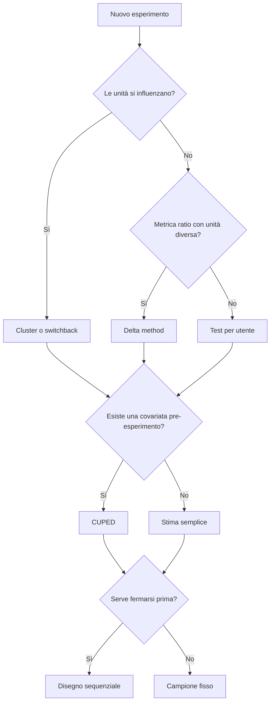

Lo scenario è costruito, con numeri di esempio. Un anno dopo il test sulla checklist di onboarding, FitLoop fa girare una ventina di esperimenti al mese. Il protocollo di base funziona: schede scritte prima, controllo SRM, durata in settimane intere. Ma arrivano domande che il protocollo di base non sa trattare. Il team contenuti vuole misurare i minuti di allenamento, una metrica così variabile che servirebbero sei settimane di traffico. Il team social vuole testare le sfide di gruppo, dove un utente nel braccio di trattamento invita amici che stanno nel controllo. Il team crescita lancia dodici modifiche "vincenti" in sei mesi, ma la metrica di business cresce molto meno della somma degli effetti dichiarati.

Ognuno di questi problemi ha una tecnica standard, nata nelle piattaforme di sperimentazione delle grandi aziende tecnologiche e ormai disponibile negli strumenti commerciali. Un product analyst non deve saperle implementare tutte da zero, ma deve sapere quando servono, che ipotesi fanno e come si leggono i loro numeri.

> **Idea chiave:** un A/B test di base presuppone unità indipendenti, effetto costante nel tempo e una sola domanda per esperimento. Le tecniche avanzate servono quando una di queste ipotesi cade: ognuna ripara una specifica ipotesi rotta, e va scelta partendo da quale si è rotta.

## Quale ipotesi si è rotta

Prima di scegliere una tecnica conviene chiedersi quale presupposto del test classico non vale nel caso concreto. La tabella collega il sintomo al rimedio.

| Sintomo | Ipotesi rotta | Tecnica |
|---|---|---|
| Campione necessario enorme su una metrica continua | Varianza troppo alta | CUPED con covariate pre-esperimento |
| Metrica per sessione o per pagina con randomizzazione per utente | Osservazioni indipendenti | Delta method o bootstrap per utente |
| Effetto forte la prima settimana e poi in calo | Effetto costante nel tempo | Analisi per giorni dall'esposizione, coorti di nuovi utenti |
| Trattati e controlli si influenzano | Nessuna interferenza (SUTVA) | Randomizzazione a cluster o switchback |
| Bisogno di decidere prima della fine | Campione fissato in anticipo | Test sequenziale con soglie corrette |
| Molte metriche o molte varianti | Una sola ipotesi | Holm, Benjamini-Hochberg |
| Somma dei test vincenti più grande della crescita reale | Effetti indipendenti e duraturi | Holdout di lungo periodo |



## CUPED: usare il passato per ridurre il rumore

La varianza di una metrica come "allenamenti completati nei 14 giorni del test" è in gran parte dovuta a differenze stabili tra persone: chi si allenava molto prima continua ad allenarsi molto. Questa parte di varianza non ha niente a che fare con il trattamento e si può togliere. È l'idea di CUPED (Controlled-experiment Using Pre-Experiment Data), proposto da Deng, Xu, Kohavi e Walker in un [articolo del 2013](https://doi.org/10.1145/2433396.2433413) sulla piattaforma di Bing.

Per ogni utente si prende una covariata $X$ misurata **prima** dell'assegnazione, di solito la stessa metrica nel periodo precedente, e si costruisce la metrica corretta:

$$
Y_{\text{cuped}} = Y - \theta\,(X - \bar{X}), \qquad \theta = \frac{\operatorname{Cov}(X, Y)}{\operatorname{Var}(X)}
$$

Poiché $X$ è misurata prima del test, la randomizzazione garantisce che abbia la stessa media nei due bracci: sottrarla non sposta la differenza attesa, quindi la stima resta corretta. La varianza invece scende di un fattore $1 - \rho^{2}$, dove $\rho$ è la correlazione tra $X$ e $Y$.

Esempio numerico su FitLoop, utenti già attivi da almeno un mese.

1. Varianza di $Y$ (allenamenti nei 14 giorni del test): 25, cioè deviazione standard 5. Varianza di $X$ (allenamenti nei 14 giorni prima): 16. Covarianza: 14.
2. Correlazione: $\rho = 14 / (5 \times 4) = 0{,}70$.
3. Coefficiente: $\theta = 14 / 16 = 0{,}875$.
4. Varianza corretta: $25 - 14^{2}/16 = 25 - 12{,}25 = 12{,}75$, cioè il 51% di quella originale, $1 - 0{,}70^{2} = 0{,}51$.
5. Campione per un MDE di 0,25 allenamenti con alfa 0,05 e potenza 80%: senza CUPED $n = 2 \times 7{,}849 \times 25 / 0{,}25^{2} = 6.279$ utenti per braccio; con CUPED $2 \times 7{,}849 \times 12{,}75 / 0{,}0625 = 3.202$.

Lo stesso test dura circa la metà. Un utente con $X = 8$ e $Y = 10$, con $\bar{X} = 5$, ha metrica corretta $10 - 0{,}875 \times 3 = 7{,}375$: era sopra la media anche prima, e CUPED toglie la parte del suo valore che il passato già spiegava.

```python
import numpy as np

rng = np.random.default_rng(2)
n = 6000  # utenti per braccio

def simula(effetto):
    x = rng.normal(5.0, 4.0, n)                              # allenamenti nei 14 giorni prima
    y = 1.0 + 0.875 * x + rng.normal(0, 3.57, n) + effetto   # allenamenti durante il test
    return x, y

x_c, y_c = simula(0.0)
x_t, y_t = simula(0.25)

# theta stimato sui due bracci insieme, con la media pre-esperimento comune
x_all, y_all = np.concatenate([x_c, x_t]), np.concatenate([y_c, y_t])
theta = np.cov(x_all, y_all)[0, 1] / np.var(x_all, ddof=1)
mu_x = x_all.mean()

def stima(y_c, y_t):
    diff = y_t.mean() - y_c.mean()
    se = np.sqrt(y_c.var(ddof=1) / n + y_t.var(ddof=1) / n)
    return diff, se

d0, se0 = stima(y_c, y_t)
d1, se1 = stima(y_c - theta * (x_c - mu_x), y_t - theta * (x_t - mu_x))
print(f"theta = {theta:.3f}")
print(f"senza CUPED: effetto {d0:.3f}, SE {se0:.3f}")
print(f"con CUPED:   effetto {d1:.3f}, SE {se1:.3f}")
print(f"riduzione di varianza: {1 - (se1 / se0) ** 2:.0%}")
# theta = 0.883
# senza CUPED: effetto 0.229, SE 0.092
# con CUPED:   effetto 0.227, SE 0.066
# riduzione di varianza: 49%
```

Le stime puntuali quasi coincidono, l'errore standard scende da 0,092 a 0,066. Tre avvertenze pratiche. La covariata deve essere misurata prima dell'assegnazione: usare una variabile che il trattamento può influenzare reintroduce un bias. Per i nuovi utenti non esiste un periodo precedente, quindi CUPED aiuta poco nei test di onboarding, a meno di usare covariate disponibili all'iscrizione come canale e piattaforma. E la riduzione dipende tutta da $\rho$: con $\rho = 0{,}3$ si guadagna solo il 9%.

## Metriche ratio e delta method

Molte [metriche di engagement](/course/analisi-prodotto/engagement-metriche/) e di prodotto sono rapporti: click-through per sessione, ricavo per ordine, errori per richiesta. Se randomizzi per utente ma calcoli il rapporto su sessioni, le sessioni dello stesso utente non sono indipendenti. Chi clicca molto lo fa in tutte le sue sessioni. Trattare 40.000 sessioni come 40.000 osservazioni indipendenti sottostima l'errore standard e produce falsi positivi, spesso proprio i "risultati sorprendenti" che non si replicano.

Il rapporto si scrive come $R = \bar{C}/\bar{S}$, dove $\bar{C}$ e $\bar{S}$ sono click e sessioni medi **per utente**. Il delta method ([Deng, Knoblich e Lu, 2018](https://arxiv.org/abs/1803.06336)) approssima la varianza di un rapporto tra medie:

$$
\operatorname{Var}(R) \approx \frac{1}{n}\left(\frac{\sigma_C^{2}}{\mu_S^{2}} - \frac{2\,\mu_C\,\sigma_{CS}}{\mu_S^{3}} + \frac{\mu_C^{2}\,\sigma_S^{2}}{\mu_S^{4}}\right)
$$

Esempio con un braccio di 10.000 utenti: in media 4,0 sessioni e 1,2 click per utente, quindi $R = 0{,}30$. Varianza delle sessioni 9, varianza dei click 4, covarianza 3.

1. Primo termine: $4 / 4{,}0^{2} = 0{,}250$.
2. Secondo termine: $2 \times 1{,}2 \times 3 / 4{,}0^{3} = 0{,}1125$.
3. Terzo termine: $1{,}2^{2} \times 9 / 4{,}0^{4} = 0{,}0506$.
4. Somma: $0{,}250 - 0{,}1125 + 0{,}0506 = 0{,}188$; divisa per 10.000 e sotto radice dà un errore standard di 0,00434.
5. Il calcolo ingenuo binomiale sulle sessioni dà $\sqrt{0{,}30 \times 0{,}70 / 40.000} = 0{,}00229$.

L'errore standard corretto è quasi il doppio. Per la differenza tra due bracci uguali va moltiplicato per $\sqrt{2}$: 0,00324 con il calcolo ingenuo, 0,00614 con il delta method. Un effetto di +0,007 sul click-through dà $z = 0{,}007/0{,}00324 = 2{,}16$ con il primo, quindi "significativo", e $z = 0{,}007/0{,}00614 = 1{,}14$ con il secondo, cioè dentro il rumore. Un A/A test con questa metrica lo rivelerebbe subito: troppi falsi positivi.

```python
import numpy as np

def ratio_se_delta(clic, sessioni):
    """Errore standard di sum(clic)/sum(sessioni) con un'osservazione per utente."""
    clic, sessioni = np.asarray(clic, float), np.asarray(sessioni, float)
    n = len(clic)
    mu_c, mu_s = clic.mean(), sessioni.mean()
    var_c, var_s = clic.var(ddof=1), sessioni.var(ddof=1)
    cov_cs = np.cov(clic, sessioni)[0, 1]
    var_r = (var_c / mu_s**2 - 2 * mu_c * cov_cs / mu_s**3 + mu_c**2 * var_s / mu_s**4) / n
    return mu_c / mu_s, np.sqrt(var_r)
```

L'effetto tra bracci si legge poi come differenza di due rapporti indipendenti, con errore standard $\sqrt{SE_A^{2} + SE_B^{2}}$. L'alternativa senza formule è il bootstrap ricampionando **utenti**, non sessioni: più lento, ma utile per controllare il delta method su metriche nuove.

## Novelty e primacy: quando l'effetto cambia nel tempo

Un cambio visibile a utenti abituali produce due reazioni opposte. L'**effetto novità** spinge a provare la cosa nuova per curiosità e svanisce in pochi giorni. L'**effetto primacy** (o di apprendimento) frena all'inizio, perché l'utente deve abituarsi, e poi si recupera. In entrambi i casi l'effetto medio di un test di una settimana non è quello che vedrai tra sei mesi.

FitLoop testa una nuova home con le sfide in evidenza sugli utenti esistenti. L'effetto sulle sessioni per utente, per settimana dalla prima esposizione, è questo.

| Settimana dall'esposizione | Utenti esistenti | Nuovi iscritti nel periodo |
|---|---:|---:|
| 1 | +8,0% | +2,6% |
| 2 | +4,1% | +2,4% |
| 3 | +2,7% | +2,5% |
| 4 | +2,5% | +2,4% |

L'effetto medio sulle quattro settimane per gli esistenti è $(8{,}0 + 4{,}1 + 2{,}7 + 2{,}5)/4 = 4{,}3\%$, ma la serie scende e si stabilizza intorno al 2,5%. I nuovi iscritti, che non conoscevano la vecchia home e quindi non possono provare novità, mostrano da subito circa il 2,5%. Le due evidenze convergono: l'effetto di lungo periodo plausibile è vicino al 2,5%, non al 4,3%, e il business case va scritto con quel numero.

Il controllo da fare in ogni test su utenti esistenti è proprio questo: la serie dell'effetto per **giorni dall'esposizione** (non per data di calendario, che mescola utenti esposti da poco e da tanto) e, se possibile, il confronto con la coorte dei nuovi utenti. Se la serie non si è stabilizzata alla fine del test, la durata era troppo corta.

## Interferenza: test a cluster e switchback

L'analisi classica presuppone che il risultato di un utente dipenda solo dalla sua variante. In statistica si chiama SUTVA (Stable Unit Treatment Value Assumption). Cade in tre situazioni tipiche: prodotti social, dove il trattato invita o influenza il controllo; marketplace, dove trattati e controlli competono per la stessa offerta; prodotti di team, dove i colleghi condividono lo stesso spazio di lavoro.

Nel test delle sfide di gruppo di FitLoop, un utente trattato crea una sfida e invita tre amici, due dei quali sono nel controllo. Il controllo riceve una parte del trattamento e la differenza tra bracci sottostima l'effetto vero. In un marketplace succede il contrario: se un algoritmo di prezzo fa prenotare di più il braccio trattato, lascia meno offerta al controllo e la differenza sovrastima l'effetto, che sparirebbe con il rilascio a tutti.

La **randomizzazione a cluster** assegna gruppi interi: tutti gli amici di una community, tutti gli utenti di un account aziendale, tutte le persone di una città. L'interferenza resta dentro il cluster. Il prezzo è statistico: gli utenti dello stesso cluster si somigliano, quindi valgono meno di altrettanti utenti indipendenti. La perdita si misura con il **design effect**:

$$
DE = 1 + (m - 1)\,\rho_{\text{ICC}}
$$

dove $m$ è la dimensione media del cluster e $\rho_{\text{ICC}}$ la correlazione intra-cluster. Con 400 account per braccio da 25 utenti ciascuno, cioè 10.000 utenti, e ICC 0,04: $DE = 1 + 24 \times 0{,}04 = 1{,}96$. Il campione efficace è $10.000/1{,}96 = 5.102$ utenti. Bisogna quasi raddoppiare il campione per avere la stessa potenza, e l'analisi va fatta a livello di cluster o con errori standard robusti per cluster.

Lo **switchback** è la soluzione quando l'interferenza riguarda un'intera area: tutti gli utenti di una città vedono la stessa variante per una finestra di tempo, poi la variante cambia. Su un servizio di consegne si alternano, per esempio, finestre di due ore per 4 città e 14 giorni: $4 \times 14 \times 12 = 672$ finestre, assegnate a caso. Si scartano i primi 30 minuti di ogni finestra, perché ordini e corrieri del periodo precedente contaminano quello nuovo, e l'unità di analisi diventa la finestra città-ora. Lo switchback funziona quando l'effetto si esaurisce in fretta; non va usato per modifiche che cambiano il comportamento per giorni.

## Test sequenziali: guardare prima senza barare

Nella lezione sull'[A/B testing](/course/analisi-prodotto/ab-testing/) il peeking compare tra gli errori che invalidano il test. Il problema è reale: una simulazione con cinque controlli equidistanti su un test con effetto nullo, fermandosi al primo $|z| > 1{,}96$, dà circa il 14% di falsi positivi invece del 5%. Ma la necessità di fermarsi prima è legittima: un effetto molto grande va colto presto, e uno molto negativo va fermato.

La soluzione è pianificare i controlli e usare soglie più severe nei primi. Il disegno di O'Brien-Fleming, il più usato in pratica, spende pochissimo alfa all'inizio e quasi tutto alla fine. La tabella mostra le soglie per quattro controlli equidistanti con alfa complessivo 0,05 bilaterale, confrontate con quelle di Pocock, che usa la stessa soglia per tutti i controlli.

| Controllo | Quota del campione | O'Brien-Fleming, soglia di z | Pocock, soglia di z |
|---|---:|---:|---:|
| 1 | 25% | 4,049 | 2,361 |
| 2 | 50% | 2,863 | 2,361 |
| 3 | 75% | 2,337 | 2,361 |
| 4 | 100% | 2,024 | 2,361 |

Con O'Brien-Fleming si ferma al primo controllo solo un effetto enorme, e l'ultima soglia, 2,024, è di poco più alta di 1,96: il costo in potenza rispetto a un test a campione fisso è piccolo, intorno al 2-3% di campione in più. Pocock permette stop anticipati più facili ma penalizza l'analisi finale. Le piattaforme commerciali offrono spesso varianti più flessibili, come le funzioni di spesa dell'alfa (che permettono controlli non equidistanti) o i test "always valid" che consentono di guardare in qualsiasi momento a fronte di una perdita di potenza maggiore. Qualunque sia il metodo, va scelto e scritto nella scheda prima del lancio.

## Molte metriche, molte varianti

Un esperimento con cinque metriche dichiarate, tutte rilevanti per la decisione, ha cinque occasioni di falso positivo. Le correzioni per confronti multipli controllano due quantità diverse. Il **FWER** (family-wise error rate) è la probabilità di almeno un falso positivo: lo controllano Bonferroni e Holm, adatti quando anche un solo errore costa caro. Il **FDR** (false discovery rate) è la quota attesa di falsi positivi tra le scoperte: lo controlla Benjamini-Hochberg, adatto quando si esplorano molte metriche e si accetta qualche errore in cambio di potenza.

Esempio con cinque valori p ordinati: 0,004; 0,012; 0,021; 0,040; 0,300.

| Rango $i$ | Valore p | Bonferroni: $0{,}05/5$ | Holm: $0{,}05/(5-i+1)$ | BH: $0{,}05 \cdot i/5$ |
|---:|---:|---|---|---|
| 1 | 0,004 | 0,010, significativo | 0,0100, significativo | 0,010, significativo |
| 2 | 0,012 | 0,010, no | 0,0125, significativo | 0,020, significativo |
| 3 | 0,021 | 0,010, no | 0,0167, no e ci si ferma | 0,030, significativo |
| 4 | 0,040 | 0,010, no | non valutato | 0,040, significativo |
| 5 | 0,300 | 0,010, no | non valutato | 0,050, no |

Bonferroni dichiara una scoperta, Holm due, Benjamini-Hochberg quattro. Holm è sempre almeno potente quanto Bonferroni e controlla lo stesso errore, quindi non c'è motivo di usare Bonferroni puro. In Benjamini-Hochberg si cerca il rango più alto il cui valore p sta sotto la propria soglia, qui il quarto, e si dichiarano significativi tutti quelli fino a lì. La regola pratica: la metrica primaria unica non va corretta; i guardrail si leggono con margini di non inferiorità; le correzioni servono quando le metriche decisionali sono più d'una o quando le varianti sono tre o più.

## Holdout di lungo periodo

Dopo sei mesi il team crescita di FitLoop ha rilasciato dodici modifiche vincenti, con effetti dichiarati sulle sessioni per utente che sommati fanno +14%. La metrica complessiva però è cresciuta molto meno. Le ragioni sono tre e si sommano: effetti novità misurati in test brevi, stime gonfiate dei test vincenti (passa la soglia soprattutto chi per caso è uscito grande) e modifiche che si sovrappongono, per esempio due notifiche diverse che spingono la stessa azione.

L'**holdout globale** misura il valore cumulato. Una quota fissa di utenti, per esempio il 5%, resta esclusa da tutte le modifiche rilasciate nel semestre e continua a vedere il prodotto di partenza. Alla fine del periodo si confrontano holdout e resto della popolazione: se la differenza sulle sessioni per utente è +6%, quella è la stima del contributo reale delle dodici modifiche, meno della metà della somma dichiarata. Il risultato non dice che i test erano sbagliati: dice di quanto vanno scontati i loro effetti quando si pianifica.

L'holdout ha costi veri: il 5% degli utenti riceve un prodotto peggiore per mesi, il codice delle vecchie esperienze va mantenuto e alcune modifiche (prezzi, policy legali) non possono essere escluse. Per questo si usa su quote piccole, per periodi definiti, e su un insieme dichiarato di modifiche.

## Errori ricorrenti nelle tecniche avanzate

### CUPED con una covariata contaminata

Il sintomo è un effetto CUPED molto diverso da quello semplice. Succede quando la covariata viene calcolata su una finestra che include giorni dopo l'assegnazione, per esempio "allenamenti negli ultimi 28 giorni" calcolato alla fine del test. Il trattamento influenza la covariata e la correzione toglie anche parte dell'effetto. Si evita fissando la finestra della covariata prima della data di assegnazione di ciascun utente.

### Interferenza scoperta dopo il test

Il sintomo è un effetto che sparisce al rilascio completo. In un marketplace il test per utente mostrava +6% di prenotazioni, ma il trattato stava prendendo offerta al controllo. Si evita chiedendosi prima del lancio se un utente trattato può cambiare l'esperienza di uno di controllo; se la risposta è sì, si passa a cluster o switchback anche al costo di un test più lungo.

### Correggere troppo o troppo poco

Il sintomo è un report con quaranta metriche e nessuna correzione, oppure una metrica primaria penalizzata con Bonferroni per le trenta metriche diagnostiche. Si evita separando i ruoli già nella scheda: una primaria senza correzione, guardrail con margini, secondarie decisionali con Holm o BH, tutto il resto esplorativo e dichiarato come tale.

## Domande di verifica

1. Una metrica ha deviazione standard 10 e la sua correlazione con il valore pre-esperimento è 0,6. Di quanto scende il campione necessario con CUPED?

<details>
<summary>Mostra risposta</summary>

La varianza si riduce del fattore $1 - 0{,}6^{2} = 0{,}64$, quindi il campione scende al 64% di quello originale, un risparmio del 36%. Se servivano 10.000 utenti per braccio ne bastano 6.400. La stima resta corretta purché la covariata sia misurata prima dell'assegnazione.

</details>

2. Randomizzi per utente e misuri il ricavo per ordine. Un collega calcola l'errore standard trattando ogni ordine come indipendente. Perché è un problema e come lo correggi?

<details>
<summary>Mostra risposta</summary>

Gli ordini dello stesso utente sono correlati, quindi le osservazioni indipendenti sono meno degli ordini e l'errore standard ingenuo è troppo piccolo: aumentano i falsi positivi. Si aggrega per utente (ricavo e ordini per utente) e si calcola la varianza del rapporto con il delta method, oppure si fa un bootstrap ricampionando utenti.

</details>

3. Un test su utenti esistenti mostra +9% di engagement nella prima settimana e +3% nella terza. Il PM vuole usare la media delle tre settimane nel business case. Che cosa proponi?

<details>
<summary>Mostra risposta</summary>

L'andamento indica un effetto novità. La media delle settimane sovrastima l'effetto stabile. Conviene guardare la serie per giorni dall'esposizione e verificare se si è stabilizzata, confrontarla con i nuovi utenti che non hanno un'abitudine precedente e, se la serie scende ancora, allungare il test. Nel business case va il valore di plateau, intorno al 3%, con la sua incertezza.

</details>

4. Un'app per team assegna la nuova bacheca condivisa a singoli utenti. Account medi da 25 utenti, ICC stimato 0,04. Perché passare alla randomizzazione per account e che cosa costa?

<details>
<summary>Mostra risposta</summary>

I colleghi usano la stessa bacheca, quindi un utente trattato cambia l'esperienza di quelli di controllo nello stesso account: l'interferenza distorce il confronto. Randomizzando per account l'interferenza resta dentro il braccio. Il costo è il design effect $1 + 24 \times 0{,}04 = 1{,}96$: servono circa il doppio degli utenti per la stessa potenza, e l'analisi deve usare errori standard per cluster.

</details>

5. Con un disegno O'Brien-Fleming a quattro controlli, al secondo controllo osservi z = 2,5. Puoi fermare il test dichiarando un vincitore?

<details>
<summary>Mostra risposta</summary>

No. La soglia al secondo controllo è 2,863 e 2,5 non la supera. Il test prosegue fino al controllo successivo, dove la soglia scende a 2,337. Fermarsi con 2,5 al secondo controllo equivale a fare peeking e rompe il controllo dell'errore di primo tipo che il disegno garantisce.

</details>
