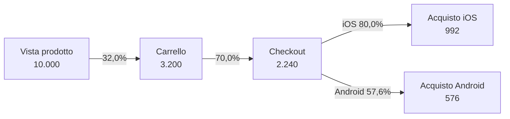

Un e-commerce di articoli per la casa (scenario costruito, numeri di esempio) apre il report settimanale e trova un tasso di conversione dal checkout all'acquisto del 104%. Il responsabile del prodotto chiede se il dato è vero, il marketing lo ha già messo in una slide. Il numero è impossibile, ma il report non ha nessun errore di calcolo: ha contato gli utenti distinti per ogni evento, senza chiedersi se l'acquisto venisse davvero dopo il checkout. Chi ha comprato dal pulsante «Riordina» senza passare dal carrello è finito nel numeratore di un passo che non ha mai attraversato.

> **Idea chiave:** un funnel non è un elenco di eventi contati uno per uno, ma una sequenza: un utente conta in un passo solo se ha fatto il passo precedente, nell'ordine giusto e dentro una finestra di tempo dichiarata.

Il funnel è lo strumento che un product analyst usa più spesso, perché trasforma la domanda «dove perdiamo le persone?» in una tabella con un numero per passo. Proprio per questo è anche lo strumento che produce più numeri sbagliati presentati con sicurezza. Le sezioni che seguono fissano le definizioni, costruiscono la query corretta, mostrano come scegliere la finestra e come segmentare, e chiudono con un esempio svolto che arriva a una decisione in euro.

## Che cos'è un funnel: passi, ordine, finestra, denominatore

Un funnel è definito da quattro scelte, e ognuna cambia il risultato. La prima sono i **passi**: una lista ordinata di eventi che rappresentano l'avanzamento verso un obiettivo, per esempio `product_viewed` → `add_to_cart` → `checkout_started` → `purchase`. La seconda è l'**ordine**: quanto deve essere rigida la sequenza. La terza è la **finestra di conversione**: il tempo massimo, misurato dal primo passo, entro cui gli altri passi devono avvenire. La quarta è il **denominatore**: chi entra nel funnel, cioè chi ha compiuto il primo passo nel periodo di analisi.

Con queste scelte le formule sono semplici. Chiamiamo $n_k$ il numero di utenti che hanno raggiunto il passo $k$ rispettando ordine e finestra.

La **conversione di passo** è $n_k / n_{k-1}$: la quota di chi era al passo precedente e ha proseguito. Risponde alla domanda «dove si fermano le persone?».

La **conversione complessiva** è $n_k / n_1$: la quota di chi è entrato nel funnel e ha raggiunto il passo $k$. È il numero che si lega ai ricavi.

Il **drop-off di passo** è $1 - n_k / n_{k-1}$ in percentuale, e $n_{k-1} - n_k$ in utenti persi. Il valore assoluto conta quanto il tasso, perché è quello che si traduce in acquisti mancati.

Siccome ogni $n_k$ è un sottoinsieme di $n_{k-1}$, vale sempre $n_1 \ge n_2 \ge \dots \ge n_K$. Nessuna conversione può superare il 100%. Se succede, la query non sta rispettando l'ordine o sta contando utenti che non sono mai entrati nel funnel.

Sull'ordine esistono tre varianti, che gli strumenti come Amplitude e Mixpanel espongono con nomi diversi ma con la stessa logica:

| Variante | Regola | Quando usarla | Rischio |
| :--- | :--- | :--- | :--- |
| Stretto (ordine esatto) | I passi devono essere consecutivi, nessun altro evento in mezzo | Flussi guidati e brevi, come un form a più schermate | Scarta utenti che hanno solo tornato indietro o aperto un aiuto |
| Ordinato (default) | I passi vanno in ordine, altri eventi in mezzo sono ammessi | Quasi tutti i funnel di prodotto ed e-commerce | Va accompagnato da una finestra, altrimenti un passo può arrivare dopo mesi |
| Qualsiasi ordine | Conta chi ha fatto tutti i passi, in qualunque sequenza | Checklist di setup senza sequenza obbligata | Non dice dove si blocca chi si ferma, perché non c'è un «prima» |

C'è poi una distinzione sull'ingresso. In un **funnel chiuso** si entra solo dal primo passo, ed è la forma che serve per misurare conversioni. In un **funnel aperto** si può entrare da qualsiasi passo: utile per descrivere il traffico di una pagina, inutile per calcolare tassi, perché il denominatore di ciascun passo è una popolazione diversa.

## Perché contare gli utenti per evento produce il 104%

Torniamo al report dell'e-commerce. Nella settimana dal 5 all'11 ottobre il team ha contato gli utenti distinti che hanno generato ciascun evento, senza legarli tra loro. A destra c'è lo stesso calcolo fatto con un funnel chiuso, ordinato, con finestra di 7 giorni dal primo `product_viewed` della settimana.

| Passo | Utenti distinti per evento | Tasso «ingenuo» | Utenti nel funnel ordinato | Conversione di passo |
| :--- | ---: | ---: | ---: | ---: |
| product_viewed | 10.000 | — | 10.000 | — |
| add_to_cart | 3.900 | 39,0% | 3.200 | 32,0% |
| checkout_started | 2.600 | 66,7% | 2.240 | 70,0% |
| purchase | 2.700 | 103,8% | 1.568 | 70,0% |

Il conteggio ingenuo mette nella riga `purchase` 2.700 persone, di cui 1.100 non hanno visto un prodotto in quella settimana: hanno riordinato dalla cronologia, hanno completato un carrello aperto la settimana prima, oppure hanno comprato prima di guardare il prodotto che ha fatto scattare l'evento di vista. Il funnel ordinato le esclude, perché non hanno compiuto i passi nell'ordine richiesto.

La differenza non è solo estetica. La conversione complessiva corretta è $1.568 / 10.000 = 15{,}7\%$. Il conteggio ingenuo suggerirebbe $2.700 / 10.000 = 27\%$, un valore che porta a sottostimare di quasi la metà il lavoro che resta da fare. Gli utenti che riordinano senza passare dal catalogo sono un fenomeno reale e interessante, ma vanno misurati con un funnel loro, non mescolati in questo.

## Ordine e finestra scritti in SQL

La query seguente implementa il funnel chiuso e ordinato sullo schema eventi comune del modulo: `events(user_id, event_name, event_time, properties)` e `users(user_id, signup_time, channel, country, platform)`. L'idea è a cascata: per ogni utente si prende il primo `product_viewed` del periodo come istante di ingresso `t1`; poi si cerca il primo `add_to_cart` successivo a `t1` e dentro la finestra; poi il primo `checkout_started` successivo a quel carrello, e così via. Un `LEFT JOIN` per passo lascia `NULL` chi si ferma, e `COUNT(colonna)` conta solo chi ha un tempo valido.

```sql
-- Funnel chiuso e ordinato, finestra di 7 giorni dal primo passo (dialetto Postgres/DuckDB)
WITH s1 AS (
    SELECT user_id, MIN(event_time) AS t1
    FROM events
    WHERE event_name = 'product_viewed'
      AND event_time >= TIMESTAMP '2026-10-05'
      AND event_time <  TIMESTAMP '2026-10-12'
    GROUP BY user_id
),
s2 AS (
    SELECT s1.user_id, s1.t1, MIN(e.event_time) AS t2
    FROM s1
    LEFT JOIN events e
      ON e.user_id = s1.user_id
     AND e.event_name = 'add_to_cart'
     AND e.event_time >= s1.t1
     AND e.event_time <= s1.t1 + INTERVAL '7 days'
    GROUP BY s1.user_id, s1.t1
),
s3 AS (
    SELECT s2.user_id, s2.t1, s2.t2, MIN(e.event_time) AS t3
    FROM s2
    LEFT JOIN events e
      ON e.user_id = s2.user_id
     AND e.event_name = 'checkout_started'
     AND e.event_time >= s2.t2                         -- dopo il passo precedente
     AND e.event_time <= s2.t1 + INTERVAL '7 days'     -- finestra misurata dall'ingresso
    GROUP BY s2.user_id, s2.t1, s2.t2
),
s4 AS (
    SELECT s3.user_id, s3.t1, s3.t2, s3.t3, MIN(e.event_time) AS t4
    FROM s3
    LEFT JOIN events e
      ON e.user_id = s3.user_id
     AND e.event_name = 'purchase'
     AND e.event_time >= s3.t3
     AND e.event_time <= s3.t1 + INTERVAL '7 days'
    GROUP BY s3.user_id, s3.t1, s3.t2, s3.t3
)
SELECT
    u.platform,
    COUNT(*)     AS viewed,
    COUNT(s4.t2) AS carted,
    COUNT(s4.t3) AS checkout,
    COUNT(s4.t4) AS purchased,
    ROUND(100.0 * COUNT(s4.t2) / COUNT(*), 1)                AS pct_view_cart,
    ROUND(100.0 * COUNT(s4.t3) / NULLIF(COUNT(s4.t2), 0), 1) AS pct_cart_checkout,
    ROUND(100.0 * COUNT(s4.t4) / NULLIF(COUNT(s4.t3), 0), 1) AS pct_checkout_purchase,
    ROUND(100.0 * COUNT(s4.t4) / COUNT(*), 1)                AS pct_overall
FROM s4
JOIN users u ON u.user_id = s4.user_id
GROUP BY ROLLUP (u.platform)          -- una riga per piattaforma più il totale
ORDER BY u.platform NULLS LAST;
```

Tre dettagli fanno la differenza tra questa query e una che sbaglia. Il primo: la finestra si misura sempre da `t1`, non dal passo precedente, altrimenti ogni passo regala altri sette giorni e la finestra reale diventa di ventotto. Il secondo: si usa il primo evento utile dopo il passo precedente (`MIN`), così un utente con tre carrelli conta una volta sola. Il terzo: si ancora l'ingresso al primo `product_viewed` del periodo. È una scelta, non una verità: un utente che non converte alla prima visita ma converte alla seconda, tre giorni dopo, resta comunque dentro grazie alla finestra; se invece torna dopo dieci giorni, risulta perso. Se il prodotto ha cicli d'acquisto lunghi, la finestra va allungata, non l'ancoraggio cambiato a caso.

C'è infine il problema delle coorti aperte. Se estrai i dati il 9 ottobre, chi è entrato l'8 ottobre ha avuto un giorno su sette per convertire e abbassa artificialmente il tasso. La regola è che la data di estrazione deve essere almeno pari alla fine del periodo più la finestra: per la settimana 5–11 ottobre con finestra di 7 giorni, non prima del 19 ottobre. Nelle dashboard in tempo reale le ultime barre risultano quasi sempre inferiori alle precedenti per questo motivo, non per un calo.

## Esempio svolto: dove si perdono gli acquisti e quanto vale sistemarli

Con la query in mano, il team dell'e-commerce ottiene i numeri per piattaforma della stessa settimana (scenario costruito).

| Passo | iOS | Android | Totale |
| :--- | ---: | ---: | ---: |
| product_viewed | 5.000 | 5.000 | 10.000 |
| add_to_cart | 1.700 (34,0%) | 1.500 (30,0%) | 3.200 (32,0%) |
| checkout_started | 1.240 (72,9%) | 1.000 (66,7%) | 2.240 (70,0%) |
| purchase | 992 (80,0%) | 576 (57,6%) | 1.568 (70,0%) |
| Conversione complessiva | 19,8% | 11,5% | 15,7% |

Le percentuali tra parentesi sono conversioni di passo. Il funnel totale sembra equilibrato: 70% al carrello-checkout, 70% al checkout-acquisto. La segmentazione racconta altro. Su iOS l'80% di chi inizia il checkout paga, su Android solo il 57,6%: 22,4 punti di distanza in un passo in cui l'utente ha già deciso di comprare e sta solo inserendo i dati di pagamento.



Il passo successivo è dare un valore alle due opzioni che il team sta discutendo, usando lo scontrino medio di 45 euro.

**Opzione A, alzare la parte alta del funnel.** Il marketing propone di migliorare le schede prodotto per portare la conversione vista-carrello dal 32% al 33%. Un punto in più su 10.000 viste sono 100 carrelli. Con le conversioni a valle invariate, diventano $100 \times 0{,}70 \times 0{,}70 = 49$ acquisti, cioè $49 \times 45 = 2.205$ euro a settimana.

**Opzione B, chiudere il divario di Android al checkout.** Se il checkout Android passasse dal 57,6% al 75%, ancora sotto iOS, gli acquisti Android diventerebbero $1.000 \times 0{,}75 = 750$. Sono $750 - 576 = 174$ acquisti in più, pari a $174 \times 45 = 7.830$ euro a settimana.

L'opzione B vale più del triplo dell'opzione A ed è anche più probabile che sia un problema risolvibile: un passo in cui una piattaforma converte 22 punti meno dell'altra di solito nasconde un difetto, non una diversa propensione all'acquisto. La raccomandazione è quindi di indagare il checkout Android prima di toccare le schede prodotto, in quest'ordine: verificare che l'evento `purchase` su Android sia tracciato come su iOS (se il pagamento con un certo metodo non lo emette, il calo è finto); poi scomporre il passo per metodo di pagamento e versione dell'app; infine guardare le registrazioni di sessione degli utenti che abbandonano. Il funnel dice dove guardare; il perché arriva da questi approfondimenti.

## Time-to-convert e scelta della finestra

La finestra di 7 giorni non è un numero magico. Va scelta guardando quanto tempo impiegano davvero gli utenti a convertire. Il **time-to-convert** è, per ogni utente che arriva all'ultimo passo, la differenza tra il tempo dell'ultimo passo e quello del primo: $t_K - t_1$. Si legge come distribuzione, con mediana e percentili alti, perché la media è dominata da pochi utenti lentissimi.

Il team ha ricalcolato lo stesso funnel con finestre diverse:

| Finestra | Acquisti | Conversione complessiva | Quota degli acquisti a 30 giorni |
| :--- | ---: | ---: | ---: |
| 1 giorno | 1.250 | 12,5% | 75,8% |
| 7 giorni | 1.568 | 15,7% | 95,0% |
| 30 giorni | 1.650 | 16,5% | 100% |

Il time-to-convert degli acquirenti a 30 giorni ha mediana di circa 3 ore e 95° percentile intorno ai 7 giorni: una finestra di 7 giorni cattura il 95% delle conversioni ($1.568 / 1.650 = 95{,}0\%$) e permette di leggere una settimana di dati dopo altri sette giorni. Una finestra di 30 giorni guadagnerebbe 82 acquisti, cioè 0,8 punti, ma ritarderebbe ogni lettura di un mese. Una finestra di un giorno invece taglierebbe un quarto delle conversioni e farebbe sembrare il funnel molto peggiore di quello che è.

La regola pratica: scegli la finestra vicino al 90°–95° percentile del time-to-convert, dichiarala nel titolo del grafico e non cambiarla tra un report e l'altro. Il calcolo dei percentili è immediato in Python a partire dalla tabella `s4` della query:

```python
import pandas as pd

# funnel: una riga per utente entrato, con t1 e t4 (NaT se non ha acquistato entro 30 giorni)
funnel = pd.read_parquet("funnel_30d.parquet")
conv = funnel.dropna(subset=["t4"]).copy()
conv["ttc_ore"] = (conv["t4"] - conv["t1"]).dt.total_seconds() / 3600

percentili = conv["ttc_ore"].quantile([0.5, 0.75, 0.9, 0.95]).round(1)
print(percentili)

# quota delle conversioni a 30 giorni catturata da ciascuna finestra candidata
for giorni in [1, 3, 7, 14]:
    quota = (conv["ttc_ore"] <= giorni * 24).mean()
    print(f"finestra {giorni:>2} giorni: {quota:.1%} delle conversioni")
```

Il time-to-convert ha anche un uso diagnostico. Se dopo un rilascio la conversione resta uguale ma la mediana passa da 3 a 9 ore, qualcosa ha reso il percorso più faticoso: un passo in più, un caricamento lento, una verifica via email. Spesso si vede nel tempo prima di vedersi nel tasso.

## Segmentare senza farsi ingannare dal mix

La segmentazione è il modo in cui un funnel smette di descrivere e comincia a spiegare. I tagli più utili sono quasi sempre gli stessi: piattaforma e versione dell'app, canale di acquisizione, paese, nuovi contro utenti di ritorno, dispositivo, metodo di pagamento sul passo di pagamento. Due regole evitano gli errori più frequenti.

La prima riguarda **quando** si fissa il segmento. Il segmento va letto al primo passo, non all'ultimo. Se un utente inizia su mobile e compra da desktop, assegnarlo al segmento dell'acquisto gonfia il desktop e svuota il mobile. Nella query di prima la piattaforma arriva dalla tabella `users`, quindi è quella di registrazione: per un'analisi fine conviene leggerla dalle `properties` dell'evento di ingresso.

La seconda riguarda l'**effetto mix**. La settimana successiva la conversione complessiva scende dal 15,7% al 14,8% e qualcuno parla di calo del prodotto. Ma iOS e Android convertono come prima: è cambiata la composizione del traffico, perché una campagna ha portato più utenti Android.

| Segmento | Settimana 1: viste | Conversione | Settimana 2: viste | Conversione |
| :--- | ---: | ---: | ---: | ---: |
| iOS | 5.000 | 19,8% | 4.000 | 19,8% |
| Android | 5.000 | 11,5% | 6.000 | 11,5% |
| Totale | 10.000 | 15,7% | 10.000 | 14,8% |

Il totale della seconda settimana è $(4.000 \times 0{,}198 + 6.000 \times 0{,}115) / 10.000 = (792 + 690) / 10.000 = 14{,}8\%$. Il calo di 0,9 punti è interamente dovuto al mix: nessun segmento è peggiorato. Prima di dichiarare un calo del funnel, confronta sempre il totale con i tassi dentro i segmenti principali. Se i segmenti sono stabili e il totale scende, il problema è nell'acquisizione, non nel prodotto.

Ultimo controllo sui segmenti piccoli: con 80 utenti al checkout, un tasso del 50% ha un intervallo di confidenza al 95% di circa ±11 punti ($1{,}96 \times \sqrt{0{,}5 \times 0{,}5 / 80} = 0{,}11$). Una classifica di venti paesi ordinata per conversione mette in cima e in fondo soprattutto i paesi con pochi utenti. Mostra sempre la numerosità accanto al tasso.

## Errori che rovinano un funnel

### Passi definiti su eventi ambigui

Il sintomo è un passo con conversione stranamente alta o bassa che nessuno sa spiegare. Succede quando un evento viene emesso in più contesti: `checkout_started` che scatta sia aprendo il checkout sia ricaricando la pagina, oppure `purchase` emesso dal client e anche dal server. Si evita controllando nel tracking plan che ogni passo abbia una sola definizione e una sola sorgente, e confrontando il conteggio degli acquisti del funnel con quello del sistema di pagamento: devono differire di pochi punti percentuali, non di decine.

### Finestra misurata dal passo precedente

Il sintomo è una conversione complessiva che cresce quando si aggiungono passi intermedi, cosa impossibile con una finestra coerente. Succede perché ogni passo fa ripartire il conteggio dei giorni, e un funnel a quattro passi con finestra di 7 giorni diventa di fatto un funnel di 28. Si evita misurando sempre la finestra da `t1`, come nella query, e scrivendo la finestra nel titolo del grafico.

### Ottimizzare il passo con il tasso più basso

Il sintomo è un team che lavora per mesi sul passo con il drop-off peggiore e muove poco i ricavi. Il tasso più basso non è automaticamente il passo più prezioso: conta il numero assoluto di utenti persi moltiplicato per la probabilità che, recuperati, arrivino in fondo e per il valore di quello che comprano. L'esempio svolto lo mostra: il passo vista-carrello ha il tasso più basso (32%), ma un punto lì vale 2.205 euro a settimana, mentre il checkout Android vale 7.830 euro.

## Verifica su casi di funnel

1. Un funnel a tre passi riporta 5.000 iscritti, 3.000 profili completati e 3.200 primi acquisti. Che cosa deduci sulla query e come la correggi?

<details>
<summary>Mostra risposta</summary>

Il terzo passo ha più utenti del secondo, quindi la query non rispetta l'ordine: conta acquisti di utenti che non hanno completato il profilo, o che lo hanno completato dopo l'acquisto. Va riscritta a cascata, contando l'acquisto solo per chi ha completato il profilo e solo se l'acquisto è successivo al completamento, dentro una finestra misurata dall'iscrizione. Con la correzione il terzo passo sarà al massimo 3.000.

</details>

2. Un funnel con finestra di 14 giorni viene estratto il 10 novembre per gli utenti entrati tra il 1° e il 7 novembre. La conversione risulta 9% contro il 15% abituale. È un calo?

<details>
<summary>Mostra risposta</summary>

Non si può dire. La coorte è ancora aperta: chi è entrato il 7 novembre ha avuto 3 giorni su 14 per convertire, e anche chi è entrato il 1° ne ha avuti solo 9. Il tasso è sottostimato per costruzione. Bisogna aspettare almeno il 21 novembre (7 novembre più 14 giorni) oppure confrontare con le settimane precedenti usando la stessa finestra parziale, per esempio la conversione entro 3 giorni.

</details>

3. Il passo checkout-acquisto è al 60%. Una modifica al form di pagamento lo porta al 66% su 2.000 checkout settimanali con scontrino medio di 50 euro. Quanto vale la modifica a settimana?

<details>
<summary>Mostra risposta</summary>

Gli acquisti passano da $2.000 \times 0{,}60 = 1.200$ a $2.000 \times 0{,}66 = 1.320$, cioè 120 acquisti in più. Il valore è $120 \times 50 = 6.000$ euro a settimana. È una stima che presuppone che il miglioramento sia reale: per esserne sicuri la modifica va validata con un test A/B, non con un confronto prima-dopo.

</details>

4. La conversione complessiva di un funnel passa dal 20% al 18%. Desktop resta al 25% e mobile al 15%. Che cosa è successo e che cosa raccomandi?

<details>
<summary>Mostra risposta</summary>

È un effetto mix. Con tassi stabili nei due segmenti, il totale scende solo se cresce il peso del segmento che converte meno: si passa da circa metà del traffico su mobile al 70% su mobile, perché $0{,}3 \times 0{,}25 + 0{,}7 \times 0{,}15 = 0{,}18$. Il prodotto non è peggiorato. La raccomandazione è di controllare quale canale ha portato più traffico mobile e di valutare la qualità di quel traffico, invece di cercare un difetto nel funnel.

</details>
