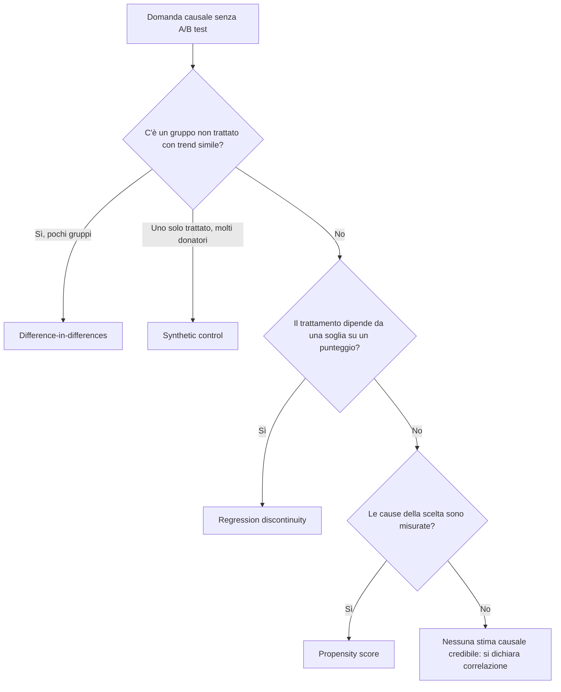

Nel 1992 New Jersey alzò il salario minimo e la vicina Pennsylvania no. Gli economisti David Card e Alan Krueger confrontarono l'occupazione nei fast food dei due stati prima e dopo l'aumento, usando la Pennsylvania come stima di che cosa sarebbe successo in New Jersey senza la legge ([NBER Working Paper 4509](https://www.nber.org/papers/w4509), poi pubblicato sull'American Economic Review nel 1994). Nessuno aveva randomizzato niente, eppure il disegno permetteva una stima causale credibile. Quel lavoro è diventato l'esempio classico del metodo difference-in-differences, e la stessa logica si usa ogni settimana nei team di prodotto.

Lo scenario della lezione è costruito, con numeri di esempio. FitLoop, l'app di allenamento in abbonamento usata nelle lezioni sugli esperimenti, ha lanciato le sfide di gruppo solo in Italia, per ragioni di localizzazione. Un mese dopo il CEO chiede: "Le sfide hanno aumentato l'uso dell'app?". Un A/B test non c'è stato e non si può fare a posteriori. Il product analyst deve rispondere comunque, e con un numero difendibile.

> **Idea chiave:** senza randomizzazione l'effetto causale non si osserva: si stima costruendo un controfattuale, cioè che cosa sarebbe successo senza l'intervento. Ogni metodo osservazionale è un modo diverso di costruirlo, e vale esattamente quanto l'ipotesi che lo regge.

## Quando un esperimento non si può fare

Un A/B test è la prima scelta, ma non sempre è disponibile. Le situazioni tipiche sono quattro. Il cambiamento è già avvenuto, come un lancio in un solo paese o una modifica di prezzo dei concorrenti. Randomizzare non è etico o non è legale, come negare un'informazione di sicurezza o offrire prezzi diversi in un mercato regolato. Il trattamento è a livello di mercato, come una campagna televisiva nazionale. Oppure il traffico è troppo basso per un test con potenza adeguata.

In tutti questi casi il confronto più ovvio è anche il più sbagliato. Prendiamo la domanda "chi partecipa alle sfide resta di più?". In Italia, a 60 giorni dall'iscrizione, è ancora attivo il 63,0% di chi si è unito a una sfida e il 36,8% di chi non l'ha fatto: +26,2 punti. Ma chi si unisce a una sfida era già più attivo prima. Il confronto mescola l'effetto della sfida con la differenza preesistente tra le persone, il **bias di selezione**. La variabile che influenza sia il trattamento sia il risultato, qui l'attività iniziale, si chiama **confondente**.



## Difference-in-differences

Il DiD confronta la variazione nel tempo del gruppo trattato con la variazione nello stesso periodo di un gruppo di controllo. La variazione del controllo stima che cosa sarebbe successo al trattato senza intervento: stagionalità, campagne globali, aggiornamenti dell'app.

$$
\widehat{\text{DiD}} = (\bar{Y}_{T,\text{dopo}} - \bar{Y}_{T,\text{prima}}) - (\bar{Y}_{C,\text{dopo}} - \bar{Y}_{C,\text{prima}})
$$

L'ipotesi è quella dei **trend paralleli**: in assenza di trattamento, la differenza tra i due gruppi sarebbe rimasta costante. Non serve che i livelli siano uguali. Serve che si muovano insieme.

Per FitLoop il trattato è l'Italia e il controllo la Spagna, mercato simile per prodotto, prezzo e stagionalità. La metrica è il numero medio di allenamenti a settimana per utente attivo. Le sfide sono partite lunedì 5 ottobre 2026.

| Settimana dal lancio | Italia | Spagna | Differenza IT − ES |
|---:|---:|---:|---:|
| −4 | 2,38 | 2,08 | 0,30 |
| −3 | 2,41 | 2,11 | 0,30 |
| −2 | 2,39 | 2,09 | 0,30 |
| −1 | 2,42 | 2,12 | 0,30 |
| +1 | 2,70 | 2,23 | 0,47 |
| +2 | 2,74 | 2,24 | 0,50 |
| +3 | 2,77 | 2,26 | 0,51 |
| +4 | 2,79 | 2,27 | 0,52 |

Il calcolo procede in quattro passaggi. La media dell'Italia prima del lancio è $(2{,}38 + 2{,}41 + 2{,}39 + 2{,}42)/4 = 2{,}40$ e dopo è $(2{,}70 + 2{,}74 + 2{,}77 + 2{,}79)/4 = 2{,}75$, quindi la variazione è +0,35.

La media della Spagna passa da 2,10 a 2,25: +0,15, il trend comune dovuto all'inizio dell'autunno e al rientro in palestra.

Il DiD è $0{,}35 - 0{,}15 = 0{,}20$ allenamenti a settimana per utente attivo.

Il controfattuale per l'Italia è $2{,}40 + 0{,}15 = 2{,}55$, quindi l'effetto relativo è $0{,}20/2{,}55 = 7{,}8\%$.

Un semplice prima-dopo in Italia avrebbe attribuito alle sfide +0,35, quasi il doppio, perché avrebbe incluso il rientro autunnale. La colonna delle differenze è il **controllo dei trend paralleli**: nelle quattro settimane prima del lancio la distanza è stabile a 0,30, poi sale a 0,47 e si assesta intorno a 0,50. Questa forma, piatta prima e con un salto dopo, è quella che si vuole vedere. Se la differenza fosse cresciuta già prima del lancio, il DiD attribuirebbe alle sfide un trend che esisteva già. Notare anche che l'effetto cresce leggermente nelle settimane: le sfide richiedono tempo per diffondersi tra gli amici.

La query che produce le medie per paese e periodo, sullo schema eventi del modulo:

```sql
-- Allenamenti medi per utente attivo a settimana, per paese e periodo, e stima DiD
WITH settimanale AS (
    SELECT
        u.country,
        e.user_id,
        DATE_TRUNC('week', e.event_time) AS settimana,
        COUNT(*)                         AS allenamenti
    FROM events e
    JOIN users u ON u.user_id = e.user_id
    WHERE e.event_name = 'workout_completed'
      AND u.country IN ('IT', 'ES')
      AND e.event_time >= DATE '2026-09-07'
      AND e.event_time <  DATE '2026-11-02'
    GROUP BY u.country, e.user_id, DATE_TRUNC('week', e.event_time)
),
medie AS (
    SELECT
        country,
        CASE WHEN settimana >= DATE '2026-10-05' THEN 'dopo' ELSE 'prima' END AS periodo,
        AVG(allenamenti) AS media
    FROM settimanale
    GROUP BY country, CASE WHEN settimana >= DATE '2026-10-05' THEN 'dopo' ELSE 'prima' END
),
variazioni AS (
    SELECT
        country,
        MAX(CASE WHEN periodo = 'dopo'  THEN media END)
      - MAX(CASE WHEN periodo = 'prima' THEN media END) AS variazione
    FROM medie
    GROUP BY country
)
SELECT
    MAX(CASE WHEN country = 'IT' THEN variazione END) AS variazione_it,
    MAX(CASE WHEN country = 'ES' THEN variazione END) AS variazione_es,
    MAX(CASE WHEN country = 'IT' THEN variazione END)
  - MAX(CASE WHEN country = 'ES' THEN variazione END) AS did
FROM variazioni;
```

Per avere anche un intervallo di confidenza si stima la stessa quantità come regressione sul panel utente-settimana: il coefficiente dell'interazione `trattato:post` è il DiD. Gli errori standard vanno raggruppati per utente, perché le settimane dello stesso utente sono correlate.

```python
import numpy as np
import pandas as pd
import statsmodels.formula.api as smf

rng = np.random.default_rng(1)
righe = []
for paese, base, n_utenti in [("IT", 2.40, 3000), ("ES", 2.10, 3000)]:
    livello = rng.normal(0, 1.0, n_utenti)          # differenze stabili tra utenti
    for settimana in range(-4, 4):                   # 4 settimane prima, 4 dopo il lancio
        post = int(settimana >= 0)
        trend = 0.15 * post                          # trend comune ai due paesi
        effetto = 0.20 * post * (paese == "IT")      # effetto vero della funzione
        y = base + trend + effetto + livello + rng.normal(0, 1.2, n_utenti)
        righe.append(pd.DataFrame({"user_id": [f"{paese}{i}" for i in range(n_utenti)],
                                   "paese": paese, "settimana": settimana,
                                   "trattato": int(paese == "IT"), "post": post,
                                   "allenamenti": y}))
panel = pd.concat(righe, ignore_index=True)

modello = smf.ols("allenamenti ~ trattato * post", data=panel).fit(
    cov_type="cluster", cov_kwds={"groups": pd.factorize(panel["user_id"])[0]})
stima = modello.params["trattato:post"]
ic = modello.conf_int().loc["trattato:post"]
print(f"DiD: {stima:.3f}  IC 95%: [{ic[0]:.3f}, {ic[1]:.3f}]")
# DiD: 0.211  IC 95%: [0.168, 0.254]
```

L'intervallo di questo codice cattura solo il rumore tra utenti. Con due soli paesi c'è un'incertezza in più che nessun errore standard misura: uno shock che colpisce solo l'Italia nello stesso mese (un concorrente che chiude, una campagna locale) finirebbe nella stima. Per questo il controllo dei trend precedenti e una verifica degli eventi di quel mese nel mercato trattato sono parte dell'analisi, non un'aggiunta.

## Synthetic control

Il DiD funziona se esiste un gruppo di controllo con trend parallelo. Quando nessun mercato singolo somiglia abbastanza al trattato, il synthetic control lo costruisce combinando più mercati donatori con pesi non negativi che sommano a 1, scelti perché la combinazione riproduca la serie del trattato prima dell'intervento. Il metodo è stato formalizzato da Abadie, Diamond e Hainmueller nello studio sul programma anti-fumo della California: stimarono che nel 2000 le vendite di sigarette pro capite erano circa 26 pacchetti l'anno più basse di quanto sarebbero state senza il programma ([Journal of the American Statistical Association, 2010](https://doi.org/10.1198/jasa.2009.ap08746)).

Per FitLoop i donatori sono Spagna, Francia, Portogallo e Germania. L'ottimizzazione sulle settimane precedenti al lancio assegna peso 0,5 alla Spagna, 0,3 alla Francia, 0,2 al Portogallo e 0 alla Germania.

| Mercato | Peso | Prima | Dopo |
|---|---:|---:|---:|
| Spagna | 0,5 | 2,10 | 2,25 |
| Francia | 0,3 | 2,55 | 2,70 |
| Portogallo | 0,2 | 2,80 | 3,02 |
| Germania | 0,0 | 2,00 | 2,12 |
| Italia sintetica | | 2,375 | 2,539 |
| Italia osservata | | 2,40 | 2,75 |

Il calcolo dell'Italia sintetica prima del lancio è $0{,}5 \times 2{,}10 + 0{,}3 \times 2{,}55 + 0{,}2 \times 2{,}80 = 1{,}050 + 0{,}765 + 0{,}560 = 2{,}375$, a 0,025 dal valore osservato: l'aderenza nel pre-periodo è buona. Dopo il lancio: $0{,}5 \times 2{,}25 + 0{,}3 \times 2{,}70 + 0{,}2 \times 3{,}02 = 2{,}539$. La differenza con l'Italia osservata è $2{,}75 - 2{,}539 = 0{,}21$, coerente con la stima DiD.

Il synthetic control non produce un errore standard classico. L'inferenza si fa con i **test placebo**: si applica lo stesso metodo a ciascun donatore come se fosse stato trattato e si confronta il suo scarto dopo il lancio con quello dell'Italia, normalizzato per l'errore di aderenza prima del lancio. Se l'Italia ha lo scarto relativo più grande dei cinque mercati, il valore p di permutazione è $1/5 = 0{,}20$. Con soli quattro donatori il test non può dare un valore p inferiore a 0,20: è un limite strutturale da dichiarare, che si riduce solo aggiungendo donatori, per esempio regioni invece che paesi.

## Regression discontinuity

Molte decisioni di prodotto si attivano con una soglia: uno sconto sopra un importo, una funzione sbloccata a un certo livello, un'email inviata quando un modello di rischio supera un valore. Gli utenti appena sopra e appena sotto la soglia sono quasi identici, ma solo i primi ricevono il trattamento. Il salto della metrica alla soglia stima l'effetto per quegli utenti.

FitLoop invia un'email di fidelizzazione con un mese a prezzo ridotto agli abbonati con punteggio di rischio di abbandono di almeno 0,70. Il confronto ingenuo è disastroso: chi ha ricevuto l'email rinnova al 48%, chi non l'ha ricevuta al 66%, cioè −18 punti, perché l'email va proprio agli utenti a rischio. La RDD guarda solo vicino alla soglia.

| Fascia di punteggio | Email | Tasso di rinnovo |
|---|---|---:|
| 0,60–0,65 | No | 58,0% |
| 0,65–0,70 | No | 55,0% |
| 0,70–0,75 | Sì | 57,5% |
| 0,75–0,80 | Sì | 54,3% |

La stima si ottiene estrapolando ciascun lato fino alla soglia, non confrontando le due fasce vicine. Sul lato sinistro il rinnovo scende di 3,0 punti per fascia da 0,05; dal centro della fascia 0,65–0,70 (0,675) alla soglia c'è mezza fascia, quindi il valore previsto alla soglia è $55{,}0 - 1{,}5 = 53{,}5\%$.

Sul lato destro il rinnovo scende di 3,2 punti per fascia; dal centro della fascia 0,70–0,75 si torna indietro di mezza fascia e si ottiene $57{,}5 + 1{,}6 = 59{,}1\%$. Il salto alla soglia è $59{,}1 - 53{,}5 = 5{,}6$ punti percentuali.

Il confronto tra le due fasce adiacenti avrebbe dato $57{,}5 - 55{,}0 = 2{,}5$ punti, sottostimando l'effetto perché ignora che il rinnovo scende con il rischio. In pratica si stima una regressione lineare locale per lato con una banda scelta dai dati, e si ripete con bande più strette e più larghe: una stima che cambia molto con la banda non è affidabile.

I controlli obbligatori sono due. Il primo è la **manipolazione**: se gli utenti possono spostarsi sopra o sotto la soglia, chi lo fa è diverso dagli altri. Qui il punteggio è calcolato da un modello interno che gli utenti non vedono, quindi il rischio è basso; con una soglia visibile, come "1.000 punti per sbloccare il coach", ci si aspetta un accumulo di utenti appena sopra, e il metodo cade. Si verifica con l'istogramma della variabile di assegnazione intorno alla soglia, che non deve mostrare picchi o buchi. Il secondo è il **bilanciamento**: caratteristiche misurate prima del trattamento, come anzianità e piattaforma, non devono saltare alla soglia. Il limite da dichiarare è la validità locale: 5,6 punti è l'effetto per utenti con rischio intorno a 0,70, non per tutti gli abbonati.

## Propensity score

Quando il trattamento è una scelta dell'utente, come unirsi a una sfida, e non ci sono soglie né gruppi esterni, resta il confronto tra chi ha scelto e chi no, corretto per le caratteristiche che spiegano la scelta. Il **propensity score** è la probabilità di ricevere il trattamento date le covariate osservate prima ([Rosenbaum e Rubin, Biometrika 1983](https://doi.org/10.1093/biomet/70.1.41)). Confrontare utenti con lo stesso punteggio equivale, sotto un'ipotesi forte, a confrontare utenti randomizzati.

L'intuizione si vede bene stratificando per una sola covariata, l'attività nel primo mese, su 7.800 utenti italiani.

| Attività iniziale | Con sfida | Attivi a 60 giorni, con sfida | Senza sfida | Attivi a 60 giorni, senza sfida | Differenza |
|---|---:|---:|---:|---:|---:|
| Bassa | 200 | 30% | 3.000 | 25% | +5 pp |
| Media | 600 | 50% | 2.000 | 42% | +8 pp |
| Alta | 1.200 | 75% | 800 | 68% | +7 pp |
| Totale | 2.000 | 63,0% | 5.800 | 36,8% | +26,2 pp |

Il totale è il confronto ingenuo dell'apertura. Dentro ogni strato la differenza è tra 5 e 8 punti. La media pesata per il numero di trattati in ciascuno strato è l'effetto sui trattati (ATT): $(5 \times 200 + 8 \times 600 + 7 \times 1.200)/2.000 = (1.000 + 4.800 + 8.400)/2.000 = 7{,}1$ punti. Più di due terzi della differenza ingenua erano selezione: chi si unisce alle sfide è soprattutto chi era già molto attivo.

Con molte covariate la stratificazione manuale non basta, perché gli strati si svuotano. Si stima il punteggio con una regressione logistica e lo si usa per pesare i controlli (inverse probability weighting) o per abbinarli ai trattati (matching).

```python
import numpy as np
import pandas as pd
import statsmodels.formula.api as smf

rng = np.random.default_rng(3)
n = 20000
df = pd.DataFrame({
    "allenamenti_pre": rng.poisson(6, n),            # attività nel primo mese
    "ios": rng.binomial(1, 0.5, n),
    "da_referral": rng.binomial(1, 0.2, n),
})
logit_t = -3.0 + 0.35 * df.allenamenti_pre + 0.4 * df.ios + 0.8 * df.da_referral
df["sfida"] = rng.binomial(1, 1 / (1 + np.exp(-logit_t)))
logit_y = -1.6 + 0.25 * df.allenamenti_pre + 0.2 * df.ios + 0.3 * df.da_referral + 0.35 * df.sfida
df["attivo_d60"] = rng.binomial(1, 1 / (1 + np.exp(-logit_y)))

# 1. Propensity score: probabilità di unirsi a una sfida date le covariate pre-trattamento
ps = smf.logit("sfida ~ allenamenti_pre + ios + da_referral", data=df).fit(disp=0)
df["ps"] = ps.predict(df)

# 2. Overlap: si tengono solo le unità con propensity in una zona comune
df = df[(df.ps > 0.05) & (df.ps < 0.95)].copy()

# 3. Pesi ATT: trattati peso 1, controlli peso ps / (1 - ps)
df["w"] = np.where(df.sfida == 1, 1.0, df.ps / (1 - df.ps))
trattati, controlli = df[df.sfida == 1], df[df.sfida == 0]
ingenuo = trattati.attivo_d60.mean() - controlli.attivo_d60.mean()
att = trattati.attivo_d60.mean() - np.average(controlli.attivo_d60, weights=controlli.w)
print(f"differenza ingenua: {ingenuo:+.3f}")
print(f"ATT con IPW:        {att:+.3f}")
# differenza ingenua: +0.182
# ATT con IPW:        +0.064
```

Nei dati simulati l'effetto vero sui trattati è di circa 7 punti: la differenza ingenua di 18 punti lo gonfia di oltre due volte, la stima pesata ci arriva vicino. Tre controlli accompagnano sempre il metodo. L'**overlap**: per ogni trattato devono esistere controlli con punteggio simile, altrimenti si confrontano persone che nei dati non hanno equivalenti. Il **bilanciamento dopo i pesi**: le medie delle covariate nei due gruppi pesati devono coincidere, con differenze standardizzate sotto 0,1. E soprattutto l'ipotesi di **assenza di confondenti non osservati**: il metodo corregge solo per le variabili nel modello. Se chi si unisce alle sfide è più motivato in un modo che l'attività passata non cattura, la stima resta distorta, e nessun controllo statistico lo può escludere.

## Scegliere il metodo e comunicare il risultato

Ogni metodo si regge su un'ipotesi non verificabile fino in fondo, più alcuni controlli che la rendono plausibile. La scelta dipende da come è stato assegnato il trattamento, non dalla preferenza dell'analista.

| Metodo | Ipotesi chiave | Controllo principale | Quando fallisce |
|---|---|---|---|
| Difference-in-differences | Trend paralleli senza trattamento | Differenze stabili prima del lancio, settimana per settimana | Shock che colpiscono un solo gruppo nello stesso periodo |
| Synthetic control | La combinazione di donatori riproduce il trattato | Aderenza pre-periodo, test placebo sui donatori | Pochi donatori o pre-periodo corto |
| Regression discontinuity | Nessuna manipolazione intorno alla soglia | Istogramma della variabile, bilanciamento, banda | Soglie visibili e raggiungibili dagli utenti |
| Propensity score | Tutti i confondenti sono osservati | Overlap e bilanciamento dopo i pesi | Motivazione o intenzione non misurate |

Nel memo al CEO il risultato si presenta come una stima con il suo grado di fiducia: "Le sfide hanno aumentato gli allenamenti settimanali di circa 0,2 per utente attivo, +8% rispetto a quanto previsto senza lancio. DiD sulla Spagna e synthetic control su quattro paesi danno lo stesso valore; la stima si regge sull'ipotesi che nessun altro evento abbia colpito solo l'Italia in ottobre, e non abbiamo trovato eventi del genere". Due metodi diversi che convergono valgono più di un intervallo di confidenza stretto da un metodo solo.

## Errori ricorrenti negli studi osservazionali

### Il prima-dopo senza controllo

Il sintomo è una slide con "dopo il lancio la metrica è salita del 15%". Il confronto include stagionalità, campagne e tutto ciò che è cambiato nello stesso periodo. Si evita costruendo sempre un controfattuale esplicito, anche solo un gruppo di confronto, e mostrando la serie delle settimane precedenti.

### Controllare per una variabile influenzata dal trattamento

Il sintomo è un modello che aggiunge tra le covariate "numero di amici nell'app" per stimare l'effetto delle sfide. Ma le sfide fanno aggiungere amici: correggere per quella variabile toglie una parte dell'effetto. Nel propensity score e nelle regressioni entrano solo variabili misurate prima del trattamento.

### Leggere un effetto locale come globale

Il sintomo è un 5,6 punti stimato alla soglia di rischio 0,70 usato per prevedere l'effetto dell'email su tutti gli abbonati. Una RDD stima l'effetto vicino alla soglia, un DiD l'effetto sul gruppo trattato, l'IPW l'effetto sui trattati con quelle covariate. Ogni numero va riportato insieme alla popolazione a cui si riferisce.

## Domande di verifica

1. Un'app lancia una nuova home solo su Android. Nel mese dopo il lancio le sessioni Android crescono da 5,0 a 5,6 per utente, quelle iOS da 6,0 a 6,3. Qual è la stima DiD e che cosa devi controllare prima di presentarla?

<details>
<summary>Mostra risposta</summary>

La stima è $(5{,}6 - 5{,}0) - (6{,}3 - 6{,}0) = 0{,}6 - 0{,}3 = 0{,}3$ sessioni per utente, circa +5,7% sul controfattuale di 5,3. Prima di presentarla va controllato che nelle settimane precedenti la differenza tra Android e iOS fosse stabile, e che nello stesso periodo non ci siano stati eventi solo su una piattaforma, come un aggiornamento di sistema operativo o una campagna sugli store.

</details>

2. In una regression discontinuity con soglia a 50 euro di carrello per la spedizione gratuita, l'istogramma degli importi mostra un picco tra 50 e 52 euro. Che cosa significa per l'analisi?

<details>
<summary>Mostra risposta</summary>

Gli utenti manipolano la variabile di assegnazione: aggiungono articoli per superare la soglia. Chi sta appena sopra non è confrontabile con chi sta appena sotto, quindi il salto non stima l'effetto della spedizione gratuita. Il picco è esso stesso un risultato interessante (la soglia cambia il comportamento d'acquisto), ma la RDD su questa soglia non è valida.

</details>

3. Con il propensity score ottieni un ATT di +4 punti sulla retention per chi usa una funzione. Il PM chiede: "Quindi se la rendiamo obbligatoria la retention sale di 4 punti?". Come rispondi?

<details>
<summary>Mostra risposta</summary>

No, per due ragioni. L'ATT è l'effetto su chi l'ha scelta, che può essere diverso da quello su chi verrebbe obbligato. Inoltre la stima è causale solo se tutte le variabili che spiegano la scelta sono nel modello: la motivazione, che non è osservata, probabilmente spiega parte dei 4 punti. La stima giustifica un esperimento sulla promozione della funzione, non una previsione dell'effetto dell'obbligo.

</details>

4. Un synthetic control costruito su tre donatori riproduce male il pre-periodo, con scarti dell'ordine dell'effetto stimato. Puoi usare la stima?

<details>
<summary>Mostra risposta</summary>

No. Se la combinazione dei donatori non segue il trattato prima dell'intervento, non c'è ragione di credere che lo segua dopo: lo scarto post-lancio può essere solo il proseguimento di quello pre-lancio. Servono più donatori o unità più fini (regioni, città) oppure un altro metodo. Con tre donatori, inoltre, il test placebo non può dare un valore p sotto $1/4 = 0{,}25$.

</details>
