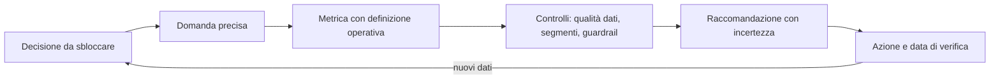

Scenario costruito, numeri di esempio. Lunedì mattina la responsabile di prodotto di un SaaS B2B per la reportistica scrive nel canale del team: «L'attivazione è crollata, dal 36% al 31%. Il nuovo onboarding è uscito il mese scorso: lo togliamo?». Nello stesso mese il marketing ha quadruplicato la spesa sugli annunci e le registrazioni sono salite da 5.000 a 8.000. Il product analyst ha davanti due numeri che sembrano raccontare storie opposte e una decisione costosa da prendere entro venerdì: annullare tre mesi di lavoro del team di design.

Il lavoro dell'analista, in quel momento, non è produrre un grafico. È stabilire che cosa è successo davvero, separare le cause, quantificare ciascuna e dire che cosa conviene fare. Alla fine dell'esempio di questa pagina scoprirai che il nuovo onboarding ha migliorato l'attivazione di un punto e che tutto il calo viene dalla composizione del traffico.

> **Idea chiave:** il product analyst non misura il prodotto per descriverlo, lo misura per cambiare una decisione. Ogni analisi parte da una scelta da sbloccare e finisce con una raccomandazione, un numero a sostegno e il grado di incertezza.

## Che cosa fa un product analyst

La product analytics è la disciplina che collega il comportamento degli utenti dentro un prodotto digitale ai risultati che contano per il business: attivazione, retention, ricavi. Il product analyst lavora accanto a product manager, designer e ingegneri e risponde a domande di questo tipo: dove si perdono gli utenti, quale funzione trattiene chi paga, quanto vale una correzione, se un esperimento ha funzionato, perché una metrica si è mossa.

Rispetto a un analista di business intelligence, il product analyst lavora su dati di evento a grana fine (ogni clic, ogni schermata, ogni azione) più che su tabelle contabili, e lavora a monte della decisione, non solo a valle. Rispetto a un data scientist che costruisce modelli predittivi, usa più spesso SQL, statistica inferenziale e disegno sperimentale che machine learning. I confini variano da azienda ad azienda, ma il nucleo resta lo stesso: domande di prodotto, dati comportamentali, decisioni.

Nel lavoro quotidiano il ruolo produce quattro tipi di output.

| Deliverable | Quando serve | Orizzonte | Esempio |
| :--- | :--- | :--- | :--- |
| Analisi ad hoc | Una domanda precisa con una decisione in sospeso | Da 1 giorno a 2 settimane | Perché l'attivazione è scesa a marzo |
| Dashboard e metriche condivise | Un numero va monitorato con regolarità | Mesi o anni | Attivazione a 48 ore per canale, ogni settimana |
| Supporto agli esperimenti | Si vuole misurare l'effetto causale di un cambiamento | Da 2 a 6 settimane per test | Dimensionamento, metrica primaria, lettura del test A/B |
| Strumentazione e qualità dei dati | Mancano eventi o i numeri non tornano | Continuo | Tracking plan del nuovo onboarding |

Le quattro attività si alimentano a vicenda. Un'analisi ad hoc che si ripete tre volte diventa una dashboard. Una dashboard che mostra un calo apre un'analisi diagnostica. Un'analisi che trova un'ipotesi promettente porta a un esperimento. E nessuna delle tre è affidabile se la strumentazione è sbagliata, motivo per cui il [tracking plan](/course/analisi-prodotto/tracking-plan-event-model/) è parte del mestiere e non un compito da delegare.

## Il loop domanda, misura, azione

Il ciclo di lavoro ha una forma ricorrente. Si parte dalla decisione, si definisce che cosa misurare, si controlla che il numero sia affidabile e non nasconda effetti collaterali, si agisce e si torna a misurare.



Il primo passaggio è il più trascurato. Una richiesta come «guardate come va l'onboarding» non è una domanda: non c'è una decisione collegata e quindi nessun criterio per dire quando l'analisi è finita. La stessa richiesta diventa lavorabile quando si esplicita la scelta: «dobbiamo decidere se tenere il nuovo onboarding o tornare al vecchio; lo teniamo se l'attivazione a 48 ore, a parità di canale, non è peggiorata di più di un punto».

Il passaggio dei controlli è quello che distingue un analista esperto da uno alle prime armi. Prima di presentare un numero si verifica che i dati siano completi (nessun evento perso dopo un rilascio dell'app), che la variazione non sia dovuta a un cambio di composizione degli utenti e che il miglioramento di una metrica non stia peggiorando qualcosa di più importante. Quest'ultima metrica di protezione si chiama guardrail ed è trattata insieme alla North Star nella [lezione sul metric tree](/course/analisi-prodotto/north-star-metric-tree/).

L'ultimo passaggio chiude il cerchio. Una raccomandazione senza responsabile, senza data di verifica e senza criterio numerico è un resoconto. «Teniamo il nuovo onboarding; ricontrolliamo il 15 aprile; se l'attivazione organica scende sotto il 42% riapriamo l'analisi» è un impegno verificabile.

## I cinque tipi di domanda

Le richieste che arrivano a un product analyst ricadono quasi sempre in cinque famiglie. Riconoscere la famiglia serve a scegliere il metodo giusto e, soprattutto, a non promettere ciò che i dati non possono dare: una domanda causale non si risolve con una correlazione, per quanto ben calcolata.

| Tipo | Domanda tipica | Metodo principale | Che cosa può concludere |
| :--- | :--- | :--- | :--- |
| Descrittiva | Quanti utenti attivi abbiamo e come si distribuiscono? | Conteggi, tassi, segmentazioni | Lo stato delle cose |
| Diagnostica | Perché l'attivazione è scesa a marzo? | Scomposizione per segmenti, [funnel](/course/analisi-prodotto/funnel-analysis/), controllo dei dati | Dove si concentra la variazione |
| Valutativa o causale | Il nuovo onboarding ha aumentato l'attivazione? | [Esperimento A/B](/course/analisi-prodotto/ab-testing/) o [metodi quasi sperimentali](/course/analisi-prodotto/inferenza-causale-osservazionale/) | Quanto della variazione è dovuto al cambiamento |
| Predittiva | Quali account rischiano di non rinnovare? | Modelli su segnali comportamentali | Una probabilità, non una causa |
| Di dimensionamento | Quanto vale correggere il passaggio 3 del checkout? | Opportunity sizing con ipotesi esplicite | Un ordine di grandezza per prioritizzare |

Due osservazioni pratiche. La prima: molte domande dichiarate descrittive sono in realtà causali travestite. «Gli utenti che usano i modelli condivisi restano di più?» è descrittiva, ma la domanda sottintesa è «se spingiamo i modelli condivisi, la retention sale?», che è causale e non si risolve con lo stesso conteggio, perché chi usa i modelli condivisi è diverso da chi non li usa per molte altre ragioni. La seconda: le domande diagnostiche sono le più frequenti e le più insidiose, perché il primo sospettato (l'ultimo rilascio) è spesso innocente, come nell'esempio di apertura.

## Dalla domanda vaga alla definizione operativa

Una metrica è utile solo se due persone diverse, lette le stesse righe di definizione, scrivono la stessa query e ottengono lo stesso numero. Per arrivarci servono sei elementi espliciti.

1. **Unità di analisi:** utente, account aziendale, sessione, ordine. Contare utenti o account cambia il risultato quando un account ha molti utenti.
2. **Numeratore:** che cosa conta come successo, con l'evento preciso. «Ha creato almeno un report» è diverso da «ha aperto l'editor dei report».
3. **Denominatore:** su chi si calcola il tasso. È l'elemento che si sbaglia più spesso.
4. **Finestra temporale:** entro quanto tempo e misurata da quale istante. «Entro 48 ore dalla registrazione» non è uguale a «nella settimana della registrazione».
5. **Granularità di riporto:** per giorno, settimana o mese di registrazione, cioè per coorte, oppure per giorno di calendario.
6. **Esclusioni:** account interni, di test, bot, utenti di paesi non serviti.

Prendiamo «utente attivo», la definizione più contesa in qualunque azienda. Il marketing conta chi ha aperto l'app almeno una volta nel mese, il prodotto chi ha compiuto un'azione di valore, la finanza chi ha un abbonamento attivo. Nessuna delle tre è sbagliata, ma usarle con lo stesso nome produce riunioni in cui si discute di definizioni invece che di decisioni. La soluzione è dare nomi diversi a cose diverse e scrivere la definizione accanto a ogni numero.

La definizione operativa dell'attivazione nello scenario di apertura è questa: unità l'utente; numeratore gli utenti con almeno un evento `report_created` entro 48 ore dalla registrazione; denominatore tutti gli utenti registrati nel periodo; granularità il mese di registrazione; esclusioni gli account del dominio aziendale e quelli marcati come test. Con questa definizione la domanda «l'attivazione è crollata?» diventa verificabile, e la prima cosa da fare è segmentarla.

## Esempio svolto: separare l'effetto mix dall'effetto reale

Riprendiamo i numeri dello scenario. A gennaio, prima della campagna e prima del nuovo onboarding, le registrazioni sono 5.000: 4.000 dal canale organico (ricerca e passaparola) e 1.000 da annunci a pagamento. A marzo sono 8.000: l'organico resta a 4.000, il pagamento sale a 4.000. La tabella riporta i tassi di attivazione a 48 ore per canale.

| Canale | Registrazioni gennaio | Attivazione gennaio | Registrazioni marzo | Attivazione marzo |
| :--- | ---: | ---: | ---: | ---: |
| Organico | 4.000 | 40% | 4.000 | 44% |
| A pagamento | 1.000 | 20% | 4.000 | 18% |
| Totale | 5.000 | 36% | 8.000 | 31% |

**Passo 1, i totali.** A gennaio gli attivati sono 4.000 × 40% + 1.000 × 20% = 1.600 + 200 = 1.800, quindi 1.800 / 5.000 = 36%. A marzo sono 4.000 × 44% + 4.000 × 18% = 1.760 + 720 = 2.480, quindi 2.480 / 8.000 = 31%. Il tasso aggregato scende di 5 punti percentuali, mentre gli attivati in valore assoluto salgono di 680 utenti.

**Passo 2, i pesi.** Il tasso aggregato è una media ponderata dei tassi di canale, con pesi pari alla quota di registrazioni. A gennaio i pesi sono 80% organico e 20% a pagamento; a marzo 50% e 50%.

**Passo 3, l'effetto mix.** Si chiede: che tasso avremmo visto a marzo se i tassi di canale fossero rimasti quelli di gennaio e fosse cambiata solo la composizione? 0,5 × 40% + 0,5 × 20% = 30%. Rispetto al 36% di gennaio, la sola composizione vale 30% − 36% = −6 punti.

**Passo 4, l'effetto tasso.** Si chiede: a composizione di marzo, quanto hanno contribuito i cambiamenti dentro ogni canale? Per l'organico 0,5 × (44% − 40%) = +2 punti; per il pagamento 0,5 × (18% − 20%) = −1 punto. In totale +1 punto.

**Passo 5, il controllo.** Effetto mix più effetto tasso: −6 + 1 = −5 punti, esattamente la variazione osservata da 36% a 31%. La scomposizione è completa, senza residui.

In formula, chiamando $w_i$ la quota del canale $i$ e $r_i$ il suo tasso, con gli indici 0 e 1 per i due periodi:

$$
\Delta R = \underbrace{\sum_i (w_{1,i} - w_{0,i})\, r_{0,i}}_{\text{effetto mix}} + \underbrace{\sum_i w_{1,i}\,(r_{1,i} - r_{0,i})}_{\text{effetto tasso}}
$$

**La lettura.** Il calo del 36% → 31% non è colpa dell'onboarding. Dentro il canale organico, dove il traffico è stabile, l'attivazione è salita di 4 punti: è il segnale più pulito disponibile ed è positivo. Il canale a pagamento perde 2 punti, plausibilmente perché la campagna più ampia raggiunge un pubblico meno qualificato. Il segnale non è causale in senso stretto, perché l'onboarding non è stato testato con un gruppo di controllo; è però abbastanza forte da sconsigliare il rollback e da suggerire un test A/B per la prossima modifica.

**La decisione economica.** Resta da capire se la campagna conviene. Supponiamo un costo di 60.000 euro per 3.000 registrazioni in più, cioè 20 euro per registrazione. Con un'attivazione del 18%, un utente attivato dal canale a pagamento costa 20 / 0,18 = 111 euro circa. Se il margine atteso di un utente attivato nei primi dodici mesi è 90 euro, la campagna distrugge valore: il punto di pareggio richiede un'attivazione di almeno 20 / 90 = 22,2%. La raccomandazione è doppia: tenere l'onboarding e ridurre la campagna ai segmenti di pubblico che superano il 22% di attivazione.

La query che produce la tabella di partenza calcola tassi e volumi per mese di registrazione e canale. La condizione sulla finestra usa un intervallo semiaperto, così un evento alla quarantottesima ora esatta non viene contato.

```sql
-- Attivazione a 48 ore per mese di registrazione e canale
-- Schema: users(user_id, signup_time, channel, country, platform)
--         events(user_id, event_name, event_time, properties)
-- Gli account interni e di test vanno esclusi a monte (vedi il tracking plan)
WITH cohort AS (
  SELECT
    u.user_id,
    u.channel,
    u.signup_time,
    DATE_TRUNC('month', u.signup_time) AS signup_month
  FROM users AS u
),
activated AS (
  SELECT DISTINCT c.user_id
  FROM cohort AS c
  JOIN events AS e
    ON e.user_id = c.user_id
   AND e.event_name = 'report_created'
   AND e.event_time >= c.signup_time
   AND e.event_time <  c.signup_time + INTERVAL '48 hours'
)
SELECT
  c.signup_month,
  c.channel,
  COUNT(*)                                      AS signups,
  COUNT(a.user_id)                              AS activated_48h,
  ROUND(100.0 * COUNT(a.user_id) / COUNT(*), 1) AS activation_pct
FROM cohort AS c
LEFT JOIN activated AS a ON a.user_id = c.user_id
GROUP BY c.signup_month, c.channel
ORDER BY c.signup_month, c.channel;
```

La scomposizione si fa in poche righe di Python a partire dal risultato della query. Con i dati dell'esempio stampa un effetto mix di −6,0 punti, un effetto tasso di +1,0 e una variazione totale di −5,0.

```python
# Scomposizione mix/tasso di una variazione di tasso aggregato
segmenti = {
    # canale: (registrazioni_t0, tasso_t0, registrazioni_t1, tasso_t1)
    "organico":    (4000, 0.40, 4000, 0.44),
    "a_pagamento": (1000, 0.20, 4000, 0.18),
}

n0 = sum(v[0] for v in segmenti.values())
n1 = sum(v[2] for v in segmenti.values())

effetto_mix = sum((v[2] / n1 - v[0] / n0) * v[1] for v in segmenti.values())
effetto_tasso = sum((v[2] / n1) * (v[3] - v[1]) for v in segmenti.values())
r0 = sum(v[0] * v[1] for v in segmenti.values()) / n0
r1 = sum(v[2] * v[3] for v in segmenti.values()) / n1

print(f"Tasso t0 {r0:.1%}, tasso t1 {r1:.1%}")
print(f"Effetto mix   {effetto_mix * 100:+.1f} punti")
print(f"Effetto tasso {effetto_tasso * 100:+.1f} punti")
print(f"Totale        {(r1 - r0) * 100:+.1f} punti")
```

Quando i segmenti sono molti (paese × piattaforma × canale), la stessa scomposizione indica quali segmenti spiegano la maggior parte della variazione. È il primo passo di ogni [diagnosi di un calo di metrica](/course/analisi-prodotto/diagnosi-calo-metrica/).

## Metriche di vanità e metriche di azione

Registrazioni totali, pagine viste, download e utenti cumulati hanno una cosa in comune: salgono quasi sempre, anche quando il prodotto perde clienti, e non dicono quale leva muovere. Sono metriche di vanità. Non sono inutili in assoluto, perché servono a dimensionare l'infrastruttura o a raccontare la crescita agli investitori, ma non guidano le decisioni di prodotto.

Una metrica di azione ha tre proprietà. È legata a un comportamento che prova il valore per l'utente, per esempio aver creato e condiviso un report. È espressa come tasso o come conteggio su una popolazione definita, così da essere confrontabile nel tempo. Ed è collegata a una leva che il team controlla: se nessuno sa quale intervento la muoverebbe, è un indicatore da osservare, non una metrica da gestire.

Un test semplice per riconoscere la differenza: chiedersi che cosa cambierebbe nel piano di lavoro della settimana se il numero scendesse del 10%. Se la risposta è «niente», la metrica non merita spazio nella riunione settimanale. Le metriche di azione vanno poi organizzate in un albero che le colleghi a una North Star condivisa, con guardrail espliciti: è il tema della lezione successiva.

## Errori che falsano la lettura dei numeri

### Guardare il tasso senza il volume, o il volume senza il tasso

Il sintomo è una conclusione opposta a seconda di chi presenta. Chi guarda il tasso vede un crollo dal 36% al 31%, chi guarda il volume vede 680 attivati in più. Succede perché ogni numero isolato risponde a una domanda diversa. Si evita riportando sempre tasso, numeratore e denominatore nella stessa tabella e segmentando per le dimensioni che cambiano composizione nel tempo: canale, piattaforma, paese, piano.

### Attribuire la variazione all'ultimo rilascio

Il sintomo è un rollback deciso in fretta. Il rilascio più recente è il sospettato naturale perché è l'evento più visibile, ma le metriche si muovono anche per stagionalità, campagne, cambi di prezzo, problemi di tracciamento, aggiornamenti degli app store. Prima di accusare un rilascio si confronta l'andamento nei segmenti che il rilascio non ha toccato e si controlla che gli eventi siano arrivati regolarmente. Se un segmento non esposto mostra lo stesso calo, il rilascio è quasi certamente innocente.

### Definizioni diverse con lo stesso nome

Il sintomo è la frase «i miei numeri non tornano con i tuoi». Due dashboard calcolano l'attivazione con finestre diverse (48 ore contro 7 giorni) o denominatori diversi (tutti gli iscritti contro chi ha confermato l'email). Si evita con un catalogo delle metriche: una pagina per metrica con definizione, query di riferimento, responsabile e data dell'ultima revisione. Gli strumenti moderni di semantic layer aiutano, ma il problema è organizzativo prima che tecnico.

### Trattare una correlazione come un effetto

Il sintomo è una raccomandazione del tipo «spingiamo la funzione X perché chi la usa resta il doppio». Chi usa X è spesso un utente già più motivato, e la funzione è un indicatore della motivazione, non la causa della retention. Si evita dichiarando il tipo di domanda: se è causale, la risposta richiede un esperimento o un metodo quasi sperimentale, e l'analisi correlazionale serve solo a generare l'ipotesi.

## Domande per verificare la comprensione

1. Le registrazioni passano da 5.000 a 8.000, i tassi di attivazione restano 40% per l'organico e 20% per il pagamento, ma il pagamento sale dal 20% al 50% del traffico. Quanto vale l'attivazione aggregata dopo, e che cosa concludi sul prodotto?

<details>
<summary>Mostra risposta</summary>

0,5 × 40% + 0,5 × 20% = 30%, contro il 36% iniziale. Il calo di 6 punti è interamente effetto mix: dentro ogni canale il comportamento non è cambiato, quindi il prodotto non è peggiorato. La domanda utile diventa economica: se un attivato dal canale a pagamento costa più del margine che genera.

</details>

2. Un PM chiede: «Gli utenti che usano i modelli condivisi hanno una retention a 30 giorni doppia. Possiamo dire che i modelli condivisi aumentano la retention?». Di che tipo di domanda si tratta e come rispondi?

<details>
<summary>Mostra risposta</summary>

La domanda dichiarata è descrittiva, quella sottintesa è causale. Il confronto osservato non basta, perché chi adotta i modelli condivisi è probabilmente più coinvolto per altre ragioni. Si risponde che la correlazione è un'ipotesi promettente e si propone un esperimento, per esempio mostrare i modelli condivisi nell'onboarding a metà dei nuovi utenti e confrontare la retention a 30 giorni tra i due gruppi.

</details>

3. Quali sei elementi deve contenere la definizione operativa di «tasso di attivazione» prima di comparire in una dashboard condivisa?

<details>
<summary>Mostra risposta</summary>

Unità di analisi (utente o account), numeratore con l'evento preciso, denominatore, finestra temporale con il suo istante di partenza, granularità di riporto (per coorte di registrazione o per giorno di calendario) ed esclusioni (account interni, di test, bot). Senza uno di questi elementi due query «corrette» danno numeri diversi.

</details>

4. Nell'esempio svolto la campagna costa 20 euro per registrazione, l'attivazione del canale a pagamento è del 18% e il margine atteso di un attivato è 90 euro. Qual è il costo per attivato e quale attivazione minima renderebbe la campagna in pareggio?

<details>
<summary>Mostra risposta</summary>

Il costo per attivato è 20 / 0,18 ≈ 111 euro, superiore al margine di 90 euro. Il pareggio richiede un'attivazione di almeno 20 / 90 ≈ 22,2%. La campagna va ristretta ai segmenti che superano questa soglia oppure resa più economica, per esempio abbassando il costo per registrazione sotto 0,18 × 90 = 16,2 euro.

</details>

5. Dopo un rilascio dell'app iOS l'attivazione scende di 3 punti su iOS e di 3 punti anche su Android e web, che non hanno ricevuto modifiche. Che cosa indica questo confronto?

<details>
<summary>Mostra risposta</summary>

Indica che il rilascio iOS quasi certamente non è la causa, perché segmenti non esposti mostrano lo stesso calo. Le ipotesi da verificare diventano comuni a tutte le piattaforme: un cambio nel mix di acquisizione, stagionalità, un problema nell'evento di attivazione lato server o un cambiamento nel flusso di registrazione condiviso.

</details>
