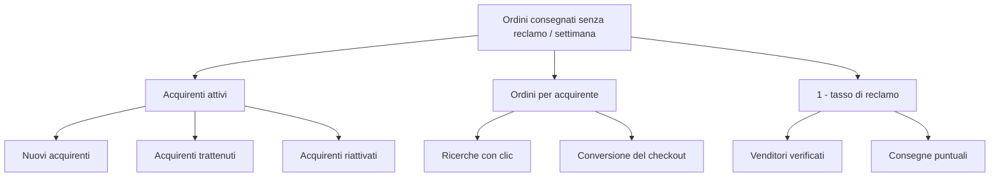

Scenario costruito, numeri di esempio. Un marketplace italiano dell'usato ha quattro squadre di prodotto. Acquisizione ottimizza le registrazioni, Ricerca il tasso di clic sui risultati, Pagamenti la conversione del checkout, Logistica i tempi di consegna. Ognuna chiude il trimestre con il proprio numero in crescita. Eppure gli ordini completati senza problemi sono fermi da due trimestri, e nella revisione con la direzione nessuno sa dire se il lavoro di un team abbia aiutato o danneggiato quello degli altri. La squadra Ricerca, per esempio, ha alzato il clic sui risultati mostrando annunci con prezzi più bassi in alto, e una parte di quegli annunci si è rivelata di venditori poco affidabili: i reclami sono aumentati.

Manca un numero che tutti condividano e una mappa che dica come il lavoro di ciascuno contribuisce a quel numero. La North Star Metric e il metric tree servono a questo.

> **Idea chiave:** la North Star misura il valore che il cliente riceve, il metric tree la scompone in leve che i team possono muovere, e guardrail e counter-metric impediscono di muovere una leva rompendo il resto.

## Che cos'è una North Star Metric

La North Star Metric è la singola metrica che meglio cattura il valore che il prodotto consegna ai clienti e che, nel medio periodo, si traduce in ricavi sostenibili. Non è il ricavo stesso: il ricavo è l'esito, la North Star è il comportamento che lo anticipa. Lenny Rachitsky, in una guida costruita interrogando persone che hanno lavorato in oltre 40 aziende in fase di crescita, la riassume così: la North Star è la strategia, e la strategia è la North Star ([Choosing your North Star Metric](https://www.lennysnewsletter.com/p/choosing-your-north-star-metric)). Scegliere la metrica significa scegliere che cosa l'azienda considera successo.

Una buona North Star soddisfa cinque criteri. Conviene valutarli uno per uno quando si confrontano più candidate.

| Criterio | Domanda di verifica | Candidata che lo viola |
| :--- | :--- | :--- |
| Misura valore per il cliente | Se il numero sale, i clienti stanno meglio? | Ricavi da commissioni: salgono anche alzando le tariffe |
| Anticipa i ricavi | Chi contribuisce di più alla metrica rinnova o compra di più? | Download dell'app: nessun legame con l'uso |
| È influenzabile dai team | Esistono leve che la muovono in un trimestre? | Quota di mercato: dipende anche dai concorrenti |
| È comprensibile | Un nuovo assunto capisce in una frase che cosa conta? | Indice composito con sei pesi |
| È un conteggio, non un rapporto | Può salire riducendo il denominatore? | Conversione del checkout: sale se arrivano meno visitatori |

L'ultimo criterio merita una spiegazione. Un rapporto come la conversione può migliorare per la ragione sbagliata: se la squadra Acquisizione smette di portare traffico poco qualificato, la conversione sale anche se gli ordini calano. Un conteggio di eventi di valore, come «ordini consegnati senza reclamo nella settimana», cresce solo se crescono il numero di clienti o il loro uso di valore. I rapporti trovano posto più in basso nell'albero, come input metric.

La North Star dipende dal tipo di valore che il prodotto crea. I prodotti di consumo che vivono dell'attenzione puntano sul tempo di uso di qualità, quelli transazionali sulle transazioni riuscite, quelli di produttività sul lavoro portato a termine. La tabella mostra esempi costruiti per modelli diversi.

| Modello | North Star di esempio | Perché funziona | Rischio da presidiare |
| :--- | :--- | :--- | :--- |
| B2C, app di allenamento | Allenamenti completati per settimana | Un allenamento completato è il valore promesso | Allenamenti brevissimi fatti solo per la serie di giorni |
| B2C, contenuti in abbonamento | Ore di ascolto da utenti attivi settimanali | L'ascolto ripetuto anticipa il rinnovo | Riproduzione automatica in sottofondo che gonfia le ore |
| B2B SaaS | Team attivi settimanali con almeno 3 report condivisi | La condivisione indica che il prodotto è entrato nel lavoro del team | Report condivisi in automatico senza essere letti |
| Marketplace | Ordini consegnati senza reclamo per settimana | Richiede che domanda, offerta e logistica funzionino insieme | Reclami scoraggiati invece che risolti |
| Fintech | Pagamenti riusciti per settimana | Ogni pagamento riuscito è un uso reale del conto | Micropagamenti di prova |

Nei marketplace la North Star deve misurare il valore per entrambe le parti. Contare solo gli ordini favorisce gli acquirenti a scapito dei venditori; contare gli annunci pubblicati premia l'offerta anche quando nessuno compra. L'ordine consegnato senza reclamo funziona perché richiede che entrambe le parti abbiano ottenuto ciò che volevano.

## Il metric tree: dalle leve dei team alla North Star

Una North Star è troppo aggregata e lenta per guidare il lavoro di una singola squadra. Il metric tree la scompone in input metric, cioè metriche più vicine alle leve operative, legate alla North Star da relazioni esplicite. Le scomposizioni sono di due tipi. Nella forma moltiplicativa la North Star è il prodotto dei fattori: ordini senza reclamo = acquirenti attivi × ordini per acquirente × (1 − tasso di reclamo). Nella forma additiva è la somma delle parti: acquirenti attivi = nuovi + trattenuti + riattivati.

Le due forme si combinano: ogni fattore di una scomposizione moltiplicativa può essere a sua volta la somma di componenti, e così via fino a metriche che una singola squadra possiede.



Quattro regole rendono l'albero utile e non decorativo.

La prima è che l'identità deve tornare: moltiplicando o sommando i rami si deve ottenere esattamente la North Star, con le stesse definizioni e la stessa finestra. Se non torna, l'albero non serve a scomporre una variazione.

La seconda è che ogni foglia ha un responsabile. Una foglia senza responsabile è un indicatore da osservare, non una leva.

La terza è che le foglie si muovono più in fretta della radice: una squadra deve vedere l'effetto del proprio lavoro in settimane, non in trimestri.

La quarta è che i legami non dimostrati vanno dichiarati. Alcuni rami sono identità contabili, altri sono ipotesi causali (le consegne puntuali riducono i reclami); questi ultimi vanno verificati con dati o esperimenti.

Un modo pratico per completare l'albero è chiedersi, per ogni nodo, quali dimensioni del comportamento lo compongono: quanti utenti fanno l'azione (ampiezza), quanto la fanno a fondo (profondità), quanto spesso (frequenza) e con quanta fatica (efficienza). Per gli ordini per acquirente, per esempio, l'ampiezza è la quota di acquirenti che cerca almeno una volta, la frequenza il numero di visite settimanali, l'efficienza la conversione da ricerca a ordine.

## Esempio svolto: dove conviene spingere

Nella settimana di riferimento il marketplace ha 50.000 acquirenti attivi, cioè con almeno un ordine consegnato. Ciascuno ne riceve in media 1,6, per 80.000 ordini. Il 5% genera un reclamo. La North Star vale quindi:

50.000 × 1,6 × (1 − 0,05) = 80.000 × 0,95 = 76.000 ordini consegnati senza reclamo.

Le tre squadre propongono tre interventi per il trimestre, ciascuno con una stima di effetto basata su test passati.

| Intervento | Squadra | Effetto stimato sulla foglia | Nuova North Star | Variazione |
| :--- | :--- | :--- | ---: | ---: |
| Campagna di riattivazione | Acquisizione | Acquirenti attivi +5%, da 50.000 a 52.500 | 52.500 × 1,6 × 0,95 = 79.800 | +3.800 (+5,0%) |
| Raccomandazioni nel carrello | Ricerca | Ordini per acquirente da 1,6 a 1,7 | 50.000 × 1,7 × 0,95 = 80.750 | +4.750 (+6,25%) |
| Verifica dei venditori | Qualità | Reclami dal 5% al 4% | 50.000 × 1,6 × 0,96 = 76.800 | +800 (+1,05%) |

**Passo 1, la proprietà moltiplicativa.** In un prodotto di fattori, una variazione relativa di un fattore si trasmette identica alla radice: +5% di acquirenti dà +5% di North Star. Il confronto tra interventi si riduce quindi al confronto tra le variazioni relative realisticamente ottenibili su ciascun fattore. Passare da 1,6 a 1,7 ordini è +6,25%; passare da un 95% a un 96% di ordini senza reclamo è appena +1,05%.

**Passo 2, il costo.** La campagna di riattivazione costa 45.000 euro nel trimestre, le raccomandazioni richiedono sei settimane di due ingegneri, la verifica dei venditori quattro settimane di un ingegnere più un costo operativo di 8.000 euro. A parità di ordine di grandezza dei costi, le raccomandazioni portano più ordini e un effetto duraturo, mentre la campagna si esaurisce quando si spegne.

**Passo 3, ciò che l'albero non vede.** L'albero è una fotografia della settimana. Non mostra che un acquirente con un reclamo, nello scenario, ha una probabilità di riacquisto a 90 giorni del 30% contro il 60% di chi non ne ha avuti. Ridurre i reclami di un punto evita 800 esperienze negative a settimana e protegge gli acquirenti attivi dei mesi successivi. È un effetto ritardato che va stimato a parte, con un'[analisi di coorte](/course/analisi-prodotto/analisi-coorte/).

**La decisione.** Le raccomandazioni nel carrello hanno la priorità, perché danno l'effetto stimato maggiore a costo contenuto. La verifica dei venditori non si scarta per il suo +1% immediato: si dimensiona l'effetto sulla retention prima di decidere. Le stime vanno confermate con un esperimento prima del rilascio completo, perché un +0,1 ordini per acquirente è un'ipotesi, non un risultato. Quando le metriche dell'albero diventano metrica primaria e guardrail di un test, si applicano le regole della lezione sugli [esperimenti avanzati](/course/analisi-prodotto/esperimenti-avanzati/).

Il confronto tra scenari si automatizza in poche righe, utili per rifare il conto quando cambiano le stime.

```python
# Sensibilità della North Star a interventi alternativi sul metric tree
def north_star(acquirenti, ordini_per_acquirente, tasso_reclamo):
    return acquirenti * ordini_per_acquirente * (1 - tasso_reclamo)

base = {"acquirenti": 50_000, "ordini_per_acquirente": 1.6, "tasso_reclamo": 0.05}
interventi = {
    "Riattivazione (+5% acquirenti)": {"acquirenti": 52_500},
    "Raccomandazioni (+0,1 ordini)":  {"ordini_per_acquirente": 1.7},
    "Verifica venditori (-1 punto)":  {"tasso_reclamo": 0.04},
}

ns_base = north_star(**base)
print(f"Base: {ns_base:,.0f}")
for nome, modifica in interventi.items():
    ns = north_star(**{**base, **modifica})
    print(f"{nome}: {ns:,.0f} ({ns - ns_base:+,.0f}, {ns / ns_base - 1:+.2%})")
```

L'output riporta 76.000 per la base e, nell'ordine, +3.800 (+5,00%), +4.750 (+6,25%) e +800 (+1,05%).

## Calcolare l'albero dai dati

L'albero diventa uno strumento quotidiano quando una query ne calcola tutti i nodi con la stessa definizione. La query seguente lavora sullo schema eventi comune del modulo e assume che ogni ordine consegnato generi un evento `order_delivered` con la proprietà `has_issue` impostata a vero quando è stato aperto un reclamo. La sintassi `->>` per leggere un campo JSON è quella di Postgres e DuckDB; in BigQuery si usa `JSON_VALUE(properties, '$.has_issue')`.

```sql
-- Metric tree settimanale: North Star = acquirenti attivi x ordini per acquirente x (1 - tasso di reclamo)
WITH delivered AS (
  SELECT
    e.user_id,
    DATE_TRUNC('week', e.event_time) AS week,
    COALESCE(CAST(e.properties ->> 'has_issue' AS BOOLEAN), FALSE) AS has_issue
  FROM events AS e
  WHERE e.event_name = 'order_delivered'
)
SELECT
  week,
  COUNT(DISTINCT user_id)                                   AS active_buyers,
  ROUND(1.0 * COUNT(*) / COUNT(DISTINCT user_id), 2)        AS orders_per_buyer,
  ROUND(AVG(CASE WHEN has_issue THEN 1.0 ELSE 0.0 END), 3)  AS issue_rate,
  SUM(CASE WHEN has_issue THEN 0 ELSE 1 END)                AS north_star
FROM delivered
GROUP BY week
ORDER BY week;
```

Sui dati della settimana di riferimento la query restituisce 50.000 acquirenti attivi, 1,6 ordini per acquirente, un tasso di reclamo di 0,05 e una North Star di 76.000. Il prodotto dei tre fattori non arrotondati restituisce esattamente la North Star, perché numeratori e denominatori si semplificano a catena. È il controllo da fare ogni volta che si aggiunge un ramo: se il prodotto non torna, qualche nodo usa una definizione diversa.

Con questa tabella settimanale, una variazione della North Star si scompone subito nei tre fattori. Se la North Star scende del 4% e gli ordini per acquirente sono stabili, il problema è nel numero di acquirenti o nei reclami, e la diagnosi parte da lì.

## Guardrail e counter-metric

Ottimizzare un numero produce effetti collaterali. La legge di Goodhart, nata da un'osservazione dell'economista Charles Goodhart sulla politica monetaria e nota nella forma resa popolare dall'antropologa Marilyn Strathern, dice che quando una misura diventa un obiettivo smette di essere una buona misura. Due strumenti limitano il problema.

Il **guardrail** è una metrica di salute generale che non deve peggiorare oltre una soglia definita in anticipo, qualunque cosa faccia la squadra. Tempi di caricamento, tasso di crash, disiscrizioni dalle email, ticket di assistenza, rimborsi. È tipicamente condiviso da tutta l'azienda e ha una soglia esplicita: «il tempo di risposta al 95° percentile della ricerca non supera 800 ms».

La **counter-metric** è una metrica abbinata a una specifica input metric, scelta per smascherare il modo più ovvio di gonfiarla. Se la squadra Ricerca ha come obiettivo il clic sui risultati, la counter-metric è la quota di clic seguiti da un ordine o da un reclamo: un aumento di clic accompagnato da più reclami indica che si stanno spingendo annunci peggiori, come nello scenario di apertura.

| Input metric | Modo ovvio di gonfiarla | Counter-metric |
| :--- | :--- | :--- |
| Clic sui risultati di ricerca | Mostrare in alto gli annunci più economici | Reclami per ordine originato dalla ricerca |
| Nuovi acquirenti | Sconti aggressivi al primo ordine | Quota di nuovi acquirenti con un secondo ordine entro 60 giorni |
| Ordini per acquirente | Spingere ordini piccoli con spedizione gratuita | Margine per ordine |
| Tempo di consegna | Dichiarare consegnato prima della consegna effettiva | Reclami per mancata consegna |

La soglia del guardrail si fissa prima del lavoro, non dopo aver visto i risultati, e si esprime come variazione massima tollerata. Un esempio: la squadra Ricerca porta i clic dal 22% al 25%, ma i reclami per ordine originato dalla ricerca salgono dal 5,0% al 6,5%, oltre la soglia concordata di +0,5 punti. Il risultato non si festeggia: si indaga quali annunci generano i reclami e si corregge il ranking prima di estendere il rilascio.

## Verificare che la North Star anticipi i ricavi

Una North Star è un'ipotesi: che il comportamento misurato porti a rinnovi, riacquisti o ricavi. L'ipotesi si verifica con i dati prima di adottarla. Si prende una coorte di clienti abbastanza vecchia da conoscerne l'esito, li si raggruppa per il valore della metrica candidata nei primi 30 giorni e si guarda l'esito a 12 mesi.

Nello scenario di un SaaS B2B si valuta come North Star il numero di report condivisi per team. Su 1.000 account acquisiti un anno fa:

| Report condivisi nei primi 30 giorni | Account | Rinnovi a 12 mesi | Tasso di rinnovo |
| :--- | ---: | ---: | ---: |
| 0 | 400 | 140 | 35% |
| 1–2 | 300 | 156 | 52% |
| 3–5 | 200 | 142 | 71% |
| 6 o più | 100 | 83 | 83% |
| Totale | 1.000 | 521 | 52,1% |

Il rinnovo cresce in modo monotono con la metrica, dal 35% all'83%, e i gruppi hanno dimensioni sufficienti per escludere che la differenza sia rumore. Il segnale è compatibile con una North Star valida. Due cautele. La relazione è una correlazione: i team che condividono più report sono anche quelli che avevano più bisogno del prodotto, e spingere la condivisione con notifiche automatiche potrebbe non produrre gli stessi rinnovi. Inoltre conviene confrontare più candidate con lo stesso metodo e scegliere quella con la separazione più netta e più stabile tra coorti diverse.

## Errori comuni nella scelta e nell'uso della North Star

### Usare i ricavi come North Star

Il sintomo è un'azienda che aumenta i ricavi del trimestre con rincari e upsell aggressivi mentre l'uso del prodotto cala. I ricavi sono un risultato ritardato: quando scendono, il danno all'esperienza è avvenuto mesi prima. Si evita scegliendo un comportamento di valore che preceda i ricavi e tenendo i ricavi come metrica di business monitorata a parte, con gli strumenti della [monetization analytics](/course/analisi-prodotto/monetization-analytics/).

### Scegliere un rapporto come radice

Il sintomo è una North Star che migliora mentre l'azienda si restringe. Un tasso di conversione o una retention media salgono anche quando si perdono i clienti meno coinvolti. Si evita mettendo alla radice un conteggio e portando i rapporti nei rami, dove la scomposizione li tiene legati al loro denominatore.

### Un albero che non torna

Il sintomo è una North Star che scende mentre tutte le input metric salgono. Succede quando i nodi usano finestre o definizioni diverse (acquirenti attivi nel mese, ordini nella settimana) o quando l'albero contiene relazioni ipotetiche spacciate per identità. Si evita verificando ogni settimana che la combinazione dei rami riproduca la radice e marcando in modo diverso i legami ipotizzati.

### Cambiare North Star a ogni trimestre

Il sintomo è un team che non riesce a confrontare l'anno corrente con il precedente. La North Star si rivede quando cambia la strategia, per esempio con l'ingresso in un nuovo segmento, non quando il numero delude. Una revisione all'anno è un ritmo ragionevole; più spesso è un segnale che la metrica è stata scelta senza la verifica descritta sopra.

## Domande per verificare la comprensione

1. Un'app di prenotazione per ristoranti propone come North Star il tasso di conversione da ricerca a prenotazione. Quale criterio viola e quale alternativa proporresti?

<details>
<summary>Mostra risposta</summary>

È un rapporto, quindi può salire riducendo il denominatore: se arrivano meno utenti poco interessati, la conversione sale anche con meno prenotazioni. Un'alternativa è un conteggio di valore per entrambe le parti, come le prenotazioni onorate (cliente presentato al tavolo) per settimana. La conversione resta nell'albero come input metric della squadra Ricerca.

</details>

2. Con 50.000 acquirenti attivi, 1,6 ordini per acquirente e un tasso di reclamo del 5%, quanto vale la North Star? E quale intervento la aumenta di più tra +4% di acquirenti e reclami dal 5% al 3%?

<details>
<summary>Mostra risposta</summary>

La North Star vale 50.000 × 1,6 × 0,95 = 76.000. Con +4% di acquirenti: 52.000 × 1,6 × 0,95 = 79.040, cioè +3.040. Con reclami al 3%: 50.000 × 1,6 × 0,97 = 77.600, cioè +1.600. L'aumento degli acquirenti vale quasi il doppio nell'immediato, ma la riduzione dei reclami ha un effetto ritardato sulla retention che l'albero non mostra e va stimato a parte.

</details>

3. Qual è la differenza tra un guardrail e una counter-metric, e quale esempio di ciascuno daresti per una squadra che deve aumentare le iscrizioni alla newsletter?

<details>
<summary>Mostra risposta</summary>

Il guardrail è una metrica di salute generale con una soglia che nessuno deve superare, per esempio il tasso di segnalazioni come spam di tutte le email aziendali sotto lo 0,1%. La counter-metric è abbinata all'obiettivo specifico e ne smaschera la manipolazione più probabile, per esempio la quota di nuovi iscritti che apre almeno una email nei primi 30 giorni: se le iscrizioni salgono con pop-up insistenti ma nessuno apre le email, l'obiettivo è stato gonfiato.

</details>

4. Tutte le input metric dell'albero sono in crescita, ma la North Star scende. Quali sono le due cause più probabili?

<details>
<summary>Mostra risposta</summary>

La prima è un albero che non torna: i nodi usano definizioni, finestre o esclusioni diverse dalla radice, per cui il loro prodotto non riproduce la North Star. La seconda è un ramo mancante o un legame ipotetico trattato come identità, per esempio un fattore che non era nell'albero (come un aumento dei reclami) e che cancella il contributo degli altri. Si verifica ricalcolando la radice dai rami con la stessa query.

</details>

5. Se nella tabella di validazione il tasso di rinnovo fosse 50%, 49%, 53% e 51% nei quattro gruppi, che cosa concluderesti sulla metrica candidata?

<details>
<summary>Mostra risposta</summary>

Che non anticipa il rinnovo: i tassi sono quasi uguali tra i gruppi e le differenze sono compatibili con il rumore. Una metrica che non separa chi rinnova da chi non rinnova non è una buona North Star, per quanto intuitiva. Si prova un'altra candidata con lo stesso metodo.

</details>
