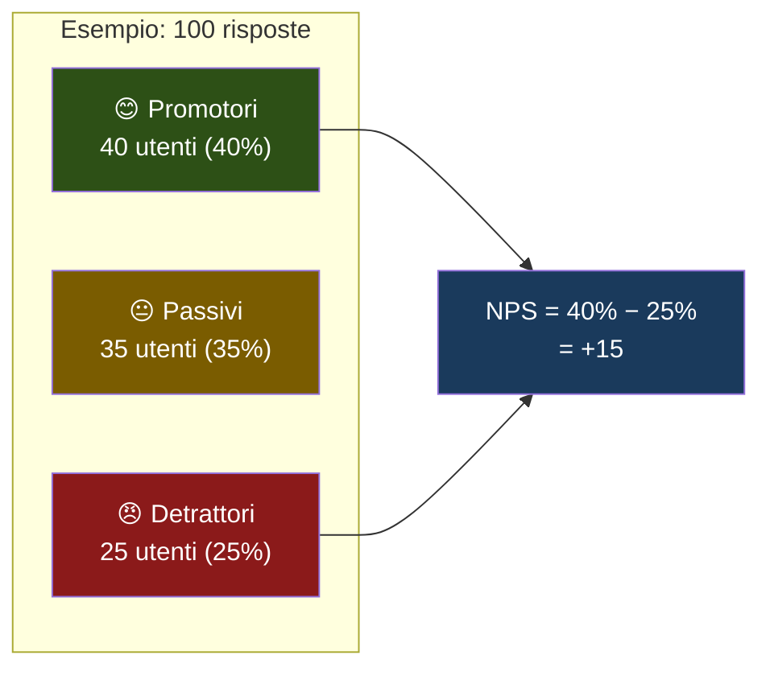
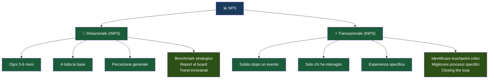
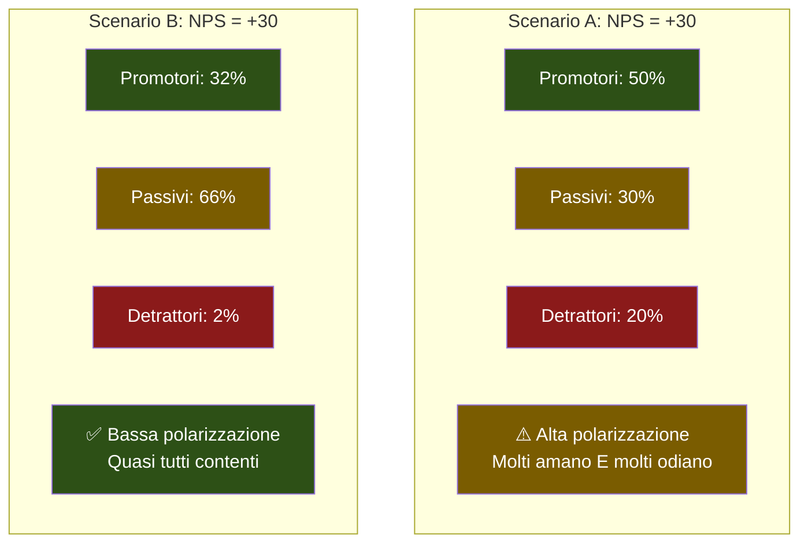
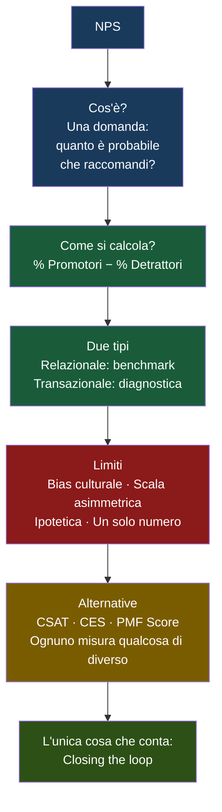

## NPS: LA METRICA PIÙ AMATA E PIÙ FRAINTESA DEL PRODUCT MANAGEMENT

Il **Net Promoter Score** è un indicatore di fedeltà del cliente basato su una sola domanda:

> *"Con quale probabilità, da 0 a 10, consiglieresti questo prodotto/servizio a un amico o collega?"*

Introdotto da Fred Reichheld in un articolo su Harvard Business Review nel 2003 ("The One Number You Need to Grow"), l'NPS ha conquistato il mondo corporate. È semplice, universale, facile da comunicare al board. Ma proprio questa semplicità nasconde trappole che la maggior parte delle aziende ignora.

## Come si calcola

Le risposte vengono classificate in tre categorie:

| Punteggio | Categoria | Significato |
|:---------:|-----------|-------------|
| 9–10 | **Promotori** | Entusiasti, fedeli, generano passaparola positivo |
| 7–8 | **Passivi** | Soddisfatti ma non entusiasti, vulnerabili alla concorrenza |
| 0–6 | **Detrattori** | Insoddisfatti, possono danneggiare il brand con passaparola negativo |

La formula:

> **NPS = % Promotori − % Detrattori**

Il risultato va da −100 (tutti detrattori) a +100 (tutti promotori).

Nota che i **passivi non compaiono nella formula** — influenzano solo il denominatore. Questo è intenzionale: Reichheld li considera "neutri", ma come vedremo è una semplificazione che può essere pericolosa.

## Benchmark: cosa è un "buon" NPS?

Non esiste un valore universalmente "buono". L'NPS dipende enormemente dal settore, dal mercato e dal tipo di prodotto.

| Settore | NPS medio | Top performer |
|---------|:---------:|:------------:|
| SaaS B2B | +30 | +60/+70 |
| E-commerce | +40 | +70/+80 |
| Telecomunicazioni | +10 | +30/+40 |
| Compagnie aeree | +20 | +50/+60 |
| Banche retail | +15 | +40/+50 |
| Assicurazioni | −5 | +20/+30 |

> **Regola pratica:** confronta il tuo NPS con il tuo settore, non con Apple. NPS +30 per una telco è eccellente; per un brand di lusso direct-to-consumer, è mediocre.

## Due tipi di NPS: relazionale e transazionale

Questa distinzione è fondamentale e spesso ignorata.

### NPS Relazionale (rNPS)

Si invia periodicamente (ogni trimestre o semestre) a tutta la base clienti. Misura la **percezione complessiva** del brand/prodotto nel tempo. È utile per il benchmarking strategico e per tracciare le tendenze a lungo termine.

### NPS Transazionale (tNPS)

Si invia subito dopo un'interazione specifica: un acquisto, una chiamata al supporto, l'uso di una funzionalità. Misura la **soddisfazione puntuale** con quell'esperienza.

L'errore più comune è usare solo l'rNPS. Sapere che il tuo NPS è +25 non ti dice *dove* intervenire. Il tNPS dopo il checkout, dopo il primo onboarding, dopo il supporto clienti, ti dice esattamente **quale touchpoint sta andando bene e quale no**.

## Closing the loop: da numero a azione

L'NPS è inutile se resta un numero su una slide. Il suo vero valore sta nel **follow-up**: contattare i detrattori per capire il problema, ringraziare i promotori e chiedere referral, analizzare i pattern nei commenti aperti.

### Il processo in quattro fasi

Il passaggio più critico è il **closing the loop con i detrattori**:
- Contattarli entro 24-48 ore dalla risposta
- Ascoltare senza difendersi
- Proporre una soluzione concreta
- Ricontattare dopo la risoluzione per verificare la soddisfazione

Le aziende che implementano un processo di closing the loop riducono il churn dei detrattori del 30-50%.

## I limiti dell'NPS (la parte che nessuno racconta)

### 1. Il problema culturale

In Giappone, dare un 10 è considerato presuntuoso — un 7-8 esprime già alta soddisfazione. In America Latina, le risposte tendono verso gli estremi. Confrontare l'NPS tra mercati diversi è come confrontare temperature in Celsius e Fahrenheit senza conversione.

### 2. L'asimmetria della scala

I detrattori occupano 7 punti della scala (0-6), i promotori solo 2 (9-10), i passivi 2 (7-8). Chi dà un 6 (abbastanza soddisfatto ma non entusiasta) è categorizzato uguale a chi dà uno 0 (furioso). Questa non è una scala lineare — è una categorizzazione arbitraria.

### 3. La domanda è ipotetica

"Consiglieresti?" chiede un'intenzione, non un comportamento reale. La ricerca mostra che la correlazione tra dichiarazione di raccomandazione e raccomandazione effettiva è bassa. Chi dice 9 potrebbe non consigliare mai il prodotto a nessuno.

### 4. Un solo numero non spiega nulla

NPS +30 con il 50% di promotori e il 20% di detrattori è molto diverso da NPS +30 con il 32% di promotori e il 2% di detrattori. Il primo ha una distribuzione polarizzata (molti amano, molti odiano), il secondo è quasi uniformemente positivo. La stessa cifra, due realtà opposte.

### 5. La tirannide del campione

Se invii il sondaggio via email, chi risponde è auto-selezionato: i molto soddisfatti e i molto insoddisfatti. I passivi — che per definizione sono meno coinvolti — rispondono meno, distorcendo il risultato.

Tasso di risposta tipico: 10-30% per rNPS via email. Il 70-90% che non risponde potrebbe essere radicalmente diverso da chi ha risposto.

## Alternative e complementi all'NPS

### CSAT (Customer Satisfaction Score)

> "Quanto sei soddisfatto di [esperienza specifica]?" (scala 1-5 o 1-7)

**CSAT = % di risposte positive / Totale risposte**

Misura la soddisfazione puntuale, non la fedeltà a lungo termine. Ideale per i touchpoint specifici: post-acquisto, post-supporto, post-onboarding.

### CES (Customer Effort Score)

> "Quanto è stato facile [completare questa azione]?" (scala 1-7)

Basato sulla ricerca di Dixon, Toman e DeLisi (*The Effortless Experience*): la fedeltà non dipende da quanto "delizi" il cliente, ma da quanto **riduci lo sforzo**. Ridurre la frizione è più potente che creare "momenti wow".

### PMF Score (Sean Ellis)

> "Come ti sentiresti se non potessi più usare questo prodotto?"

Con le opzioni: "Molto deluso", "Un po' deluso", "Non deluso", "Non lo uso più". Se il 40%+ dice "Molto deluso", hai il Product-Market Fit (approfondito nella lezione dedicata).

| Metrica | Misura | Quando usarla | Debolezza |
|---------|--------|---------------|-----------|
| **NPS** | Fedeltà/advocacy | Benchmark generale | Ipotetica, culturalmente biased |
| **CSAT** | Soddisfazione puntuale | Post-interazione | Non predice la fedeltà |
| **CES** | Facilità d'uso | Post-task critico | Non cattura il "delight" |
| **PMF Score** | Dipendenza dal prodotto | Pre/post PMF | Solo per prodotti in fase early |

## Caso studio: il paradosso dell'NPS alto con churn alto

Un'azienda SaaS B2B ha un NPS di +45 — eccellente per il settore. Ma il churn annuo è al 18%, ben sopra la media del settore (10-12%).

L'analisi dei dati rivela il problema: i **clienti enterprise** (quelli che pagano di più e rispondono al sondaggio perché ricevono un account manager dedicato) danno punteggi alti. I clienti **SMB** (piccole imprese) hanno churn del 30% ma rispondono al sondaggio con un tasso del 5%.

L'NPS era alto perché il campione era auto-selezionato: rispondevano solo i clienti più seguiti e coccolati. I clienti che se ne andavano non rispondevano ai sondaggi — erano già mentalmente altrove.

**Lezione:** un NPS alto non è garanzia di salute del business. Va sempre letto insieme a retention, churn e revenue metrics. Ed è essenziale monitorare il tasso di risposta per segmento.

## Come analizzare l'NPS in modo serio

Invece di guardare solo il numero, analizza:

1. **La distribuzione** — traccia l'istogramma delle risposte, non solo il punteggio aggregato
2. **I trend** — l'NPS di questo trimestre vs il precedente, per segmento
3. **La correlazione con il comportamento** — i promotori davvero comprano di più? Davvero fanno referral?
4. **I commenti aperti** — la vera miniera d'oro. Usa topic modeling o categorizzazione manuale per identificare i temi ricorrenti
5. **La segmentazione** — NPS per segmento cliente, per fase del ciclo di vita, per piano tariffario, per canale di acquisizione

## Riepilogo

Tre cose da portare a casa:

1. **L'NPS è un termometro, non una cura** — ti dice che qualcosa non va (o va bene), ma non dove intervenire. Senza il commento aperto e il follow-up, è un numero sterile.

2. **Usa l'NPS transazionale, non solo quello relazionale** — il tNPS dopo ogni touchpoint critico è infinitamente più azionabile del rNPS trimestrale.

3. **Non innamorarti del numero** — un NPS alto con churn alto, con basso tasso di risposta, o con distribuzione polarizzata, non è un buon segnale. Leggi sempre la distribuzione, non solo l'aggregato.

## NPS leading o lagging? Il ruolo predittivo della metrica

Una delle domande più pratiche sull'NPS è se sia un indicatore **leading** (anticipa il futuro) o **lagging** (fotografa il passato). La risposta onesta è: dipende da come lo usi.

### NPS come indicatore lagging

Nella sua forma più comune — survey trimestrale inviata a tutta la base — l'NPS è quasi interamente una metrica lagging. Riflette l'esperienza accumulata degli utenti nei mesi precedenti. Quando il risultato arriva, i problemi che ha rilevato possono già essere stati risolti, o possono essersi aggravati.

Un NPS relazionale che scende da +35 a +20 in un trimestre è un segnale allarmante — ma il danno è già fatto. La domanda è: cosa è successo 60-90 giorni fa che ha peggiorato l'esperienza?

### NPS transazionale come indicatore leading

Il tNPS, somministrato subito dopo ogni touchpoint critico, ha caratteristiche di indicatore leading. Se il tNPS dopo il supporto clienti scende da +40 a +15 in un mese, è quasi certo che il churn aumenterà nelle settimane successive — con sufficiente anticipo per intervenire.

Le aziende più sofisticate usano il tNPS come early warning system:

- **Amazon:** misura l'NPS dopo ogni ordine e dopo ogni interazione con il Customer Service. Un calo del tNPS post-CS di 5+ punti attiva automaticamente una review del processo di supporto.
- **Apple Retail:** misura l'NPS dopo ogni visita in store. Il Net Promoter Score dei Genius Bar è una KPI operativa per ogni negozio — i direttori di store ricevono il report settimanale e devono rispondere ai cali.
- **Airbnb:** misura l'NPS separatamente per host e guest dopo ogni transazione. Il calo dell'NPS host nel 2020 (durante la pandemia e le cancellazioni massive) fu uno dei segnali che spinse Airbnb a introdurre politiche di protezione degli host più robuste.

## Calcolo statistico: confidence interval e sample size

Il singolo numero NPS senza intervallo di confidenza è quasi privo di significato statistico. Eppure la stragrande maggioranza delle aziende presenta l'NPS come "il nostro NPS è +42" senza mai menzionare la precisione di quella stima.

### Intervallo di confidenza dell'NPS

L'NPS ha una distribuzione complessa (non è una proporzione semplice, né una media continua), ma per campioni ragionevoli (n > 100) si può approssimare usando il bootstrap o la formula semplificata:

> **Margine di errore ≈ 1.96 × √[ (p_p × (1-p_p) + p_d × (1-p_d)) / n ]**

Dove p_p = proporzione di promotori, p_d = proporzione di detrattori, n = numero di rispondenti.

Esempio:
- 200 rispondenti: 80 promotori (40%), 40 detrattori (20%), 80 passivi (40%)
- NPS = 40% − 20% = +20
- Margine di errore ≈ 1.96 × √[(0,40 × 0,60 + 0,20 × 0,80) / 200] ≈ ±8 punti

Quindi l'NPS "reale" è tra +12 e +28 con il 95% di confidenza. Dire "il nostro NPS è +20" è tecnicamente corretto ma implica una precisione che non esiste.

### Sample size minimo per rilevare variazioni significative

Quante risposte servono per rilevare un cambiamento di 5 punti nell'NPS (ad esempio da +30 a +35)?

Il calcolo dipende dalla variabilità dell'NPS, che è tipicamente alta. Come regola pratica:

| Variazione da rilevare | Sample size per gruppo | Note |
|:---------------------:|:----------------------:|------|
| ±3 punti | 1.000+ | Test molto sensibile, raro nella pratica |
| ±5 punti | 400-600 | Standard per confronti trimestrali |
| ±10 punti | 100-200 | Rilevabile con campioni più piccoli |

Questo ha implicazioni pratiche: se hai 50 rispondenti, la variazione da +30 a +40 non è statisticamente significativa. Non puoi concludere che le cose sono migliorate — potresti semplicemente avere un campione diverso.

### Il problema del confronto nel tempo

Ogni volta che confronti l'NPS di questo trimestre con quello precedente, stai facendo un test di ipotesi implicito. Ma il tasso di risposta varia, il segmento che risponde varia, il periodo stagionale varia.

La best practice è usare il **confronto standardizzato**: stesso periodo dell'anno precedente, stesso canale di somministrazione, stesso segmento di utenti. I confronti YoY (year-over-year) sono più affidabili dei confronti QoQ (quarter-over-quarter) per rimuovere la stagionalità.

## Correlazione NPS e revenue: la promessa di Reichheld

Fred Reichheld ha costruito tutta la sua tesi su un'affermazione audace: l'NPS è il "one number you need to grow" perché i promotori crescono il business attraverso il passaparola, e i detrattori lo danneggiano.

La ricerca originale di Reichheld (pubblicata su HBR nel 2003 e approfondita nel libro "The Ultimate Question") mostrava correlazioni positive tra NPS e crescita del fatturato in diversi settori. Ma la metodologia è stata contestata.

### La tesi di Reichheld

Nel suo studio originale, Reichheld ha mostrato che l'NPS era più correlato alla crescita del fatturato di qualsiasi altro indicatore di soddisfazione. In settori come le telecomunicazioni, le compagnie aeree e le banche, le aziende con NPS più alto crescevano più velocemente.

### La critica di Keiningham e il dibattito scientifico

Nel 2007, Timothy Keiningham e colleghi pubblicarono su Journal of Marketing una replica dello studio di Reichheld con dati da 21 industrie. Le conclusioni furono molto diverse:

- L'NPS non era superiore ad altre metriche di soddisfazione (ACSI, customer satisfaction tradizionale) nel predire la crescita del fatturato
- La correlazione tra NPS e crescita variava enormemente tra settori
- In alcuni settori, la customer satisfaction tradizionale era un predittore migliore

Questo non significa che l'NPS sia inutile — significa che la promessa "un solo numero per la crescita" è una semplificazione commerciale. L'NPS è un indicatore utile tra molti, non un oracolo.

### La posizione di Fred Reichheld: la risposta alle critiche

Reichheld ha riconosciuto che l'NPS funziona meglio in alcuni settori (dove il passaparola è critico) che in altri (settori con switching costs alti dove il cliente resta indipendentemente dalla soddisfazione). Ha anche evoluto la sua posizione nel libro "Winning on Purpose" (2021), dove introduce il concetto di "Earned Growth" — la crescita generata da referral e repeat business, che è correlata all'NPS meglio del fatturato totale.

**Earned Growth Rate:**
> Earned Growth = (Revenue da clienti esistenti + Revenue da referral) / Revenue totale anno precedente

Questa metrica è più direttamente collegata all'NPS perché misura la crescita che viene da clienti soddisfatti, non da acquisizioni a pagamento.

## Closed-loop feedback: il processo completo

Il "closing the loop" non è solo chiamare i detrattori. È un processo sistematico con quattro componenti:

### Componente 1 — Inner loop (tatttico)

Il follow-up immediato con i singoli clienti che hanno risposto. Si chiude entro 24-72 ore dalla risposta.

- **Detrattori:** contatto proattivo, ascolto, risoluzione se possibile. Obiettivo: trasformare l'esperienza negativa in positiva.
- **Passivi:** un'email di ringraziamento con domande di follow-up per capire cosa manca per essere promossi a promotori.
- **Promotori:** ringraziamento e, dove opportuno, richiesta di referral o testimonianza.

Il tasso di risoluzione dei detrattori e la percentuale di detrattori trasformati in passivi o promotori sono KPI dell'inner loop.

### Componente 2 — Outer loop (strategico)

L'analisi aggregata delle risposte per identificare i temi ricorrenti e portarli al team di prodotto o operations. Si chiude mensilmente o trimestralmente.

Il processo tipico:
1. Categorizzazione dei commenti aperti per tema (manuale o con NLP)
2. Prioritizzazione dei temi per frequenza e impatto sull'NPS
3. Presentazione al team con raccomandazioni di intervento
4. Tracking delle azioni intraprese e dell'impatto successivo sull'NPS

### Componente 3 — Strutturale (organizzativo)

Le modifiche al prodotto, al processo o alla politica aziendale basate sui pattern identificati nell'outer loop. Si misurano sull'NPS dei trimestri successivi.

### Componente 4 — Cultural

L'NPS diventa una metrica condivisa da tutti, non solo dal Customer Success. Il team di prodotto vede l'NPS per funzionalità. Il team di marketing vede l'NPS per canale di acquisizione. Il team di supporto vede l'NPS per tipo di ticket.

Apple ha reso famoso il concetto di "NPS culture": ogni dipendente Apple Retail conosce l'NPS del proprio store, e i manager di store sono valutati anche su questa metrica. Non solo il Customer Service — anche i Genius Bar technicians.

<Aside type="tip">
L'NPS più azionabile non è quello relazionale trimestrale — è quello transazionale misurato subito dopo ogni touchpoint critico. Se puoi scegliere di misurare l'NPS in un solo momento, scegli il momento di maggiore "intensità" dell'esperienza: dopo il primo acquisto, dopo il supporto, dopo un problema risolto. Quel momento rivela la vera esperienza emotiva del cliente.
</Aside>
