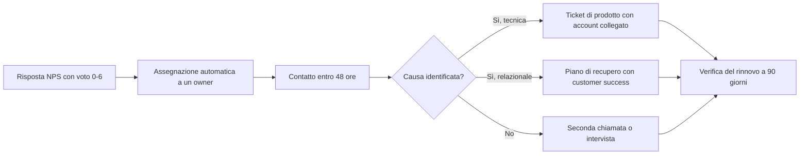

Caso ricostruito con numeri di esempio: una società italiana di servizi digitali per le imprese chiude il trimestre con un NPS aziendale di 44, valore che il consiglio di amministrazione giudica ottimo. Nello stesso trimestre, però, il tasso di rinnovo dei contratti più grandi scivola sotto le attese e due account enterprise comunicano la disdetta. Il responsabile del customer success propone di cercare l'errore nel sondaggio, il direttore commerciale sostiene che il punteggio è buono e che la disdetta dipende dal prezzo.

Entrambi hanno un pezzo di ragione, ma nessuno ha ancora guardato chi ha risposto e quanto pesa economicamente. Un punteggio medio aggregato è una sintesi che nasconde dove sta il rischio. NPS, CSAT e CES funzionano come sensori diagnostici: hanno valore se legati a un segmento preciso, a un momento del percorso e a un intervento di chiusura, e diventano numeri decorativi in tutti gli altri casi.

## Tre sensori per tre decisioni diverse

Le tre metriche misurano dimensioni diverse della relazione con il cliente. Usarle nel momento sbagliato produce segnali confusi: chiedere un NPS subito dopo una chat di assistenza misura l'umore di quel giorno e non la propensione a consigliare il prodotto, mentre usare un CSAT per prevedere il rinnovo annuale significa interpretare un'istantanea come un trend.

> **Idea chiave:** un sondaggio di soddisfazione genera valore solo quando è collegato al comportamento reale del cliente e attiva un intervento con un responsabile entro 48 ore.

L'NPS, Net Promoter Score, chiede quanto si consiglierebbe il prodotto su una scala da 0 a 10. Si classificano i rispondenti in tre gruppi: promotori con voto 9 o 10, passivi con 7 o 8, detrattori da 0 a 6. Il punteggio è la percentuale di promotori meno la percentuale di detrattori, dunque varia da meno 100 a più 100, e i passivi non entrano nella differenza. Il CSAT, Customer Satisfaction, misura la soddisfazione per una specifica interazione, di solito su scala da 1 a 5, e si riporta come quota di risposte 4 e 5. Il CES, Customer Effort Score, chiede quanto è stato facile completare un'azione, e si legge come media o come quota di risposte positive.

| Metrica | Domanda centrale | Momento ideale di invio | Decisione supportata | Limite principale |
| :--- | :--- | :--- | :--- | :--- |
| NPS | Quanto consiglieresti il prodotto, da 0 a 10? | Dopo almeno 30 giorni di uso reale | Prevedere rinnovi, upsell e passaparola | Sensibile a fattori esterni al prodotto |
| CSAT | Quanto sei soddisfatto di questa interazione? | Subito dopo un ticket o un onboarding completato | Valutare la qualità del supporto o di una funzione | Misura l'istante, non la tenuta nel tempo |
| CES | Quanto è stato facile completare l'azione? | Al termine di un flusso operativo complesso | Ridurre attrito e sforzo percepito | Non cattura il valore strategico percepito |

La scelta non è mai tra metriche migliori o peggiori ma tra decisioni. Se devi capire perché i clienti non rinnovano, serve l'NPS letto per segmento e incrociato con i rinnovi. Se devi capire se il nuovo flusso di fatturazione è più semplice del vecchio, serve il CES nel punto esatto del flusso. Se devi giudicare la qualità dell'assistenza dopo una riorganizzazione del team, serve il CSAT sui ticket chiusi.

## Esempio numerico: il 44 che nasconde un meno 20

Riprendiamo i dati del trimestre. Hai raccolto 400 risposte NPS, divise in due segmenti: 320 da piccole e medie imprese e 80 da clienti enterprise. Il segmento delle PMI genera il 40% del fatturato ricorrente, quello enterprise il 60%.

Nel segmento PMI i 320 rispondenti si distribuiscono così: 208 promotori (65%), 96 passivi (30%) e 16 detrattori (5%). L'NPS delle PMI è 65% − 5% = +60. Nel segmento enterprise gli 80 rispondenti sono 20 promotori (25%), 24 passivi (30%) e 36 detrattori (45%), quindi l'NPS è 25% − 45% = −20.

Il numero che il consiglio ha visto è l'NPS aggregato, calcolato su tutti i 400 rispondenti: promotori 208 + 20 = 228, detrattori 16 + 36 = 52. L'NPS è (228 − 52) / 400 = 176 / 400 = +44. Il segmento PMI, che ha l'80% delle risposte, trascina la media verso l'alto.

Quando invece si pesa per fatturato, il calcolo cambia. L'NPS pesato per ricavo è 0,40 × 60 + 0,60 × (−20) = 24 − 12 = +12. Lo stesso dato di partenza produce due messaggi molto diversi: 44 secondo la distribuzione delle risposte e 12 secondo la distribuzione dei ricavi. Il secondo è più vicino alla realtà economica, perché una disdetta enterprise pesa molto più di una disdetta PMI.

Ora si incrocia con i rinnovi. Supponiamo che nei 90 giorni successivi il tasso di rinnovo osservato sia il 91% per i promotori, l'80% per i passivi e il 62% per i detrattori. Per le PMI i rinnovi attesi sono 208 × 91% + 96 × 80% + 16 × 62% = 189,3 + 76,8 + 9,9 = 276 su 320 account, cioè un tasso dell'86,3%. Per gli enterprise sono 20 × 91% + 24 × 80% + 36 × 62% = 18,2 + 19,2 + 22,3 = 59,7 su 80 account, cioè il 74,7%. Un divario di circa 11,6 punti percentuali è abbastanza grande da spiegare la disdetta senza ricorrere al prezzo.

Per stimare l'esposizione economica si moltiplica. Se ogni account enterprise vale in media 30.000 euro all'anno, i 36 detrattori che non rinnovano nel 38% dei casi (100% − 62%) producono 36 × 38% = 13,7 account persi, pari a circa 410.000 euro di fatturato ricorrente. Questo è l'importo che il customer success deve difendere con un intervento mirato, e non un punto di NPS in più o in meno.

La query seguente produce proprio la lettura per segmento e per gruppo NPS, con il numero di account e il tasso di rinnovo osservato.

```sql
-- NPS per piano tariffario con tasso di rinnovo a 90 giorni per gruppo di rispondenti
SELECT
  c.plan_tier,
  multiIf(s.score >= 9, 'Promotore', s.score >= 7, 'Passivo', 'Detrattore') AS nps_segment,
  count(DISTINCT s.account_id) AS accounts,
  round(avg(r.renewed_90d) * 100, 1) AS renewal_rate_pct,
  round(sum(c.arr_eur), 0) AS arr_eur
FROM survey_responses AS s
INNER JOIN accounts AS c ON s.account_id = c.account_id
LEFT JOIN account_renewals AS r ON s.account_id = r.account_id
WHERE s.survey_type = 'NPS'
  AND s.answered_at >= today() - 90
GROUP BY c.plan_tier, nps_segment
ORDER BY c.plan_tier, nps_segment;
```

## Errori comuni nell'uso di NPS, CSAT e CES

Anche le aziende che raccolgono migliaia di risposte cadono in errori che rendono i dati poco utili.

### Leggere il punteggio aggregato senza segmentazione

Il sintomo è un NPS stabile o in crescita mentre i rinnovi peggiorano. Succede perché il campione dei rispondenti non coincide con la distribuzione dei ricavi: i clienti piccoli sono più numerosi e rispondono di più, quelli grandi sono pochi e silenziosi. L'esempio precedente mostra la distanza tra 44 e 12. La correzione è calcolare sempre l'NPS per piano tariffario, anzianità e dimensione del cliente, e riportare accanto al punteggio per risposta quello pesato per fatturato.

### Inviare il sondaggio nel momento sbagliato

Il sintomo sono voti casuali o irritati e tassi di risposta bassi. Chiedere a un utente appena registrato quanto consiglierebbe il prodotto non ha senso, perché non ha ancora provato alcun valore. Inviare il sondaggio solo a chi apre volontariamente il centro notifiche introduce invece un bias di selezione verso gli entusiasti e gli arrabbiati. La correzione è legare l'invio a eventi: NPS dopo 30 giorni di uso reale, CSAT alla chiusura del ticket, CES al termine del flusso.

### Raccogliere voti senza chiudere il loop

Il sintomo è un calo progressivo del tasso di risposta. Succede quando un cliente scrive un voto basso con una spiegazione dettagliata e non riceve nessun riscontro. Se i commenti dei detrattori restano in un foglio mensile senza responsabile, i clienti capiscono che il sondaggio è inutile e smettono di rispondere. La correzione è automatizzare l'assegnazione: ogni detrattore genera un'attività per un responsabile, con scadenza a 48 ore e un esito registrato.



## Capire i commenti e il cambiamento nel tempo

Al voto numerico si affianca una sola domanda aperta: qual è il motivo principale del tuo punteggio. Per i detrattori conviene renderla obbligatoria, per gli altri lasciarla facoltativa. Codificando i commenti per tema ricorrente, come prestazioni lente, mancanza di un'integrazione contabile o difficoltà nell'esportazione, puoi attribuire a ciascun problema il fatturato a rischio con lo stesso metodo dell'esempio: numero di account, ARR medio, quota che non rinnova.

Un secondo accorgimento è guardare il cambiamento individuale dello stesso account. Un cliente che passa da 9 a 6 in sei mesi segnala un deterioramento reale della relazione molto prima della scadenza contrattuale, anche se il suo voto isolato non sembra drammatico. Una tabella per account con il voto attuale, il voto precedente e la variazione fa emergere questi casi senza aspettare la fine del trimestre.

Quando prodotto e customer success lavorano su questa vista condivisa, le riunioni smettono di ruotare attorno al decimo di punto dell'NPS medio. Il lavoro si concentra sui temi che colpiscono i segmenti ad alto valore e sulla verifica, nei trimestri successivi, che gli interventi rilasciati abbiano ridotto la quota di detrattori in quei segmenti.

## I clienti silenziosi che non rispondono mai

In ogni base clienti esiste una fascia ampia di account che non compila alcun sondaggio. Spesso sono i più impegnati o i più rassegnati a cambiare fornitore alla scadenza. Se si basano le previsioni di rinnovo esclusivamente sui rispondenti, si guarda solo la parte visibile del portafoglio. Nel nostro caso i 400 rispondenti potrebbero essere appena un terzo degli account, e i due terzi restanti non hanno ancora espresso nulla.

Per evitare il punto cieco si monitora il tasso di risposta per segmento e si tratta l'assenza prolungata di risposte, unita a un calo dell'utilizzo settimanale, come un segnale di rischio equivalente a un voto basso. Un cliente enterprise che non risponde da due trimestri e ha dimezzato gli accessi richiede un contatto diretto esattamente come un detrattore dichiarato. Non è una questione di sensibilità: è una regola da inserire nel sistema di allerta.

Un'integrazione utile è il micro-sondaggio contestuale, di un solo clic, al termine di operazioni chiave dentro l'applicazione. Raccogliere un CSAT o un CES nel momento dell'uso aumenta la partecipazione rispetto alle email trimestrali e produce dati freschi anche per gli utenti meno propensi a compilare questionari lunghi. Messi insieme a utilizzo e ticket, questi segnali ricostruiscono lo stato di salute di ogni account anche quando il voto NPS manca.

## Verifica sul tuo sondaggio di soddisfazione

1. Un segmento ha 150 risposte NPS: 60 promotori, 45 passivi e 45 detrattori. Qual è il suo NPS?

<details>
<summary>Mostra risposta</summary>

Promotori 60 / 150 = 40%, detrattori 45 / 150 = 30%. L'NPS è 40% − 30% = +10. I passivi contano nel denominatore ma non entrano nella differenza.

</details>

2. L'NPS per risposta è +50 per un segmento che pesa il 25% dei ricavi e −10 per uno che pesa il 75%. Qual è l'NPS pesato per ricavo e cosa comunica alla direzione?

<details>
<summary>Mostra risposta</summary>

0,25 × 50 + 0,75 × (−10) = 12,5 − 7,5 = +5. Il punteggio per ricavo è molto più basso di quello che la sola media delle risposte potrebbe suggerire, perché il segmento critico è quello che genera la maggior parte del fatturato. La direzione deve concentrare l'attenzione su quel segmento.

</details>

3. Vuoi sapere se la nuova procedura di fatturazione è più semplice di quella precedente. Quale metrica scegli e quando la invii?

<details>
<summary>Mostra risposta</summary>

Il CES, inviato al termine del flusso di fatturazione, perché misura lo sforzo percepito nell'azione specifica. L'NPS sarebbe troppo generico e il CSAT misurerebbe una soddisfazione complessiva, non la facilità del passaggio.

</details>

4. In un segmento da 60 account, 15 sono detrattori con un tasso di rinnovo del 60% e un ARR medio di 20.000 euro. Quanto fatturato ricorrente è esposto?

<details>
<summary>Mostra risposta</summary>

Gli account che non rinnovano sono 15 × (100% − 60%) = 6. Il fatturato esposto è 6 × 20.000 = 120.000 euro. È l'importo da usare per decidere quante ore di customer success dedicare ai detrattori, e non il solo numero di voti bassi.

</details>

5. Quali segnali, oltre al voto, ti dicono che un account silenzioso è a rischio?

<details>
<summary>Mostra risposta</summary>

Il calo degli accessi settimanali, l'assenza di risposta per più trimestri consecutivi, i ticket aperti non risolti e il peggioramento del voto rispetto a sei mesi prima. Se due o più segnali coincidono, l'account entra nella lista di contatto diretto allo stesso modo di un detrattore dichiarato.

</details>
