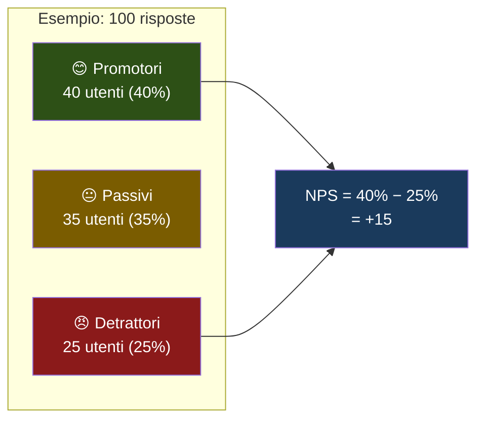
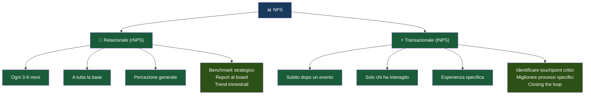
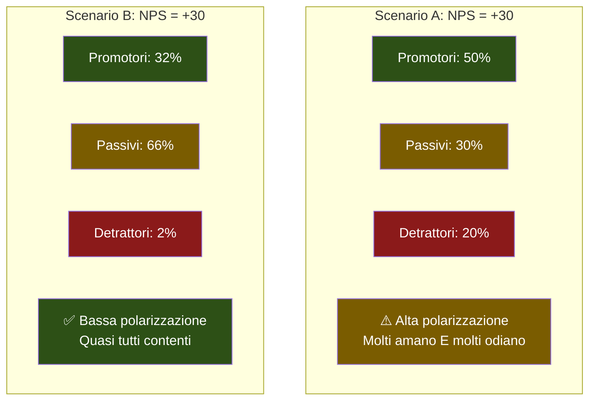
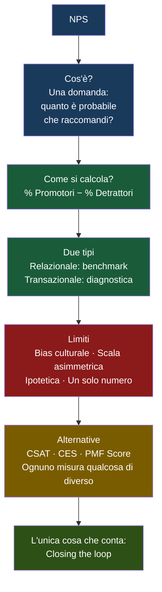

## NPS: LA METRICA PIÙ AMATA E PIÙ FRAINTESA DEL PRODUCT MANAGEMENT

Il **Net Promoter Score** è un indicatore di fedeltà del cliente basato su una sola domanda:

> *"Con quale probabilità, da 0 a 10, consiglieresti questo prodotto/servizio a un amico o collega?"*

Introdotto da Fred Reichheld in un articolo su Harvard Business Review nel 2003 ("The One Number You Need to Grow"), l'NPS ha conquistato il mondo corporate. È semplice, universale, facile da comunicare al board. Ma proprio questa semplicità nasconde trappole che la maggior parte delle aziende ignora.

## Come si calcola

Le risposte vengono classificate in tre categorie:

| Punteggio | Categoria | Significato |
|:---------:|-----------|-------------|
| 9–10 | **Promotori** | Entusiasti, fedeli, generano passaparola positivo |
| 7–8 | **Passivi** | Soddisfatti ma non entusiasti, vulnerabili alla concorrenza |
| 0–6 | **Detrattori** | Insoddisfatti, possono danneggiare il brand con passaparola negativo |

La formula:

> **NPS = % Promotori − % Detrattori**

Il risultato va da −100 (tutti detrattori) a +100 (tutti promotori).

Nota che i **passivi non compaiono nella formula** — influenzano solo il denominatore. Questo è intenzionale: Reichheld li considera "neutri", ma come vedremo è una semplificazione che può essere pericolosa.

## Benchmark: cosa è un "buon" NPS?

Non esiste un valore universalmente "buono". L'NPS dipende enormemente dal settore, dal mercato e dal tipo di prodotto.

| Settore | NPS medio | Top performer |
|---------|:---------:|:------------:|
| SaaS B2B | +30 | +60/+70 |
| E-commerce | +40 | +70/+80 |
| Telecomunicazioni | +10 | +30/+40 |
| Compagnie aeree | +20 | +50/+60 |
| Banche retail | +15 | +40/+50 |
| Assicurazioni | −5 | +20/+30 |

> **Regola pratica:** confronta il tuo NPS con il tuo settore, non con Apple. NPS +30 per una telco è eccellente; per un brand di lusso direct-to-consumer, è mediocre.

## Due tipi di NPS: relazionale e transazionale

Questa distinzione è fondamentale e spesso ignorata.

### NPS Relazionale (rNPS)

Si invia periodicamente (ogni trimestre o semestre) a tutta la base clienti. Misura la **percezione complessiva** del brand/prodotto nel tempo. È utile per il benchmarking strategico e per tracciare le tendenze a lungo termine.

### NPS Transazionale (tNPS)

Si invia subito dopo un'interazione specifica: un acquisto, una chiamata al supporto, l'uso di una funzionalità. Misura la **soddisfazione puntuale** con quell'esperienza.

L'errore più comune è usare solo l'rNPS. Sapere che il tuo NPS è +25 non ti dice *dove* intervenire. Il tNPS dopo il checkout, dopo il primo onboarding, dopo il supporto clienti, ti dice esattamente **quale touchpoint sta andando bene e quale no**.

## Closing the loop: da numero a azione

L'NPS è inutile se resta un numero su una slide. Il suo vero valore sta nel **follow-up**: contattare i detrattori per capire il problema, ringraziare i promotori e chiedere referral, analizzare i pattern nei commenti aperti.

### Il processo in quattro fasi

Il passaggio più critico è il **closing the loop con i detrattori**:
- Contattarli entro 24-48 ore dalla risposta
- Ascoltare senza difendersi
- Proporre una soluzione concreta
- Ricontattare dopo la risoluzione per verificare la soddisfazione

Le aziende che implementano un processo di closing the loop riducono il churn dei detrattori del 30-50%.

## I limiti dell'NPS (la parte che nessuno racconta)

### 1. Il problema culturale

In Giappone, dare un 10 è considerato presuntuoso — un 7-8 esprime già alta soddisfazione. In America Latina, le risposte tendono verso gli estremi. Confrontare l'NPS tra mercati diversi è come confrontare temperature in Celsius e Fahrenheit senza conversione.

### 2. L'asimmetria della scala

I detrattori occupano 7 punti della scala (0-6), i promotori solo 2 (9-10), i passivi 2 (7-8). Chi dà un 6 (abbastanza soddisfatto ma non entusiasta) è categorizzato uguale a chi dà uno 0 (furioso). Questa non è una scala lineare — è una categorizzazione arbitraria.

### 3. La domanda è ipotetica

"Consiglieresti?" chiede un'intenzione, non un comportamento reale. La ricerca mostra che la correlazione tra dichiarazione di raccomandazione e raccomandazione effettiva è bassa. Chi dice 9 potrebbe non consigliare mai il prodotto a nessuno.

### 4. Un solo numero non spiega nulla

NPS +30 con il 50% di promotori e il 20% di detrattori è molto diverso da NPS +30 con il 32% di promotori e il 2% di detrattori. Il primo ha una distribuzione polarizzata (molti amano, molti odiano), il secondo è quasi uniformemente positivo. La stessa cifra, due realtà opposte.

### 5. La tirannide del campione

Se invii il sondaggio via email, chi risponde è auto-selezionato: i molto soddisfatti e i molto insoddisfatti. I passivi — che per definizione sono meno coinvolti — rispondono meno, distorcendo il risultato.

Tasso di risposta tipico: 10-30% per rNPS via email. Il 70-90% che non risponde potrebbe essere radicalmente diverso da chi ha risposto.

## Alternative e complementi all'NPS

### CSAT (Customer Satisfaction Score)

> "Quanto sei soddisfatto di [esperienza specifica]?" (scala 1-5 o 1-7)

**CSAT = % di risposte positive / Totale risposte**

Misura la soddisfazione puntuale, non la fedeltà a lungo termine. Ideale per i touchpoint specifici: post-acquisto, post-supporto, post-onboarding.

### CES (Customer Effort Score)

> "Quanto è stato facile [completare questa azione]?" (scala 1-7)

Basato sulla ricerca di Dixon, Toman e DeLisi (*The Effortless Experience*): la fedeltà non dipende da quanto "delizi" il cliente, ma da quanto **riduci lo sforzo**. Ridurre la frizione è più potente che creare "momenti wow".

### PMF Score (Sean Ellis)

> "Come ti sentiresti se non potessi più usare questo prodotto?"

Con le opzioni: "Molto deluso", "Un po' deluso", "Non deluso", "Non lo uso più". Se il 40%+ dice "Molto deluso", hai il Product-Market Fit (approfondito nella lezione dedicata).

| Metrica | Misura | Quando usarla | Debolezza |
|---------|--------|---------------|-----------|
| **NPS** | Fedeltà/advocacy | Benchmark generale | Ipotetica, culturalmente biased |
| **CSAT** | Soddisfazione puntuale | Post-interazione | Non predice la fedeltà |
| **CES** | Facilità d'uso | Post-task critico | Non cattura il "delight" |
| **PMF Score** | Dipendenza dal prodotto | Pre/post PMF | Solo per prodotti in fase early |

## Caso studio: il paradosso dell'NPS alto con churn alto

Un'azienda SaaS B2B ha un NPS di +45 — eccellente per il settore. Ma il churn annuo è al 18%, ben sopra la media del settore (10-12%).

L'analisi dei dati rivela il problema: i **clienti enterprise** (quelli che pagano di più e rispondono al sondaggio perché ricevono un account manager dedicato) danno punteggi alti. I clienti **SMB** (piccole imprese) hanno churn del 30% ma rispondono al sondaggio con un tasso del 5%.

L'NPS era alto perché il campione era auto-selezionato: rispondevano solo i clienti più seguiti e coccolati. I clienti che se ne andavano non rispondevano ai sondaggi — erano già mentalmente altrove.

**Lezione:** un NPS alto non è garanzia di salute del business. Va sempre letto insieme a retention, churn e revenue metrics. Ed è essenziale monitorare il tasso di risposta per segmento.

## Come analizzare l'NPS in modo serio

Invece di guardare solo il numero, analizza:

1. **La distribuzione** — traccia l'istogramma delle risposte, non solo il punteggio aggregato
2. **I trend** — l'NPS di questo trimestre vs il precedente, per segmento
3. **La correlazione con il comportamento** — i promotori davvero comprano di più? Davvero fanno referral?
4. **I commenti aperti** — la vera miniera d'oro. Usa topic modeling o categorizzazione manuale per identificare i temi ricorrenti
5. **La segmentazione** — NPS per segmento cliente, per fase del ciclo di vita, per piano tariffario, per canale di acquisizione

## Riepilogo

Tre cose da portare a casa:

1. **L'NPS è un termometro, non una cura** — ti dice che qualcosa non va (o va bene), ma non dove intervenire. Senza il commento aperto e il follow-up, è un numero sterile.

2. **Usa l'NPS transazionale, non solo quello relazionale** — il tNPS dopo ogni touchpoint critico è infinitamente più azionabile del rNPS trimestrale.

3. **Non innamorarti del numero** — un NPS alto con churn alto, con basso tasso di risposta, o con distribuzione polarizzata, non è un buon segnale. Leggi sempre la distribuzione, non solo l'aggregato.
