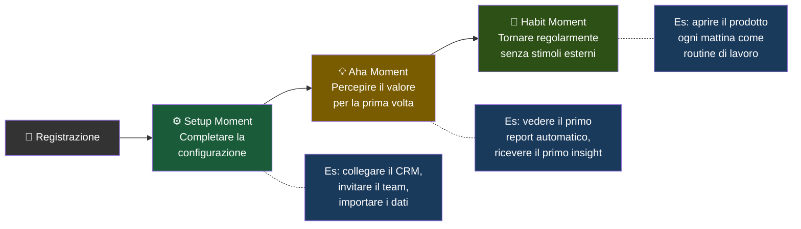
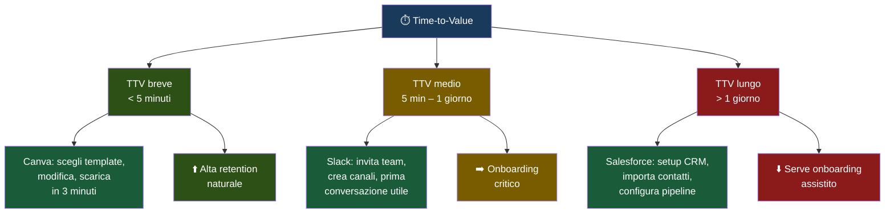
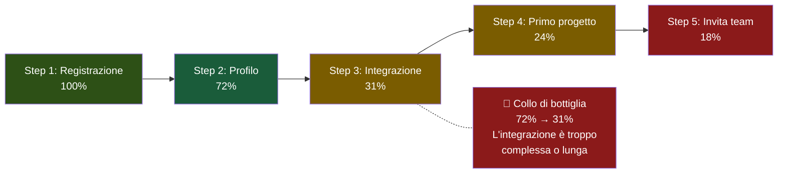
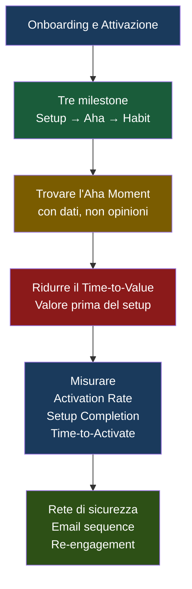
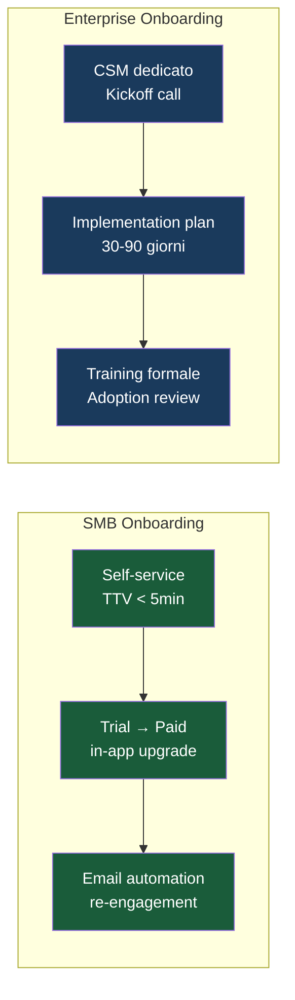

import { Aside } from '@astrojs/starlight/components'

L'onboarding e' il punto in cui una promessa di marketing diventa esperienza concreta. Se il nuovo utente non capisce rapidamente il valore del prodotto, il resto del funnel perde efficienza e la retention crolla prima ancora di iniziare.

In questa lezione analizziamo come disegnare il percorso iniziale, come riconoscere l'aha moment e quali metriche usare per capire se l'attivazione sta davvero funzionando.

## ONBOARDING: LA FINESTRA DI 24 ORE CHE DECIDE TUTTO

Il 40-60% degli utenti che si registrano a un prodotto SaaS lo usano **una sola volta** e non tornano mai. Non perché il prodotto sia cattivo, ma perché non hanno mai raggiunto il momento in cui il valore diventa evidente.

L'**onboarding** è il processo che guida un nuovo utente dal primo contatto al momento in cui percepisce il valore del prodotto. L'**attivazione** è il punto in cui questa percezione avviene — il momento in cui l'utente pensa: "Ok, questo mi serve davvero."

La differenza tra un prodotto che cresce e uno che stagna non sta quasi mai nelle feature. Sta in quanti utenti superano la soglia dell'attivazione.

## Setup Moment vs Aha Moment vs Habit Moment

Ci sono tre milestone critiche nel percorso di un nuovo utente, e confonderle è uno degli errori più comuni.



**Setup Moment** — l'utente completa la configurazione tecnica necessaria. È la condizione *necessaria ma non sufficiente* per l'attivazione. Senza setup, non c'è aha moment. Ma completare il setup senza raggiungere l'aha moment è inutile: l'utente ha configurato tutto ma non ha ancora capito perché dovrebbe restare.

**Aha Moment** — l'utente percepisce il valore per la prima volta. Questo è il punto di svolta. Dopo l'aha moment, la probabilità di retention a lungo termine aumenta drammaticamente.

**Habit Moment** — l'utente integra il prodotto nella sua routine. Non serve più un trigger esterno (email, notifica) per farlo tornare. Questo è l'obiettivo finale.

> **Attenzione:** la maggior parte dei prodotti ottimizza il setup (perché è facile da misurare) ma non l'aha moment (perché è difficile da identificare). Risultato: utenti che completano il tutorial ma non tornano mai.

## Identificare l'Aha Moment con i dati

L'aha moment non si inventa in sala riunioni. Si scopre analizzando i dati degli utenti che sono rimasti e confrontandoli con quelli che hanno abbandonato.

### Il metodo

1. **Definisci "attivato"** — un utente che è tornato almeno X volte nelle prime Y settimane (es. 3 sessioni nei primi 14 giorni)
2. **Elenca le azioni chiave** — tutte le azioni significative che un utente può compiere nel prodotto nelle prime 48 ore
3. **Confronta attivati vs non-attivati** — per ogni azione, calcola la percentuale di utenti attivati che l'hanno compiuta vs la percentuale di non-attivati

| Azione (prime 48h) | % tra attivati | % tra non-attivati | Delta |
|---|---:|---:|---:|
| Ha invitato un collega | 72% | 8% | **+64 pp** |
| Ha creato un progetto con > 3 task | 68% | 12% | +56 pp |
| Ha collegato un'integrazione | 55% | 15% | +40 pp |
| Ha personalizzato il profilo | 45% | 40% | +5 pp |
| Ha guardato il video tutorial | 30% | 28% | +2 pp |

In questo esempio, **invitare un collega** e **creare un progetto con più di 3 task** sono le azioni con il delta maggiore. Sono i candidati per l'aha moment.

### Il problema della causalità

Correlazione non è causalità. Forse gli utenti che invitano un collega non restano *perché* hanno invitato un collega — forse sono semplicemente più motivati in partenza. Per distinguere, serve un esperimento: forzare gentilmente un gruppo di utenti verso l'azione e vedere se la retention migliora.

Se sì, l'azione è causale → tutto l'onboarding dovrebbe spingere verso quella azione.
Se no, l'azione è solo un indicatore → utile come metrica predittiva ma non come leva di intervento.

## Time-to-Value (TTV): il nemico invisibile

Il **Time-to-Value** è il tempo che passa tra la registrazione e il primo momento di valore percepito. Più è lungo, più utenti si perdono.



Strategie per ridurre il TTV:

**Valore immediato senza setup** — mostra il risultato prima di chiedere un input. Grammarly corregge il testo immediatamente, prima di chiedere la registrazione. L'utente vede il valore *prima* di investire tempo.

**Dati pre-popolati** — invece di un foglio bianco, mostra un esempio reale o importa i dati dell'utente. Un tool di analytics che al primo accesso mostra già i dati del sito (perché si collega a GA4 durante il signup) ha un TTV di minuti, non di ore.

**Quick wins** — guida l'utente verso un risultato semplice ma tangibile. Notion suggerisce di creare una prima pagina. Figma ti fa modificare un template. L'obiettivo è che l'utente *produca qualcosa* il prima possibile.

## Pattern di onboarding

### 1. Product Tour guidato

Un overlay che mostra le funzionalità principali, passo dopo passo.

**Quando funziona:** prodotti con UI complessa e molte feature (es. strumenti di analytics, CRM).

**Quando fallisce:** se il tour è troppo lungo (> 5 step), se non è personalizzato per il caso d'uso dell'utente, se l'utente non può saltarlo.

### 2. Checklist di progresso

Una lista di azioni da completare con barra di progresso.

**Quando funziona:** prodotti che richiedono setup multi-step (es. integrazioni, configurazione team).

**Perché funziona:** sfrutta l'effetto Zeigarnik — la tendenza psicologica a voler completare le attività iniziate. Una checklist al 60% crea ansia di completamento.

> **Trucco di Linkedin:** inizia la checklist già parzialmente completata (es. "Registrazione ✅" conta come primo step). L'utente vede 1/5 completato e il desiderio di arrivare a 5/5 lo spinge avanti.

### 3. Template e modelli pronti

Invece di partire da zero, l'utente sceglie un template che corrisponde al suo caso d'uso.

**Quando funziona:** prodotti creativi o di produttività (Notion, Canva, Airtable).

**Perché funziona:** elimina lo "schermo bianco" — lo stress di non sapere da dove iniziare. E permette di personalizzare (più facile che creare), non di creare da zero.

### 4. Onboarding conversazionale

Un flusso tipo chat o wizard che fa domande e personalizza l'esperienza.

**Quando funziona:** prodotti con use case molto diversi (es. un tool di project management usato sia da dev team che da marketing).

**Esempio:** alla registrazione, ChatGPT chiede "Cosa vuoi fare?" e adatta l'esperienza iniziale. Typeform chiede "Qual è il tuo obiettivo?" e suggerisce template diversi.

### 5. Empty state strategico

Quando l'utente arriva a una sezione vuota, invece di mostrare... niente, si mostra un messaggio contestuale con un'azione chiara.

**Esempio:** la sezione "Progetti" vuota non dice "Non ci sono progetti" ma "Crea il tuo primo progetto in 2 minuti" con un pulsante ben visibile e un'immagine che mostra il risultato finale.

## Metriche di attivazione

### Activation Rate

> **Activation Rate = Utenti attivati / Utenti registrati × 100**

Dove "attivato" = ha completato l'aha moment entro la finestra di tempo definita (tipicamente 7, 14 o 30 giorni).

Benchmark per SaaS:
- **< 20%**: onboarding rotto, problema urgente
- **20-40%**: nella media, ampio margine di miglioramento
- **40-60%**: buon onboarding
- **> 60%**: eccellente

### Time-to-Activate

Quanto tempo ci mettono gli utenti che si attivano a raggiungere l'aha moment. Questa distribuzione è cruciale:

- Se il picco è nelle prime 2 ore → l'onboarding funziona per chi lo completa subito
- Se c'è una lunga coda → molti utenti si distraggono e tornano giorni dopo. Serve un sistema di re-engagement (email, notifiche push)

### Setup Completion Rate

La percentuale di utenti che completano ogni step del processo di onboarding. Se il 90% completa lo step 1, il 60% lo step 2 e il 15% lo step 3, hai un collo di bottiglia chiaro allo step 3.



## Caso studio: come Slack ha ripensato l'attivazione

Slack non misura l'attivazione come "ha creato un account". La loro metrica storica è:

> **Un team è attivato quando ha scambiato 2.000 messaggi.**

Perché? Perché l'analisi dei dati mostrò che i team che raggiungevano questa soglia avevano una retention a 12 mesi superiore al 93%. Sotto questa soglia, la retention crollava.

Tutto l'onboarding di Slack è progettato per accelerare il raggiungimento dei 2.000 messaggi:
- Il bot Slackbot ti manda messaggi per insegnarti le funzionalità (e quei messaggi contano)
- L'invito dei colleghi è il primo step post-registrazione
- Le integrazioni (Google Drive, GitHub) generano messaggi automatici
- I canali predefiniti (#general, #random) incoraggiano la conversazione informale

## Caso studio: Dropbox e il tutorial come attivazione

Dropbox scoprì che gli utenti che completavano una lista di 7 azioni (installare il client desktop, caricare un file, condividerlo, ecc.) avevano una retention 4x superiore.

La soluzione fu trasformare queste azioni in una **checklist gamificata**: ogni azione completata guadagnava spazio di archiviazione aggiuntivo gratuito. Il risultato fu un aumento del 15% nella completion dell'onboarding.

> **Lezione:** l'incentivo non era lo spazio (250 MB era poco anche nel 2010). Era il senso di progresso e di completamento. La gamification funziona quando il premio è allineato con il valore del prodotto.

## Email di onboarding: la rete di sicurezza

Solo il 30-40% degli utenti completa l'onboarding al primo accesso. Il resto se ne va e potrebbe non tornare mai. Le email di onboarding sono la rete di sicurezza.

### Sequenza tipo per un SaaS B2B

| Timing | Email | Obiettivo |
|---|---|---|
| Subito | Benvenuto + link al primo step | Confermare la registrazione, creare urgenza |
| +24h | "Hai completato il setup?" | Re-engagement per chi ha abbandonato |
| +3 giorni | Quick win: "Ecco cosa puoi fare in 5 minuti" | Dare un motivo per tornare con un obiettivo piccolo |
| +7 giorni | Social proof: "Come [azienda simile] usa il prodotto" | Ridurre l'incertezza con prova sociale |
| +14 giorni | "Hai bisogno di aiuto?" con link alla demo | Ultimo tentativo, oferere supporto umano |

**Regola chiave:** ogni email deve avere **una sola call-to-action** che corrisponde al prossimo step dell'onboarding. Non mandare email con 5 link diversi — l'utente non cliccherà nessuno.

## Gli errori fatali dell'onboarding

### 1. Chiedere troppo, troppo presto

Richiedere 15 campi nella registrazione, il numero di carta di credito, la configurazione completa del profilo — tutto prima che l'utente abbia visto un briciolo di valore. Ogni campo aggiuntivo nel form di registrazione riduce la conversione del 3-5%.

### 2. Mostrare tutto subito

Un product tour di 15 step che mostra ogni singola feature. L'utente non ha contesto, non sa ancora perché dovrebbe interessargli, e si sente sopraffatto. **Progressive disclosure:** mostra solo ciò che serve nel momento in cui serve.

### 3. Ottimizzare il setup, non l'aha moment

Misurare "% utenti che completano il tutorial" non è misurare l'attivazione. L'attivazione è percepire il valore. Un utente può completare il tutorial e non tornare mai. Misura il comportamento post-onboarding, non la compliance con l'onboarding.

### 4. Un solo onboarding per tutti

Un product manager che vuole tracciare le OKR del team e un freelancer che vuole gestire i suoi progetti personali hanno bisogni radicalmente diversi. L'onboarding che funziona per uno aliena l'altro. **Segmenta l'onboarding per caso d'uso.**

## Riepilogo



Tre cose da portare a casa:

1. **L'aha moment si trova nei dati** — confronta sistematicamente le azioni degli utenti attivati vs non-attivati. L'azione con il delta maggiore è il tuo candidato per l'aha moment. Poi verifica la causalità con un esperimento.

2. **Il TTV è la leva più potente** — ogni ora in più tra registrazione e primo valore percepito costa utenti. Elimina la frizione, mostra il valore prima di chiedere lo sforzo, pre-popola i dati.

3. **L'onboarding non finisce al primo login** — il 60% degli utenti non completa l'onboarding al primo tentativo. Le email di re-engagement con una singola call-to-action sono la rete di sicurezza che trasforma i "quasi-utenti" in utenti attivati.

## Onboarding per segmento: SMB vs Enterprise

Un errore quasi universale è trattare tutti i nuovi utenti con lo stesso flusso di onboarding. La realtà è che le esigenze di una piccola impresa (SMB) e di un'azienda enterprise sono radicalmente diverse — tanto nei tempi quanto nel tipo di supporto necessario.

### SMB: velocità e self-service

Il tipico utente SMB — un fondatore, un responsabile marketing di una PMI, un freelancer — vuole **valore immediato senza frizione**. Non ha un IT department che configura l'ambiente, non ha un account manager dedicato. Si aspetta di poter usare il prodotto in autonomia entro pochi minuti.

Le caratteristiche dell'onboarding SMB ottimale:

**Self-service completo:** documentazione chiara, video tutorial, chatbot per le FAQ. L'utente SMB non vuole aspettare che qualcuno lo richiami — vuole risolvere il problema adesso.

**Valore immediato senza setup lungo:** se il prodotto richiede più di 10 minuti per mostrare il primo risultato, l'utente SMB se ne va. Canva permette di creare un post in 3 minuti. Notion mostra un template pronto in 30 secondi. Il tempo investito nell'esperienza pre-signup conta.

**Trial aggressivo con upgrade in-app:** il percorso da "provo" a "pago" deve essere fluido. L'utente SMB decide quasi sempre da solo, spesso usando la carta di credito personale. L'upgrade deve avvenire all'interno del prodotto, nel momento in cui l'utente incontra il limite del piano free.

**Metriche SMB critiche:**
- Time to first value (TTV) — obiettivo: sotto i 5 minuti
- Trial-to-paid conversion rate — benchmark SaaS: 2-5% per il freemium, 15-25% per il free trial a tempo
- Completion rate dell'onboarding — se scende sotto il 25%, c'è un problema strutturale

### Enterprise: profondità e supporto umano

L'utente enterprise ha esigenze opposte. Il decisore che firma il contratto (Chief Revenue Officer, VP Engineering) non è spesso l'utilizzatore finale. L'implementazione coinvolge IT, Legal, Security, e magari l'integrazione con sistemi legacy.

Le caratteristiche dell'onboarding enterprise ottimale:

**Customer Success Manager dedicato:** per contratti sopra una certa soglia (tipicamente 5.000-10.000 €/anno), un essere umano che gestisce l'onboarding non è un lusso — è necessario per la retention. Il CSM tiene conto dei processi aziendali specifici del cliente e configura il prodotto di conseguenza.

**Implementation plan strutturato:** non una checklist generica ma un piano di progetto con milestone, deliverable e timeline. L'enterprise compra una soluzione, non solo un tool.

**Training formale:** webinar dedicati, sessioni di formazione per gli utenti finali, materiali branded per l'azienda cliente. Salesforce ha un'intera università (Trailhead) dedicata alla formazione.

**Metriche enterprise critiche:**
- Time to go-live — da firma contratto a produzione: obiettivo sotto i 30 giorni
- Adoption rate — percentuale di licenze acquistate vs utenti attivi mensili (se l'azienda paga per 100 seat ma ne usa 30, è a rischio churn)
- Executive sponsor engagement — è presente un responsabile interno? Senza uno sponsor interno, l'implementazione muore in silenzio



## La sequenza email di onboarding: struttura e best practice

Le email di onboarding non sono newsletter — sono una sequenza comportamentale che si adatta alle azioni dell'utente. La differenza tra una sequenza generica e una sequenza intelligente può valere 20-30 punti percentuali di activation rate.

### Principi fondamentali

**Trigger comportamentali, non solo temporali:** inviare email "3 giorni dopo la registrazione" indipendentemente da cosa ha fatto l'utente è un approccio del 2010. L'approccio moderno usa trigger comportamentali:

- Ha completato il setup? → salta l'email di reminder setup, manda quella di feature discovery
- Ha creato un progetto ma non ha invitato nessuno? → manda un'email sull'invito del team
- Ha invitato un collega ma il collega non ha accettato? → manda un reminder per il collega

**Una sola call-to-action per email:** ogni email deve avere un obiettivo e un'azione soltanto. Due link → l'utente non clicca nessuno dei due. Un link → il tasso di click è massimo.

**Plain text o HTML minimale:** le email che sembrano inviate da una persona reale hanno open rate e reply rate significativamente superiori alle email graficamente elaborate. Intercom, Superhuman e la maggior parte dei SaaS B2B di successo usano email in plain text o quasi.

### Sequenza tipo per un SaaS B2B (14 giorni)

| Giorno | Trigger | Oggetto | CTA |
|:------:|---------|---------|-----|
| 0 | Registrazione | "Benvenuto in [Prodotto] — inizia qui" | Link al primo step dell'onboarding |
| 1 | Non ha completato step 1 | "Hai 2 minuti? Ecco come completare il setup" | Link diretto allo step bloccante |
| 3 | Ha completato setup, nessun progetto | "Crea il tuo primo progetto in 5 minuti" | Template pre-compilato |
| 5 | Ha creato progetto, nessun invito team | "Il prodotto è più potente in team" | Link alla funzione di invito |
| 7 | Qualsiasi stato | "Come [Azienda simile] ha ridotto i tempi di report del 40%" | Case study con link |
| 10 | Non attivo gli ultimi 4 giorni | "Ci manchi. Ecco cosa c'è di nuovo" | Feature highlight con link |
| 14 | Non attivato | "Posso aiutarti?" (da CEO o founder) | Reply diretta o link a Calendly |

Il giorno 14, l'email del fondatore o CEO — breve, in plain text, con invito esplicito a rispondere — spesso genera i conversion rates più alti dell'intera sequenza. Gli utenti sono sorpresi che qualcuno di "importante" si preoccupi della loro esperienza.

### Email di win-back per utenti che si allontanano

La sequenza non finisce all'attivazione. Per utenti che si attivano ma poi smettono di tornare (zombie retention):

- **Giorno X+7 senza accesso:** "Il tuo workspace ti aspetta — cosa è cambiato"
- **Giorno X+14:** "Hai 5 minuti? Voglio capire cosa non funziona" (invito a una call)
- **Giorno X+30:** offerta di migrazione a un piano diverso o sospensione dell'account con dati salvati

## Metriche di attivazione: misurare ciò che conta

### Time to Value (TTV) come metrica operativa

Il TTV non è solo un concetto — è una metrica che si misura e si ottimizza come qualsiasi altra.

Come calcolarlo in SQL su un database eventi:

```sql
-- Calcola il Time to Value per ogni utente
-- Definizione: tempo tra registrazione e primo "aha moment" (es. primo progetto con > 3 task)

WITH registration AS (
    SELECT
        user_id,
        MIN(event_timestamp) AS registered_at
    FROM events
    WHERE event_name = 'user_signed_up'
    GROUP BY user_id
),
aha_moment AS (
    SELECT
        user_id,
        MIN(event_timestamp) AS aha_at
    FROM events
    WHERE event_name = 'project_created'
      AND JSON_EXTRACT(properties, '$.task_count') > 3
    GROUP BY user_id
)
SELECT
    r.user_id,
    r.registered_at,
    a.aha_at,
    TIMESTAMPDIFF(HOUR, r.registered_at, a.aha_at) AS ttv_hours,
    CASE
        WHEN TIMESTAMPDIFF(HOUR, r.registered_at, a.aha_at) < 1 THEN 'instant'
        WHEN TIMESTAMPDIFF(HOUR, r.registered_at, a.aha_at) < 24 THEN 'same_day'
        WHEN TIMESTAMPDIFF(HOUR, r.registered_at, a.aha_at) < 168 THEN 'first_week'
        ELSE 'slow'
    END AS ttv_bucket
FROM registration r
LEFT JOIN aha_moment a ON r.user_id = a.user_id;
```

### L'Aha Moment di Slack, Notion e Figma a confronto

Tre prodotti con Aha Moment radicalmente diversi, tre strategie di onboarding diverse:

**Slack — L'Aha Moment è collettivo:** Slack ha scoperto che il valore percepito emerge solo quando l'intero team usa il prodotto. Un utente singolo su Slack non può avere un Aha Moment — serve almeno un altro. Per questo motivo, il primo step dell'onboarding di Slack è sempre stato "Invita il tuo team". Non configurare le notifiche, non personalizzare il profilo — invitare i colleghi è la priorità assoluta. La metrica storica dei 2.000 messaggi per team è una proxy dell'adozione collettiva.

**Notion — L'Aha Moment è personale ma contestualizzato:** Notion ha un problema di onboarding classico del "foglio bianco" — il prodotto è così flessibile che l'utente non sa da dove iniziare. La soluzione di Notion è stata duplice: una galleria di template per casi d'uso specifici (da "Personal Task Manager" a "Engineering Wiki") e un onboarding wizard che chiede "Per cosa vuoi usare Notion?" e mostra un workspace pre-configurato per quel caso d'uso. L'Aha Moment di Notion è il momento in cui l'utente vede la prima pagina funzionante che assomiglia a ciò che usa nella vita reale.

**Figma — L'Aha Moment è la collaborazione in tempo reale:** Figma ha un vantaggio competitivo enorme rispetto a Sketch: la collaborazione in tempo reale. Il problema era che molti utenti arrivavano da Sketch e usavano Figma come se fosse Sketch — da soli, senza condividere. L'onboarding di Figma ha progressivamente spostato il focus verso la collaborazione: invitare un revisore, ricevere commenti, vedere il cursore di un collega muoversi sullo stesso file. Chi scopre la collaborazione in tempo reale nelle prime 48 ore ha una retention a 30 giorni 3x superiore a chi non la scopre.

<Aside type="tip">
Il miglior investimento nell'onboarding non è aggiungere più step — è rimuovere quelli che non portano all'Aha Moment. Ogni step inutile è una possibilità in più di perdere l'utente. Mappa il percorso minimo verso il tuo Aha Moment e taglia tutto il resto.
</Aside>
