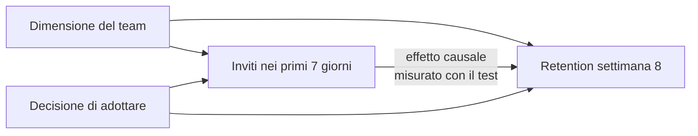

Un'app di gestione progetti per piccole agenzie creative (scenario costruito, numeri di esempio) misura l'attivazione come «ha creato il primo progetto». In sei mesi il team spinge questo tasso dal 52% al 71% con un tutorial interattivo e un progetto di esempio precompilato. La retention a otto settimane, nello stesso periodo, resta ferma al 24%. Il tutorial ha funzionato, nel senso che più persone creano un progetto; non ha funzionato nel senso che conta, perché creare un progetto da soli non è il momento in cui un'agenzia capisce che lo strumento le serve.

> **Idea chiave:** l'evento di attivazione non è l'ultimo passo del setup ma il primo comportamento che predice in modo affidabile che l'utente resterà; si sceglie guardando la retention, e prima di ottimizzarlo si verifica con un esperimento che spostarlo sposti davvero la retention.

Il percorso è in quattro passi: separare i concetti che di solito si confondono, cercare la soglia nei dati con un metodo ripetibile, capire quanto di quella soglia è causa e quanto è selezione, e misurare il tempo che serve per arrivarci.

## Setup, aha moment, attivazione, abitudine

Nel linguaggio dei team di prodotto quattro idee vengono spesso usate come sinonimi. Tenerle separate è il primo passo per misurare la cosa giusta.

| Concetto | Che cos'è | Esempio nell'app per agenzie | Come si misura |
| :--- | :--- | :--- | :--- |
| Setup | Le azioni necessarie per poter usare il prodotto | Creare lo spazio di lavoro, caricare il logo | Funnel di onboarding, completamento per passo |
| Aha moment | Il momento in cui l'utente percepisce il valore | Vedere un collega commentare un'attività e chiuderla | Ricerca qualitativa, interviste; non è un evento loggato |
| Activation event | Il comportamento osservabile, entro una finestra, che predice la retention | Invitare almeno 3 colleghi nei primi 7 giorni | Evento nei log con soglia e finestra |
| Habit | L'uso ripetuto con la cadenza naturale del prodotto | Completare attività in almeno 3 settimane su 4 | Retention a finestra, engagement |

L'aha moment è un'esperienza, e come tale non si misura direttamente. L'activation event è la sua approssimazione misurabile: un evento o una combinazione di eventi, con una soglia e una finestra, scelto perché chi lo raggiunge resta molto più spesso di chi non lo raggiunge. Nel [metric tree](/course/analisi-prodotto/north-star-metric-tree/) è una delle input metric che alimentano la North Star.

La definizione operativa del **tasso di attivazione** ha tre componenti esplicite:

$$\text{tasso di attivazione} = \frac{\text{iscritti della coorte che raggiungono l'evento entro } W \text{ giorni}}{\text{iscritti della coorte}}$$

Il denominatore sono tutti gli iscritti della coorte, compresi quelli che non hanno mai fatto login dopo la registrazione. La finestra $W$ è fissa, e una coorte entra nel calcolo solo quando la finestra è chiusa per tutti i suoi membri: la coorte di agosto con $W = 7$ giorni è leggibile dall'8 settembre in poi.

Il **time to value** (TTV) è il tempo tra l'iscrizione e il raggiungimento dell'evento di attivazione. È l'altra faccia dell'attivazione: a parità di tasso, un prodotto che porta al valore in un'ora perde meno persone per strada di uno che ci mette cinque giorni.

## Come si riconosce un buon evento di attivazione

Un evento candidato va giudicato su cinque criteri, e un evento che ne soddisfa solo alcuni produce il problema dell'agenzia: un tasso che sale senza effetti.

1. **Predice la retention.** Chi lo raggiunge resta molto più di chi non lo raggiunge, e la differenza si vede su più coorti, non su una.
2. **Arriva presto.** Deve essere osservabile nei primi giorni, altrimenti non serve a guidare l'onboarding. Un evento che si misura alla quarta settimana è già retention.
3. **È influenzabile dal prodotto.** Il team deve poter progettare qualcosa che aiuti gli utenti a raggiungerlo. «Ha un'azienda con più di 50 dipendenti» predice la retention ma non è un comportamento.
4. **Copre abbastanza utenti che restano.** Se solo il 10% di chi resta lo raggiunge, descrive una nicchia di utenti esperti, non il percorso normale verso il valore.
5. **È semplice e misurato bene.** Una soglia su un solo evento affidabile batte un punteggio composito di sei eventi che nessuno sa spiegare a un designer.

Il primo e il quarto criterio sono in tensione: alzando la soglia la retention di chi la supera cresce, ma la quota di chi resta catturata dalla soglia scende. La ricerca della soglia è il modo di trovare il punto di equilibrio.

Un riferimento che compare in quasi tutti i talk di growth è la regola dei «7 amici in 10 giorni», attribuita al team growth di Facebook dei primi anni. Viene citata di seconda mano in moltissime presentazioni, ma non è disponibile una fonte primaria pubblicata con i dati di supporto: va trattata come un aneddoto che illustra la forma del ragionamento (un numero, un'azione, una finestra), non come un risultato da riprodurre.

## Esempio svolto: la soglia di inviti nella prima settimana

Il team dell'app per agenzie ha un'ipotesi dalle interviste: le agenzie che restano sono quelle in cui più persone lavorano nello stesso spazio. Il candidato è quindi il numero di colleghi invitati nei primi 7 giorni, e la variabile da predire è la retention alla settimana 8, cioè almeno un'attività completata tra il giorno 56 e il giorno 62 dopo l'iscrizione. La coorte è agosto 2026: 5.000 iscritti, maturi dal 2 novembre.

La query costruisce una riga per livello di inviti, con il numero di utenti e di trattenuti. Il livello 5 raccoglie «5 o più», per non avere code con pochi utenti.

```sql
-- Retention alla settimana 8 per numero di inviti nei primi 7 giorni (dialetto Postgres/DuckDB)
WITH cohort AS (
    SELECT user_id, signup_time
    FROM users
    WHERE signup_time >= TIMESTAMP '2026-08-01'
      AND signup_time <  TIMESTAMP '2026-09-01'
),
inviti AS (
    SELECT c.user_id, COUNT(e.user_id) AS inviti_7g
    FROM cohort c
    LEFT JOIN events e
      ON e.user_id = c.user_id
     AND e.event_name = 'invite_sent'
     AND e.event_time >= c.signup_time
     AND e.event_time <  c.signup_time + INTERVAL '7 days'   -- finestra di attivazione
    GROUP BY c.user_id
),
attivi_s8 AS (
    SELECT DISTINCT c.user_id
    FROM cohort c
    JOIN events e
      ON e.user_id = c.user_id
     AND e.event_name = 'task_completed'
     AND e.event_time >= c.signup_time + INTERVAL '56 days'  -- settimana 8: giorni 56-62
     AND e.event_time <  c.signup_time + INTERVAL '63 days'
)
SELECT
    LEAST(i.inviti_7g, 5) AS inviti_bucket,                 -- 5 significa "5 o più"
    COUNT(*)              AS utenti,
    COUNT(a.user_id)      AS trattenuti_s8,
    ROUND(100.0 * COUNT(a.user_id) / COUNT(*), 1) AS retention_s8
FROM inviti i
LEFT JOIN attivi_s8 a ON a.user_id = i.user_id
GROUP BY LEAST(i.inviti_7g, 5)
ORDER BY inviti_bucket;
```

Il risultato:

| Inviti nei primi 7 giorni | Utenti | Trattenuti alla settimana 8 | Retention |
| :--- | ---: | ---: | ---: |
| 0 | 2.000 | 160 | 8,0% |
| 1 | 1.000 | 150 | 15,0% |
| 2 | 800 | 200 | 25,0% |
| 3 | 600 | 330 | 55,0% |
| 4 | 300 | 180 | 60,0% |
| 5 o più | 300 | 186 | 62,0% |
| Totale | 5.000 | 1.206 | 24,1% |

La curva ha una forma riconoscibile: sale lentamente fino a 2 inviti, fa un salto di 30 punti tra 2 e 3, poi si appiattisce (+5 e +2 punti). Il salto suggerisce una soglia a 3, ma va confermato con un criterio esplicito. Per ogni soglia candidata «almeno $k$ inviti» si calcolano quattro numeri, trattando la soglia come un classificatore che predice chi resterà.

La **copertura** è la quota di iscritti che supera la soglia. La **precisione** è la retention di chi la supera: trattenuti sopra soglia diviso utenti sopra soglia.

Il **richiamo** è la quota dei trattenuti totali che supera la soglia: trattenuti sopra soglia diviso 1.206. Misura quanto del percorso normale verso la retention la soglia riesce a descrivere.

L'**F1** è la media armonica di precisione e richiamo, $2PR / (P + R)$. Premia le soglie che non sacrificano troppo né l'una né l'altro, e scende rapidamente quando uno dei due crolla.

Per la soglia 3: sopra soglia ci sono $600 + 300 + 300 = 1.200$ utenti (copertura 24%) con $330 + 180 + 186 = 696$ trattenuti. La precisione è $696 / 1.200 = 58{,}0\%$, il richiamo $696 / 1.206 = 57{,}7\%$, e F1 vale $2 \times 0{,}580 \times 0{,}577 / (0{,}580 + 0{,}577) = 0{,}579$. Sotto soglia restano 3.800 utenti con 510 trattenuti, cioè il 13,4%.

| Soglia | Copertura | Retention sopra | Retention sotto | Richiamo | F1 |
| :--- | ---: | ---: | ---: | ---: | ---: |
| almeno 1 | 60% | 34,9% | 8,0% | 86,7% | 0,497 |
| almeno 2 | 40% | 44,8% | 10,3% | 74,3% | 0,559 |
| almeno 3 | 24% | 58,0% | 13,4% | 57,7% | 0,579 |
| almeno 4 | 12% | 61,0% | 19,1% | 30,3% | 0,405 |
| almeno 5 | 6% | 62,0% | 21,7% | 15,4% | 0,247 |

La soglia 3 massimizza F1, coincide con il salto della curva ed è semplice da comunicare: «tre colleghi invitati nella prima settimana». Con la soglia 4 la retention sopra soglia guadagna solo 3 punti, ma il richiamo si dimezza. Il tasso di attivazione di agosto, con questa definizione, è il 24%.

Il calcolo si automatizza in poche righe di Python, partendo dalla tabella prodotta dalla query:

```python
import pandas as pd

t = pd.DataFrame({
    "inviti":     [0, 1, 2, 3, 4, 5],
    "utenti":     [2000, 1000, 800, 600, 300, 300],
    "trattenuti": [160, 150, 200, 330, 180, 186],
})
N, R = t["utenti"].sum(), t["trattenuti"].sum()

righe = []
for k in range(1, 6):
    sopra = t[t["inviti"] >= k]
    n, r = sopra["utenti"].sum(), sopra["trattenuti"].sum()
    precisione, richiamo = r / n, r / R
    righe.append({
        "soglia": k,
        "copertura": n / N,
        "ret_sopra": precisione,
        "ret_sotto": (R - r) / (N - n),
        "richiamo": richiamo,
        "f1": 2 * precisione * richiamo / (precisione + richiamo),
    })

print(pd.DataFrame(righe).round(3))
```

Una buona pratica è ripetere la ricerca su almeno tre coorti mensili. Se la soglia ottimale salta da 2 a 5 tra un mese e l'altro, il segnale è instabile e non va usato per guidare il prodotto.

## Correlazione o causa: quanto vale davvero la soglia

La tabella dice che chi invita 3 colleghi resta al 58% e chi non lo fa al 13%. La tentazione è leggere la differenza di 45 punti come l'effetto degli inviti, e concludere che basta spingere tutti a invitare. È la lettura sbagliata, per tre ragioni.

**Selezione.** Le agenzie con dieci persone hanno più colleghi da invitare e, indipendentemente dagli inviti, più lavoro da coordinare. Una parte della differenza è dovuta alla dimensione del team, che fa salire sia gli inviti sia la retention. Gli inviti sono in parte un indicatore di chi era già destinato a restare.

**Causalità inversa.** Un'agenzia che ha già deciso di adottare lo strumento invita i colleghi perché ha deciso di restare, non resta perché ha invitato.

**Pressione sulla metrica.** Quando l'onboarding obbliga a invitare tre persone per proseguire, gli utenti invitano indirizzi a caso o colleghi che non useranno mai l'app. Il numero di inviti sale, la sua relazione con la retention si indebolisce: è la legge di Goodhart applicata all'attivazione.

Il modo di misurare la parte causale è un [esperimento randomizzato](/course/analisi-prodotto/ab-testing/); quando non si può randomizzare, restano i [metodi osservazionali](/course/analisi-prodotto/inferenza-causale-osservazionale/), con ipotesi più fragili. Il team progetta un onboarding che propone l'invito al momento giusto (subito dopo aver assegnato la prima attività a qualcuno) e lo confronta con l'onboarding attuale, con metrica primaria la retention alla settimana 8, non il numero di inviti. Prima di lanciarlo, scrive la previsione «ingenua» basata sui dati osservazionali: se il nuovo flusso porta il 6% degli iscritti dalla fascia 1–2 inviti (retention $350 / 1.800 = 19{,}4\%$) alla fascia di almeno 3 inviti (58,0%), la retention complessiva dovrebbe salire di $0{,}06 \times (58{,}0 - 19{,}4) = 2{,}3$ punti.

L'esperimento, con 12.000 iscritti per braccio, dà questo risultato: la quota di utenti con almeno 3 inviti sale dal 24% al 30% come previsto, e la retention alla settimana 8 passa dal 24,1% al 25,3%. L'errore standard della differenza è $\sqrt{0{,}241 \times 0{,}759 / 12.000 + 0{,}253 \times 0{,}747 / 12.000} = 0{,}0056$, cioè 0,56 punti; la differenza di 1,2 punti vale $z = 1{,}2 / 0{,}56 = 2{,}2$ e l'intervallo al 95% va da +0,1 a +2,3 punti.



La lettura corretta: l'effetto è reale, ma è circa la metà ($1{,}2 / 2{,}3 \approx 52\%$) di quello che la correlazione prometteva. L'altra metà era selezione. La decisione è di tenere il nuovo flusso, usare 25,3% come nuova base, e smettere di presentare la soglia come una leva che vale 45 punti. Il team ora sa anche quanto vale un punto di attivazione in più: circa 0,2 punti di retention ($1{,}2 / 6$), un numero che servirà per dare priorità alle prossime idee.

## Time to value: misurarlo senza ingannarsi

Il time to value si calcola facilmente nel modo sbagliato: si prende chi si è attivato e si calcola la mediana del tempo dall'iscrizione all'attivazione. Il difetto è che quella mediana ignora tutti quelli che non si sono mai attivati, cioè proprio gli utenti che l'onboarding sta perdendo. Se un intervento fa attivare in fretta alcuni utenti e fa perdere del tutto quelli lenti, la mediana dei soli attivati migliora mentre il prodotto peggiora.

La forma corretta è una curva cumulata sull'intera coorte: per ogni giorno $d$, la quota di iscritti che si è attivata entro $d$ giorni. Per la coorte di agosto:

| Entro | Attivati | Quota della coorte | Quota degli attivati a 7 giorni |
| :--- | ---: | ---: | ---: |
| 1 giorno | 450 | 9,0% | 37,5% |
| 3 giorni | 850 | 17,0% | 70,8% |
| 7 giorni | 1.200 | 24,0% | 100% |

Solo il 37,5% degli attivati ($450 / 1.200$) raggiunge la soglia nelle prime 24 ore. Per un prodotto in cui il valore dipende dalla presenza dei colleghi, questo è il punto da attaccare: un utente che resta solo nello spazio di lavoro per tre giorni ha molte occasioni di abbandonarlo prima che arrivi qualcuno. La curva cumulata si confronta tra coorti a parità di giorno, e un miglioramento dell'onboarding si vede come una curva che sale prima e arriva più in alto.

Il TTV va letto insieme al funnel di onboarding. Il setup dell'app per agenzie ha quattro passi (spazio di lavoro creato, primo progetto, prima attività assegnata, primo invito) e si analizza con le stesse regole di un funnel di acquisto: ordine dei passi, finestra dalla registrazione, segmentazione per canale e dimensione del team. Il funnel indica dove si fermano gli utenti, il TTV quanto ci mettono quelli che proseguono, la retention se il percorso porta dove serve.

## Errori ricorrenti nell'analisi dell'attivazione

### Finestre che si sovrappongono

Il sintomo è una soglia con un potere predittivo spettacolare, del tipo «chi completa 20 attività resta al 95%». Succede quando la finestra dell'attivazione si sovrappone a quella della retention: chi completa 20 attività in otto settimane è, per definizione, ancora attivo alla settimana 8. È il cosiddetto *immortal time bias*: l'utente deve sopravvivere abbastanza a lungo per raggiungere la soglia. Si evita chiudendo la finestra di attivazione (7 giorni) prima che inizi quella della retention (giorni 56–62), come nella query.

### Ottimizzare il passo invece dell'esito

Il sintomo è quello dell'apertura: il tasso di attivazione sale, la retention no. Succede quando l'evento di attivazione è stato scelto perché facile da muovere, non perché predittivo, oppure quando la leva usata per muoverlo ne svuota il significato (inviti forzati, tutorial che crea il progetto al posto dell'utente). Si evita tenendo la retention come metrica primaria di ogni esperimento sull'onboarding e l'attivazione come metrica secondaria.

### Una sola soglia per tutti

Il sintomo è una soglia che funziona per un segmento e non per un altro: per le agenzie individuali «tre colleghi invitati» è impossibile per definizione. Succede quando la ricerca della soglia è fatta sul totale e la popolazione contiene casi d'uso diversi. Si evita ripetendo la ricerca per i segmenti principali (dimensione del team, caso d'uso dichiarato all'iscrizione) e accettando, se serve, due definizioni di attivazione. Per un freelance l'evento predittivo potrebbe essere «primo progetto condiviso con un cliente».

## Verifica su casi di attivazione

1. Una coorte di 3.000 iscritti ha 900 utenti che raggiungono l'evento di attivazione entro 7 giorni, di cui 540 trattenuti a 8 settimane. Il totale dei trattenuti è 750. Quanto valgono tasso di attivazione, precisione e richiamo?

<details>
<summary>Mostra risposta</summary>

Il tasso di attivazione è $900 / 3.000 = 30\%$. La precisione, cioè la retention degli attivati, è $540 / 900 = 60\%$. Il richiamo è $540 / 750 = 72\%$: la soglia cattura quasi tre quarti di chi resta. Sotto soglia restano 2.100 utenti con 210 trattenuti, retention 10%: la soglia separa bene i due gruppi.

</details>

2. Un analista propone come evento di attivazione «almeno 15 sessioni nei primi 30 giorni», con retention a 30 giorni del 92% per chi lo raggiunge. Che problema ha la proposta?

<details>
<summary>Mostra risposta</summary>

La finestra di attivazione coincide con quella della retention: chi fa 15 sessioni in 30 giorni è attivo per costruzione, quindi la precisione altissima è un artefatto. L'evento arriva inoltre troppo tardi per guidare l'onboarding. Va scelto un comportamento nei primi giorni e misurata la retention in una finestra successiva e separata.

</details>

3. Dai dati osservazionali, portare il 10% degli utenti oltre la soglia dovrebbe alzare la retention di 4 punti. Un test A/B mostra +1 punto con intervallo da +0,2 a +1,8. Come comunichi il risultato?

<details>
<summary>Mostra risposta</summary>

L'effetto causale esiste ma è circa un quarto di quello previsto: il resto della correlazione era selezione o causalità inversa. Si comunica il +1 punto con il suo intervallo come stima di riferimento, si tiene la modifica perché l'effetto è positivo, e si usa il rapporto (1 punto ogni 10 punti di attivazione) per valutare le idee successive invece della differenza osservazionale.

</details>

4. Dopo un nuovo onboarding la mediana del time to value degli attivati scende da 2 giorni a 1 giorno, ma il tasso di attivazione a 7 giorni scende dal 30% al 25%. L'onboarding è migliorato?

<details>
<summary>Mostra risposta</summary>

No, o almeno non si può dire. La mediana calcolata solo sugli attivati migliora anche quando il nuovo flusso perde gli utenti lenti, che escono dal calcolo. Bisogna confrontare le curve cumulate sull'intera coorte: se a 1 giorno la quota attivata è salita ma a 7 giorni è scesa di 5 punti, il flusso accelera alcuni utenti e ne perde altri, e il saldo va giudicato sulla retention.

</details>
