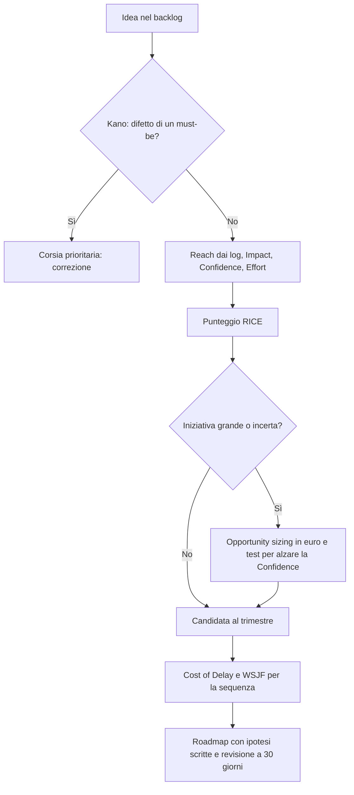

Scenario costruito con numeri di esempio. Un'app freemium di gestione delle spese personali ha 200.000 utenti attivi al mese e un abbonamento premium da 48 euro l'anno. Il team ha capacità per due o tre iniziative nel prossimo trimestre e quattro candidati: un onboarding semplificato per collegare il conto bancario, l'esportazione dei report in PDF, i budget condivisi in famiglia chiesti a gran voce sui social, e la correzione di una sincronizzazione bancaria che fallisce per una parte degli utenti. In riunione vince chi parla meglio: i budget condivisi hanno una presentazione bellissima, la sincronizzazione non ha nessuno che la difenda.

Il product analyst entra in questa discussione con un compito preciso: trasformare ogni proposta in numeri confrontabili, con le ipotesi scritte. Non decide la roadmap, ma rende visibile quanto vale ogni scelta e quanto si è sicuri di quella stima.

> **Idea chiave:** un framework di prioritizzazione non sostituisce il giudizio; costringe ogni proposta a dichiarare quanti utenti tocca, quanto vale per ciascuno, quanto siamo sicuri e quanto costa, così la discussione si sposta dalle opinioni alle ipotesi verificabili.

## Quattro metodi, quattro domande diverse

I metodi di prioritizzazione non sono alternative tra cui scegliere a gusto: ciascuno risponde a una domanda diversa, e si usano insieme.

| Metodo | Domanda a cui risponde | Unità del risultato | Quando serve |
| :--- | :--- | :--- | :--- |
| RICE | Quale idea dà più valore atteso per unità di lavoro? | Punteggio relativo | Ordinare molte idee eterogenee |
| Opportunity sizing | Quanto vale in euro chiudere questo gap? | Euro o utenti all'anno | Iniziative grandi, business case |
| Kano | Come reagisce il cliente alla presenza o assenza della funzione? | Categoria e coefficienti | Separare difetti di base da novità |
| Cost of Delay e WSJF | In che ordine rilasciare per perdere meno valore? | Euro a settimana per settimana di lavoro | Sequenza, scadenze, capacità limitata |

Esistono varianti più semplici, come ICE (Impact, Confidence, Ease, ciascuno da 1 a 10) o la matrice valore contro sforzo. Vanno bene per un primo filtro su decine di idee, ma non usano il numero di utenti raggiunti e quindi favoriscono le idee che sembrano grandi rispetto a quelle che toccano molte persone.

## RICE con il Reach preso dai log

RICE è stato reso popolare dal team di prodotto di Intercom, che lo descrive in un [articolo di Sean McBride](https://www.intercom.com/blog/rice-simple-prioritization-for-product-managers). La formula è:

**RICE = Reach × Impact × Confidence / Effort**

Il Reach è il numero di persone che l'iniziativa tocca in un periodo fisso, per esempio un trimestre: è un conteggio, non una percentuale. L'Impact è quanto cambia il comportamento di ciascuna persona raggiunta, su una scala discreta: 3 enorme, 2 alto, 1 medio, 0,5 basso, 0,25 minimo. La Confidence dice quanto ci fidiamo delle stime precedenti: 100% alta, 80% media, 50% bassa; sotto il 50% l'idea è ancora un'intuizione. L'Effort è il lavoro totale in persone-settimana o persone-mese, inclusi design, sviluppo, test e rilascio.

Il termine più facile da rendere oggettivo è il Reach, perché si estrae dai log. Per ogni iniziativa si identifica l'evento che segnala che un utente passa dal flusso interessato, poi si contano gli utenti distinti negli ultimi 90 giorni, che approssimano un trimestre. La query usa lo schema comune del modulo, `events(user_id, event_name, event_time, properties)`.

```sql
-- Reach trimestrale per iniziativa: utenti distinti che passano dal flusso negli ultimi 90 giorni
WITH flussi AS (
  SELECT 'onboarding_banca' AS iniziativa, 'bank_connect_start' AS evento
  UNION ALL SELECT 'export_pdf', 'report_export_click'
  UNION ALL SELECT 'budget_condivisi', 'budget_page_view'
  UNION ALL SELECT 'fix_sincronizzazione', 'bank_sync_error'
)
SELECT
  f.iniziativa,
  COUNT(DISTINCT e.user_id) AS reach_90g
FROM flussi AS f
LEFT JOIN events AS e
  ON  e.event_name = f.evento
  AND e.event_time >= CURRENT_DATE - INTERVAL '90' DAY
GROUP BY f.iniziativa
ORDER BY reach_90g DESC;
```

Nello scenario la query restituisce: 45.000 utenti iniziano il collegamento bancario nel trimestre, 18.000 incontrano almeno un errore di sincronizzazione, 12.000 aprono la pagina dei budget, 6.000 cliccano sull'esportazione. Per i budget condivisi il Reach è una stima generosa: aprire la pagina dei budget personali non significa volerli condividere.

La Confidence va ancorata al tipo di prova, non all'entusiasmo del proponente. Una regola pratica: 100% se esiste un esperimento o un difetto riproducibile nei log, 80% se c'è un prototipo testato o dati quantitativi indiretti, 50% se ci sono solo interviste o richieste di clienti, 20–30% per un'intuizione.

| Iniziativa | Reach (trimestre) | Impact | Confidence | Effort (persone-settimana) | Calcolo | RICE |
| :--- | ---: | ---: | ---: | ---: | :--- | ---: |
| Fix sincronizzazione | 18.000 | 2 | 100% | 8 | 18.000 × 2 × 1,0 / 8 | 4.500 |
| Onboarding banca | 45.000 | 1 | 80% | 16 | 45.000 × 1 × 0,8 / 16 | 2.250 |
| Export PDF | 6.000 | 0,5 | 100% | 2 | 6.000 × 0,5 × 1,0 / 2 | 1.500 |
| Budget condivisi | 12.000 | 2 | 50% | 24 | 12.000 × 2 × 0,5 / 24 | 500 |

La correzione della sincronizzazione ha un Impact 2 perché i log mostrano che chi incontra l'errore abbandona molto più spesso, e Confidence 100% perché il difetto è riproducibile. I budget condivisi, la proposta più amata in riunione, sono ultimi: Reach incerto, Confidence bassa perché basata su commenti social, Effort alto. Il punteggio non dice «non farlo mai». Dice: prima di investire 24 persone-settimana, porta la Confidence dal 50% all'80% con un prototipo o un test di interesse.

## Opportunity sizing: quanto vale in euro

Il punteggio RICE ordina, ma non dice se un'iniziativa vale il suo costo. Per le iniziative grandi serve una stima in euro, l'opportunity sizing. La formula generale:

**Valore = utenti raggiungibili × variazione attesa del tasso × valore per conversione × fattore di correzione**

Il fattore di correzione tiene conto che i confronti osservazionali sovrastimano l'effetto, perché chi compie un'azione è spesso diverso da chi non la compie.

### Esempio svolto: onboarding bancario

Dai log: 45.000 nuovi utenti a trimestre arrivano al passo di collegamento della banca, e il 40% lo completa. Chi collega la banca passa a premium entro 30 giorni nel 6% dei casi, chi non la collega nell'1%. Un prototipo testato su un piccolo gruppo fa sperare in un completamento del 50%.

Il primo passo è contare gli utenti in più che collegano la banca: 45.000 × (50% − 40%) = 4.500 a trimestre. Se la differenza di conversione fosse tutta causale, gli abbonati in più sarebbero 4.500 × (6% − 1%) = 225, cioè 225 × 48 euro = 10.800 euro di ricavo annuo ricorrente per ogni trimestre di nuovi iscritti. Ma chi collega la banca è più motivato fin dall'inizio, quindi la differenza tra 6% e 1% non è tutta merito del collegamento. Con un fattore di correzione prudente del 50% la stima scende a 5.400 euro.

La cifra corretta è quella da presentare, con la cifra lorda come scenario ottimistico. Il modo di eliminare l'incertezza del passo 4 è un esperimento: la lezione sugli A/B test spiega come progettarlo.

### Esempio svolto: correzione della sincronizzazione

Dai log: 18.000 utenti a trimestre incontrano l'errore. Il loro churn a 30 giorni è del 25%, contro il 10% degli utenti senza errore. Si stima che la correzione riporti il loro churn al 12%, lasciando un margine perché l'errore potrebbe colpire utenti già meno attivi.

Gli utenti trattenuti in più sono 18.000 × (25% − 12%) = 2.340 a trimestre. Di questi l'8% è premium, quindi 2.340 × 8% = 187 abbonati trattenuti, che valgono 187 × 48 euro, circa 9.000 euro di ricavo annuo ricorrente salvato a trimestre.

Con un quarto dello sforzo per persona-settimana, la correzione vale più dell'onboarding. È lo stesso ordine del RICE, ma ora espresso in euro, la lingua in cui ragiona chi approva il budget.

La query seguente produce i numeri di partenza del primo esempio: tasso di completamento del collegamento e conversione a premium nei due gruppi, sulla coorte di iscritti del trimestre. Usa `users(user_id, signup_time, ...)` e `subscriptions(user_id, plan, started_at, ended_at, mrr)`.

```sql
-- Opportunity sizing: conversione a premium entro 30 giorni per chi collega o non collega la banca
WITH coorte AS (
  SELECT u.user_id, u.signup_time
  FROM users AS u
  WHERE u.signup_time >= DATE '2026-07-01'
    AND u.signup_time <  DATE '2026-10-01'
    AND EXISTS (
      SELECT 1 FROM events AS e
      WHERE e.user_id = u.user_id AND e.event_name = 'bank_connect_start'
    )
),
flag AS (
  SELECT
    c.user_id,
    MAX(CASE WHEN e.event_name = 'bank_connect_success' THEN 1 ELSE 0 END) AS collegato,
    MAX(CASE WHEN s.started_at < c.signup_time + INTERVAL '30' DAY THEN 1 ELSE 0 END) AS premium_30g
  FROM coorte AS c
  LEFT JOIN events AS e
    ON e.user_id = c.user_id AND e.event_name = 'bank_connect_success'
  LEFT JOIN subscriptions AS s
    ON s.user_id = c.user_id AND s.plan = 'premium'
  GROUP BY c.user_id
)
SELECT
  collegato,
  COUNT(*) AS utenti,
  ROUND(100.0 * COUNT(*) / SUM(COUNT(*)) OVER (), 1) AS quota_pct,
  ROUND(100.0 * AVG(premium_30g), 1) AS premium_30g_pct
FROM flag
GROUP BY collegato
ORDER BY collegato;
```

## Kano: classificare prima di ordinare

Il modello proposto da Noriaki Kano negli anni Ottanta distingue le funzioni secondo come cambia la soddisfazione quando ci sono e quando mancano. Le categorie principali sono quattro. I requisiti di base, detti must-be (M), non entusiasmano quando ci sono ma fanno arrabbiare quando mancano: è il caso di una sincronizzazione bancaria che funziona. Le funzioni prestazionali, one-dimensional (O), aumentano la soddisfazione in proporzione alla loro qualità, come la velocità dell'app. Le funzioni attrattive, attractive (A), sono inattese: entusiasmano se ci sono e non mancano se assenti, come i budget condivisi per una parte degli utenti. Le funzioni indifferenti (I) non spostano la soddisfazione.

Il questionario Kano fa due domande per ogni funzione: una funzionale («Come ti sentiresti se l'app avesse i budget condivisi?») e una disfunzionale («Come ti sentiresti se non li avesse?»), con cinque risposte: mi piace, me lo aspetto, mi è indifferente, posso tollerarlo, non mi piace. La coppia di risposte si legge nella tabella di valutazione; R indica una funzione indesiderata, Q una risposta incoerente.

| Funzionale ↓ / Disfunzionale → | Mi piace | Me lo aspetto | Indifferente | Lo tollero | Non mi piace |
| :--- | :---: | :---: | :---: | :---: | :---: |
| Mi piace | Q | A | A | A | O |
| Me lo aspetto | R | I | I | I | M |
| Indifferente | R | I | I | I | M |
| Lo tollero | R | I | I | I | M |
| Non mi piace | R | R | R | R | Q |

La categoria di una funzione è quella più frequente tra i rispondenti, ma il voto di maggioranza nasconde spesso segmenti diversi. Per questo si calcolano due coefficienti di soddisfazione:

Il coefficiente Better = (A + O) / (A + O + M + I) misura quanto la presenza della funzione alza la soddisfazione, da 0 a 1. Il coefficiente Worse = −(O + M) / (A + O + M + I) misura quanto la sua assenza la abbassa, da 0 a −1. Le risposte R e Q restano fuori dalla base.

Esempio su 200 risposte. Budget condivisi: A = 70, O = 30, M = 10, I = 85, R = 3, Q = 2. La base è 70 + 30 + 10 + 85 = 195. Better = 100 / 195 = 0,51. Worse = −40 / 195 = −0,21. Sincronizzazione affidabile: M = 120, O = 50, A = 5, I = 20, Q = 5. Better = 55 / 195 = 0,28. Worse = −170 / 195 = −0,87.

La lettura è chiara. La sincronizzazione è un requisito di base: farla funzionare non genera entusiasmo, ma ogni errore costa moltissimo. I budget condivisi dividono il pubblico: per la maggior parte sono indifferenti, per un segmento consistente sono attrattivi. Prima di costruirli conviene capire chi è quel segmento, per esempio le coppie con conto cointestato, e misurarne la dimensione nei dati. La regola operativa è che i must-be con difetti noti passano davanti alle funzioni attrattive, perché un prodotto che fallisce sulle basi non viene premiato per le novità.

## Cost of Delay e WSJF: decidere la sequenza

RICE dice che cosa vale di più; non dice in che ordine rilasciare quando la capacità è limitata. Il Cost of Delay è il valore che si perde per ogni settimana in cui un'iniziativa non è disponibile. Il concetto è stato formalizzato da Donald Reinertsen nel libro *The Principles of Product Development Flow* (2009). Il WSJF, Weighted Shortest Job First, divide il Cost of Delay per la durata:

**WSJF = Cost of Delay per settimana / durata in settimane**

Si rilascia prima l'iniziativa con il WSJF più alto. Il framework SAFe ne usa una versione a punteggi relativi, in cui il Cost of Delay è la somma di valore per l'utente, criticità temporale e riduzione del rischio; la versione in euro qui sotto è più esigente ma più verificabile.

Dai calcoli di opportunity sizing si ricava il valore settimanale: 9.000 euro a trimestre per la sincronizzazione sono circa 690 euro a settimana, 5.400 euro per l'onboarding circa 415 euro. Per l'export PDF il valore stimato in riduzione dei ticket di assistenza è 150 euro a settimana, per i budget condivisi 250 euro. Con il team disponibile, le durate in settimane di calendario sono 4, 8, 1 e 12.

| Iniziativa | Cost of Delay (euro/settimana) | Durata (settimane) | WSJF | Posizione |
| :--- | ---: | ---: | ---: | ---: |
| Fix sincronizzazione | 690 | 4 | 172,5 | 1 |
| Export PDF | 150 | 1 | 150,0 | 2 |
| Onboarding banca | 415 | 8 | 51,9 | 3 |
| Budget condivisi | 250 | 12 | 20,8 | 4 |

L'export PDF sale dal terzo al secondo posto perché richiede una sola settimana: farlo prima ritarda l'onboarding di poco, mentre farlo dopo lo lascia fermo otto settimane. Il vantaggio si dimostra con il costo totale del ritardo. Se si fa prima l'export e poi l'onboarding, l'export è pronto alla settimana 1 e l'onboarding alla 9: costo 150 × 1 + 415 × 9 = 150 + 3.735 = 3.885 euro. Nell'ordine inverso l'onboarding è pronto alla 8 e l'export alla 9: costo 415 × 8 + 150 × 9 = 3.320 + 1.350 = 4.670 euro. L'ordine per WSJF fa risparmiare 785 euro senza aggiungere lavoro.

Il Cost of Delay non è costante. Un adeguamento normativo con una scadenza ha costo di ritardo quasi nullo fino alla scadenza e altissimo dopo; un'iniziativa stagionale, come una funzione per la dichiarazione dei redditi, perde quasi tutto il valore se arriva dopo la stagione. In questi casi la data conta più del WSJF medio.

## Dal backlog alla roadmap

I metodi si applicano in sequenza, ciascuno con il suo ruolo.



Un controllo utile prima di presentare la classifica è la sensibilità: quanto devono sbagliare le stime perché l'ordine cambi? Il codice seguente ricalcola i punteggi con la Confidence al minimo e al massimo plausibile.

```python
iniziative = {
    # nome: (reach, impact, (conf_min, conf_max), effort)
    "Fix sincronizzazione": (18_000, 2.0, (0.8, 1.0), 8),
    "Onboarding banca":     (45_000, 1.0, (0.5, 0.8), 16),
    "Export PDF":           (6_000, 0.5, (0.8, 1.0), 2),
    "Budget condivisi":     (12_000, 2.0, (0.3, 0.8), 24),
}

for nome, (reach, impact, (c_min, c_max), effort) in iniziative.items():
    basso = reach * impact * c_min / effort
    alto = reach * impact * c_max / effort
    print(f"{nome:22s} RICE da {basso:6.0f} a {alto:6.0f}")

# Fix sincronizzazione   RICE da   3600 a   4500
# Onboarding banca       RICE da   1406 a   2250
# Export PDF             RICE da   1200 a   1500
# Budget condivisi       RICE da    300 a    800
```

Gli intervalli della sincronizzazione e dei budget condivisi non si sovrappongono: anche con la Confidence più ottimistica i budget restano ultimi. Onboarding ed export si sovrappongono, quindi il loro ordine dipende dalle stime e va deciso con il WSJF.

Resta il caso delle richieste di un singolo cliente importante, frequente nel B2B. Il RICE le mette in fondo, perché il Reach è un account, ma il rischio di perderlo è reale. La soluzione è una quota di capacità esplicita: con 6 sviluppatori per 13 settimane la capacità è 78 persone-settimana, e un tetto del 15% riserva 78 × 15% = 11,7 persone-settimana alle richieste su misura. Oltre il tetto serve una decisione della direzione, con il confronto esplicito su che cosa si toglie dalla roadmap.

## Trappole comuni

### Reach in percentuale invece che in utenti

Il sintomo è un'iniziativa con «Reach 80%» che batte una con «Reach 30%», anche se la prima riguarda l'80% di una pagina usata da pochi. Succede perché la percentuale sembra più comparabile. Si evita usando sempre il conteggio assoluto di utenti nel periodo, estratto dai log con la stessa finestra per tutte le iniziative.

### Confondere correlazione e impatto nell'opportunity sizing

Il sintomo è un business case che promette di moltiplicare per sei la conversione perché chi usa una funzione converte sei volte di più. Succede perché la differenza osservata include la selezione: chi usa la funzione era già più motivato. Si evita applicando un fattore di correzione dichiarato, presentando una forchetta e, quando la cifra in gioco lo giustifica, misurando l'effetto con un esperimento.

### Punteggi mai rivisti dopo il rilascio

Il sintomo è una tabella RICE ferma da mesi, con stime mai confrontate con i risultati. Succede perché il punteggio viene usato per approvare, non per imparare. Si evita controllando a 30 giorni dal rilascio se Reach e Impact misurati corrispondono alle stime e annotando lo scarto: in pochi trimestri il team impara di quanto tende a sovrastimare.

### Sottostimare l'effort

Il sintomo è un rilascio previsto in sei settimane che occupa il team per un trimestre. Succede perché si stima solo lo sviluppo, non design, test, documentazione e manutenzione. Si evita facendo stimare l'effort a chi costruisce, non a chi propone, e aggiungendo un margine per le iniziative con dipendenze esterne.

## Domande per il prossimo comitato di roadmap

1. Un'iniziativa ha Reach 9.000 utenti a trimestre, Impact 1, Confidence 50% ed Effort 6 persone-settimana. Un'altra ha Reach 3.000, Impact 2, Confidence 100% ed Effort 4. Quale viene prima secondo RICE?

<details>
<summary>Mostra risposta</summary>

La prima vale 9.000 × 1 × 0,5 / 6 = 750, la seconda 3.000 × 2 × 1,0 / 4 = 1.500. Viene prima la seconda. La prima potrebbe superarla se un test portasse la sua Confidence all'80%: 9.000 × 0,8 / 6 = 1.200, ancora sotto. Servirebbe anche un Impact più alto.

</details>

2. Chi usa la funzione «obiettivi di risparmio» rinnova l'abbonamento nel 70% dei casi, chi non la usa nel 40%. Un collega propone di stimare il valore della funzione su questa differenza di 30 punti. Cosa obietti?

<details>
<summary>Mostra risposta</summary>

Che la differenza è osservazionale: chi imposta obiettivi di risparmio è probabilmente più coinvolto a prescindere dalla funzione. Usare 30 punti sovrastima il valore. Si presenta una forchetta con un fattore di correzione dichiarato, per esempio il 30–50% della differenza, si confrontano utenti simili per attività iniziale e, se la decisione è importante, si misura l'effetto con un esperimento che promuove la funzione a un gruppo casuale.

</details>

3. In un questionario Kano una funzione ottiene A = 20, O = 40, M = 90, I = 50. Quali sono Better e Worse e che cosa implicano?

<details>
<summary>Mostra risposta</summary>

La base è 20 + 40 + 90 + 50 = 200. Better = (20 + 40) / 200 = 0,30, Worse = −(40 + 90) / 200 = −0,65. È soprattutto un requisito di base: la sua assenza costa molto più di quanto la sua presenza faccia guadagnare. Se ha difetti, la correzione va nella corsia prioritaria; non ha senso pubblicizzarla come novità.

</details>

4. Iniziativa X: Cost of Delay 3.000 euro a settimana, durata 2 settimane. Iniziativa Y: Cost of Delay 9.000 euro a settimana, durata 9 settimane. Quale rilasci per prima e quanto risparmi rispetto all'ordine inverso?

<details>
<summary>Mostra risposta</summary>

WSJF di X = 3.000 / 2 = 1.500, di Y = 9.000 / 9 = 1.000: prima X. Costo con X poi Y: 3.000 × 2 + 9.000 × 11 = 6.000 + 99.000 = 105.000 euro. Con Y poi X: 9.000 × 9 + 3.000 × 11 = 81.000 + 33.000 = 114.000 euro. L'ordine per WSJF fa risparmiare 9.000 euro.

</details>

5. Il commerciale chiede di anticipare una funzione per un cliente che vale il 12% del fatturato, con un Effort di 15 persone-settimana. La quota per richieste su misura è di 11,7 persone-settimana. Come imposti la decisione?

<details>
<summary>Mostra risposta</summary>

La richiesta supera la quota di 3,3 persone-settimana, quindi non si decide tra team e commerciale ma in direzione. Si portano tre numeri: il rischio di perdita del cliente in euro moltiplicato per la probabilità stimata, il valore delle iniziative di roadmap che slitterebbero, e la possibilità di generalizzare la funzione a un segmento più ampio, che ne alzerebbe il Reach e la farebbe rientrare nella roadmap ordinaria.

</details>
