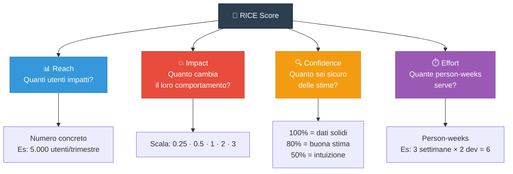
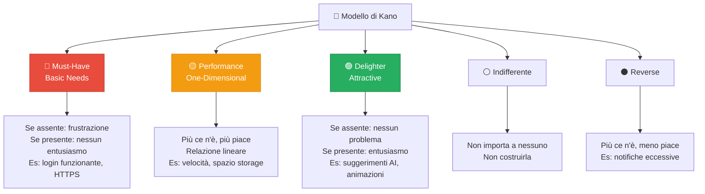
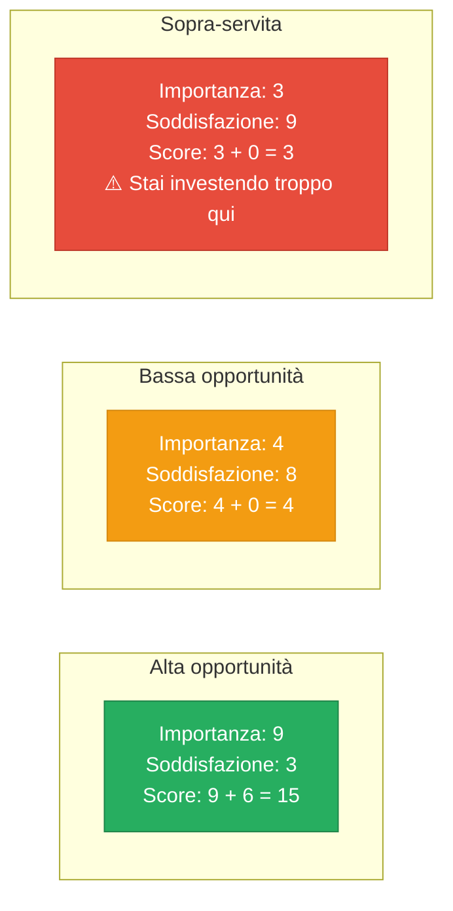
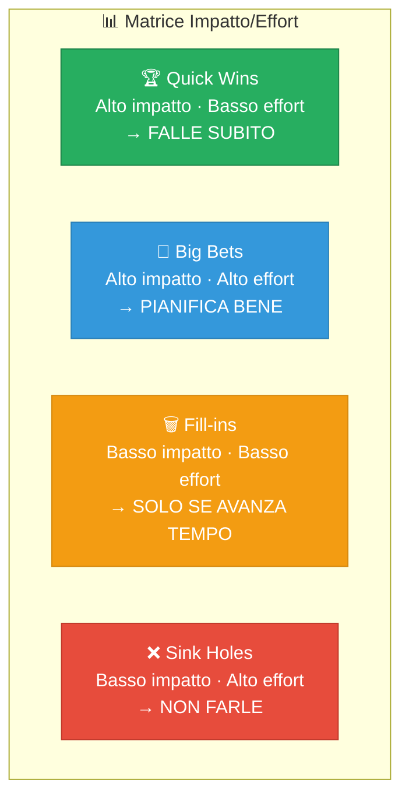
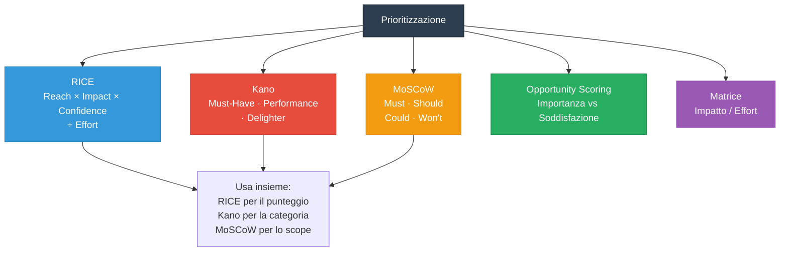

## PRIORITIZZARE: L'ARTE DI DIRE NO A COSE BUONE

La prioritizzazione non è scegliere cosa fare. È scegliere **cosa non fare**. In un prodotto con risorse limitate (cioè tutti i prodotti), ogni feature che costruisci è una feature che *non* costruisci. Il costo-opportunità è la metrica più importante — e la più ignorata — nel product management.

Il problema non è mai la mancanza di idee. Il problema è averne troppe. Clienti che chiedono feature diverse, stakeholder con visioni contrapposte, il team tecnico che vuole refactorare, il marketing che vuole un redesign. Senza un framework oggettivo, vince chi urla di più — e quel modo di decidere porta a prodotti gonfi, incoerenti e che non risolvono bene nessun problema.

## Il framework RICE

Sviluppato da Intercom, **RICE** assegna un punteggio numerico a ogni iniziativa basandosi su quattro fattori:

> **RICE Score = (Reach × Impact × Confidence) / Effort**

### Come compilare ogni fattore

**Reach** — quanti utenti saranno impattati dalla feature in un periodo definito (tipicamente un trimestre). Non è una stima vaga: usa i dati reali. Se la feature riguarda il checkout, il reach è il numero di utenti che arrivano al checkout ogni trimestre.

**Impact** — quanto la feature cambia il comportamento degli utenti impattati. Intercom usa una scala ordinale:
- 3 = impatto massiccio (cambia radicalmente l'esperienza)
- 2 = alto impatto
- 1 = medio
- 0,5 = basso
- 0,25 = minimo

**Confidence** — quanto sono affidabili le stime di Reach e Impact. È il "correttore di onestà":
- 100% = hai dati solidi (A/B test precedenti, ricerca utente, analytics)
- 80% = buona stima basata su evidenze parziali
- 50% = intuizione educata, pochi dati

**Effort** — il costo in person-weeks (una persona che lavora per una settimana = 1). Include sviluppo, design, QA, documentazione.

### Esempio pratico

| Feature | Reach | Impact | Confidence | Effort | RICE Score |
|---|---:|---:|---:|---:|---:|
| Onboarding personalizzato | 8.000 | 2 | 80% | 6 | **2.133** |
| Export CSV avanzato | 500 | 1 | 100% | 2 | **250** |
| Redesign dashboard | 12.000 | 1 | 50% | 12 | **500** |
| Notifiche push mobile | 3.000 | 2 | 80% | 4 | **1.200** |
| SSO enterprise | 200 | 3 | 100% | 8 | **75** |

L'onboarding personalizzato vince perché raggiunge molti utenti con alto impatto e buona confidenza. L'SSO enterprise ha impatto massimo (3) ma il reach è troppo basso — a meno che quei 200 utenti enterprise rappresentino il 60% del revenue (e allora va pesato diversamente).

> **Il limite del RICE:** non considera la strategia. L'SSO potrebbe essere necessario per entrare nel mercato enterprise, che è l'obiettivo strategico dell'anno. RICE è un input, non la decisione finale.

## Il modello di Kano

Noriaki Kano ha proposto un modello di classificazione delle feature basato su un insight fondamentale: **la relazione tra la presenza di una feature e la soddisfazione del cliente non è lineare.**

### Come classificare le feature con Kano

Si fanno due domande per ogni feature:
1. **Funzionale:** "Come ti sentiresti se il prodotto avesse questa feature?"
2. **Disfunzionale:** "Come ti sentiresti se il prodotto NON avesse questa feature?"

Le risposte (mi piace, lo aspetto, neutro, lo tollero, non mi piace) vengono incrociate in una matrice che classifica la feature.

### Implicazioni strategiche

| Tipo | Priorità | Strategia |
|---|---|---|
| **Must-Have** | Massima | Non negoziabile. Se manca, perdi clienti. Non differenzia. |
| **Performance** | Alta | Più investi, più soddisfazione. Confronto diretto con i competitor. |
| **Delighter** | Selettiva | Investi poco per sorprendere molto. Si degrada nel tempo: il delighter di oggi è il must-have di domani. |
| **Indifferente** | Zero | Non costruire. Risparmia le risorse. |

> **Il decadimento temporale di Kano:** i delighter decadono in performance, e i performance decadono in must-have. Lo swipe di Tinder era un delighter nel 2013 — oggi è un must-have per qualsiasi app di dating. La navigazione satellitare nelle auto era un delighter nel 2005 — oggi è un must-have.

## ICE: la versione semplificata

**ICE** (Impact, Confidence, Ease) è una versione semplificata di RICE che elimina il Reach:

> **ICE Score = Impact × Confidence × Ease**

Tutti i fattori su scala 1-10. È più veloce da compilare ma meno preciso — l'assenza di Reach lo rende soggettivo.

**Quando usare ICE:** brainstorming rapidi, prioritizzazione di piccole ottimizzazioni, sessioni con stakeholder non tecnici che vogliono un framework semplice.

**Quando NON usare ICE:** decisioni strategiche importanti, confronto tra iniziative con reach molto diverso.

## MoSCoW: la negoziazione strutturata

MoSCoW non assegna punteggi ma classifica le feature in quattro categorie:

| Categoria | Significato | Regola |
|-----------|------------|--------|
| **Must have** | Senza queste, il rilascio è inutile | Se non c'è, il prodotto non funziona |
| **Should have** | Importanti ma non bloccanti | Possono essere nel rilascio successivo |
| **Could have** | Nice-to-have | Solo se avanza tempo |
| **Won't have (this time)** | Escluse dal rilascio corrente | Documentate per il futuro |

La regola d'oro: i **Must** non dovrebbero superare il 60% dello scope totale. Se tutto è "must", niente è "must".

**Quando usare MoSCoW:** pianificazione di rilascio con deadline fissa, negoziazione con stakeholder, scope management.

## Opportunity Scoring (Ulwick)

Anthony Ulwick, autore di *Jobs to Be Done*, propone un approccio diverso: misurare **l'importanza** di un risultato per il cliente e la sua **soddisfazione attuale** con le soluzioni esistenti.

> **Opportunity Score = Importanza + max(Importanza − Soddisfazione, 0)**

Le feature con alta importanza e bassa soddisfazione hanno il punteggio più alto — sono le **opportunità sotto-servite**.

**Vantaggi:** parte dal cliente, non dalla feature. Non chiede "vuoi questa feature?" ma "quanto è importante questo risultato e quanto sei soddisfatto delle soluzioni attuali?"

## La matrice Impatto/Effort: il quadrante delle decisioni rapide

La versione più semplice e visiva di prioritizzazione: un asse x (effort) e un asse y (impatto).

**Quando usare:** workshop di prioritizzazione con il team, retrospettive, pianificazione sprint.

**Trappola:** tutto finisce nel quadrante "Quick Wins" perché nessuno ammette che la propria idea ha basso impatto. Serve disciplina e dati per posizionare onestamente.

## Caso studio: come Spotify sceglie cosa costruire

Spotify usa un processo chiamato **DIBB** (Data → Insight → Belief → Bet):

1. **Data:** "Il 35% degli utenti abbandona durante la prima sessione di ascolto"
2. **Insight:** "Non trovano musica che li interessa abbastanza velocemente"
3. **Belief:** "Se personalizziamo la homepage dal primo secondo, la retention migliorerà"
4. **Bet:** "Investiamo un quarter per costruire il modello di raccomandazione cold-start"

La differenza con i framework tradizionali è che Spotify esplicita le **beliefs** — le assunzioni non provate che stanno dietro la decisione. Questo permette di validarle o invalidarle con un esperimento, invece di scoprire mesi dopo che l'assunzione era sbagliata.

## Gli errori comuni nella prioritizzazione

### 1. La feature richiesta dal cliente più grande

Il cliente enterprise che paga 100k€/anno chiede una feature specifica. Il team la costruisce. Risultato: una feature usata da un solo cliente che complica il prodotto per tutti gli altri. La regola: **ascolta il problema, non la soluzione**. Il cliente grande ha un problema legittimo; la soluzione potrebbe essere diversa da quella che propone.

### 2. La roadmap guidata dalla concorrenza

"Il competitor X ha lanciato questa feature, dobbiamo averla anche noi." Ma il competitor ha una base clienti, una strategia e un posizionamento diversi. Copiare le feature non è una strategia — è una corsa al ribasso.

### 3. L'assenza del "Won't do"

Una roadmap senza una lista esplicita di "cose che abbiamo deciso di NON fare" non è una roadmap seria. La sezione "Won't do" è la prova che hai fatto delle scelte, non che hai semplicemente elencato dei desideri.

## Riepilogo

Tre cose da portare a casa:

1. **Nessun framework è la risposta** — sono strumenti per strutturare la conversazione, non oracoli. RICE senza dati di Reach è inutile. Kano senza ricerca utente è fantasia. La prioritizzazione è un processo, non una formula.

2. **Il costo-opportunità è la metrica nascosta** — ogni feature che costruisci è una feature che non costruisci. I framework servono a rendere questo trade-off esplicito e condivisibile.

3. **Il "Won't do" è importante quanto il "Will do"** — una roadmap senza una lista di cose escluse non è una roadmap. È una lista dei desideri.
