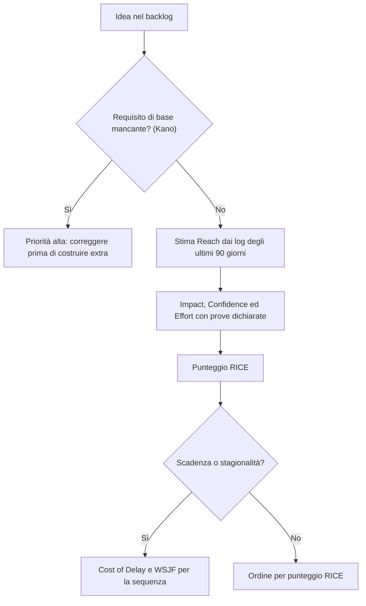

Scenario costruito con numeri di esempio: una software house B2B italiana con 1.000 account attivi nell'ultimo trimestre dedica quattro mesi a un modulo di reportistica personalizzata chiesto da due grandi clienti. Nel frattempo restano ferme due cose che nessun cliente grande ha richiesto: un miglioramento dell'onboarding che toccherebbe 800 nuovi iscritti a trimestre e la correzione di un'esportazione CSV che va in errore per circa 400 account. Quando il responsabile di prodotto chiede perché sia stata scelta la reportistica, la risposta è che i due clienti erano molto convincenti in riunione.

Una roadmap guidata dalla voce più forte non è una scelta, è una conseguenza dei rapporti di forza. Prioritizzare con i dati significa sostituire la politica interna con criteri espliciti, confrontabili e verificabili. I framework non decidono al posto tuo: rendono visibili le ipotesi su portata, impatto, incertezza e costo prima di impegnare mesi di lavoro tecnico.

## Tre framework, tre domande diverse

Ogni metodo risponde a una domanda distinta, e confonderli produce classifiche incoerenti. Il punteggio RICE, acronimo di Reach, Impact, Confidence, Effort, ordina le iniziative per valore atteso per unità di lavoro. Il modello Kano classifica le funzioni secondo la reazione dei clienti: requisiti di base, la cui assenza provoca abbandono immediato, fattori di performance, per cui più migliorano più cresce la soddisfazione, e delighter, che sorprendono e differenziano. Il Cost of Delay misura quanto valore perde l'azienda per ogni settimana di ritardo nel rilascio.

> **Idea chiave:** una roadmap basata sui dati non elimina il giudizio strategico, ma costringe ogni proposta a dichiarare portata reale, confidenza delle prove e costo di un eventuale ritardo.

| Framework | Variabili chiave | Quando usarlo | Errore più frequente |
| :--- | :--- | :--- | :--- |
| RICE | Reach, Impact, Confidence, Effort | Confrontare molte idee sullo stesso backlog | Gonfiare l'Impact senza prove storiche |
| Modello Kano | Requisiti di base, performance, delighter | Evitare extra su un prodotto fragile | Ignorare i difetti di base per inseguire novità |
| Cost of Delay | Valore economico perso a settimana | Gestire scadenze normative o picchi stagionali | Trattare ogni richiesta come urgente |
| WSJF | Cost of Delay diviso durata del lavoro | Scegliere la sequenza ottimale negli sprint | Sottostimare test e rilascio |

Si usano in sequenza. Il modello Kano filtra: prima di discutere novità si verifica che i requisiti di base siano soddisfatti. RICE ordina il resto per rapporto tra valore e fatica. Il Cost of Delay e il WSJF intervengono quando due iniziative hanno punteggi simili o quando una ha una scadenza che trasforma il tempo in denaro.

## Il punteggio RICE passo per passo

Il calcolo è semplice, la difficoltà è dare numeri onesti ai quattro termini. Il Reach è il numero di utenti o account raggiunti dall'iniziativa in un periodo fisso, per esempio un trimestre. L'Impact è la variazione attesa su ciascuno, su una scala discreta: 3 massimo, 2 alto, 1 medio, 0,5 basso, 0,25 minimo. La Confidence è la fiducia nelle stime, espressa in percentuale e ancorata al tipo di prova. L'Effort è il lavoro totale in settimane-persona o mesi-persona, comprensivo di design, test e rilascio. Il punteggio è Reach × Impact × Confidence / Effort.

Applichiamolo al backlog dello scenario, con tre candidati. Il miglioramento dell'onboarding ha un Reach di 800 account a trimestre, un Impact di 1, una Confidence dell'80% perché esiste un test su un prototipo, e un Effort di 3 mesi-persona. Il modulo di reportistica personalizzata ha un Reach di 60 account, cioè il 6% dei 1.000 attivi, un Impact di 2, una Confidence del 50% perché si basa solo su due interviste, e un Effort di 4 mesi-persona. La correzione dell'esportazione CSV ha un Reach di 400, un Impact di 1, una Confidence del 100% perché l'errore è riproducibile nei log, e un Effort di 1 mese-persona.

I punteggi si calcolano così. Onboarding: 800 × 1 × 0,80 / 3 = 640 / 3 = 213,3. Reportistica: 60 × 2 × 0,50 / 4 = 60 / 4 = 15,0. Esportazione CSV: 400 × 1 × 1,00 / 1 = 400,0. L'ordine è esportazione, onboarding, reportistica. La reportistica, che aveva assorbito quattro mesi, risulta quasi 27 volte meno efficiente della correzione CSV e 14 volte meno dell'onboarding. Questo non significa che non vada mai costruita, ma che non deve passare per prima, e che serve più prova prima di poterle assegnare una confidenza superiore al 50%.



## Estrarre il Reach reale dai log prima di assegnare il punteggio

Il modo più rapido per rendere onesto il punteggio RICE è calcolare il Reach direttamente dai dati di utilizzo degli ultimi 90 giorni, contando quanti account compiono davvero il flusso collegato alla proposta. Un'idea brillante che tocca il 3% della base avrà quasi sempre priorità inferiore a un miglioramento semplice che interessa il 70% dei nuovi iscritti. La query seguente produce il Reach per area funzionale in ClickHouse.

```sql
-- Reach per area funzionale: account distinti che hanno usato il flusso negli ultimi 90 giorni
WITH active_accounts AS (
  SELECT uniq(account_id) AS total_active
  FROM product_events
  WHERE event_date >= today() - 90
)
SELECT
  e.feature_area,
  uniq(e.account_id) AS reached_accounts_90d,
  round(uniq(e.account_id) * 100.0 / any(a.total_active), 1) AS reach_pct
FROM product_events AS e
CROSS JOIN active_accounts AS a
WHERE e.event_date >= today() - 90
GROUP BY e.feature_area
ORDER BY reached_accounts_90d DESC;
```

Una volta ottenuto il Reach dal database, la tabella RICE si può calcolare direttamente, con una colonna per ogni termine e una per il punteggio. In questo modo la classifica è riproducibile e si aggiorna ogni mese, quando cambiano confidenza ed effort.

```sql
-- Punteggio RICE calcolato in query: reach * impact * confidence / effort
SELECT
  feature_name,
  reach_accounts,
  impact,
  confidence_pct,
  effort_person_months,
  round(reach_accounts * impact * (confidence_pct / 100.0) / effort_person_months, 1) AS rice_score
FROM roadmap_ideas
WHERE status = 'candidate'
ORDER BY rice_score DESC;
```

La Confidence va ancorata al livello di prova disponibile. Una percentuale del 100% si assegna solo quando esiste già un test o un difetto riproducibile nei log, 80% con un prototipo validato su qualche utente, 50% con sole interviste, e 20-30% con un'intuizione del proponente. Chi propone un'idea ha un interesse naturale a gonfiare tutti i termini, quindi conviene far assegnare Impact e Confidence da una persona diversa dal proponente, oppure da più persone con media dei voti.

## Kano: i requisiti di base prima delle novità

Nessuna funzione innovativa compensa un'esportazione CSV che va in errore o una fattura che non si genera. Il modello Kano formalizza questa intuizione: i requisiti di base non aumentano la soddisfazione quando ci sono, ma la fanno crollare quando mancano. Le funzioni di performance sono quelle per cui più si migliora più il cliente è contento, come la velocità di caricamento. I delighter sono funzioni inattese che entusiasmano, ma solo se la base è solida.

Per classificare una funzione si pongono ai clienti due domande: come ti sentiresti se questa funzione ci fosse, e come ti sentiresti se non ci fosse. La combinazione delle risposte colloca la funzione in una categoria. Nello scenario la correzione CSV è un requisito di base: nessuno applaude un file che si esporta, tutti protestano se non funziona. Il punteggio RICE di 400 conferma la lettura, e il modello Kano la rende un vincolo: finché i requisiti di base hanno difetti noti, il rendimento di qualunque nuova funzione accessoria è ridotto.

## Cost of Delay e WSJF per decidere la sequenza

Quando due iniziative hanno punteggi vicini, o quando una ha una scadenza esterna, conta il tempo. Il Cost of Delay è il valore perso per ogni settimana di ritardo. Il WSJF, Weighted Shortest Job First, lo divide per la durata del lavoro: si parte da ciò che perde più valore per unità di tempo di lavoro.

Aggiungiamo al backlog una quarta iniziativa: un adeguamento alla nuova norma di fatturazione, con scadenza fissa tra 8 settimane. Il Cost of Delay è stimato in 12.000 euro a settimana, per sanzioni evitate e clienti trattenuti, e la durata è di 2 settimane. Il WSJF è 12.000 / 2 = 6.000. Per l'esportazione CSV il Cost of Delay è di 2.500 euro a settimana, per ticket e rinnovi a rischio, e la durata è di 4 settimane, quindi WSJF = 2.500 / 4 = 625. Per l'onboarding il Cost of Delay è di 4.000 euro a settimana, legato ai nuovi account che si fermano al setup, e la durata è di 12 settimane, quindi WSJF = 4.000 / 12 = 333,3.

La sequenza per WSJF è: adeguamento normativo (6.000), esportazione CSV (625), onboarding (333,3). La sequenza è diversa da quella del solo RICE, dove l'adeguamento non compariva, perché il suo valore non dipende dal Reach ma dalla scadenza. Le due letture si combinano: RICE rimane il criterio principale per il backlog ordinario, mentre il WSJF stabilisce chi passa davanti quando il calendario ha dei vincoli.

## Tre errori che trasformano la prioritizzazione in teatro

Un foglio di calcolo con le formule RICE non garantisce decisioni migliori se il team usa i punteggi per giustificare scelte già prese.

### Usare punteggi di impatto inventati a sensazione

Il sintomo è un backlog in cui tutte le idee del proponente più autorevole hanno Impact 3. Succede perché la scala è soggettiva e nessuno è tenuto a documentare la stima. La correzione è collegare ogni voto a una prova: il Reach arriva da una query, l'Impact da un esperimento o da una stima di conversione precedente, la Confidence dal tipo di prova. Se la prova manca, il termine scende, e con esso il punteggio.

### Sottostimare l'effort di manutenzione

Il sintomo è una funzione rilasciata in sei settimane che occupa il team per mesi con correzioni, documentazione e assistenza. Succede perché l'effort viene calcolato come giorni di scrittura di codice e non include design, test automatici, documentazione e supporto futuro. Una funzione usata dal 2% dei clienti ma che richiede manutenzione ogni trimestre ha un costo reale molto più alto di quello pianificato. La correzione è stimare l'effort su tutto il ciclo di vita e aggiungere un margine per la manutenzione.

### Non rivedere i punteggi dopo il rilascio

Il sintomo è una tabella RICE ferma da mesi, con stime mai confrontate con i risultati. Succede perché la tabella viene vista come un documento di approvazione e non come uno strumento di apprendimento. La correzione è rivedere la tabella ogni mese aggiornando Confidence ed Effort, e controllare a trenta giorni dal rilascio se l'impatto misurato nei log corrisponde alla stima. Questo ciclo chiuso migliora nel tempo la qualità delle stime del team.

## Richieste contrattuali di un singolo grande cliente

Nel mercato B2B capita che un cliente enterprise condizioni il rinnovo di un contratto importante alla creazione di una funzione molto specifica. La formula RICE darebbe un punteggio bassissimo, perché il Reach è un solo account, eppure il Cost of Delay immediato è altissimo. Il metodo non va forzato: serve un contenitore separato.

Si separa il backlog strategico dalle richieste su misura e si verifica se il bisogno può essere generalizzato a un intero segmento. Se resta un'eccezione, la richiesta si tratta come costo commerciale di mantenimento del cliente, con una voce separata, in modo che non eroda in silenzio la capacità del team. Una regola pratica è fissare un tetto: con 6 sviluppatori per 13 settimane la capacità trimestrale è di 78 settimane-persona, e un tetto del 15% limita le richieste su misura a 78 × 15% = 11,7 settimane-persona. Superato quel tetto, ogni nuova richiesta richiede una decisione esplicita della direzione, non un accordo informale con il commerciale.

Condividere i criteri di punteggio con vendite, marketing e customer success riduce infine le tensioni tra reparti, perché ogni richiesta è valutata con le stesse regole. Quando tutti vedono perché una proposta precede un'altra, la discussione si sposta dai desideri ai dati.

## Verifica prima di congelare la roadmap

1. Una funzione ha Reach 500, Impact 2, Confidence 80% ed Effort 5 mesi-persona. Qual è il suo punteggio RICE?

<details>
<summary>Mostra risposta</summary>

500 × 2 × 0,80 / 5 = 800 / 5 = 160. Se l'effort reale fosse di 8 mesi-persona, il punteggio scenderebbe a 100, quindi la stima di effort va ricontrollata prima di fidarsi della posizione in classifica.

</details>

2. Come classifichi, secondo Kano, una fattura che non si genera, e cosa cambia nella priorità?

<details>
<summary>Mostra risposta</summary>

È un requisito di base: la sua presenza non entusiasma, la sua assenza provoca abbandono. Va corretta prima di investire in funzioni di performance o in delighter, perché finché i difetti di base restano il rendimento di qualunque novità è ridotto.

</details>

3. Iniziativa X: Cost of Delay 3.000 euro a settimana, durata 2 settimane. Iniziativa Y: Cost of Delay 9.000 euro a settimana, durata 9 settimane. Quale parte per prima secondo il WSJF?

<details>
<summary>Mostra risposta</summary>

X ha WSJF 3.000 / 2 = 1.500, Y ha WSJF 9.000 / 9 = 1.000. Parte X, perché perde più valore per unità di lavoro. Y ha un costo di ritardo assoluto più alto ma richiede molto più tempo, quindi bloccherebbe la capacità per più settimane.

</details>

4. Con 5 sviluppatori per 12 settimane e un tetto del 15% per le richieste su misura, quante settimane-persona puoi destinare a un cliente enterprise?

<details>
<summary>Mostra risposta</summary>

La capacità è 5 × 12 = 60 settimane-persona, e il tetto è 60 × 15% = 9 settimane-persona. Se la richiesta ne richiede 14, servono una decisione esplicita della direzione e il confronto con la quota di roadmap generale che verrebbe sacrificata.

</details>

5. Una proposta ha Confidence 100% basata solo sull'entusiasmo del proponente. Cosa fai?

<details>
<summary>Mostra risposta</summary>

Riporti la Confidence al livello della prova effettiva, per esempio 30% se esiste solo un'intuizione, e indichi quale prova la farebbe salire: un prototipo testato con cinque clienti, un esperimento A/B o un difetto riproducibile nei log. Il punteggio si aggiorna quando la prova arriva.

</details>
