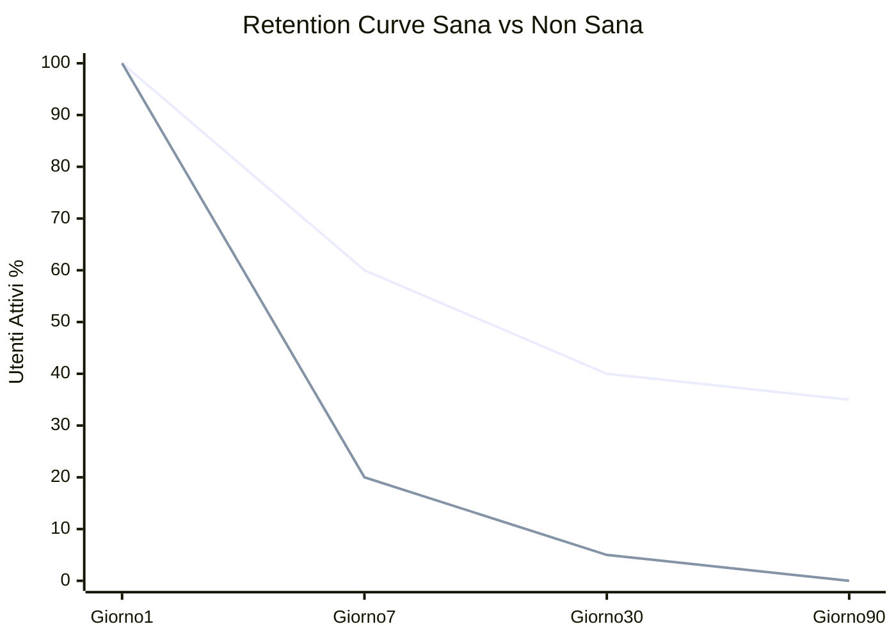

## Product-Market Fit: il Santo Graal delle Startup

Il **Product-Market Fit** (PMF) è il momento in cui un prodotto soddisfa una domanda di mercato così forte che la crescita diventa quasi organica. Marc Andreessen, co-fondatore di Andreessen Horowitz, lo definì nel 2007 come: *"trovarsi in un buon mercato con un prodotto che può soddisfare quel mercato"*.

Questo concetto è il singolo fattore più importante per determinare il successo o il fallimento di una startup. Prima del PMF, tutto è incerto e fragile. Dopo il PMF, le sfide cambiano natura: non si tratta più di capire *se* il prodotto funziona, ma di *scalare* ciò che funziona.

### Obiettivi di Apprendimento

Al termine di questa lezione, lo studente sarà in grado di:
1.  Definire il Product-Market Fit e riconoscere i segnali qualitativi della sua presenza (o assenza).
2.  Applicare il **Sean Ellis Test** (la regola del 40%) per misurare quantitativamente il PMF.
3.  Interpretare le **Retention Curves** per distinguere una crescita sana da una crescita drogata dal marketing.
4.  Utilizzare la **Piramide del PMF** di Dan Olsen per iterare verso il successo.

### Timeline della Lezione

| Fase | Argomento | Durata |
|------|-----------|--------|
| 1 | Introduzione: La definizione di Andreessen | 5 min |
| 2 | Misurazione Qualitativa: Sean Ellis Test | 10 min |
| 3 | Misurazione Quantitativa: Retention e Engagement | 15 min |
| 4 | Framework: La Piramide di Dan Olsen | 10 min |
| 5 | Casi Studio: Superhuman e Slack | 5 min |
| **Totale** | | **45 min** |

## 1. Definizione di Marc Andreessen

Nel suo celebre articolo *The Only Thing That Matters*, Andreessen articolò una visione netta del PMF. Secondo lui, in una startup ci sono tre elementi fondamentali:
-   **Il team**: le persone che costruiscono il prodotto.
-   **Il prodotto**: ciò che viene offerto ai clienti.
-   **Il mercato**: la dimensione e la qualità della domanda.

La sua tesi è provocatoria: **il mercato è più importante del team e del prodotto**. Un mercato eccellente con un prodotto mediocre può comunque avere successo. Un prodotto eccellente in un mercato inesistente fallirà sempre.

### I Segnali Qualitativi del PMF

-   **Quando NON hai PMF:** Tutto è faticoso. Le vendite non chiudono. I clienti non tornano. La stampa non risponde. Le assunzioni sono difficili.
-   **Quando HAI PMF:** I clienti comprano più velocemente di quanto tu possa produrre. I server non reggono. I giornalisti ti cercano. Assumi a raffica e non basta mai.

## 2. Il Sean Ellis Test (la Regola del 40%)

Sean Ellis, padre del Growth Hacking, ha proposto il metodo più semplice e diffuso per misurare il PMF: il **survey della delusione**.

### Come Funziona

Si pone una singola domanda agli utenti attivi:
> **"Come ti sentiresti se non potessi più usare [nome prodotto]?"**
> 1. Molto deluso
> 2. Un po' deluso
> 3. Non deluso (non è davvero utile)

### La Soglia del 40%

Se almeno il **40%** risponde "Molto deluso", hai un forte segnale di PMF.
-   **< 40%:** Devi ancora iterare sul prodotto o sul target.
-   **> 40%:** Sei pronto per scalare (Growth).

> **Strategia:** Analizza le risposte qualitative di chi ha risposto "Molto deluso". Chiedi: *"Qual è il beneficio principale che ottieni?"*. Le loro parole sono il tuo copy di marketing più efficace.

## 3. Metriche Quantitative: Retention Curves

Le curve di retention sono la prova del nove. Mostrano la % di utenti che tornano nel tempo.

-   **Curva piatta (Smiling Curve):** Gli utenti si stabilizzano. Hai trovato il PMF per quella coorte.
-   **Curva verso lo zero:** Nessuno resta. Hai un "Leaky Bucket". Non scalare!

## 4. La Piramide del PMF di Dan Olsen

Dan Olsen (*The Lean Product Playbook*) sistematizza il processo in 5 livelli gerarchici. Non puoi risolvere i problemi in alto se le fondamenta sono deboli.

1.  **Target Customer** (Base): Chi è il cliente?
2.  **Underserved Needs:** Quali bisogni non sono soddisfatti?
3.  **Value Proposition:** Come li soddisfiamo meglio degli altri?
4.  **Feature Set:** Cosa costruiamo (MVP)?
5.  **UX Design** (Cima): Come funziona l'interfaccia?

> **Errore Comune:** Molti founder iterano sulla UX (livello 5) quando il problema è il Target (livello 1). È come ridipingere le pareti di una casa che sta crollando.

## 5. Casi Studio

### Superhuman (Email Client)
Rahul Vohra usò il Sean Ellis Test scientificamente.
1.  Survey iniziale: 22% "Molto deluso". (No PMF).
2.  Segmentazione: Isolò i founder/manager. Tra loro il punteggio era 32%.
3.  Roadmap Data-Driven: Costruì solo le feature richieste da quel segmento specifico.
4.  Risultato: PMF raggiunto (58%) in 3 trimestri.

### Slack
Nato come tool interno di un'azienda di videogiochi fallita (Glitch).
-   **Segnale:** Il team non riusciva a lavorare senza.
-   **Viralità interna:** Appena un team lo usava, si diffondeva a tutta l'azienda.
-   **Retention:** 93% dopo 30 giorni.

---

> **Conclusione:** Il PMF non è un evento binario (c'è/non c'è), ma un gradiente. Misuralo costantemente. Scalare prematuramente senza PMF è la causa #1 di morte delle startup (Startup Genome Report).
