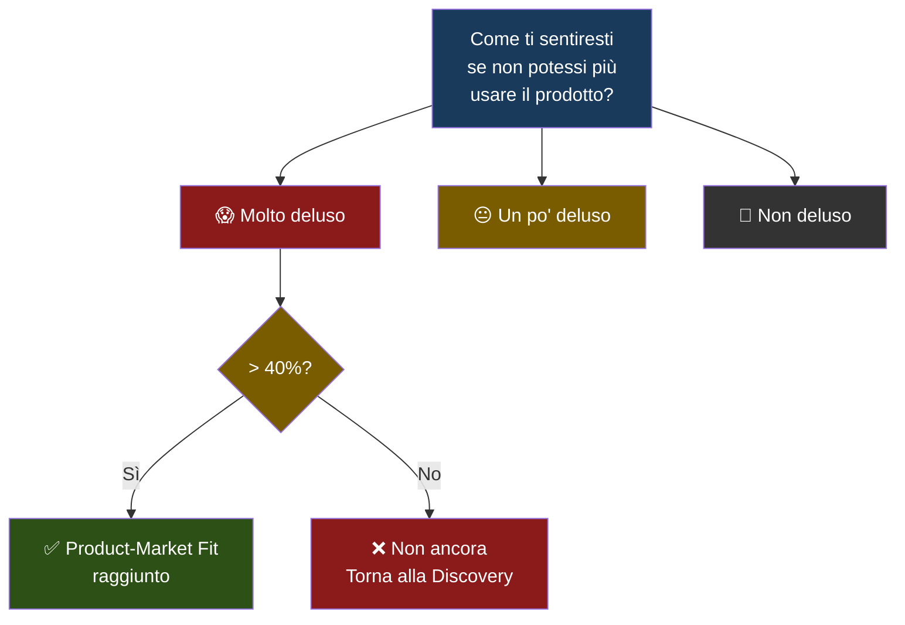
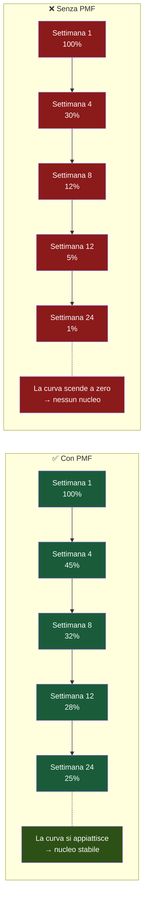
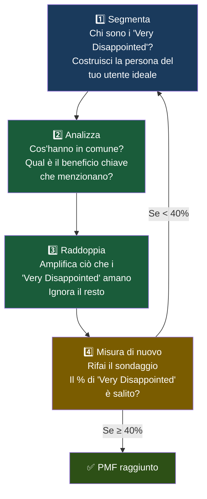
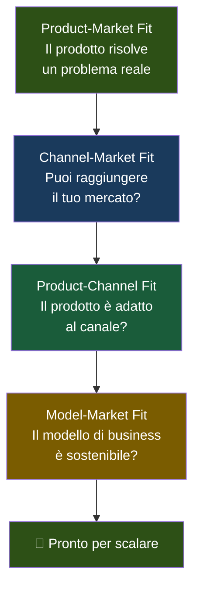
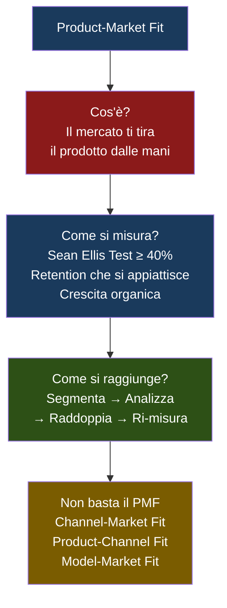

import { Aside } from '@astrojs/starlight/components'

## PRODUCT-MARKET FIT: IL MOMENTO IN CUI SMETTI DI SPINGERE E INIZI A ESSERE TIRATO

Marc Andreessen ha definito il Product-Market Fit (PMF) come il momento in cui *"il mercato ti tira il prodotto dalle mani"*. Prima del PMF, ogni acquisizione è una battaglia. Dopo il PMF, il problema diventa stare dietro alla domanda.

È il concetto più importante nel ciclo di vita di un prodotto, eppure uno dei più difficili da misurare. Non esiste un singolo numero magico che dica "hai raggiunto il PMF" — ma esistono segnali quantitativi e qualitativi che, combinati, danno un quadro chiaro.

## Il test di Sean Ellis: la domanda da 40%

Sean Ellis (che ha coniato il termine "growth hacking") ha proposto un test semplice e potente:

> *"Come ti sentiresti se non potessi più usare questo prodotto?"*

Con tre risposte possibili:
1. **Molto deluso**
2. **Un po' deluso**
3. **Non deluso** (non è realmente utile per me)

La regola:

> **Se il 40% o più degli utenti risponde "Molto deluso", hai raggiunto il PMF.**



### Perché funziona

Il test non chiede "ti piace?" (tutti dicono di sì per cortesia). Chiede un'emozione negativa ipotetica — la **paura della perdita**. La loss aversion è uno dei bias cognitivi più potenti: sentiamo la perdita due volte più intensamente del guadagno equivalente.

Se il 40% dei tuoi utenti avrebbe una reazione emotiva forte alla scomparsa del prodotto, hai creato qualcosa che è diventato parte della loro routine, del loro flusso di lavoro, della loro vita.

### Come somministrare il test

**A chi:** solo utenti attivi che hanno usato il prodotto almeno 2-3 volte. Non mandarlo a chi si è registrato ieri — non hanno avuto tempo di sperimentare il valore.

**Quando:** dopo che l'utente ha avuto abbastanza esposizione (tipicamente dopo 2-4 settimane di uso).

**Sample size:** minimo 30-40 risposte per avere un segnale affidabile. Idealmente 100+.

**Follow-up cruciale:** a chi risponde "Molto deluso", chiedi: *"Qual è il beneficio principale che ricevi dal prodotto?"*. Le risposte a questa domanda sono la tua value proposition — scritta con le parole dei tuoi utenti, non le tue.

## I segnali qualitativi del PMF

Prima dei numeri, ci sono segnali che si percepiscono:

### 🟢 Segnali positivi (hai il PMF)

- I clienti ti raccomandano ad altri senza che tu lo chieda
- Gli utenti si lamentano quando il prodotto è down (= ci tengono)
- Inizi a ricevere richieste di feature che estendono il prodotto (= lo usano abbastanza da volere di più)
- Il passaparola genera lead organici
- I clienti descrivono il tuo prodotto usando le tue stesse parole (= il messaging risuona)
- I giornalisti/blogger ti contattano senza outreach da parte tua

### 🔴 Segnali negativi (non hai il PMF)

- Le vendite richiedono demo lunghe e convincimento intenso
- I clienti usano il prodotto ma non tornano spontaneamente
- Le richieste di feature sono tutte in direzioni diverse (= non c'è consenso sul valore)
- Il churn è alto nonostante un buon onboarding
- Gli utenti capiscono cosa fa il prodotto ma non capiscono perché ne hanno bisogno
- I competitor ti battono facilmente senza offrire nulla di radicalmente diverso

## I segnali quantitativi del PMF

### 1. La curva di retention

Il segnale quantitativo più forte. Traccia la retention per coorte. Se la curva si **appiattisce** dopo un certo punto (non scende a zero), hai un nucleo di utenti che resta. Se continua a scendere inesorabilmente, non hai il PMF.



### 2. Il tasso di crescita organica

Qual è la percentuale di nuovi utenti che arriva senza marketing a pagamento? Se il tasso di crescita organica è superiore al 50%, il prodotto si vende da solo — segnale forte di PMF.

### 3. Il viral coefficient (K-factor)

> **K = N × C**

Dove N = numero medio di inviti mandati da ogni utente e C = tasso di conversione di ciascun invito.

Se K > 1, ogni utente porta più di un nuovo utente → crescita virale. Se K > 0,5, hai una buona componente virale che amplifica il marketing a pagamento.

### 4. Il rapporto DAU/MAU

Il rapporto tra utenti attivi giornalieri e mensili misura la "frequenza di ritorno".

| DAU/MAU | Interpretazione | Esempio |
|:-------:|-----------------|---------|
| > 50% | Uso quotidiano, prodotto essenziale | Slack, WhatsApp |
| 25-50% | Uso frequente, buon engagement | Instagram, Spotify |
| 10-25% | Uso settimanale | LinkedIn |
| < 10% | Uso sporadico, possibile problema | — |

> **Attenzione:** questo benchmark vale per prodotti consumer. Per SaaS B2B, un DAU/MAU del 30% è già ottimo — non tutti devono usare il CRM ogni giorno.

### 5. Il payback period del CAC

Se il costo di acquisizione di un cliente viene ripagato entro 12-18 mesi, e il LTV è almeno 3x il CAC, l'economia funziona. Se il payback period è > 24 mesi, il modello non è sostenibile anche se la retention sembra buona.

## Il framework di Rahul Vohra: PMF come processo

Rahul Vohra (CEO di Superhuman) ha sviluppato un processo strutturato per **misurare e migliorare sistematicamente il PMF**, partendo dal test di Sean Ellis.

### Il processo in 4 step



### L'insight chiave di Vohra

Non cercare di rendere tutti "Molto delusi" alla perdita del prodotto. **Concentrati sugli utenti che già lo sono e cerca di trovarne altri come loro.** Invece di diluire il prodotto cercando di piacere a tutti, triplica il valore per il tuo segmento ideale.

- **Ignora i "Non delusi"** — non sono il tuo target. Cercare di convertirli diluisce il prodotto.
- **Converti i "Un po' delusi"** — analizza cosa manca per farli diventare "Molto delusi". Spesso è una feature specifica o un'integrazione.
- **Mantieni i "Molto delusi"** — loro sono il tuo core. Ogni decisione di prodotto deve passare il test: "Questo rende il prodotto più indispensabile per il mio core?"

## Prima e dopo il PMF: due mondi diversi

Il comportamento corretto dell'azienda è radicalmente diverso prima e dopo il PMF:

| | Pre-PMF | Post-PMF |
|---|---|---|
| **Priorità** | Validazione | Scalabilità |
| **Team** | Piccolo, generalista | In crescita, specializzato |
| **Spesa marketing** | Minima, organica | Aggressiva, a pagamento |
| **Feature** | Core value, nothing else | Espansione e difesa |
| **Metriche** | Retention, engagement | Revenue, market share |
| **Mentalità** | "Abbiamo ragione?" | "Come facciamo di più?" |

> **L'errore più pericoloso:** scalare prima del PMF. Investire in marketing aggressivo per un prodotto senza PMF è come versare acqua in un secchio bucato. Ogni euro speso acquisisce utenti che se ne vanno. L'unica cosa che cresce è il burn rate.

## Caso studio: Slack — il PMF che si è costruito da solo

Slack non è nato come prodotto a sé. Era un tool interno di Tiny Speck, l'azienda che stava sviluppando il videogioco Glitch. Quando Glitch fallì, il team si rese conto che il loro strumento di comunicazione interna era la cosa più preziosa che avessero costruito.

**I segnali di PMF erano inequivocabili:**
- Il team usava Slack 10+ ore al giorno durante lo sviluppo di Glitch
- Quando misero Slack in beta invitando amici e colleghi, il prodotto si diffuse viralmente senza marketing
- Il DAU/MAU era superiore al 70% — praticamente tutti gli utenti registrati tornavano ogni giorno
- La waiting list per la beta crebbe da 8.000 a 15.000 richieste al giorno senza advertising

**Lezione:** il PMF non è un momento puntuale — è un segnale continuo. Slack lo raggiunse prima ancora di essere lanciato ufficialmente, riconoscendo che il valore emergeva naturalmente dall'uso reale.

## Caso studio: Superhuman — PMF come metrica operativa

Quando Vohra misurò il PMF di Superhuman con il test di Sean Ellis, il risultato fu del 22% — sotto la soglia del 40%.

Invece di scoraggiarsi, usò il dato come punto di partenza:

1. **Segmentò i "Very Disappointed":** erano fondatori e investitori che gestivano centinaia di email al giorno
2. **Identificò il beneficio chiave:** velocità. "Superhuman mi fa gestire la posta in metà tempo"
3. **Raddoppiò su velocità:** ogni feature futura doveva rendere il prodotto più veloce, non più ricco di funzionalità
4. **Eliminò le distrazioni:** smise di costruire feature richieste dai "Non delusi" (es. integrazione calendario — utile, ma non core)

Dopo 3 trimestri di iterazione focalizzata, il PMF score salì al 58%.

## Quando il PMF non basta

Raggiungere il PMF non garantisce il successo a lungo termine. Servono anche:

**Channel-Market Fit** — hai trovato canali di distribuzione scalabili? Un prodotto con PMF eccellente ma senza canale di distribuzione efficace cresce lentamente.

**Product-Channel Fit** — il tuo prodotto è adatto al canale? Un prodotto B2B enterprise non si vende via TikTok ads. Un'app consumer non si vende via cold calling.

**Model-Market Fit** — il modello di business funziona? Freemium, subscription, pay-per-use — non tutti funzionano per tutti i mercati.



## Riepilogo



Tre cose da portare a casa:

1. **Il PMF si misura, non si indovina** — usa il test di Sean Ellis con utenti attivi reali. Se il 40%+ sarebbe "molto deluso" senza il tuo prodotto, hai il PMF. Se no, hai una direzione chiara per migliorare.

2. **Non cercare di piacere a tutti** — il framework di Vohra insegna che è meglio essere indispensabile per pochi che "carino" per molti. Raddoppia su ciò che il tuo core ama.

3. **Non scalare prima del PMF** — scalare senza PMF è bruciare soldi. La retention è il termometro: se la curva non si appiattisce, investire in acquisizione è come versare acqua in un secchio bucato.

## La PMF Survey: come somministrarla correttamente

La survey di Sean Ellis è semplice in teoria, ma piena di trappole nell'esecuzione. Una survey mal somministrata produce dati inutilizzabili o — peggio — fuorvianti.

### Chi includere (e chi escludere)

La regola aurea è somministrare la survey solo a utenti che hanno avuto abbastanza esposizione al prodotto per esprimere un giudizio significativo. Includere utenti che si sono registrati ieri o che hanno usato il prodotto una volta sola produce sistematicamente false negative: il prodotto non ha ancora avuto modo di dimostrare il proprio valore, quindi naturalmente nessuno sarebbe "molto deluso".

**Criteri di inclusione consigliati:**
- Ha usato il prodotto almeno 2 volte nelle ultime 2 settimane, oppure
- Ha completato l'onboarding e ha raggiunto l'aha moment, oppure
- È attivo da almeno 30 giorni

**Criteri di esclusione:**
- Registrati negli ultimi 7 giorni
- Utenti che si sono già cancellati (il loro feedback è utile, ma per un'analisi churn separata)
- Dipendenti dell'azienda

**Il sample size:** Rahul Vohra raccomanda un minimo di 40 risposte per avere un segnale affidabile. Sean Ellis ha sviluppato il suo benchmark su centinaia di survey con campioni di 100-300 risposte. Sotto i 30 rispondenti, l'intervallo di confidenza è troppo ampio per essere actionable.

### Le domande di follow-up che fanno la differenza

La domanda principale ("come ti sentiresti...") è solo il punto di partenza. Le domande di follow-up sono dove si trovano gli insight reali:

1. **A chi risponde "Molto deluso":** "Qual è il beneficio principale che ricevi dal prodotto?" — questa risposta è la tua value proposition, scritta con le parole dei tuoi migliori utenti.

2. **A tutti:** "Quale tipo di persona trae più beneficio dal prodotto?" — questa risposta definisce il tuo ICP (Ideal Customer Profile) con le parole dei tuoi utenti, non le tue.

3. **A chi risponde "Un po' deluso" o "Non deluso":** "Cosa manca per rendere questo prodotto indispensabile per te?" — questa risposta rivela i gap tra il valore attuale e il valore potenziale per quel segmento.

4. **A chi risponde "Molto deluso":** "Come hai trovato questo prodotto?" — questa risposta rivela i canali di acquisizione che portano i tuoi utenti migliori.

### Frequency of Use come proxy del PMF

Oltre alla survey di Ellis, la frequenza d'uso è un indicatore potente e misurabile continuamente senza dover fare sondaggi.

Il concetto di **Product Usage Interval** (PUI) è stato formalizzato da Brian Balfour (ex VP Growth di HubSpot): ogni prodotto ha un "intervallo naturale" di utilizzo — la frequenza con cui un utente che trae valore reale lo usa. Snapchat ha un PUI di ore; Calendly di giorni; TurboTax di un anno.

| Prodotto | PUI | DAU/MAU benchmark |
|---------|-----|:-----------------:|
| WhatsApp, Slack | Ore | > 60% |
| Instagram, Twitter | Giorni | 40-60% |
| Spotify, Netflix | Giorni | 30-50% |
| Notion, Figma | Settimane | 20-35% |
| Salesforce CRM | Settimane | 15-25% |
| TurboTax | Mesi/anni | < 5% |

La chiave è confrontare il DAU/MAU del proprio prodotto non con un benchmark universale ma con il proprio PUI teorico. Un'app di gestione delle spese con DAU/MAU del 10% potrebbe avere un ottimo PMF se il PUI naturale è mensile.

## Retention come proxy primario del PMF

La retention è il segnale quantitativo più robusto per determinare il PMF. Non perché sia la definizione di PMF, ma perché è la conseguenza naturale di un prodotto che le persone trovano indispensabile: tornano.

### Come leggere la curva di retention per segmento

Una curva di retention aggregata può nascondere segnali importanti. Il PMF quasi sempre esiste solo per un sottoinsieme degli utenti — il problema è identificarlo.

Supponiamo di avere una curva di retention globale che continua a scendere (segnale negativo). Prima di concludere "non abbiamo il PMF", segmenta:

**Per fonte di acquisizione:** gli utenti che arrivano da referral organico hanno quasi sempre retention superiore a quelli che arrivano da paid. Se la curva del referral si appiattisce ma quella del paid no, hai il PMF con un segmento ma non con l'altro.

**Per piano tariffario o use case:** in un prodotto con più piani, i clienti enterprise hanno tipicamente retention molto superiore. Se segmenti per piano e la curva enterprise si appiattisce, hai il PMF per l'enterprise — e devi decidere se vuole sterzare in quella direzione.

**Per segmento demografico:** settore, dimensione azienda, ruolo dell'utente. Spesso il PMF esiste per un verticale specifico prima di espandersi.

Il seguente approccio SQL aiuta a costruire curve di retention segmentate:

```sql
-- Retention per coorte e segmento (es. piano tariffario)
WITH cohorts AS (
    SELECT
        user_id,
        plan_type,
        DATE_TRUNC('month', MIN(created_at)) AS cohort_month
    FROM users
    GROUP BY user_id, plan_type
),
activity AS (
    SELECT
        user_id,
        DATE_TRUNC('month', event_date) AS activity_month
    FROM user_events
    WHERE event_name = 'session_started'
    GROUP BY user_id, activity_month
)
SELECT
    c.cohort_month,
    c.plan_type,
    DATEDIFF('month', c.cohort_month, a.activity_month) AS months_since_signup,
    COUNT(DISTINCT a.user_id) AS active_users,
    COUNT(DISTINCT c.user_id) AS cohort_size,
    ROUND(100.0 * COUNT(DISTINCT a.user_id) / COUNT(DISTINCT c.user_id), 1) AS retention_rate
FROM cohorts c
LEFT JOIN activity a ON c.user_id = a.user_id
    AND a.activity_month >= c.cohort_month
GROUP BY 1, 2, 3
ORDER BY 1, 2, 3;
```

### Il concetto di Retention Plateau

Il segnale definitivo di PMF nella retention è il **plateau** — il punto in cui la curva smette di scendere e si stabilizza orizzontalmente. Questo nucleo di utenti fidelizzati è la prova che il prodotto soddisfa un bisogno reale e ricorrente.

Airbnb, nel 2009, aveva una retention globale orribile. Ma analizzando per segmento, scoprirono che gli utenti che avevano prenotato più di tre soggiorni avevano una retention a 12 mesi superiore all'80%. Quel segnale indicava PMF per un segmento specifico — i viaggiatori frequenti che cercavano alternative agli hotel. L'intera strategia di marketing di Airbnb si riorientò verso quel segmento.

Spotify, nella fase di lancio in Europa (2008-2009), aveva bassa retention nel piano gratuito ma retention quasi perfetta nel piano premium. Il PMF era chiarissimo per il segmento disposto a pagare — e la successiva strategia freemium aggressiva serviva principalmente come funnel verso il premium.

## Checklist PMF: come capire dove sei

Usa questa checklist come strumento di diagnosi periodica — ogni trimestre o dopo ogni iterazione significativa del prodotto.

### Segnali forti di PMF raggiunto

- [ ] Il 40%+ degli utenti attivi sarebbe "molto deluso" senza il prodotto (test Sean Ellis)
- [ ] La curva di retention per il segmento principale si appiattisce dopo la settimana 4-8
- [ ] Più del 30% dei nuovi utenti arriva da referral organico (passaparola o inviti)
- [ ] Gli utenti usano il prodotto più frequentemente di quanto previsto in fase di design
- [ ] Il team riceve richieste di feature che espandono il core (non che lo correggono)
- [ ] Il churn degli utenti attivati (post-aha moment) è sotto il 5% mensile
- [ ] I clienti descrivono il prodotto nelle stesse parole che usi nella value proposition

### Segnali di PMF assente o parziale

- [ ] Le conversioni richiedono demo lunghe e obiezioni numerose
- [ ] Il churn avviene prevalentemente dopo il rinnovo (non durante il trial)
- [ ] Le richieste di feature degli utenti vanno in direzioni diverse e non convergono
- [ ] La retention continua a scendere oltre i 3 mesi senza plateau
- [ ] La crescita è interamente guidata da paid marketing (nessun organic o referral)
- [ ] Gli utenti capiscono cosa fa il prodotto ma faticano a spiegare perché ne hanno bisogno

### Azioni da prendere in base alla diagnosi

**Se hai il PMF per un segmento specifico:** smetti di cercare un PMF più ampio e scala quel segmento. La tentazione di "allargare la tenda" troppo presto ha ucciso prodotti che avevano un PMF reale e solido su un verticale.

**Se sei vicino al 40% (30-39%):** applica il framework di Vohra. Identifica chi sono i "very disappointed", trova il beneficio che li accomuna, raddoppia su quello. Elimina le feature che servono solo i segmenti non-core.

**Se sei sotto il 20%:** il problema è probabilmente più profondo della feature roadmap. Torna alla discovery: stai risolvendo il problema giusto? Per le persone giuste? Con il modello di business giusto?

<Aside type="tip">
Il PMF non è un interruttore che si accende una volta per sempre. Prodotti maturi che smettono di innovare possono perdere il PMF nel tempo, specialmente quando il mercato cambia. Monitora il PMF score ogni trimestre, anche dopo averlo raggiunto. Un calo da 55% a 40% è il segnale che qualcosa sta cambiando nel mercato o nella percezione del prodotto.
</Aside>
