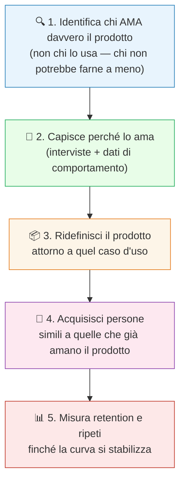

C'è un momento nella vita di ogni prodotto in cui le cose cambiano. Prima di quel momento, ogni nuovo utente richiede un enorme sforzo. Dopo quel momento, gli utenti arrivano da soli, si raccontano il prodotto a vicenda, e smettere di usarlo li spaventa davvero.

Quel momento si chiama **Product Market Fit**.

Marc Andreessen, il venture capitalist che ha finanziato Facebook, Airbnb e Lyft, lo descrive così:

> *"Sei in un mercato con un prodotto buono abbastanza da soddisfare quel mercato."*

Semplice nella definizione. Brutalmente difficile da raggiungere.

## Il test di Sean Ellis

Sean Ellis, il growth hacker che ha scalato Dropbox, ha trovato il modo più semplice per misurare il PMF. Poni questa domanda ai tuoi utenti attivi:

> **"Come ti sentiresti se non potessi più usare questo prodotto?"**
> - Molto deluso
> - Abbastanza deluso
> - Non molto deluso (non è davvero indispensabile)
> - Non lo uso già più

**Soglia:** se almeno il **40%** risponde "molto deluso", hai raggiunto il Product Market Fit.

Perché il 40%? Perché sotto quella soglia, anche con crescita forzata (ads, PR, partnership), l'azienda in genere non riesce a crescere in modo sostenibile. Sopra il 40%, la crescita tende a diventare organica — gli utenti portano altri utenti, il costo di acquisizione scende, il word of mouth funziona davvero.

## La curva di retention: il segnale più onesto

Il PMF si vede meglio nella curva di retention nel tempo. Non c'è segnale più affidabile.

**Curva con PMF:** la retention scende inizialmente (normale, alcuni utenti fanno churn subito), poi si **stabilizza** — c'è un nucleo solido di utenti fedeli che non se ne vanno. Questo è il segnale del PMF.

**Curva senza PMF:** la retention continua a scendere verso zero. Ogni mese perdi utenti, e nessun investimento in acquisizione risolve il problema perché il "secchio" è bucato.

Puoi iniettare nuovi utenti nel secchio bucato quanto vuoi — l'acqua non resta mai.

## I segnali qualitativi del PMF

Oltre al test di Ellis e alla curva di retention, il PMF si riconosce da segnali che senti più che misuri:

- **Il team di supporto è sopraffatto** — ci sono così tante richieste che non riesci a star dietro
- **I clienti ti raccomandano spontaneamente** — senza incentivi, senza programmi referral
- **La stampa ne parla** — senza che tu li abbia contattati
- **I competitor cominciano a copiarti** — il segnale più lusinghiero in assoluto
- **Non riesci ad assumere abbastanza velocemente** — la domanda supera la tua capacità operativa

## Caso italiano: Musixmatch

Musixmatch è nata a Bologna nel 2010 come app per i testi delle canzoni. Per i primi anni ha faticato: gli utenti arrivavano, usavano l'app una volta, poi sparivano. La curva di retention andava verso zero.

Il punto di svolta è arrivato quando hanno aggiunto il **karaoke in tempo reale**: i testi scorrevano in sincrono con Spotify. Gli utenti non solo sono rimasti — hanno cominciato a usare l'app ogni giorno, a condividere screenshot dei testi su Instagram, a segnalarla agli amici.

La retention è cambiata radicalmente. Il team di supporto è stato sommerso. La crescita è diventata organica. Oggi Musixmatch ha oltre 100 milioni di utenti e collabora con tutte le principali piattaforme musicali mondiali.

**La lezione:** il PMF non si trova sempre al primo tentativo. Si trova iterando — spesso cambiando non il prodotto in sé, ma il **caso d'uso principale**.

## Anti-pattern: segnali falsi da evitare

| Segnale falso | Cosa sembra | Cosa è davvero |
|---|---|---|
| Molti download al lancio | "Il mercato vuole il prodotto!" | Buona campagna marketing, non PMF |
| Alta soddisfazione post-uso | "Gli utenti sono contenti" | Soddisfatti ma non dipendenti |
| PR positiva | "Il mercato ci ama" | Curiosità per la novità, non abitudine |
| Crescita MoM alta | "Stiamo scalando!" | Crescita forzata da ads, non organica |

**Il test pratico:** cosa succede se smetti di spendere in acquisizione per 30 giorni? Se la crescita si ferma completamente, non hai il PMF. Se continua, anche solo in parte, stai costruendo qualcosa di reale.

## Come trovare il PMF

Non esiste una formula. Ma ci sono mosse che aumentano le probabilità:

## Problema reale

Il team vede segnali positivi sparsi, ma non sa se sono entusiasmo di nicchia, early adopters rumorosi o vero product-market fit replicabile.

La domanda pratica non e "so ripetere la teoria?", ma: **quale decisione migliora se applico bene questa lezione?** In product analytics, il rischio tipico e prendere un segnale parziale e trasformarlo in una scelta costosa: una feature lanciata troppo presto, un budget spostato senza causalita, un modello dati fragile o una raccomandazione piu elegante che utile.

## Modello concettuale

Usa questa griglia in tre passaggi: prima definisci il fenomeno, poi scegli l evidenza minima credibile, infine trasformi l evidenza in una decisione esplicita.

| Livello | Domanda guida | Output atteso |
|---|---|---|
| Fenomeno | Che cosa sta davvero succedendo? | Perimetro, segmenti e assunzioni |
| Evidenza | Quale dato cambierebbe la nostra opinione? | Metriche, osservazioni e guardrail |
| Decisione | Che cosa faremo se il segnale regge? | Azione, owner, timing e criterio di stop |

Questo modello evita due estremi: teoria senza applicazione e operativita senza ragionamento.

## Formalizzazione rigorosa

Formalizza la lezione come una catena decisionale:

| Elemento | Definizione operativa | Controllo di qualita |
|---|---|---|
| Input | eventi prodotto, funnel, coorti, survey, ticket supporto e session recording | Fonte, periodo, granularita e completezza dichiarati |
| Ipotesi | Relazione attesa tra comportamento, metrica e decisione | Assunzioni scritte prima dell analisi |
| Metrica | activation, retention, conversione, NPS, churn e valore per utente | Denominatore, segmento e finestra temporale espliciti |
| Guardrail | Cosa non deve peggiorare mentre ottimizzi | Soglie condivise con product, growth e design |
| Decisione | scegliere quali frizioni rimuovere, quali segmenti servire e quali interventi mettere in backlog | Owner, scadenza e criterio di revisione |

Una lezione e formalizzata bene quando un altra persona puo ricostruire il ragionamento e contestare le assunzioni senza chiedere spiegazioni extra.

## Esempio o caso studio

Immagina una review settimanale in cui product, growth e design deve decidere su "Product Market Fit: quando il mercato ti tira invece di doverti spingere". Il dato iniziale mostra un segnale promettente, ma il team non si ferma al numero principale. Divide il problema per segmento, controlla i guardrail, cerca spiegazioni alternative e scrive una raccomandazione con tre parti: cosa sappiamo, cosa non sappiamo, cosa faremo adesso.

| Osservazione | Interpretazione prudente | Azione |
|---|---|---|
| Segnale positivo sulla metrica primaria | Potrebbe essere effetto reale o composizione del campione | Controllare segmenti e baseline |
| Guardrail stabile | Il miglioramento non sembra creare danni immediati | Procedere con rollout limitato |
| Evidenza ancora incompleta | Serve una verifica prima di scalare | Definire un secondo ciclo di misura |

Il valore del caso non sta nel trovare una risposta perfetta, ma nel rendere la decisione piu difendibile.

## Lab / esercizio

Usa questo esercizio per trasformare la lezione in pratica verificabile.

| Livello | Attivita | Output |
|---|---|---|
| Livello base | Riassumi il problema in cinque righe e scegli una metrica primaria con un guardrail. | Mini brief decisionale |
| Livello intermedio | Applica il modello a un caso reale o simulato, includendo segmenti, baseline e rischi. | Tabella di analisi con raccomandazione |
| Livello research-grade | Scrivi un memo che confronta due spiegazioni alternative e indica quale evidenza le distinguerebbe. | Decision memo revisionabile |

**Dataset e materiali consigliati:** esportazione eventi o metriche dal tuo prodotto, una dashboard gia usata dal team, note qualitative, risultati di un esperimento o un dataset pubblico coerente con il tema.

## Errore tipico da evitare

L errore piu comune e usare "Product Market Fit: quando il mercato ti tira invece di doverti spingere" come etichetta autorevole invece che come metodo. Succede quando il team cita il concetto per giustificare una scelta gia presa, oppure quando ottimizza una metrica locale senza chiedersi quale comportamento sta incentivando.

Correzione pratica: prima di presentare la raccomandazione, scrivi una riga con la decisione proposta, una riga con l evidenza che la sostiene e una riga con la condizione che ti farebbe cambiare idea. Se manca una di queste tre righe, la lezione non e ancora stata applicata con rigore.

## Quiz o checkpoint

1. Quale decisione concreta dovrebbe migliorare applicando questa lezione?
2. Quale metrica useresti come segnale primario e quale come guardrail?
3. Quale spiegazione alternativa potrebbe rendere sbagliata la tua interpretazione?
4. Che cosa dovrebbe succedere nei dati per farti cambiare raccomandazione?
5. Quale output consegneresti a product, growth e design: dashboard, memo, esperimento, backlog o modello dati?

Se non riesci a rispondere in modo specifico, torna al problema reale prima di continuare.

## Riepilogo

- Il **PMF** è il momento in cui il prodotto soddisfa davvero un mercato — la crescita diventa organica invece di forzata
- **Test di Sean Ellis:** se >40% degli utenti dice "molto deluso" senza il prodotto, sei nel PMF
- Il segnale più affidabile è la **curva di retention** che si stabilizza invece di andare a zero
- **Musixmatch** ha trovato il PMF iterando sul caso d'uso — da lettura statica a karaoke live
- I segnali qualitativi: supporto sopraffatto, raccomandazioni spontanee, competitor che copiano
- Se la crescita si ferma appena smetti di fare ads: il PMF non è ancora arrivato
- Trovare il PMF richiede iterazione — spesso è il caso d'uso a cambiare, non il prodotto in sé
