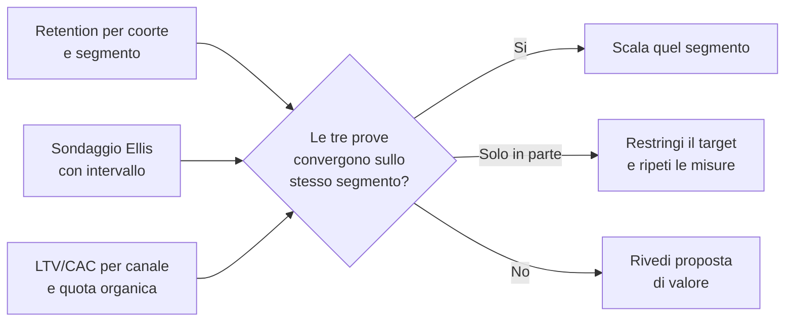

Una piattaforma B2B per la pianificazione dei turni cresce da due trimestri e ogni mese acquisisce 400 nuovi account (scenario costruito, numeri di esempio). Di questi, 320 arrivano dalle campagne a pagamento, che costano 150.000 € al mese, e 80 da passaparola e ricerca organica. Il consiglio di amministrazione chiede di contenere i costi e il marketing taglia la spesa del 40%, a 90.000 €. Il mese dopo i nuovi account sono 272, il 32% in meno, e la base attiva comincia a restringersi. L'azienda leggeva la propria crescita come domanda del mercato, mentre era in gran parte traffico acquistato. La domanda che nessuno aveva posto con i dati era semplice: il prodotto ha trovato un mercato, o lo stiamo comprando?

> **Idea chiave:** il Product-Market Fit non è una sensazione né un singolo numero. Lo dichiari quando tre prove indipendenti, una comportamentale, una dichiarativa e una economica, puntano nella stessa direzione sullo stesso segmento di clienti.

Il compito del product analyst è trasformare un concetto nato come intuizione imprenditoriale in una misura che si può ricalcolare, discutere e seguire nel tempo. Nelle prossime sezioni costruisci le tre prove una alla volta sui numeri della piattaforma dei turni, con le query che servono per ottenerle, e poi le combini in una decisione.

## Dalla definizione alla misura

La formulazione più citata è quella di Marc Andreessen, che nel 2007 descrisse il fit come il trovarsi in un buon mercato con un prodotto capace di soddisfarlo, e osservò che quando manca lo si sente: i clienti non ottengono valore, il passaparola non parte, l'uso non cresce ([The only thing that matters](https://pmarchive.com/guide_to_startups_part4.html)). È una descrizione utile ma tardiva: quando i segnali sono evidenti, la fase in cui potevi correggere la rotta è già passata.

Per un analista serve una definizione operativa: un segmento di clienti ha Product-Market Fit quando continua a usare il prodotto dopo la fase di prova, lo considera difficile da sostituire e può essere acquisito a un costo che il suo valore ripaga, anche senza spingere la domanda con il budget. Ognuna delle tre condizioni corrisponde a una misura con un denominatore preciso.

| Prova | Misura | Denominatore | Soglia di lavoro | Come inganna |
| :--- | :--- | :--- | :--- | :--- |
| Comportamentale | Retention mensile di coorte e sua pendenza finale | Account della coorte di iscrizione | Calo inferiore a 2 punti negli ultimi 3 mesi osservati | Contratti annuali che tengono "attivi" account che non usano il prodotto |
| Dichiarativa | Quota di "molto deluso" al sondaggio di Sean Ellis | Utenti attivi di recente che hanno risposto | 40% con limite inferiore dell'intervallo vicino o sopra la soglia | Campioni piccoli, risposte di utenti inattivi o amici dell'azienda |
| Economica | LTV/CAC e payback per canale, quota organica dei nuovi | Nuovi account del canale nel periodo | LTV/CAC almeno 3, payback entro 12 mesi, quota organica stabile o in crescita | Media complessiva che nasconde un canale a pagamento in perdita |

La parola che conta nella definizione è "segmento". Quasi nessun prodotto ha fit con tutti i propri utenti. Una media su clienti eterogenei mescola un nucleo che ama il prodotto con una coda che lo ha provato per caso, e il numero che ne esce non descrive nessuno dei due gruppi. Per questo ogni prova va calcolata per segmento, definito da attributi osservabili prima dell'uso: dimensione dell'azienda, settore, canale di acquisizione, ruolo di chi si iscrive.



## Prova comportamentale: il plateau della curva di retention

Una curva di retention per coorte riporta, per ogni mese dall'iscrizione, la quota di account della coorte ancora attivi. La formula è semplice: retention al mese m = account della coorte con almeno un'azione chiave nel mese m / account della coorte. L'azione chiave deve rappresentare il valore del prodotto, non la semplice presenza: per un software di turni è la pubblicazione di un turno, non il login.

Quasi tutte le curve scendono rapidamente nei primi mesi, perché molti account provano il prodotto e lo abbandonano. Il segnale di fit sta nella coda: in un prodotto con fit la discesa rallenta fino ad appiattirsi su un livello positivo, il plateau; senza fit la curva continua a perdere una quota costante e tende a zero. Un criterio di lavoro esplicito evita discussioni sulla forma del grafico: la curva è in plateau se negli ultimi tre mesi osservati perde meno di 2 punti percentuali e se quel calo è inferiore a quello del trimestre precedente, cioè se la discesa sta rallentando invece di procedere a ritmo costante.

### Esempio svolto: due segmenti, due storie

La piattaforma dei turni ha una coorte di gennaio con 400 account. Il team li divide in due segmenti in base alla dimensione dichiarata all'iscrizione: 240 aziende tra 10 e 50 dipendenti (segmento A) e 160 attività con meno di 10 dipendenti (segmento B). La tabella riporta la retention mensile.

| Mese dall'iscrizione | Segmento A (240 account) | Segmento B (160 account) |
| :--- | ---: | ---: |
| 0 | 100% | 100% |
| 1 | 62% | 48% |
| 2 | 54% | 34% |
| 3 | 51% | 27% |
| 6 | 46% | 17% |
| 9 | 44% | 11% |
| 12 | 43% | 7% |

Il calcolo per il segmento A: tra il mese 9 e il mese 12 la retention passa da 44% a 43%, un calo di 1 punto, sotto i 2 punti del criterio. Il trimestre precedente, dal mese 6 al mese 9, il calo era di 2 punti, e quello prima ancora, dal mese 3 al mese 6, di 5 punti. La discesa rallenta e si ferma attorno al 43%: in valori assoluti, 0,43 × 240 = 103 account che a un anno pubblicano ancora turni ogni mese.

Il segmento B perde 4 punti tra il mese 9 e il mese 12 (da 11% a 7%), il doppio della soglia, e 6 punti nel trimestre precedente. In termini relativi la perdita non rallenta affatto: 4 / 11 = 36% degli account rimasti in un trimestre, contro 6 / 17 = 35% nel trimestre prima. La curva non si appiattisce: a dodici mesi restano 0,07 × 160 = 11 account, e il ritmo di perdita lascia prevedere che la coorte si esaurisca. La decisione che segue è chiara già da questa prima prova: il fit, se c'è, sta nel segmento A, e il segmento B va trattato come esplorazione, non come mercato da scalare.

Due attenzioni prima di fidarsi della tabella. La prima: la coorte deve avere almeno un paio di centinaia di account per segmento, altrimenti una differenza di 2 punti equivale a pochi account e cade nel rumore. La seconda: in un prodotto con contratti annuali, la retention di fatturazione resta piatta per dodici mesi per costruzione; la retention che conta è quella d'uso, misurata sull'azione chiave.

### La query di retention per segmento

La query segue lo schema comune del modulo: `users(user_id, signup_time, channel, country, platform)` per gli account e `events(user_id, event_name, event_time, properties)` per le azioni. Qui `user_id` identifica l'account. La dimensione dell'azienda è una proprietà dell'evento `workspace_created`. La sintassi JSON è quella di Postgres; in BigQuery si usa `JSON_VALUE(properties, '$.team_size')`.

```sql
-- Retention mensile d'uso per coorte di iscrizione e segmento
WITH coorte AS (
  SELECT
    u.user_id,
    DATE_TRUNC('month', u.signup_time) AS mese_coorte,
    CASE
      WHEN (w.properties ->> 'team_size')::int >= 10 THEN 'A: 10-50 dipendenti'
      ELSE 'B: meno di 10'
    END AS segmento
  FROM users u
  JOIN events w
    ON w.user_id = u.user_id
   AND w.event_name = 'workspace_created'
),
attivita AS (
  -- un account e' attivo nel mese se pubblica almeno un turno
  SELECT DISTINCT
    e.user_id,
    DATE_TRUNC('month', e.event_time) AS mese_attivo
  FROM events e
  WHERE e.event_name = 'shift_published'
),
mesi AS (
  SELECT
    c.mese_coorte,
    c.segmento,
    c.user_id,
    (EXTRACT(YEAR FROM a.mese_attivo) - EXTRACT(YEAR FROM c.mese_coorte)) * 12
      + (EXTRACT(MONTH FROM a.mese_attivo) - EXTRACT(MONTH FROM c.mese_coorte)) AS mese_n
  FROM coorte c
  JOIN attivita a ON a.user_id = c.user_id
)
SELECT
  m.mese_coorte,
  m.segmento,
  m.mese_n,
  COUNT(DISTINCT m.user_id) AS attivi,
  dim.account_coorte,
  ROUND(100.0 * COUNT(DISTINCT m.user_id) / dim.account_coorte, 1) AS retention_pct
FROM mesi m
JOIN (
  SELECT mese_coorte, segmento, COUNT(*) AS account_coorte
  FROM coorte
  GROUP BY mese_coorte, segmento
) dim
  ON dim.mese_coorte = m.mese_coorte AND dim.segmento = m.segmento
WHERE m.mese_n >= 0
GROUP BY m.mese_coorte, m.segmento, m.mese_n, dim.account_coorte
ORDER BY m.mese_coorte, m.segmento, m.mese_n;
```

Il denominatore è fisso: tutti gli account della coorte, anche quelli che non hanno mai pubblicato un turno. Per questo viene calcolato in una sottoquery a parte e non dal `JOIN` con l'attività, che escluderebbe gli account mai attivi e gonfierebbe la retention. Il mese 0 vale per costruzione circa 100% solo se l'azione chiave avviene nel mese di iscrizione; se in un segmento il mese 0 è molto più basso, il problema è di attivazione prima che di retention.

## Prova dichiarativa: il sondaggio di Sean Ellis

Sean Ellis, che ha guidato la crescita iniziale di Dropbox ed Eventbrite, propose di chiedere agli utenti: "Come ti sentiresti se non potessi più usare il prodotto?", con tre risposte: molto deluso, abbastanza deluso, per niente deluso. Secondo il resoconto pubblicato da First Round Review, Ellis confrontò quasi cento startup e osservò che quelle in difficoltà restavano quasi sempre sotto il 40% di "molto deluso", mentre quelle con forte trazione lo superavano ([Rahul Vohra, First Round Review, 2018](https://review.firstround.com/how-superhuman-built-an-engine-to-find-product-market-fit/)).

Lo stesso articolo documenta il caso Superhuman, il client email fondato da Rahul Vohra. Nell'estate 2017 la quota di molto delusi era del 22%. Restringendo l'analisi al profilo degli utenti più entusiasti salì al 33%, e dopo tre trimestri di lavoro sul prodotto guidato dalle risposte arrivò al 58%. L'articolo riporta anche un sondaggio aperto di Hiten Shah su 731 utenti di Slack, con il 51% di molto delusi. Sono casi utili perché mostrano che la misura si muove con il segmento scelto e con il lavoro sul prodotto, non solo che una soglia esiste.

Il sondaggio funziona solo se lo invii alle persone giuste. Superhuman lo inviava agli utenti che avevano usato il prodotto almeno due volte nelle ultime due settimane: chi non ha mai sperimentato il valore non può dire se gli mancherebbe. L'articolo indica che i risultati diventano orientativi attorno ai 40 rispondenti; è un minimo per una lettura direzionale, non per una decisione su un segmento.

### Esempio svolto con l'intervallo di confidenza

La piattaforma dei turni invia il sondaggio agli account che hanno pubblicato turni almeno due volte negli ultimi 14 giorni. Rispondono 300 account: 180 del segmento A e 120 del segmento B.

| Segmento | Rispondenti | Molto delusi | Quota | Intervallo di Wilson al 95% |
| :--- | ---: | ---: | ---: | :--- |
| A: 10-50 dipendenti | 180 | 84 | 46,7% | 39,5% – 53,9% |
| B: meno di 10 | 120 | 27 | 22,5% | 15,9% – 30,8% |
| Totale | 300 | 111 | 37,0% | 31,7% – 42,6% |

Il dato totale, 111 / 300 = 37%, è sotto la soglia e porterebbe a concludere che il fit manca. È la conclusione sbagliata, perché media due popolazioni diverse. Nel segmento A la quota è 84 / 180 = 46,7%. L'errore standard con l'approssimazione normale vale √(0,467 × 0,533 / 180) = 0,037, cioè 3,7 punti, e l'intervallo di Wilson va da 39,5% a 53,9%. Il limite inferiore sfiora il 40%: il segmento A supera la soglia con buona probabilità. Nel segmento B la quota è 27 / 120 = 22,5% e anche il limite superiore, 30,8%, resta lontano dal 40%.

Si usa l'intervallo di Wilson e non quello normale semplice perché resta affidabile con campioni piccoli e quote lontane dal 50%. Con 40 rispondenti e 16 molto delusi, cioè 40% esatto, l'intervallo di Wilson va da circa 26% a 55%: compatibile sia con un fit assente sia con uno forte. Per questo nessuna decisione di investimento dovrebbe poggiare su un sondaggio di poche decine di risposte.

```python
from math import sqrt

def wilson(successi, n, z=1.96):
    """Intervallo di Wilson al 95% per una proporzione."""
    p = successi / n
    den = 1 + z**2 / n
    centro = (p + z**2 / (2 * n)) / den
    semi = z * sqrt(p * (1 - p) / n + z**2 / (4 * n**2)) / den
    return p, centro - semi, centro + semi

risposte = {"A: 10-50 dipendenti": (84, 180), "B: meno di 10": (27, 120), "Totale": (111, 300)}
for segmento, (molto_delusi, n) in risposte.items():
    p, basso, alto = wilson(molto_delusi, n)
    print(f"{segmento:22s} {p:6.1%}  IC95% {basso:6.1%} - {alto:6.1%}")
# A: 10-50 dipendenti     46.7%  IC95%  39.5% -  53.9%
# B: meno di 10           22.5%  IC95%  15.9% -  30.8%
# Totale                  37.0%  IC95%  31.7% -  42.6%
```

Le domande aperte che accompagnano il sondaggio valgono quanto la quota. Superhuman chiedeva anche chi trarrebbe più beneficio dal prodotto, quale sia il beneficio principale e come migliorarlo. Le risposte dei molto delusi descrivono il cliente ideale e il valore da proteggere; quelle degli abbastanza delusi che citano lo stesso beneficio indicano cosa manca per convertirli. Sono il ponte verso le interviste di customer development, che servono a capire il perché dietro le percentuali.

## Prova economica: crescita organica e LTV/CAC per canale

La terza prova chiede se il mercato arriva da solo e se i clienti che compri valgono quello che costano. Servono tre formule, sempre calcolate per canale:

- CAC = spesa di acquisizione del canale nel periodo / nuovi account del canale nello stesso periodo.
- LTV = ricavo medio mensile per account × margine lordo / churn mensile. È l'approssimazione per churn costante; sovrastima il valore quando il churn dei primi mesi è più alto della media, come accade quasi sempre.
- Payback = CAC / (ricavo medio mensile × margine lordo), cioè i mesi di margine necessari a ripagare l'acquisizione.

### Esempio svolto: la media che nasconde il problema

La piattaforma ha un ricavo medio di 120 € al mese per account e un margine lordo del 75%, quindi 90 € di margine mensile. Il canale a pagamento costa 150.000 € e porta 320 clienti: CAC = 150.000 / 320 = 468,75 €. Il canale organico costa 12.000 € al mese tra contenuti e SEO e porta 80 clienti: CAC = 12.000 / 80 = 150 €. Il CAC medio complessivo, (150.000 + 12.000) / 400 = 405 €, sembra sostenibile, ma non descrive nessuno dei due canali.

Il churn mensile osservato è del 7% per gli account a pagamento, che arrivano attratti da uno sconto e appartengono in maggioranza al segmento B, e del 3% per quelli organici. L'LTV del canale a pagamento vale 90 / 0,07 = 1.286 €, quindi LTV/CAC = 1.286 / 468,75 = 2,7 e payback = 468,75 / 90 = 5,2 mesi. L'LTV organico vale 90 / 0,03 = 3.000 €, con LTV/CAC = 3.000 / 150 = 20. Il canale a pagamento è sotto la soglia di lavoro di 3, e con un churn del 7% al mese il 30% degli account se ne va entro i primi cinque mesi, cioè prima di aver ripagato il proprio costo: 1 − 0,93^5 = 1 − 0,70 = 0,30.

Il taglio del budget ora si può prevedere invece di subirlo. Se il CAC pagato resta 468,75 €, con 90.000 € arrivano 90.000 / 468,75 = 192 account pagati, più 80 organici: 272 in totale, il calo del 32% osservato. L'analista avrebbe potuto anticiparlo, e soprattutto avrebbe potuto proporre un taglio selettivo: eliminare le campagne verso il segmento B, dove LTV/CAC è più basso, e proteggere quelle verso il segmento A.

### La quota organica come segnale

Oltre all'economia per canale conta la tendenza della quota organica: account da passaparola, referral, ricerca del marchio e accesso diretto, diviso tutti i nuovi account. Una quota organica stabile o in crescita mentre la spesa resta costante indica che il prodotto genera domanda da sé. Una quota in calo indica che la crescita dipende in misura crescente dal budget. Il canale va registrato all'iscrizione in `users.channel`, con regole di attribuzione scritte: un referral che arriva da un annuncio è organico o pagato? Qualunque scelta va bene se resta la stessa nel tempo.

```sql
-- 1) Quota organica dei nuovi account per mese
SELECT
  DATE_TRUNC('month', signup_time) AS mese,
  COUNT(*) AS nuovi_totali,
  SUM(CASE WHEN channel IN ('referral', 'organic_search', 'direct') THEN 1 ELSE 0 END) AS nuovi_organici,
  ROUND(100.0 * SUM(CASE WHEN channel IN ('referral', 'organic_search', 'direct') THEN 1 ELSE 0 END)
        / COUNT(*), 1) AS quota_organica_pct
FROM users
GROUP BY 1
ORDER BY 1;

-- 2) Churn mensile per tipo di canale = cessazioni / mesi-account di esposizione
-- subscriptions(user_id, plan, mrr, start_date, end_date): end_date NULL se ancora attivo
SELECT
  CASE WHEN u.channel IN ('referral', 'organic_search', 'direct') THEN 'organico'
       ELSE 'pagato' END AS tipo_canale,
  SUM(CASE WHEN s.end_date IS NOT NULL THEN 1 ELSE 0 END) AS cessazioni,
  SUM((COALESCE(s.end_date, CURRENT_DATE) - s.start_date) / 30.0) AS mesi_esposizione,
  ROUND(SUM(CASE WHEN s.end_date IS NOT NULL THEN 1 ELSE 0 END)
        / SUM((COALESCE(s.end_date, CURRENT_DATE) - s.start_date) / 30.0), 4) AS churn_mensile
FROM users u
JOIN subscriptions s ON s.user_id = u.user_id
GROUP BY 1;
```

Il churn per canale si calcola come cessazioni divise per i mesi-account di esposizione, non come cessazioni divise per gli account. La seconda formula ignora quanto a lungo ogni account è stato osservato e confronta male canali con età diverse. La sottrazione tra date restituisce giorni in Postgres; in BigQuery si usa `DATE_DIFF(end_date, start_date, DAY)`.

## Combinare le prove in una decisione

Le tre prove ora si leggono insieme, segmento per segmento.

| Segmento | Retention a 12 mesi e pendenza | Molto delusi (IC 95%) | Economia | Verdetto |
| :--- | :--- | :--- | :--- | :--- |
| A: 10-50 dipendenti | 43%, calo di 1 punto nell'ultimo trimestre | 46,7% (39,5–53,9) | Organico forte; pagato da ricalcolare sul solo segmento A | Fit: scala con investimenti mirati |
| B: meno di 10 | 7%, calo di 4 punti, nessun plateau | 22,5% (15,9–30,8) | Grosso del canale pagato, LTV/CAC 2,7 o peggio | Nessun fit: sospendi le campagne |

La raccomandazione da portare al management ha tre parti. Primo, il prodotto ha fit con le aziende tra 10 e 50 dipendenti, con tre prove concordi. Secondo, la crescita pagata attuale finanzia soprattutto il segmento sbagliato: spostare il budget verso il segmento A dovrebbe ridurre il churn medio dei nuovi e alzare LTV/CAC. Terzo, il segmento B resta un'ipotesi di esplorazione da testare con un prodotto o un prezzo diversi, non un mercato da scalare con lo stesso funnel.

Quando le prove divergono, la divergenza stessa è informativa. Retention in plateau ma pochi molto delusi indica spesso un prodotto usato per inerzia o per obbligo contrattuale, vulnerabile all'arrivo di un concorrente. Molti molto delusi ma retention in calo indica un nucleo entusiasta troppo piccolo, oppure un problema di attivazione che impedisce ai nuovi di arrivare al valore. Economia negativa con retention e sondaggio buoni indica un problema di canale o di prezzo, non di prodotto.

## Trappole comuni

### Crescita comprata scambiata per domanda

Il sintomo è una crescita mensile elevata con una quota organica in calo e un CAC che sale trimestre dopo trimestre. Succede perché i nuovi account sono il numero più visibile e il più facile da spingere con il budget. Si evita riportando sempre, accanto ai nuovi account, la quota organica e LTV/CAC per canale, e simulando che cosa succederebbe con la spesa dimezzata.

### Sondaggio inviato alle persone sbagliate

Il sintomo è una quota di molto delusi alta ottenuta da poche decine di risposte, spesso di clienti che il team conosce personalmente, oppure bassa perché il sondaggio è stato inviato a tutti gli iscritti, compresi quelli mai attivati. Succede perché si sceglie la lista più comoda. Si evita fissando un criterio d'uso recente, campionando dagli account che lo soddisfano, non ripetendo il sondaggio alle stesse persone e riportando sempre l'intervallo di confidenza.

### Retention di fatturazione al posto della retention d'uso

Il sintomo è una curva perfettamente piatta per dodici mesi seguita da un crollo ai rinnovi. Succede quando si misura l'abbonamento attivo invece dell'azione chiave, e i contratti annuali nascondono il disuso. Si evita misurando la retention sull'evento che rappresenta il valore e trattando un calo d'uso come segnale anticipatore dei mancati rinnovi.

## Il fit cambia nel tempo

Il fit non si conquista una volta per tutte. Un concorrente, un cambio di normativa o un'evoluzione del prodotto possono eroderlo in un segmento mentre si rafforza in un altro. Per questo le tre misure diventano un piccolo cruscotto trimestrale: la retention a 6 mesi delle coorti recenti per segmento, la quota di molto delusi su un campione nuovo di utenti attivi, LTV/CAC e quota organica per canale. Un calo di 10 punti nella quota di molto delusi o un allungamento del ciclo di vendita senza ragioni commerciali sono segnali che anticipano di mesi il calo dei ricavi.

Nei mercati di nicchia la lettura cambia. Se le aziende potenziali in Italia sono 2.000, il segmento A con 103 account fedeli a un anno è già una quota rilevante del mercato e la crescita passa dall'espansione del valore per account, più utenti e piani superiori, più che da nuove acquisizioni. Prima di allargarti a un segmento adiacente, ripeti le tre prove su un campione pilota del nuovo segmento: il fit non si trasferisce per contiguità.

## Domande per verificare la comprensione

1. Una coorte di 300 account ha retention del 41% al mese 6, del 38% al mese 9 e del 37% al mese 12. Il trimestre tra il mese 3 e il mese 6 aveva perso 9 punti. Con il criterio della lezione, la curva è in plateau?

<details>
<summary>Mostra risposta</summary>

Sì. Nell'ultimo trimestre il calo è 38 − 37 = 1 punto, sotto la soglia di 2, e inferiore al calo del trimestre precedente, 41 − 38 = 3 punti, a sua volta molto più piccolo dei 9 punti del trimestre ancora prima. La discesa rallenta in modo netto. Il plateau si colloca attorno al 37%, cioè circa 111 account su 300. Conviene confermarlo con una seconda coorte prima di usarlo come base per un piano di investimenti.

</details>

2. In un segmento rispondono 50 utenti attivi e 22 sono molto delusi. Il product manager vuole annunciare che il segmento ha superato la soglia del 40%. Che cosa rispondi?

<details>
<summary>Mostra risposta</summary>

La quota è 22 / 50 = 44%, ma con 50 risposte l'intervallo di Wilson al 95% va da circa 31% a 58% (31,2% – 57,7%). Il dato è compatibile con un fit assente come con uno forte, quindi non basta per un annuncio. Servono più risposte nello stesso segmento, oppure la conferma delle altre due prove: plateau di retention ed economia per canale. Puoi comunicare il risultato come incoraggiante ma non conclusivo.

</details>

3. Il CAC medio dell'azienda è 405 € e l'LTV medio 2.000 €, con LTV/CAC pari a 4,9. Perché questo numero non basta per decidere se aumentare la spesa pubblicitaria?

<details>
<summary>Mostra risposta</summary>

Perché mescola canali con economie opposte. La spesa aggiuntiva va al canale a pagamento, il cui rapporto marginale nell'esempio è 2,7, non al canale organico, che ha rapporto 20 e alza la media. Inoltre la spesa marginale di solito costa di più di quella media, perché le campagne migliori sono già attive. La decisione va presa sul LTV/CAC del canale e del segmento a cui andrebbero i soldi in più.

</details>

4. La retention di un segmento è in plateau al 35%, ma solo il 24% dei rispondenti attivi sarebbe molto deluso. Come interpreti la divergenza e quale analisi fai dopo?

<details>
<summary>Mostra risposta</summary>

È il profilo tipico di un prodotto usato per abitudine, obbligo o costo di cambio, non perché insostituibile. La retention regge finché nessuno offre un'alternativa comoda. Il passo successivo è leggere le risposte aperte dei molto delusi e degli abbastanza delusi per capire quale beneficio manca, e intervistare un campione di account in plateau che hanno risposto "abbastanza deluso". Va anche controllato se la retention è misurata sull'azione chiave e non sulla sola presenza.

</details>
