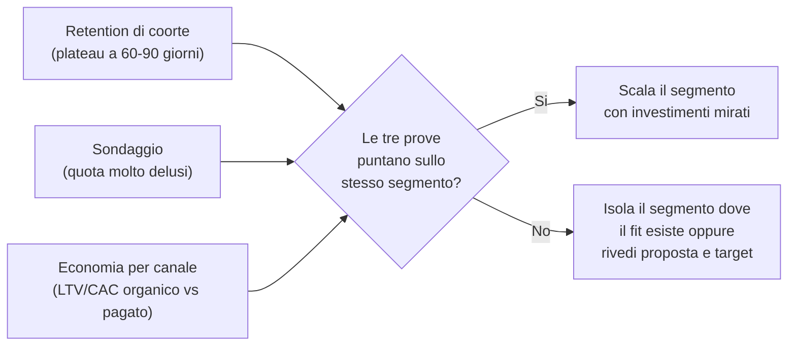

Una piattaforma B2B per la gestione dei turni cresce del 30% al mese per due trimestri (scenario costruito, numeri di esempio). Ogni mese arrivano 400 nuovi account: 320 portati dalle campagne a pagamento, che costano 150.000 € al mese, e 80 da passaparola e ricerca organica. Il consiglio di amministrazione chiede di contenere i costi e il marketing taglia la spesa del 40%, cioè a 90.000 €. Il mese dopo i nuovi account scendono a 272, un calo del 32%, e la base attiva comincia a restringersi. L'azienda aveva letto la propria crescita come domanda del mercato, mentre era in gran parte traffico acquistato a un prezzo che il prodotto non riusciva a ripagare.

> **Idea chiave:** il Product-Market Fit si riconosce da tre prove che puntano nella stessa direzione sullo stesso segmento di clienti: una curva di retention che si appiattisce, utenti che non vorrebbero rinunciare al prodotto e una crescita che regge anche quando smetti di pagare per ottenerla.

Il fatturato lordo e il numero di nuove registrazioni misurano quanto riesci a vendere, non quanto il mercato ti riconosce. Un prodotto con fit reale continua a trattenere i clienti, li spinge a parlarne con i colleghi e rende conveniente ogni euro speso per acquisirli. Questa lezione costruisce le tre prove una alla volta, con numeri che puoi ricalcolare a mano, e mostra come metterle insieme prima di decidere se scalare gli investimenti commerciali.

## Tre prove che devono convergere sullo stesso segmento

Nessun indicatore da solo certifica il fit. La curva di retention può appiattirsi perché hai pochi clienti molto fedeli e un mercato minuscolo. Il sondaggio può dare un risultato eccellente perché lo hai inviato agli amici dell'azienda. La crescita organica può essere alta perché il prodotto è gratuito. Ogni prova ha un modo tipico di ingannare, e per questo servono tutte e tre, lette sullo stesso insieme di clienti.

La prima prova è comportamentale: guarda se, dopo sessanta o novanta giorni, la percentuale di utenti di una coorte ancora attivi smette di scendere. La seconda è dichiarativa: chiede agli utenti realmente attivi come si sentirebbero se il prodotto sparisse domani. La terza è economica: confronta il valore che un cliente genera nella sua vita con il costo sostenuto per acquisirlo, separando i clienti arrivati da soli da quelli comprati.

| Prova | Che cosa misuri | Soglia di riferimento | Come inganna |
| :--- | :--- | :--- | :--- |
| Plateau di retention | Quota di coorte ancora attiva a 60-90 giorni, e se smette di calare | Curva piatta su un livello positivo, tipicamente 20-30% nel B2B | Pochi clienti fedeli e mercato troppo piccolo per sostenere l'azienda |
| Sondaggio "molto deluso" | Quota di rispondenti attivi che sarebbero molto delusi senza il prodotto | Almeno 40% nel segmento target | Campione di amici, utenti gratuiti o rispondenti non attivi |
| Economia per canale | LTV/CAC e payback separati per canale organico e a pagamento | LTV/CAC almeno 3 e payback sotto i 12 mesi | Media complessiva che nasconde un canale a pagamento in perdita |
| Crescita organica | Quota di nuovi clienti da passaparola, referral e ricerca | Quota stabile o crescente, non solo in valore assoluto | Picco temporaneo dovuto a una promozione o a un articolo virale |

La soglia del 40% viene dal lavoro di Sean Ellis, che la ricavò confrontando le risposte di molte startup e notando che quelle con crescita sostenuta superavano quasi sempre quel valore. Resta una regola empirica e non una legge: la leggi come un segnale di allarme se sei sotto e come un invito a verificare ulteriormente se sei sopra.



## Il plateau di retention: dove si ferma la curva

Una curva di retention per coorte mostra, per ogni mese di vita, la quota di account di quella coorte ancora attivi. Quasi tutte le curve scendono rapidamente all'inizio. Ciò che distingue un prodotto con fit da uno senza è la parte finale: nel primo la discesa rallenta fino a diventare quasi piatta, nel secondo continua con pendenza costante verso zero.

Prendi due coorti da 500 account ciascuna, acquisite nello stesso mese attraverso canali diversi (numeri di esempio). La coorte A arriva da referral e ricerca organica, la coorte B da una campagna a pagamento con sconto sul primo semestre. Dopo un mese la coorte A conserva 340 account attivi, pari a 340 / 500 = 68%. Al mese 2 sono 255, cioè 51%. Al mese 3 sono 205, cioè 41%. Al mese 6 sono 185, cioè 37%. Al mese 9 sono 180, cioè 36%. Tra il sesto e il nono mese la coorte perde soltanto 185 - 180 = 5 account, un punto percentuale in tre mesi: la curva si è appiattita attorno al 36%.

La coorte B parte con 300 account attivi al mese 1, cioè 60%, poi scende a 120 al mese 3 (24%), a 60 al mese 6 (12%) e a 30 al mese 9 (6%). Tra il sesto e il nono mese gli account si dimezzano, da 60 a 30. Il ritmo di perdita non rallenta: se prolunghi la curva, raggiunge zero. Le due coorti possono avere lo stesso numero di registrazioni iniziali e raccontano storie opposte, perché solo nella prima esiste un nucleo di clienti che ha trovato un valore ricorrente.

Per decidere se una curva è piatta serve un criterio scritto, altrimenti ognuno vede quello che vuole. Un criterio ragionevole confronta la perdita dell'ultimo trimestre osservato con quella del trimestre precedente: se la coorte perde meno di due punti percentuali dei suoi account iniziali in tre mesi, la consideri in plateau. Nell'esempio la coorte A passa da 205 a 185 account tra il mese 3 e il mese 6, cioè 20 account su 500, pari a 4 punti percentuali, e poi perde 5 account su 500, pari a 1 punto: il rallentamento è netto e la soglia è rispettata. La coorte B perde 60 account su 500 tra il mese 3 e il mese 6 (12 punti) e altri 30 su 500 tra il mese 6 e il mese 9 (6 punti), e non rispetta la soglia.

Questo calcolo si ripete su ogni coorte mensile. Lo script seguente lo automatizza partendo da una tabella con una riga per account, la data di ingresso e la data dell'ultima attività utile.

```python
import pandas as pd

# accounts: una riga per account, con data di ingresso e ultimo mese attivo
# colonne: account_id, cohort_month (periodo), last_active_month (periodo)
accounts = pd.read_csv("accounts.csv", parse_dates=["cohort_month", "last_active_month"])
accounts["cohort_month"] = accounts["cohort_month"].dt.to_period("M")
accounts["last_active_month"] = accounts["last_active_month"].dt.to_period("M")

# eta' massima osservabile in mesi per ogni account
accounts["age_active"] = (accounts["last_active_month"] - accounts["cohort_month"]).apply(lambda d: d.n)

def retention_curve(group, horizon=9):
    n = len(group)
    # quota di account con almeno 'm' mesi di attivita' sopravvissuti
    return pd.Series({m: (group["age_active"] >= m).sum() / n for m in range(horizon + 1)})

curve = accounts.groupby("cohort_month").apply(retention_curve)

# plateau: perdita (in punti) dell'ultimo trimestre minore di 2 punti percentuali
curve["loss_last_q"] = curve[6] - curve[9]
curve["plateau"] = curve["loss_last_q"] < 0.02
print(curve[[3, 6, 9, "loss_last_q", "plateau"]].round(3))
```

La tabella restituita dallo script ha una riga per coorte: se tutte le coorti recenti mostrano plateau sullo stesso livello, la prima prova è soddisfatta. Se il livello cambia da una coorte all'altra, la differenza va spiegata prima di procedere, per esempio guardando il canale di acquisizione.

## Il sondaggio Sean Ellis e l'incertezza che lo accompagna

La domanda del sondaggio è una sola: come ti sentiresti se non potessi più usare il prodotto? Le risposte possibili sono molto deluso, abbastanza deluso, non deluso. Conta la quota di molto deluso, calcolata però solo sugli utenti che hanno usato davvero il prodotto: una soglia ragionevole è almeno quattro giorni attivi negli ultimi trenta, e vanno esclusi account interni e di prova. Chiedere a chi si è registrato e non è mai tornato produce risposte di cortesia o di indifferenza che non dicono nulla sul valore.

Hai raccolto 180 risposte valide da utenti attivi (numeri di esempio) e le dividi per settore. Tra i 120 rispondenti degli studi professionali, 54 si dichiarano molto delusi, 40 abbastanza e 26 per nulla: 54 + 40 + 26 = 120, e la quota di molto delusi vale 54 / 120 = 45%. Tra i 60 rispondenti delle aziende manifatturiere, 12 sono molto delusi, cioè 12 / 60 = 20%. Sul totale i molto delusi sono 54 + 12 = 66 su 180, cioè 36,7%: la media sembra un fit mediocre, ma nasconde un segmento forte e uno debole.

Con campioni di questa taglia un singolo valore percentuale non basta, perché l'errore di campionamento è alto. Con la formula dell'errore standard di una proporzione, p moltiplicato per 1 - p diviso la numerosità, sotto radice, ottieni per gli studi professionali sqrt(0,45 × 0,55 / 120) = sqrt(0,0020625) = 0,0454, cioè 4,5 punti percentuali. L'intervallo al 95% è 45% ± 1,96 × 4,5 punti, quindi tra 36,1% e 53,9%. Per le aziende manifatturiere l'errore standard vale sqrt(0,20 × 0,80 / 60) = sqrt(0,002667) = 0,0516, e l'intervallo al 95% è 20% ± 10,1 punti, cioè tra 9,9% e 30,1%.

La lettura cambia rispetto al semplice confronto con il 40%. Gli studi professionali hanno un risultato puntuale sopra soglia, ma il limite inferiore dell'intervallo, 36,1%, scende sotto il 40%: è un segnale favorevole e non una prova definitiva, e conviene raccogliere altre risposte prima di impegnare budget pesanti. Le aziende manifatturiere sono sotto soglia anche al limite superiore, 30,1%, quindi per quel segmento il prodotto non ha ancora un fit. La domanda successiva diventa pratica: quante risposte servono per restringere l'intervallo? Per dimezzare l'errore servono quattro volte i rispondenti, quindi circa 480 negli studi professionali.

La query seguente produce lo stesso conteggio dal warehouse, applicando il filtro sugli utenti attivi e una numerosità minima per segmento.

```sql
-- Quota di "molto deluso" per settore, solo utenti attivi (ClickHouse)
WITH active_target AS (
    SELECT
        a.account_id,
        a.industry,
        a.acquisition_channel,
        s.pmf_answer
    FROM accounts AS a
    INNER JOIN pmf_surveys AS s ON a.account_id = s.account_id
    WHERE a.active_days_last_30 >= 4
      AND a.is_internal = 0
)
SELECT
    industry,
    count() AS respondents,
    round(countIf(pmf_answer = 'very_disappointed') * 100.0 / count(), 1) AS very_disappointed_pct,
    -- errore standard in punti percentuali, per costruire l'intervallo al 95%
    round(100 * sqrt((countIf(pmf_answer = 'very_disappointed') / count())
        * (1 - countIf(pmf_answer = 'very_disappointed') / count()) / count()), 1) AS se_pct
FROM active_target
GROUP BY industry
HAVING respondents >= 20
ORDER BY very_disappointed_pct DESC;
```

## Crescita comprata e crescita organica: l'economia per canale

La terza prova chiede se ogni euro speso per acquisire clienti li porta a valere di più di quanto è costato. Il rapporto tra valore del cliente nel tempo, o LTV, e costo di acquisizione, o CAC, è la metrica standard. Calcolarlo sulla media di tutti i canali nasconde la differenza decisiva tra clienti che arrivano da soli e clienti che compri.

Riprendi la piattaforma dei turni. Ogni clienti paga 90 euro al mese e il margine lordo è dell'80%, quindi 90 × 0,80 = 72 euro di margine mensile per clienti. Gli clienti organici lasciano il prodotto al ritmo del 3% al mese, quindi il loro tempo di vita atteso è 1 / 0,03 = 33,3 mesi e l'LTV vale 72 / 0,03 = 2.400 euro. Gli clienti da campagna lasciano all'8% al mese, perché molti sono attratti dallo sconto: l'LTV è 72 / 0,08 = 900 euro.

Il costo del canale a pagamento è di 150.000 euro al mese per 320 clienti, quindi il CAC è 150.000 / 320 = 468,75 euro. Il rapporto LTV/CAC vale 900 / 468,75 = 1,92, sotto la soglia di 3, e il payback è 468,75 / 72 = 6,5 mesi di margine, ma con un tasso di abbandono all'8% molti clienti se ne vanno prima di aver ripagato l'acquisizione. Il canale organico costa 10.000 euro al mese di contenuti e supporto per 80 clienti: il CAC è 125 euro e l'LTV/CAC vale 2.400 / 125 = 19,2.

La media complessiva inganna. Il CAC mescolato è (150.000 + 10.000) / 400 = 400 euro. L'LTV medio ponderato è (320 × 900 + 80 × 2.400) / 400 = (288.000 + 192.000) / 400 = 1.200 euro. Il rapporto complessivo vale 1.200 / 400 = 3,0 e il quadro sembra a posto, mentre il canale che assorbe il 94% della spesa distrugge valore. Dopo il taglio del 40% il canale a pagamento produce 90.000 / 468,75 = 192 clienti, il canale organico resta a 80, e il totale è 272, il 32% in meno dei 400 iniziali. Il fit esiste, ma riguarda il 20% dei clienti che arriva da solo, e l'azienda stava sovvenzionando il restante 80%.

```python
# Economia unitaria per canale: LTV, CAC, rapporto e payback
margine_mensile = 90 * 0.80  # 72 euro per account al mese

canali = {
    "a_pagamento": {"spesa": 150_000, "account": 320, "churn": 0.08},
    "organico": {"spesa": 10_000, "account": 80, "churn": 0.03},
}

tot_spesa = sum(c["spesa"] for c in canali.values())
tot_account = sum(c["account"] for c in canali.values())

for nome, c in canali.items():
    cac = c["spesa"] / c["account"]
    ltv = margine_mensile / c["churn"]
    payback_mesi = cac / margine_mensile
    print(f"{nome}: CAC {cac:.2f}, LTV {ltv:.0f}, LTV/CAC {ltv / cac:.2f}, payback {payback_mesi:.1f} mesi")

# media ponderata: appare accettabile e nasconde il canale in perdita
ltv_medio = sum(margine_mensile / c["churn"] * c["account"] for c in canali.values()) / tot_account
print("misto: CAC", tot_spesa / tot_account, "LTV/CAC", round(ltv_medio / (tot_spesa / tot_account), 2))
```

## Errori che producono un falso Product-Market Fit

### Prendere la crescita sostenuta da sconti e pubblicità per domanda reale

Il sintomo è un grafico di nuovi clienti che sale finché mantieni lo sconto del 50% o la spesa pubblicitaria alta e crolla quando li riduci, come nell'esempio dei 400 account scesi a 272. Succede perché gli strumenti di acquisizione a pagamento vendono volume, e il volume è facile da confondere con interesse genuino: l'utente che si registra perché ha ricevuto sei mesi gratuiti compra il prezzo, non il prodotto. Il rimedio consiste nel guardare sempre separati i canali, nel confrontare la retention della coorte scontata con quella a prezzo pieno e nel testare un taglio di budget in un mercato limitato prima di generalizzarlo.

### Calcolare il sondaggio su tutta la base indistinta

Il sintomo è una quota di molto delusi bassa e stabile attorno al 30%, che spinge il team a concludere che il prodotto sia mediocre ovunque. Succede perché il questionario è inviato a tutti gli iscritti, compresi quelli del piano gratuito e quelli che hanno aperto un account e mai più usato il prodotto, la cui risposta più probabile è l'indifferenza. La correzione è filtrare sugli utenti attivi, segmentare per ruolo, settore e piano, e riportare per ogni segmento la numerosità e l'intervallo di confidenza, scartando i gruppi con meno di venti risposte.

### Guardare la media aziendale invece del segmento dove il fit esiste

Il sintomo è una decisione di strategia presa sulla media: con il 36,7% complessivo si conclude che il fit manca e si tagliano gli investimenti, quando gli studi professionali sono sopra il 40% e le aziende manifatturiere sotto il 25%. Succede perché la media pesa i segmenti per numerosità, non per importanza strategica. Il rimedio è cercare il fit dentro i sottogruppi e concentrare le risorse sul segmento che supera la soglia in tutte e tre le prove, lasciando gli altri in osservazione.

## Quando il fit si perde: nicchie, normative e funzioni in eccesso

Il Product-Market Fit non è un risultato permanente. Un prodotto può averlo oggi e perderlo in diciotto mesi perché cambia una norma fiscale, arriva un concorrente più rapido o il team aggiunge decine di opzioni richieste da pochi clienti atipici, fino a complicare l'uso per tutti gli altri. Per questo le tre prove vanno ripetute con cadenza semestrale, e ogni controllo conserva i numeri del precedente, per poterli confrontare.

Un segnale precoce di perdita è lo scivolamento della quota di molto delusi in un segmento storico: se un segmento che stava al 45% scende sotto il 35% in sei mesi, qualcosa è cambiato prima che le vendite lo mostrino. Un altro segnale è l'allungamento del ciclo di vendita senza una ragione commerciale evidente, o l'aumento dello sconto medio concesso per chiudere un contratto. Sono sintomi di un valore percepito che cala, che compaiono mesi prima di un calo di fatturato.

Nei mercati B2B di nicchia il caso è particolare. Se i potenziali clienti in Italia sono 2.000 in totale, raggiungere un plateau di retention su 200 clienti fedeli ha più peso della velocità di crescita mensile: con quel numero hai già il 10% del mercato e la strada per crescere passa dall'espansione del valore per account, cioè da più utenti per cliente e piani superiori, non da nuove acquisizioni. L'indicatore da seguire diventa la crescita del ricavo dei clienti esistenti, che quando è positiva senza sconti conferma che il valore generato supera il canone pagato.

Anche un fit forte ha un limite: se il segmento che lo mostra è troppo piccolo per sostenere i costi dell'azienda, il problema non è di prodotto ma di mercato, e la decisione riguarda l'allargamento a segmenti adiacenti. Prima di allargare, ripeti le tre prove sul nuovo segmento con un campione pilota, senza dare per scontato che il fit si trasferisca.

## Controllo prima di scalare gli investimenti

1. Una coorte di 600 account perde 24 account tra il mese 6 e il mese 9 e 84 account tra il mese 3 e il mese 6. Si può dire che la curva è in plateau con il criterio di meno di due punti percentuali in tre mesi?

<details>
<summary>Mostra risposta</summary>

La perdita dell'ultimo trimestre è 24 / 600 = 4 punti percentuali, sopra il criterio di 2 punti, quindi la coorte non è ancora in plateau in senso stretto. La perdita del trimestre precedente era 84 / 600 = 14 punti, quindi la discesa sta rallentando molto, ed è plausibile che il plateau arrivi con un trimestre in più di osservazione. La decisione corretta è attendere il mese 12 prima di dichiarare il fit, evitando di trattare la curva come già divergente verso lo zero.

</details>

2. In un segmento hai 90 rispondenti attivi e 36 molto delusi. La quota è del 40%: puoi dichiarare raggiunta la soglia di Sean Ellis?

<details>
<summary>Mostra risposta</summary>

La quota è 36 / 90 = 40% esatto, ma l'errore standard vale sqrt(0,40 × 0,60 / 90) = sqrt(0,002667) = 0,0516, cioè 5,2 punti percentuali. L'intervallo al 95% va da circa 29,9% a 50,1%, quindi il risultato è compatibile sia con un fit insufficiente sia con uno buono. Non puoi dichiarare la soglia raggiunta: servono più risposte, circa quattro volte tante per dimezzare l'errore, oppure una seconda prova indipendente come la retention.

</details>

3. Un canale a pagamento costa 60.000 € al mese e porta 150 account con margine mensile di 60 € e abbandono del 6% al mese. Qual è il suo LTV/CAC e il payback?

<details>
<summary>Mostra risposta</summary>

Il CAC vale 60.000 / 150 = 400 €. L'LTV vale 60 / 0,06 = 1.000 €, quindi LTV/CAC = 1.000 / 400 = 2,5, sotto la soglia di 3. Il payback è 400 / 60 = 6,7 mesi, accettabile come durata ma con un tasso di abbandono del 6% mensile una quota importante degli account esce prima di quel momento. Il canale non è sostenibile in questa forma: serve ridurre il CAC o migliorare la retention prima di aumentare la spesa.

</details>

4. Dopo il taglio del 40% della spesa a pagamento, il canale organico resta a 80 account al mese. Se il CAC pagato resta 468,75 €, quanti account arrivano in totale con una spesa pagata di 60.000 €?

<details>
<summary>Mostra risposta</summary>

Gli account pagati sono 60.000 / 468,75 = 128 e quelli organici sono 80, per un totale di 208, il 48% in meno rispetto ai 400 di partenza. Il calcolo assume un CAC costante, cosa che nella pratica non succede: ridurre la spesa di solito abbassa il CAC perché si eliminano le campagne meno efficienti, e il test sul taglio va fatto proprio per misurare quanto cambia.

</details>
