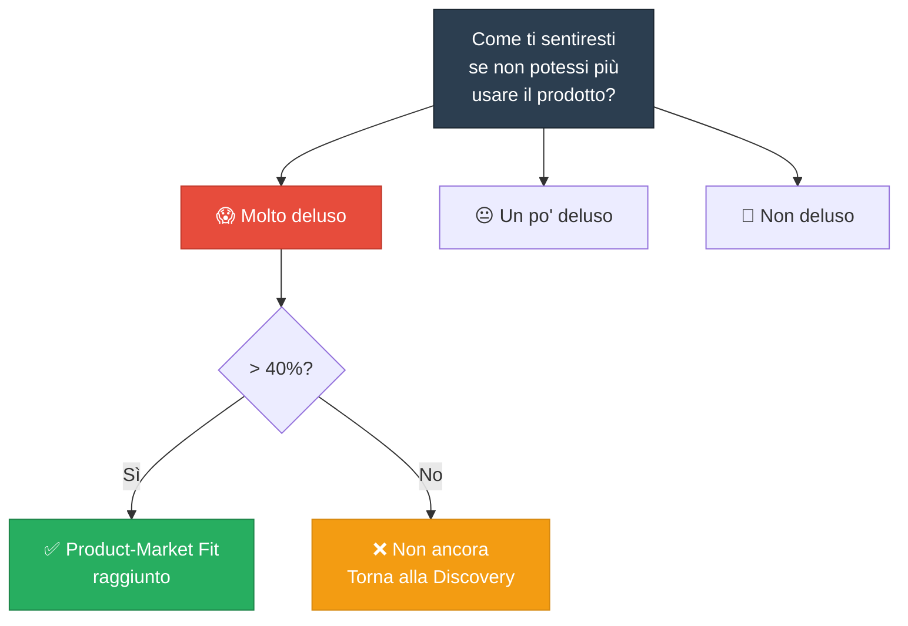
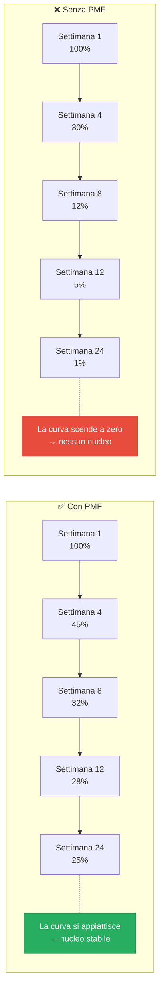
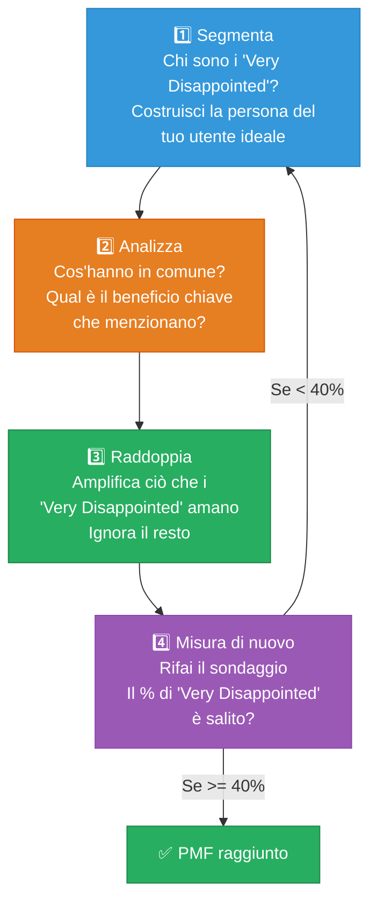
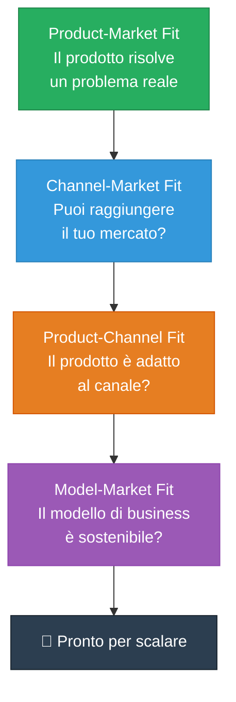
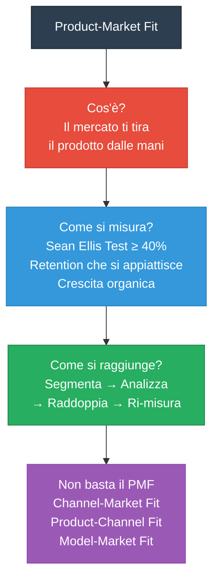

## PRODUCT-MARKET FIT: IL MOMENTO IN CUI SMETTI DI SPINGERE E INIZI A ESSERE TIRATO

Marc Andreessen ha definito il Product-Market Fit (PMF) come il momento in cui *"il mercato ti tira il prodotto dalle mani"*. Prima del PMF, ogni acquisizione è una battaglia. Dopo il PMF, il problema diventa stare dietro alla domanda.

È il concetto più importante nel ciclo di vita di un prodotto, eppure uno dei più difficili da misurare. Non esiste un singolo numero magico che dica "hai raggiunto il PMF" — ma esistono segnali quantitativi e qualitativi che, combinati, danno un quadro chiaro.

## Il test di Sean Ellis: la domanda da 40%

Sean Ellis (che ha coniato il termine "growth hacking") ha proposto un test semplice e potente:

> *"Come ti sentiresti se non potessi più usare questo prodotto?"*

Con tre risposte possibili:
1. **Molto deluso**
2. **Un po' deluso**
3. **Non deluso** (non è realmente utile per me)

La regola:

> **Se il 40% o più degli utenti risponde "Molto deluso", hai raggiunto il PMF.**

### Perché funziona

Il test non chiede "ti piace?" (tutti dicono di sì per cortesia). Chiede un'emozione negativa ipotetica — la **paura della perdita**. La loss aversion è uno dei bias cognitivi più potenti: sentiamo la perdita due volte più intensamente del guadagno equivalente.

Se il 40% dei tuoi utenti avrebbe una reazione emotiva forte alla scomparsa del prodotto, hai creato qualcosa che è diventato parte della loro routine, del loro flusso di lavoro, della loro vita.

### Come somministrare il test

**A chi:** solo utenti attivi che hanno usato il prodotto almeno 2-3 volte. Non mandarlo a chi si è registrato ieri — non hanno avuto tempo di sperimentare il valore.

**Quando:** dopo che l'utente ha avuto abbastanza esposizione (tipicamente dopo 2-4 settimane di uso).

**Sample size:** minimo 30-40 risposte per avere un segnale affidabile. Idealmente 100+.

**Follow-up cruciale:** a chi risponde "Molto deluso", chiedi: *"Qual è il beneficio principale che ricevi dal prodotto?"*. Le risposte a questa domanda sono la tua value proposition — scritta con le parole dei tuoi utenti, non le tue.

## I segnali qualitativi del PMF

Prima dei numeri, ci sono segnali che si percepiscono:

### 🟢 Segnali positivi (hai il PMF)

- I clienti ti raccomandano ad altri senza che tu lo chieda
- Gli utenti si lamentano quando il prodotto è down (= ci tengono)
- Inizi a ricevere richieste di feature che estendono il prodotto (= lo usano abbastanza da volere di più)
- Il passaparola genera lead organici
- I clienti descrivono il tuo prodotto usando le tue stesse parole (= il messaging risuona)
- I giornalisti/blogger ti contattano senza outreach da parte tua

### 🔴 Segnali negativi (non hai il PMF)

- Le vendite richiedono demo lunghe e convincimento intenso
- I clienti usano il prodotto ma non tornano spontaneamente
- Le richieste di feature sono tutte in direzioni diverse (= non c'è consenso sul valore)
- Il churn è alto nonostante un buon onboarding
- Gli utenti capiscono cosa fa il prodotto ma non capiscono perché ne hanno bisogno
- I competitor ti battono facilmente senza offrire nulla di radicalmente diverso

## I segnali quantitativi del PMF

### 1. La curva di retention

Il segnale quantitativo più forte. Traccia la retention per coorte. Se la curva si **appiattisce** dopo un certo punto (non scende a zero), hai un nucleo di utenti che resta. Se continua a scendere inesorabilmente, non hai il PMF.

### 2. Il tasso di crescita organica

Qual è la percentuale di nuovi utenti che arriva senza marketing a pagamento? Se il tasso di crescita organica è superiore al 50%, il prodotto si vende da solo — segnale forte di PMF.

### 3. Il viral coefficient (K-factor)

> **K = N × C**

Dove N = numero medio di inviti mandati da ogni utente e C = tasso di conversione di ciascun invito.

Se K > 1, ogni utente porta più di un nuovo utente → crescita virale. Se K > 0,5, hai una buona componente virale che amplifica il marketing a pagamento.

### 4. Il rapporto DAU/MAU

Il rapporto tra utenti attivi giornalieri e mensili misura la "frequenza di ritorno".

| DAU/MAU | Interpretazione | Esempio |
|:-------:|-----------------|---------|
| > 50% | Uso quotidiano, prodotto essenziale | Slack, WhatsApp |
| 25-50% | Uso frequente, buon engagement | Instagram, Spotify |
| 10-25% | Uso settimanale | LinkedIn |
| < 10% | Uso sporadico, possibile problema | — |

> **Attenzione:** questo benchmark vale per prodotti consumer. Per SaaS B2B, un DAU/MAU del 30% è già ottimo — non tutti devono usare il CRM ogni giorno.

### 5. Il payback period del CAC

Se il costo di acquisizione di un cliente viene ripagato entro 12-18 mesi, e il LTV è almeno 3x il CAC, l'economia funziona. Se il payback period è > 24 mesi, il modello non è sostenibile anche se la retention sembra buona.

## Il framework di Rahul Vohra: PMF come processo

Rahul Vohra (CEO di Superhuman) ha sviluppato un processo strutturato per **misurare e migliorare sistematicamente il PMF**, partendo dal test di Sean Ellis.

### Il processo in 4 step

### L'insight chiave di Vohra

Non cercare di rendere tutti "Molto delusi" alla perdita del prodotto. **Concentrati sugli utenti che già lo sono e cerca di trovarne altri come loro.** Invece di diluire il prodotto cercando di piacere a tutti, triplica il valore per il tuo segmento ideale.

- **Ignora i "Non delusi"** — non sono il tuo target. Cercare di convertirli diluisce il prodotto.
- **Converti i "Un po' delusi"** — analizza cosa manca per farli diventare "Molto delusi". Spesso è una feature specifica o un'integrazione.
- **Mantieni i "Molto delusi"** — loro sono il tuo core. Ogni decisione di prodotto deve passare il test: "Questo rende il prodotto più indispensabile per il mio core?"

## Prima e dopo il PMF: due mondi diversi

Il comportamento corretto dell'azienda è radicalmente diverso prima e dopo il PMF:

| | Pre-PMF | Post-PMF |
|---|---|---|
| **Priorità** | Validazione | Scalabilità |
| **Team** | Piccolo, generalista | In crescita, specializzato |
| **Spesa marketing** | Minima, organica | Aggressiva, a pagamento |
| **Feature** | Core value, nothing else | Espansione e difesa |
| **Metriche** | Retention, engagement | Revenue, market share |
| **Mentalità** | "Abbiamo ragione?" | "Come facciamo di più?" |

> **L'errore più pericoloso:** scalare prima del PMF. Investire in marketing aggressivo per un prodotto senza PMF è come versare acqua in un secchio bucato. Ogni euro speso acquisisce utenti che se ne vanno. L'unica cosa che cresce è il burn rate.

## Caso studio: Slack — il PMF che si è costruito da solo

Slack non è nato come prodotto a sé. Era un tool interno di Tiny Speck, l'azienda che stava sviluppando il videogioco Glitch. Quando Glitch fallì, il team si rese conto che il loro strumento di comunicazione interna era la cosa più preziosa che avessero costruito.

**I segnali di PMF erano inequivocabili:**
- Il team usava Slack 10+ ore al giorno durante lo sviluppo di Glitch
- Quando misero Slack in beta invitando amici e colleghi, il prodotto si diffuse viralmente senza marketing
- Il DAU/MAU era superiore al 70% — praticamente tutti gli utenti registrati tornavano ogni giorno
- La waiting list per la beta crebbe da 8.000 a 15.000 richieste al giorno senza advertising

**Lezione:** il PMF non è un momento puntuale — è un segnale continuo. Slack lo raggiunse prima ancora di essere lanciato ufficialmente, riconoscendo che il valore emergeva naturalmente dall'uso reale.

## Caso studio: Superhuman — PMF come metrica operativa

Quando Vohra misurò il PMF di Superhuman con il test di Sean Ellis, il risultato fu del 22% — sotto la soglia del 40%.

Invece di scoraggiarsi, usò il dato come punto di partenza:

1. **Segmentò i "Very Disappointed":** erano fondatori e investitori che gestivano centinaia di email al giorno
2. **Identificò il beneficio chiave:** velocità. "Superhuman mi fa gestire la posta in metà tempo"
3. **Raddoppiò su velocità:** ogni feature futura doveva rendere il prodotto più veloce, non più ricco di funzionalità
4. **Eliminò le distrazioni:** smise di costruire feature richieste dai "Non delusi" (es. integrazione calendario — utile, ma non core)

Dopo 3 trimestri di iterazione focalizzata, il PMF score salì al 58%.

## Quando il PMF non basta

Raggiungere il PMF non garantisce il successo a lungo termine. Servono anche:

**Channel-Market Fit** — hai trovato canali di distribuzione scalabili? Un prodotto con PMF eccellente ma senza canale di distribuzione efficace cresce lentamente.

**Product-Channel Fit** — il tuo prodotto è adatto al canale? Un prodotto B2B enterprise non si vende via TikTok ads. Un'app consumer non si vende via cold calling.

**Model-Market Fit** — il modello di business funziona? Freemium, subscription, pay-per-use — non tutti funzionano per tutti i mercati.

## Riepilogo

Tre cose da portare a casa:

1. **Il PMF si misura, non si indovina** — usa il test di Sean Ellis con utenti attivi reali. Se il 40%+ sarebbe "molto deluso" senza il tuo prodotto, hai il PMF. Se no, hai una direzione chiara per migliorare.

2. **Non cercare di piacere a tutti** — il framework di Vohra insegna che è meglio essere indispensabile per pochi che "carino" per molti. Raddoppia su ciò che il tuo core ama.

3. **Non scalare prima del PMF** — scalare senza PMF è bruciare soldi. La retention è il termometro: se la curva non si appiattisce, investire in acquisizione è come versare acqua in un secchio bucato.
